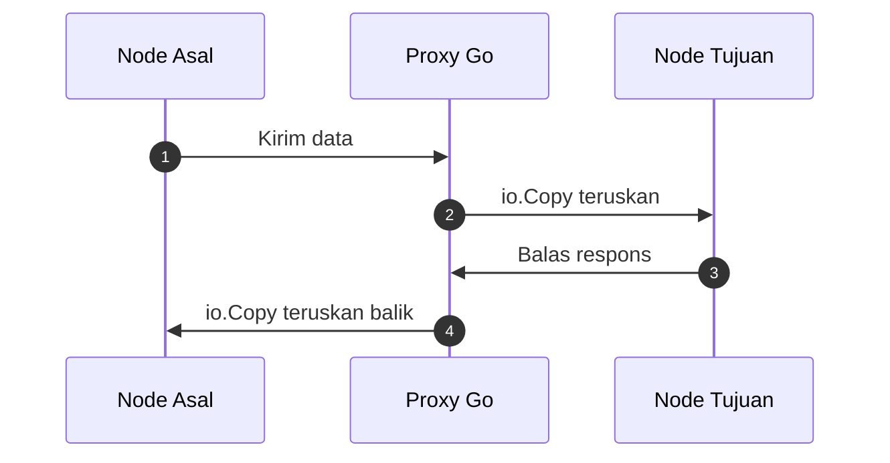
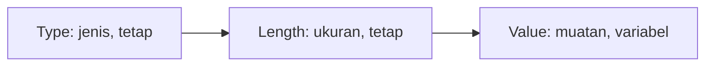
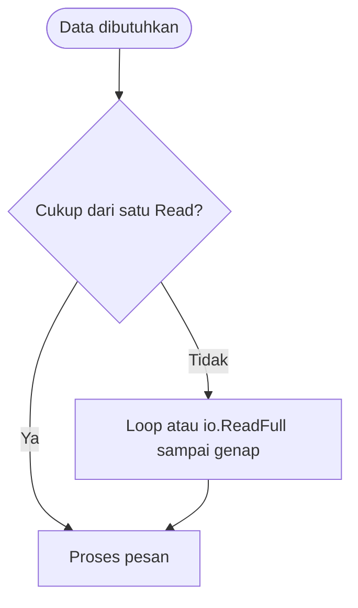

# Network and System Programming | Sesi 4: Mengirim Data Lewat TCP

> **Mata Kuliah:** Network and System Programming | **Sesi:** 4 | **Status:** Materi UTS

---

## 🔑 Cues

- Koneksi sebagai berkas baca-tulis
- Baca buffer berukuran tetap
- Bingkai tipe-panjang-nilai
- Utilitas salin dan cabang tulis
- Perantara dua arah
- Skalabel, aman, tangguh
- Batas waktu via konteks
- Pakai ulang koneksi

---

## 📖 Materi Utama

### 1. Membaca dan Menulis Seperti Berkas

- `net.Conn` mengimplementasikan `io.ReadWriteCloser` — operasi jaringan diperlakukan sama seperti operasi berkas, sehingga seluruh utilitas I/O Go bisa dipakai langsung.
- **Bacaan buffer tetap**: `Read` mengisi byte slice sampai kapasitasnya bila data tersedia di receive buffer OS; bila data yang ada lebih sedikit, `Read` langsung pulang membawa seadanya tanpa menunggu buffer penuh. Selalu potong buffer memakai `n` (jumlah byte terbaca) agar tak memproses sampah sisa.
- Jangan pernah mengasumsikan satu `Read` melahap satu pesan utuh — pakai loop atau `io.ReadFull` untuk memastikan pesan lengkap sebelum diproses.

### 2. Membingkai Pesan Variabel: TLV

Untuk pesan yang panjangnya tak menentu, pengirim dan penerima menyepakati bingkai **Type-Length-Value**:

1. **Type** — jenis data, berukuran tetap.
2. **Length** — ukuran nilai, berukuran tetap.
3. **Value** — muatan sesungguhnya, berukuran variabel sesuai Length.

Dengan Length di depan, penerima tahu kapan pesan genap diterima dan bisa memverifikasi kelengkapannya sebelum memproses.

### 3. Perkakas `io` dan Perantara Data

- `io.Copy` — memompa data dari `io.Reader` ke `io.Writer`; tulang punggung pemindahan antar koneksi.
- `io.MultiWriter` — menulis salinan sama ke banyak writer sekaligus (misalnya ke koneksi sekaligus ke berkas log).
- `io.TeeReader` — membaca sambil diam-diam menyalin yang dibaca ke satu writer (cocok untuk monitoring traffic).
- **Proxy** adalah perantara dua node; dengan `io.Copy` sepasang arah (`proxyConn`), data mengalir bolak-balik sumber–tujuan tanpa logika rumit.

### 4. Resep Jaringan yang Tangguh

- **Scalability** — arsitektur dan topologi siap menampung pertumbuhan pengguna dan perangkat.
- **Security** — firewall, IPS, dan enkripsi (SSL/TLS) menjaga data dan akses ilegal.
- **Resilience** — perangkat redundan plus mekanisme failover menekan downtime.
- **Vendor diversity** — hindari ketergantungan satu vendor agar tak ada titik tunggal kegagalan.
- **Operasi** — load balancing membagi beban antar server; dokumentasi yang selalu sinkron mempercepat troubleshooting; pantau SLO agar performa sesuai standar organisasi.

### 5. Menjinakkan Masalah TCP di Go

- **Cek error** — selalu `if err != nil` usai tiap operasi jaringan.
- **Timeout** — pasang batas waktu via package `context` (misalnya `DialContext`) agar aplikasi tak menggantung menunggu koneksi mayat (zombie).
- **Connection pooling** — pakai ulang koneksi existing via `sync.Pool` alih-alih membuka baru terus-menerus.
- **Aliran besar** — bungkus koneksi dengan `bufio.Reader`/`bufio.Writer` untuk menekan system call ke kernel; `encoding/gob` (binary, compact) kerap lebih hemat daripada JSON untuk sesama aplikasi Go.
- **Konkuren** — satu goroutine per koneksi masuk agar layanan melayani banyak client serentak.

#### **[Visualisasi Konsep]**

---

## Library Diagram & Arsitektur

### Anatomi bingkai TLV

### Disiplin baca: jangan percaya satu Read

---

## 🛠️ Use Case / Implementasi Nyata

- **Skenario:** Gateway kos mem-proxy traffic asrama ke server kampus sambil mencatatnya untuk audit.
- **Masalah yang Diatasi:** Data harus diteruskan dua arah tanpa modifikasi sekaligus disalin ke log — ditulis manual berarti dua loop rawan deadlock.
- **Keuntungan:** Sepasang `io.Copy` menangani relay bolak-balik, `io.MultiWriter` mencabangkan salinan ke berkas log, dan `context` timeout memastikan koneksi macet tak menahan resource selamanya.

---

## 🗂️ Konsep Kunci

| Istilah | Definisi | Contoh / Catatan |
|---------|----------|-----------------|
| TLV | Bingkai Type-Length-Value | Protokol pesan dinamis |
| Proxy | Perantara relay dua node | Dibangun via `io.Copy` |
| `io.Copy` | Pompa Reader ke Writer | Relay data |
| `io.MultiWriter` | Satu tulis ke banyak tujuan | Logging dan broadcast |
| `io.TeeReader` | Baca sambil menyalin | Monitoring traffic |
| Zombie connection | Koneksi mati suri menahan resource | Diatasi dengan timeout |

---

## 📊 Tabel Ringkasan

| Fungsi | Deskripsi | Kegunaan utama |
|--------|-----------|----------------|
| `io.Copy` | Salin Reader ke Writer | Proxying data |
| `io.MultiWriter` | Tulis ke banyak Writer | Logging dan broadcast |
| `io.TeeReader` | Baca sambil tulis | Monitoring traffic |

| Kategori | Praktik | Tujuan |
|----------|---------|--------|
| Desain | Scalability dan topologi | Siap tumbuh, jalur efisien |
| Hardware | Load balancing | Beban terbagi, anti overload |
| Security | SSL/TLS dan firewall | Data aman, akses liar tertahan |
| Resilience | Redundancy dan failover | Downtime minimal |
| Operasi | Dokumentasi dan training | Troubleshooting cepat, skill terjaga |

---

## ⚠️ Catatan Penting

> **[Parsial itu normal]** — Satu `Read` boleh pulang membawa sebagian pesan. Kode yang mengasumsikan pesan selalu utuh adalah bug yang menunggu waktu sibuk untuk meledak.

> **[Timeout itu pagar]** — Batas waktu memastikan resource tak disandera koneksi yang tak kunjung merespons.

---

## 📝 Materi Tambahan (Visual Insights)

- `bufio.NewReader(conn)` memangkas system call karena bacaan kecil digabung di buffer ruang-pengguna sebelum menyentuh kernel.
- SLO bukan pajangan: ambang performa yang dipantau terus-menerus memberi peringatan dini sebelum pengguna yang mengeluh lebih dulu.

#### Sinkronisasi Dokumentasi

- Arsitektur yang berubah tanpa dokumen yang ikut berubah sama dengan peta kadaluarsa — troubleshooting berubah menjadi tebak-tebakan.

---

## ✅ Standar Visual & Orisinalitas (bar jual — wajib untuk semua catatan)

- **Sintesis orisinal**: struktur, diagram, dan contoh milik sendiri. Sumber (materi aslab/dosen) hanya referensi fakta. Jangan cerminkan urutan langkah, nama contoh, atau naskah sumber.
- **Konsistensi visual**: judul `# MK | Sesi N: Judul`, callout pembuka, cues ≤15 dalam toggle, tabel selalu ber-header, blok kode ≤2000 char (lebih = pecah), ikon + cover judul terisi otomatis saat import.
- **Jujur provenance**: bila sumber hanya kerangka/tanpa isi, tulis di Sumber bahwa isi disusun dari dokumentasi umum.
