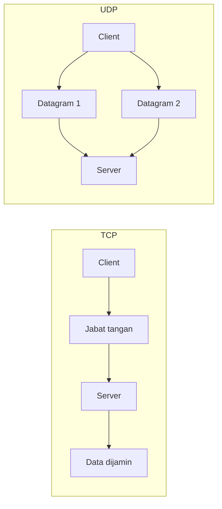
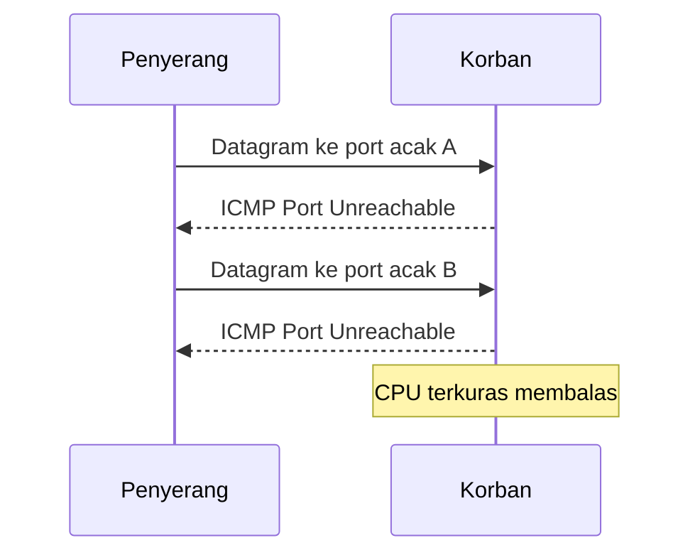
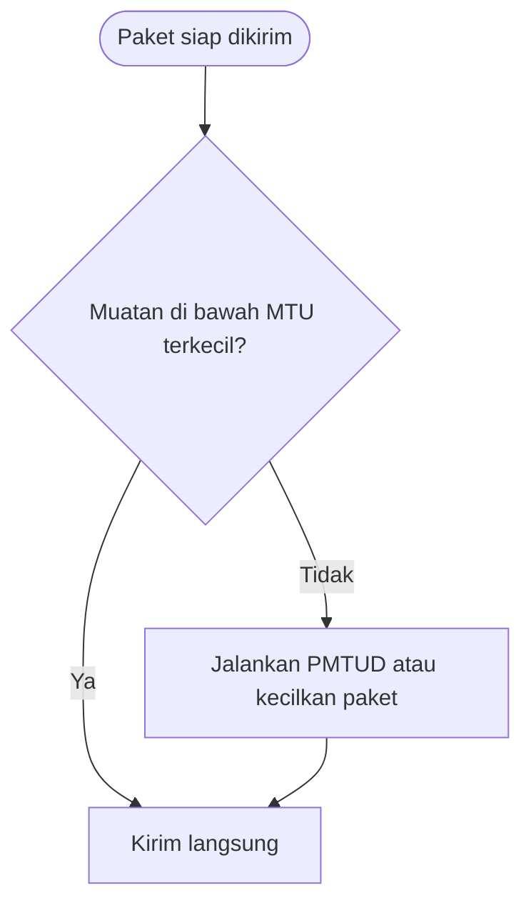

# Network and System Programming | Sesi 5: Komunikasi UDP yang Tak Andal

> **Mata Kuliah:** Network and System Programming | **Sesi:** 5 | **Status:** Materi UTS

---

## 🔑 Cues

- Protokol kirim-tanpa-kenalan
- Satuan datagram mandiri
- Cepat lawan andal
- Aplikasi toleran hilang paket
- Banjir paket sebagai senjata
- Batas ukuran bingkai fisik
- Deteksi batas jalur dinamis
- Taktik anti pecah paket

---

## 📖 Materi Utama

### 1. Kirim Dulu, Urusan Nanti

**User Datagram Protocol (UDP)** adalah protokol untuk transmisi yang sensitif waktu: tiap unit transmisi (**datagram**) ditembak langsung ke target tanpa jabat tangan pembuka. Tak ada jaminan urutan, tak ada konfirmasi tiba, tak ada kirim ulang — datagram yang raib ya raib. Aplikasi pemakainya wajib tahan terhadap paket hilang, duplikat, atau datang acak.

### 2. Dua Filosofi: Kenalan Dulu vs Langsung Tembak

- **TCP** berkenalan dulu (three-way handshake), menomori urutan, mengakui kedatangan, dan mengirim ulang yang hilang — andal tapi ber-overhead.
- **UDP** langsung kirim (connectionless) — jauh lebih ringan dan cepat karena nol perkenalan dan nol pengecekan.

### 3. Di Mana Kehilangan Paket Bisa Dimaafkan

Filosofinya: "sedikit hilang lebih baik daripada lama menunggu".

- **VoIP** — percakapan berderak statis masih bisa diikuti; suara jernih yang tertunda parah justru menghancurkan percakapan.
- **Game online** — respons real-time menentukan menang-kalah; posisi sedetik lalu tak ada gunanya dikirim ulang.
- **DNS** — gerbang pertama tiap request internet; kalau gerbangnya lambat karena overhead handshake, seluruh browsing ikut terseret.
- **Video streaming** — bintik kecil yang hilang tak merusak tontonan dibanding buffering berkepanjangan.

### 4. Sisi Gelap: Banjir UDP

Justru karena tanpa handshake, penyerang bebas membanjiri server dengan datagram tanpa izin (**UDP flood DDoS**): paket diarahkan ke port acak sehingga target terpaksa membalas tiap kiriman dengan pesan ICMP "Port Unreachable" — resource komputasi target terkuras untuk membalas serangan. Penawarnya: batasi laju balasan ICMP dan tadahkan serangan lewat jaringan perantara terdistribusi.

### 5. Menjaga Paket Tetap Utuh

Paket yang melampaui **MTU** (batas muatan fisik jaringan, umumnya 1500 bytes) akan dipecah (fragmentasi) di tengah jalan — berisiko gagal dirakit ulang di tujuan. Lima taktik menghindarinya:

1. **PMTUD (Path MTU Discovery)** — ukur MTU terkecil sepanjang jalur secara dinamis.
2. **Ukuran paket konservatif** — desain muatan aplikasi jauh di bawah batas standar.
3. **Setel buffer socket** — atur write buffer (di Go via package `net`) agar selaras kebutuhan.
4. **Negosiasi ukuran** — pengirim dan penerima menyepakati besaran paket.
5. **Kompresi** — kecilkan payload sebelum dikirim.

#### **[Visualisasi Konsep]**

---

## Library Diagram & Arsitektur

### Anatomi serangan banjir UDP

### Keputusan taktik anti-fragmentasi

---

## 🛠️ Use Case / Implementasi Nyata

- **Skenario:** Turnamen game kampus memakai server UDP untuk posisi pemain, plus query DNS lokal yang sibuk.
- **Masalah yang Diatasi:** Protokol andal menambah jeda tiap update posisi; paket raksasa peta arena pecah di jalan dan gagal dirakit.
- **Keuntungan:** Datagram ringan mengejar tenggat real-time, PMTUD menjaga paket peta tetap di bawah 1500 bytes, dan rate-limit ICMP membuat server tahan terhadap banjir paket iseng.

---

## 🗂️ Konsep Kunci

| Istilah | Definisi | Contoh / Catatan |
|---------|----------|-----------------|
| Datagram | Satuan transmisi mandiri UDP | Tiba, hilang, atau ganda — nasib bebas |
| Connectionless | Tanpa pembuka sesi | Ciri paling UDP |
| MTU | Batas muatan fisik jaringan | Umumnya 1500 bytes |
| PMTUD | Pengukur MTU terkecil sejalur | Tameng anti-fragmentasi |
| UDP flood | Banjir datagram penguras resource | Balasan ICMP jadi senjata makan tuan |

---

## 📊 Tabel Ringkasan

| Fitur | TCP | UDP |
|-------|-----|-----|
| Pembuka | Three-way handshake | Tanpa handshake |
| Urutan | Dijamin nomor urut | Tanpa jaminan |
| Keandalan | Retransmisi penuh | Best effort |
| Kecepatan | Berat overhead | Ringan, sangat cepat |
| Bentuk data | Stream kontinu | Datagram mandiri |

---

## ⚠️ Catatan Penting

> **[Hilang itu desain]** — Paket UDP yang raib bukan bug, melainkan harga kecepatan. Butuh keandalan di atas UDP? Bangun sendiri ACK dan kirim-ulang di lapis aplikasi.

> **[Tanpa verifikasi = mudah dipalsukan]** — Sifat tanpa-kenalan memudahkan pemalsuan alamat sumber dan semburan volume besar sepihak — justru inilah yang dieksploitasi DDoS.

---

## 📝 Materi Tambahan (Visual Insights)

- Tiap datagram UDP ditangani independen di Go; karena tak ada konfirmasi otomatis, penanganan error menjadi krusial dan tak boleh diabaikan.
- Menyetel buffer socket bukan kosmetik: buffer yang pas mengurangi campur tangan fragmentasi OS terhadap paket aplikasi.

#### Gerbang Pertama Internet

- DNS wajib ringan karena setiap browsing — bahkan sebelum konten diminta — selalu melewatinya lebih dulu.

---

## ✅ Standar Visual & Orisinalitas (bar jual — wajib untuk semua catatan)

- **Sintesis orisinal**: struktur, diagram, dan contoh milik sendiri. Sumber (materi aslab/dosen) hanya referensi fakta. Jangan cerminkan urutan langkah, nama contoh, atau naskah sumber.
- **Konsistensi visual**: judul `# MK | Sesi N: Judul`, callout pembuka, cues ≤15 dalam toggle, tabel selalu ber-header, blok kode ≤2000 char (lebih = pecah), ikon + cover judul terisi otomatis saat import.
- **Jujur provenance**: bila sumber hanya kerangka/tanpa isi, tulis di Sumber bahwa isi disusun dari dokumentasi umum.
