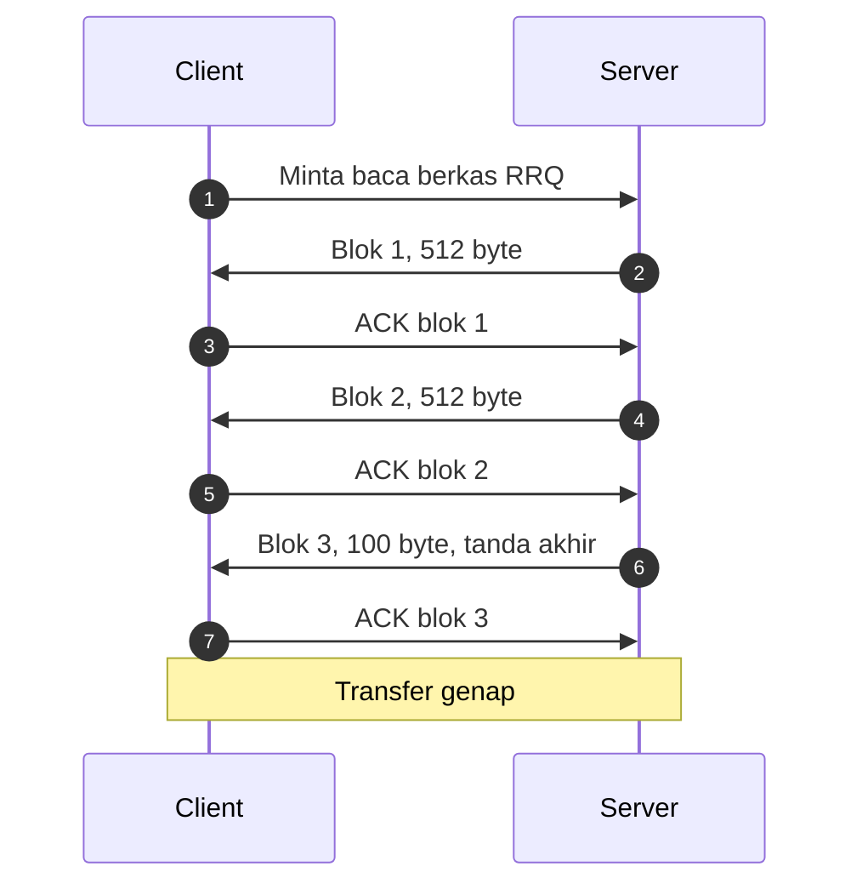
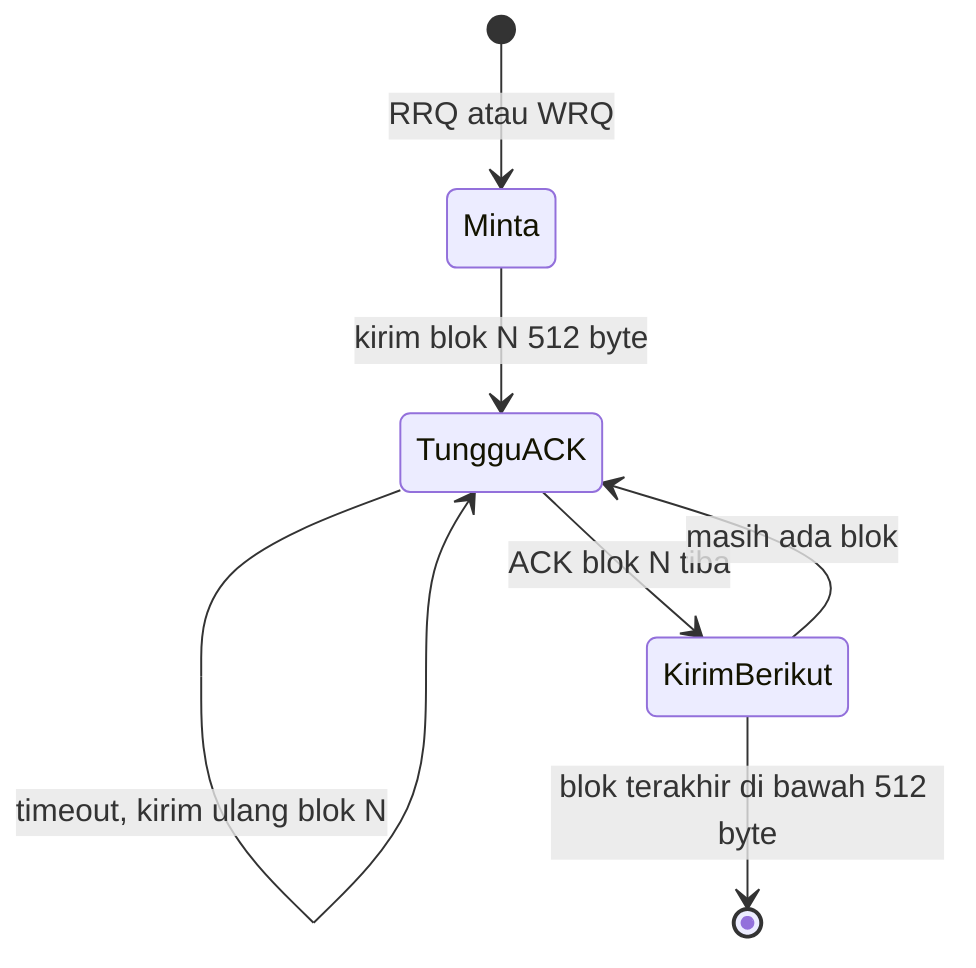
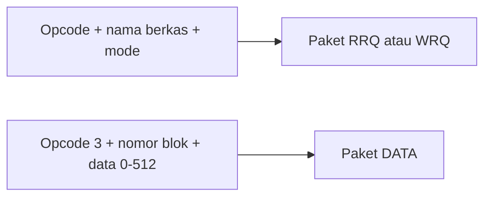

# Network and System Programming | Sesi 6: Membuat UDP Bisa Diandalkan

> **Mata Kuliah:** Network and System Programming | **Sesi:** 6 | **Status:** Materi UTS

---

## 🔑 Cues

- Protokol transfer super-minimalis
- Port 69 di atas UDP
- Empat jenis paket
- Blok data 512 oktet
- Tunggu-ACK tiap blok
- Tanda akhir dari paket pendek
- Boot tanpa disk dan firmware
- Perkakas server TFTP

---

## 📖 Materi Utama

### 1. Si Mungil Penyalur Berkas

**Trivial File Transfer Protocol (TFTP)** adalah protokol transfer berkas yang sengaja dibuat sederhana, ringan, dan minimalis — untuk situasi di mana FTP penuh fitur justru terlalu berat, seperti konfigurasi perangkat jaringan atau boot tanpa disk (diskless boot). Ia menumpang UDP pada **port 69**.

### 2. Empat Jenis Paket

1. **RRQ (Read Request), tipe 1** — client meminta salinan berkas dari server.
2. **WRQ (Write Request), tipe 2** — client mengunggah berkas ke server.
3. **Data, tipe 3** — potongan berkas, berukuran tetap **512 octets (bytes)** per blok.
4. **ACK (Acknowledgment), tipe 4** — tanda terima tiap blok, dikirim kedua arah sesuai giliran.

### 3. Andal Lewat Disiplin Antre: Stop-and-Wait

Meski menumpang UDP yang tak andal, TFTP menjamin ketibaan dengan pola kirim-satu-tunggu-satu:

1. Client membuka dengan RRQ atau WRQ ke port 69.
2. Server melepas blok data pertama (512 bytes).
3. Server menahan blok berikutnya sampai ACK blok itu tiba.
4. Siklus kirim–ACK berulang hingga berkas habis.
5. Paket data berukuran **kurang dari 512 bytes** dibaca sebagai tanda akhir berkas (EOF). Berkas yang pas kelipatan 512 ditutup dengan satu paket kosong 0 byte.
6. ACK yang hilang memicu timeout dan kirim-ulang blok sama; penerima membedakan kiriman ganda lewat **nomor blok** di tiap paket.

### 4. Timbangan Plus-Minus

**Kelebihan** — overhead nyaris nol; rakus memori sangat rendah sehingga muat di firmware; implementasi sederhana yang didukung hampir semua perangkat (router, switch, firewall); gesit untuk berkas kecil seperti image boot atau konfigurasi.

**Kekurangan** — tanpa enkripsi maupun autentikasi bawaan; tanpa manajemen berkas (tak bisa rename atau delete); deteksi error hanya mengandalkan timeout.

### 5. Perkakas Server di Pasaran

- **SolarWinds TFTP Server** — gratis, melayani berkas hingga 4 GB, berjalan sebagai Windows service; setup awal menuntut pengalaman teknis.
- **TFTPD64** — open-source populer; satu paket berisi server DHCP, DNS, dan Syslog; sangat fleksibel dengan kurva belajar lebih curam.
- **haneWIN TFTP Server** — membawa kontrol akses (filter IP) plus CLI untuk scripting; tampilannya berorientasi teknisi.
- **Pinkie** — bundel perkakas monitoring jaringan (Ping, Traceroute) dengan server TFTP sederhana bertampilan tab; daftar transaksi bisa berantakan pada volume sangat tinggi.
- **Windows TFTP Utility** — sangat minimalis dan ringan untuk pemakaian sesekali; hampir tanpa opsi konfigurasi (tak bisa pilih interface).

#### **[Visualisasi Konsep]**

---

## Library Diagram & Arsitektur

### Mesin status stop-and-wait

### Bedah paket: permintaan vs data

---

## 🛠️ Use Case / Implementasi Nyata

- **Skenario:** Lab kampus mem-boot 40 PC tanpa hard disk dari satu server, dilanjut upgrade firmware router via TFTP.
- **Masalah yang Diatasi:** PC tanpa penyimpanan butuh kernel awal sebelum OS utama berjalan; router butuh cara ambil image OS (IOS) baru yang didukung semua merek.
- **Keuntungan:** DHCP memberi IP, TFTP menyuapi berkas boot blok-demi-blok dengan RAM mungil, dan pola ACK-per-blok memastikan tiap workstation menerima citra utuh meski jaringannya UDP.

---

## 🗂️ Konsep Kunci

| Istilah | Definisi | Contoh / Catatan |
|---------|----------|-----------------|
| RRQ | Permintaan baca berkas | Paket tipe 1 |
| WRQ | Permintaan tulis berkas | Paket tipe 2 |
| Octet | Satuan 8-bit | Sinonim byte |
| EOF | Tanda akhir berkas | Paket data di bawah 512 bytes |
| Port 69 | Port bawaan TFTP | Selalu di atas UDP |
| Nomor blok | Penanda urutan tiap paket data | Tameng anti-duplikat |

---

## 📊 Tabel Ringkasan

| Perkakas | Platform | Kelebihan | Kekurangan |
|----------|----------|-----------|------------|
| SolarWinds | Windows | Gratis, file 4 GB, jalan sebagai service | Setup butuh pengalaman |
| TFTPD64 | Windows | Open-source, bundel DHCP/DNS/Syslog | Fitur banyak, belajar lebih lama |
| haneWIN | Windows | Filter IP, CLI scripting | Tampilan teknisi |
| Pinkie | Windows | Ringan, tab rapi, bundel net-tools | kacau di volume sangat tinggi |
| Windows TFTP | Windows | Sangat ringan, sekali pakai | Minim opsi konfigurasi |

---

## ⚠️ Catatan Penting

> **[Duplikat itu keniscayaan]** — ACK yang hilang membuat pengirim mengulang blok yang sama; penerima yang memeriksa nomor blok kebal terhadap kiriman ganda.

> **[Kelipatan pas butuh penutup]** — Berkas tepat kelipatan 512 byte wajib diakhiri paket kosong 0 byte, kalau tidak penerima menunggu selamanya.

---

## 📝 Materi Tambahan (Visual Insights)

- Jalur boot jaringan (PXE) adalah pasangan DHCP + TFTP: yang satu membagi alamat, yang satu menyuapi kernel awal.
- Kontrol akses ala haneWIN bukan bagian spek RFC asli — melainkan tempelan praktis yang justru sangat berguna di lingkungan produksi tanpa autentikasi bawaan.

#### Lambat di Jarak Jauh

- Stop-and-wait memaksa satu RTT per 512 byte; di jaringan ber-latency tinggi, throughput TFTP jatuh bebas — harga kewajaran untuk protokol se-sederhana ini.

---

## ✅ Standar Visual & Orisinalitas (bar jual — wajib untuk semua catatan)

- **Sintesis orisinal**: struktur, diagram, dan contoh milik sendiri. Sumber (materi aslab/dosen) hanya referensi fakta. Jangan cerminkan urutan langkah, nama contoh, atau naskah sumber.
- **Konsistensi visual**: judul `# MK | Sesi N: Judul`, callout pembuka, cues ≤15 dalam toggle, tabel selalu ber-header, blok kode ≤2000 char (lebih = pecah), ikon + cover judul terisi otomatis saat import.
- **Jujur provenance**: bila sumber hanya kerangka/tanpa isi, tulis di Sumber bahwa isi disusun dari dokumentasi umum.
