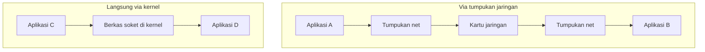
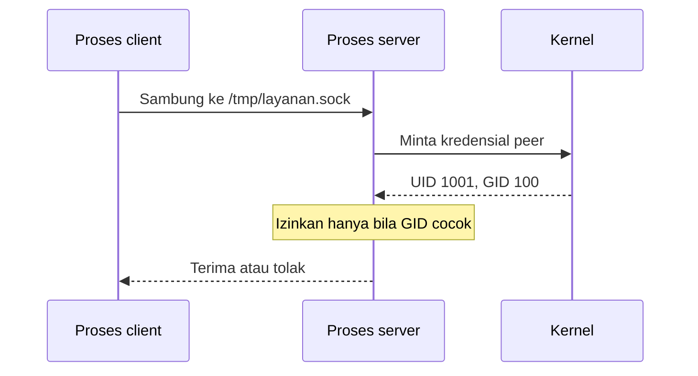
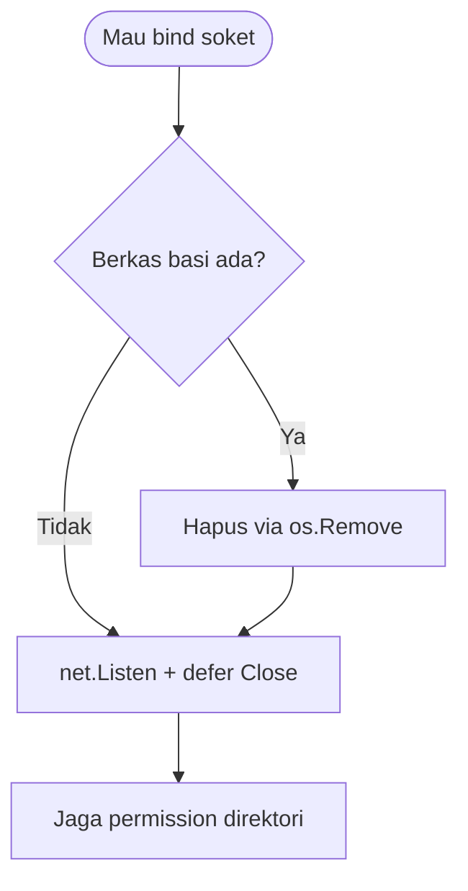

# Network and System Programming | Sesi 7: Soket Domain Unix

> **Mata Kuliah:** Network and System Programming | **Sesi:** 7 | **Status:** Materi UTS

---

## 🔑 Cues

- Obrolan antar-proses satu mesin
- Komunikasi penuh di ruang kernel
- Identitas berupa path berkas
- Varian aliran andal
- Varian datagram cepat
- Varian hibrida jarang pakai
- Kuras berkas soket basi
- Kredensial lawan bicara

---

## 📖 Materi Utama

### 1. Ngobrol Tanpa Lewat Jaringan

**Unix Domain Socket (UDS)** adalah mekanisme komunikasi antar-proses (IPC) untuk proses-proses dalam satu mesin Unix/Unix-like. Seluruh percakapan terjadi di dalam **kernel** tanpa menyentuh tumpukan TCP/IP — tanpa checksum paket, tanpa header IP, tanpa lookup tabel rute — sehingga latensi rendah dan CPU hemat. Alamatnya bukan IP:port, melainkan **path berkas** di filesystem (misalnya `/tmp/app.sock`).

### 2. Tiga Varian di Go

Go membungkus UDS dalam tiga tipe lewat antarmuka `net.Conn` yang sama dengan soket jaringan:

1. **`unix` (streaming)** — kembaran TCP: connection-oriented, andal, urutan terjaga, aliran dua arah. Pilihan utama transfer besar yang konsisten.
2. **`unixgram` (datagram)** — kembaran UDP: connectionless, tiap pesan mandiri, cepat tapi tanpa jaminan urutan. Cocok untuk pesan kecil seperti logging.
3. **`unixpacket` (sequence packet)** — hibrida: punya sesi seperti TCP namun menjaga batas pesan seperti UDP. Aturannya keras: data yang tak dibaca dalam satu datagram **dibuang OS** (baca 32 byte dari paket 50 byte → sisa 18 byte hangus). Jarang dipakai, umumnya warisan protokol telekomunikasi lama (X.25/AX.25), dan dukungan lintas-platformnya paling minim.

### 3. Tata Kelola Berkas Soket

- Berkas soket lahir saat kode melakukan bind via `net.Listen`.
- Berkas basi dari proses sebelumnya membuat OS menolak bind baru dengan error **"address in use"** — solusinya singkirkan berkas lama (`os.Remove(path)`) sebelum bind ulang.
- Secara teori OS membersihkan berkas saat proses mati; praktik terbaik tetap bersih-bersih manual plus `defer` penutup listener.

### 4. Mengenali Lawan Bicara

Di Linux, server bisa meminta **kredensial peer** dari kernel — User ID (UID) dan Group ID (GID) proses di seberang soket. Gunanya membatasi layanan hanya untuk user/grup tertentu (misalnya soket administratif yang cuma boleh disentuh grup `admin`). Karena tak ada enkripsi ala TLS di sini, keamanan praktis bertumpu pada **permission berkas soket**: siapa boleh baca/tulis ditentukan filesystem, jadi direktori soket pun wajib dikunci hanya untuk yang berwenang.

#### **[Visualisasi Konsep]**

---

## Library Diagram & Arsitektur

### Alur verifikasi identitas lawan

### Disiplin bind yang benar

---

## 🛠️ Use Case / Implementasi Nyata

- **Skenario:** Daemon autentikasi kos-kosan melayani 10 worker lokal lewat `/run/auth.sock`, khusus grup `admin`.
- **Masalah yang Diatasi:** Memakai TCP localhost berarti membayar overhead tumpukan jaringan untuk percakapan yang tak pernah keluar mesin; tanpa verifikasi peer, worker mana pun bisa menyamar.
- **Keuntungan:** `unix` memberi aliran andal nyaris tanpa overhead, kernel membocorkan UID/GID lawan untuk penapisan grup, dan permission berkas menjadi pagar lapis kedua.

---

## 🗂️ Konsep Kunci

| Istilah | Definisi | Contoh / Catatan |
|---------|----------|-----------------|
| IPC | Komunikasi antar-proses satu host | UDS adalah salah satu wujudnya |
| Berkas soket | Alamat UDS di filesystem | `/tmp/app.sock` |
| `unix` | Varian aliran andal | Analog TCP lokal |
| `unixgram` | Varian datagram cepat | Analog UDP lokal |
| `unixpacket` | Varian sesi berbasis paket | Sisa tak dibaca dibuang OS |
| Kredensial peer | Identitas UID/GID lawan | Fitur keamanan Linux |

---

## 📊 Tabel Ringkasan

| Tipe Go | Analogi | Sifat | Paling pas untuk |
|---------|---------|-------|------------------|
| `unix` | TCP | Stream andal | Transfer besar dan konsisten |
| `unixgram` | UDP | Datagram cepat | Pesan kecil mandiri, logging |
| `unixpacket` | Hibrida | Sesi per paket | Protokol legacy tertentu |

---

## ⚠️ Catatan Penting

> **[Cepat tapi telanjang]** — UDS kencang justru karena tanpa overhead enkripsi jaringan; gantinya, permission berkas dan direktori adalah satu-satunya benteng — salah seting berarti pintu terbuka.

> **[Sisa bacaan hangus]** — Pada `unixpacket`, membaca sebagian datagram memusnahkan sisanya. Ukur buffer baca dengan benar atau pindah ke `unix` stream.

---

## 📝 Materi Tambahan (Visual Insights)

- Penghematan CPU UDS datang dari semua yang dilewati: tanpa checksum, tanpa rakit header IP, tanpa konsultasi tabel rute per paket.
- Integrasi GID dengan `/etc/groups` membuat kontrol akses aplikasi menyatu dengan manajemen user standar OS — tanpa membangun sistem akun tandingan.
- Pola kode yang aman: `os.Remove` dulu untuk berkas basi, `net.Listen` kemudian, `defer` tutup listener — ketiganya satu paket disiplin.

#### Portabilitas Varian

- `unixpacket` paling sedikit didukung lintas platform; bila kode harus jalan di mana-mana, bertahanlah pada `unix` atau `unixgram`.

---

## ✅ Standar Visual & Orisinalitas (bar jual — wajib untuk semua catatan)

- **Sintesis orisinal**: struktur, diagram, dan contoh milik sendiri. Sumber (materi aslab/dosen) hanya referensi fakta. Jangan cerminkan urutan langkah, nama contoh, atau naskah sumber.
- **Konsistensi visual**: judul `# MK | Sesi N: Judul`, callout pembuka, cues ≤15 dalam toggle, tabel selalu ber-header, blok kode ≤2000 char (lebih = pecah), ikon + cover judul terisi otomatis saat import.
- **Jujur provenance**: bila sumber hanya kerangka/tanpa isi, tulis di Sumber bahwa isi disusun dari dokumentasi umum.
