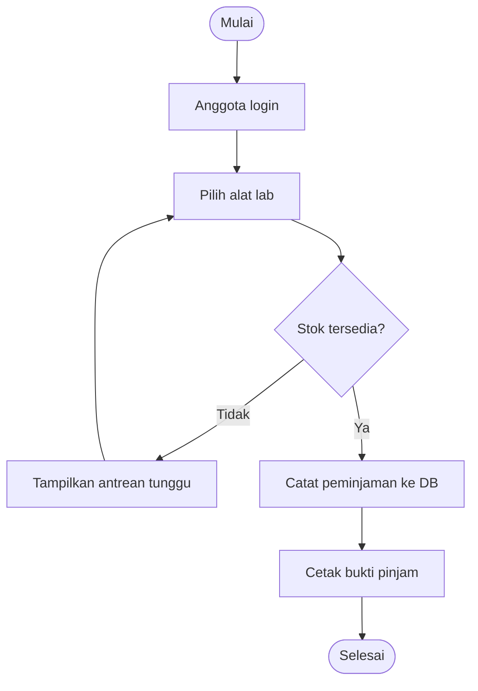
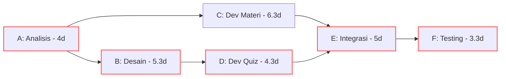

# Software Engineering | Sesi 00: Jawaban Latihan UTS

> **Mata Kuliah:** Software Engineering | **Sesi:** 00 (Review UTS) | **Status:** Latihan UTS

---

## 🔑 Cues
- Waterfall vs Scrum
- Functional vs Non-Functional Requirements
- 7 tugas Requirements Engineering
- Abstraksi, Modularitas, Enkapsulasi
- Monolit vs Microservices
- PERT: TE = (O + 4M + P) / 6
- Critical Path ±22 hari (A-B-D-E-F)
- Definition of Ready & Change Request

---

## 📖 Materi Utama

### 1. Memilih Model Proses: Kaku vs Adaptif
- **Waterfall** berjalan sekuensial: Requirements → Design → Implementation → Testing → Deployment → Maintenance. Kelemahannya: perubahan di tengah jalan (misal tiba-tiba diminta modul tutor AI) memicu rework mahal karena fase awal dianggap final.
- **Scrum** bekerja iteratif dalam Sprint 2–4 minggu. Perubahan ditampung lewat Product Backlog, sehingga risiko kegagalan besar menyusut dan feedback datang tiap sprint.

### 2. Kebutuhan: Bedakan Apa vs Bagaimana
- **Functional Requirements (FR):** apa yang sistem lakukan — contoh Login, Upload Materi, Auto-grading.
- **Non-Functional Requirements (NFR):** kualitas sistem — contoh load time < 3 detik, skalabel untuk 1000 user, data terenkripsi.
- Tujuh tugas RE berurutan: Inception, Elicitation, Elaboration, Negotiation, Specification, Validation, Management. Untuk kebutuhan yang mudah berubah, teknik elicitation **prototyping** paling membantu karena stakeholder melihat wujud nyata, bukan dokumen abstrak.

### 3. Desain: Tiga Prinsip OOP Inti
- **Abstraction:** sembunyikan detail di balik interface, misal `CourseManager.publishGrade()`.
- **Modularity:** pecah sistem jadi unit independen, misal `QuizModule` dan `AuthModule`.
- **Encapsulation:** bungkus data dan batasi akses, misal `private currentScore` di `QuizSession`.

### 4. Arsitektur: Satu Bongkahan vs Layanan Kecil
- **Monolithic:** satu unit deployable; sederhana di awal, sulit di-scale parsial.
- **Microservices:** layanan independen (Auth, Quiz, Material); unggul dalam scalability, fault isolation (satu service mati, lainnya jalan), dan development paralel antar tim.

### 5. Estimasi: Dari Tebakan ke Angka Berbobot
- **Expected Time PERT:** TE = (O + 4M + P) / 6 dengan O = optimis, M = most likely, P = pesimis.
- **Critical Path** = jalur aktivitas terpanjang; keterlambatan di sini menunda seluruh proyek. Pada proyek LMS: A(4d) → B(5,3d) → D(4,3d) → E(5d) → F(3,3d) total ±22 hari.
- Waspadai aktivitas bervarians tinggi walau di luar critical path: aktivitas C (optimis 4 hari, pesimis 10 hari, variance 1,0) bisa berubah menjadi bottleneck baru.

---

## Library Diagram & Arsitektur

### Alur Peminjaman Alat Lab (Activity Flow)

### Network Diagram PERT Proyek LMS (Critical Path)

Jalur merah (A-B-D-E-F, ±22 hari) adalah critical path.

---

## 🛠️ Use Case / Implementasi Nyata
- **Skenario:** Sistem peminjaman alat laboratorium kampus yang harus pindah dari antrean kertas ke aplikasi web dalam satu semester.
- **Masalah yang Diatasi:** Aturan peminjaman berubah-ubah tiap fakultas dan lonjakan pemakaian menjelang pekan UAS.
- **Keuntungan:** Dengan microservices, hanya `BookingService` yang di-scale saat antrean membludak; modul denda dan katalog tetap berjalan normal tanpa provisioning berlebih.

---

## 🗂️ Konsep Kunci

| Istilah | Definisi | Contoh / Catatan |
|---------|----------|-----------------|
| Critical Path | Jalur aktivitas terpanjang penentu durasi minimum proyek | A-B-D-E-F (±22 hari); telat di sini = proyek telat |
| Expected Time (TE) | Estimasi berbobot (O + 4M + P) / 6 | Rumus inti metode PERT |
| Variance aktivitas | Ketidakpastian antara estimasi optimis dan pesimis | Aktivitas C variance 1,0 — risiko tertinggi |
| Definition of Ready | Syarat agar User Story boleh masuk sprint | Jelas, testable, sudah diestimasi |
| Change Request | Prosedur formal mengubah requirement di Waterfall | Menahan scope creep |

---

## 📊 Tabel Ringkasan

| Aspek | Waterfall | Scrum |
|-------|-----------|-------|
| Alur | Sekuensial, fase terkunci | Iteratif per sprint 2–4 minggu |
| Perubahan | Mahal, via Change Request | Diterima via Product Backlog |
| Feedback | Akhir proyek | Tiap akhir sprint |
| Risiko | Kegagalan besar di akhir | Kegagalan kecil cepat terdeteksi |

| Aspek | Monolithic | Microservices |
|-------|------------|---------------|
| Deployment | Sekaligus satu aplikasi | Per service independen |
| Skalabilitas | Scale seluruh app | Scale service yang padat saja |
| Fault isolation | Satu bug bisa jatuhkan semua | Service lain tetap jalan |

---

## ⚠️ Catatan Penting
> **Variance tinggi = risiko tersembunyi** — aktivitas di luar critical path dengan selisih optimis–pesimis besar (seperti aktivitas C: 4 vs 10 hari) dapat bergeser menjadi jalur kritis baru tanpa peringatan.

---

## 📝 Materi Tambahan (Visual Insights)
- Enam kelas inti pemodelan LMS: **User** (base autentikasi), **Mahasiswa** dan **Dosen** (turunan User), **Course** (pusat materi, quiz, peserta), **Quiz** dan **Assignment** (logika grading berbeda).
- NFR mendorong arsitektur: kebutuhan scalability 1000 user konkuren adalah alasan memilih microservices, sedangkan modularity menjaga maintainability saat modul diperbaiki satu per satu.

---

## ✅ Standar Visual & Orisinalitas
- Sintesis orisinal sesi review UTS; struktur, alur lab, dan tabel milik sendiri; angka PERT, rumus TE, dan contoh kode merujuk materi asli.
