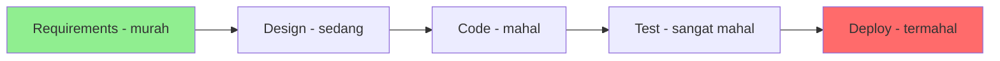
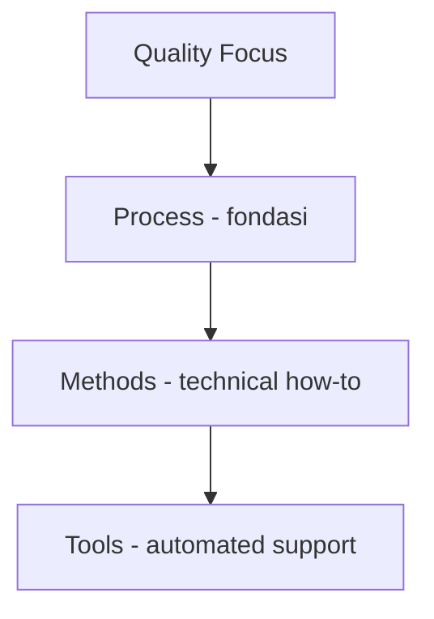

# Software Engineering | Sesi 01: The Nature of Software and Software Engineering

> **Mata Kuliah:** Software Engineering | **Sesi:** 01 | **Status:** Materi UTS

---

## 🔑 Cues
- Definisi software: instruksi + data + dokumentasi
- Definisi Software Engineering (IEEE)
- 7 domain aplikasi software
- Programming vs Software Engineering
- Lapisan SE: Process, Methods, Tools
- Vasa Syndrome (1628)
- Hyrum's Law & Shifting Left

---

## 📖 Materi Utama

### 1. Software Itu Bukan Sekadar Kode
- **Instructions (programs):** fitur, fungsi, dan performance yang dieksekusi saat runtime — inti logika bisnis sistem.
- **Data structures:** wadah informasi yang dimanipulasi program; struktur yang efisien menentukan performa.
- **Descriptive information:** dokumentasi hard copy maupun virtual (manual, help files) yang menjelaskan operasi program — krusial untuk maintenance jangka panjang.

### 2. Software Engineering Menurut IEEE
- Penerapan pendekatan yang **systematic, disciplined, quantifiable** pada pengembangan, operasi, dan pemeliharaan software — fokus pada kualitas dan keterukuran proses.

### 3. Tujuh Domain Aplikasi
- **System software:** melayani program lain — Linux, Windows, compiler, device drivers.
- **Application software:** kebutuhan bisnis/personal — Word, SAP, browser.
- **Engineering/scientific:** number-crunching dan simulasi — MATLAB, CAD, meteorologi.
- **Embedded software:** tertanam di produk non-komputasi — Tesla Autopilot, IoT, microwave.
- **Product-line software:** komponen reusable multi-customer — MS Office, AutoCAD, Oracle DB.
- **Web/mobile applications:** berbasis browser, cloud, mobile — Google Docs, Figma, Trello.
- **AI software:** robotik, sistem pakar, ML, pengenalan pola — ChatGPT, Gemini.

### 4. Programming vs Software Engineering
- **Programming** mengejar kode yang jalan hari ini (fitur berfungsi, tes lulus).
- **Software Engineering** adalah programming yang diintegrasikan terhadap waktu: development + modification + maintenance, dengan penekanan skalabilitas, reliabilitas, dan keberlanjutan.

### 5. Tiga Lapisan SE di Atas Quality Focus
- **Process (fondasi):** framework kerja — aktivitas, milestone, peran, kontrol perubahan.
- **Methods:** technical how-to — panduan requirements, desain, coding, testing.
- **Tools:** dukungan otomatis/semi-otomatis (CASE tools) — IDE, version control.

### 6. Pelajaran Sejarah dan Waktu
- **Vasa Syndrome:** kapal perang Swedia (1628) tenggelam di pelayaran perdana karena requirements tak terkontrol, QA lemah, hilangnya expertise, dan tanpa metrics — template kegagalan proyek software modern.
- **Time and change:** software tidak aus (wear out) seperti hardware, melainkan **deteriorates** — kualitasnya menurun akibat perubahan lingkungan, dependensi, dan akumulasi technical debt.
- **Hyrum's Law:** semua behavior observable sistem akan diandalkan seseorang — "kontrak" API saja tidak menjamin stabilitas.
- **Shifting Left:** deteksi masalah sedini mungkin; earlier mistakes are cheaper mistakes.
- **Trade-offs:** setiap keputusan punya opportunity cost — biaya dari tindakan yang tidak diambil.

---

## Library Diagram & Arsitektur

### Biaya Perubahan vs Waktu (Shifting Left)

### Lapisan Software Engineering

---

## 🛠️ Use Case / Implementasi Nyata
- **Skenario:** Aplikasi presensi kampus yang awalnya skrip sekali pakai, lalu dipakai 4 fakultas selama 6 tahun.
- **Masalah yang Diatasi:** Setiap semester aturan presensi berubah dan server kampus di-upgrade; skrip "yang penting jalan" rusak tiap kali lingkungan berubah (deterioration + Hyrum's Law: fakultas lain mengandalkan format CSV internal Sellinger).
- **Keuntungan:** Dengan mindset SE (process + dokumentasi + shifting left), perubahan aturan menjadi update terukur, bukan perombakan darurat.

---

## 🗂️ Konsep Kunci

| Istilah | Definisi | Contoh / Catatan |
|---------|----------|-----------------|
| Software | Instruksi + struktur data + dokumentasi | Definisi lengkap menurut Pressman |
| Software Engineering | Pendekatan sistematis, disiplin, terukur pada software | Definisi resmi IEEE |
| Sustainability | Kemampuan proyek tetap up-to-date secara reliabel | Butuh manajemen perubahan yang baik |
| Hyrum's Law | Behavior observable pasti diandalkan seseorang | Kontrak API tidak cukup |
| Shifting Left | Deteksi masalah sedini mungkin | Bug requirement termurah diperbaiki |
| Technical Debt | Beban kompleksitas dari jalan pintas tak terpelihara | Dibayar via refactoring |
| Opportunity Cost | Kerugian akibat tindakan yang tidak diambil | Faktor kunci decision making |

---

## 📊 Tabel Ringkasan

| Aspek | Software | Hardware |
|-------|----------|----------|
| Kegagalan | Deteriorates (perubahan env/requirement) | Wears out (aus fisik) |
| Bentuk | Intangible | Tangible |
| Perubahan | Relatif mudah dikembangkan | Mahal setelah diproduksi |

---

## ⚠️ Catatan Penting
> **"Happens to work" vs "is maintainable"** — di proyek jangka panjang, kode yang sekadar jalan adalah ancaman; keberlanjutan menuntut kode yang bisa dipelihara.

---

## 📝 Materi Tambahan (Visual Insights)
- Karakteristik software: **intangible** (tak berwujud), **customizable** (mudah diubah), **lifespan** (menurun kualitasnya seiring waktu), **complex** (interaksi antar komponen besar).
- Urutan kegagalan ala Vasa: changing requirements → loss of key expert → no stability tests → catastrophic failure.

---

## ✅ Standar Visual & Orisinalitas
- Sintesis orisinal sesi 01; struktur, diagram, dan contoh presensi milik sendiri; definisi IEEE, Hyrum's Law, dan fakta Vasa (1628) merujuk materi asli.
