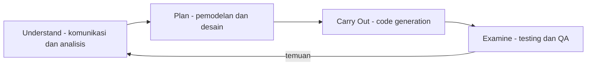
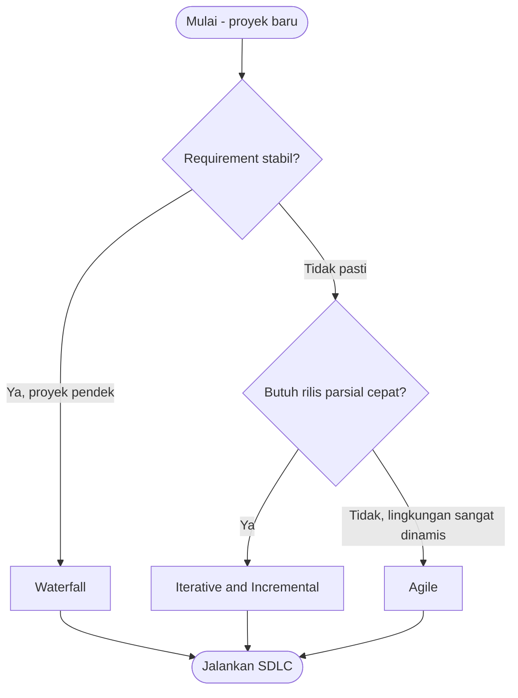

# Software Engineering | Sesi 02: Software Processes and Development Life Cycle Models

> **Mata Kuliah:** COMP6100001 - Software Engineering | **Sesi:** 02 | **Status:** Materi UTS

---

## 🔑 Cues
- Software process: activity, action, task
- 4 langkah praktik SE
- 7 fase SDLC
- Framework vs umbrella activities
- Waterfall vs IID vs Agile
- Iteration vs increment
- 4 paradigma struktur tim

---

## 📖 Materi Utama

### 1. Anatomi Software Process
- **Software process** = kumpulan aktivitas, aksi, dan tugas untuk menghasilkan work product (software + artefaknya). Sifatnya adaptif, bukan urutan kaku.
- **Activity:** tujuan luas (komunikasi stakeholder, perencanaan, QA). **Action:** sekumpulan tugas penghasil work product utama (architectural design → architecture model). **Task:** pekerjaan kecil konkret (tulis satu unit test).
- Empat langkah praktik SE: (1) understand the problem via komunikasi & analisis, (2) plan a solution via pemodelan & desain, (3) carry out the plan via code generation, (4) examine the result via testing & QA.
- Waspadai **software myths** — keyakinan masuk akal tapi menyesatkan, misal "requirements yang sudah jelas tidak akan berubah" atau "tambah developer pasti mempercepat delivery" (Brooks' Law: koordinasi justru melambat).

### 2. Tujuh Fase SDLC
- **Planning:** scope, tujuan, sumber daya, timeline. **Analysis:** pahami kebutuhan user + kelayakan. **Design:** blueprint struktur dan fungsi. **Implementation:** terjemahkan desain jadi kode. **Testing & Integration:** pastikan fitur berjalan + komponen terintegrasi. **Deployment:** rilis setelah pengujian dan persetujuan. **Maintenance:** rawat dan tingkatkan agar tetap relevan.
- **Framework activities** (komunikasi, perencanaan, pemodelan, konstruksi, deployment) dilengkapi **umbrella activities** yang menyelimuti seluruh proses: tracking proyek, manajemen risiko, QA, technical review, konfigurasi software.

### 3. Tiga Keluarga Model
- **Waterfall:** linear-sekuensial, fase terkunci. Jelas dan mudah dikelola; cocok bila requirements stabil dan proyek pendek. Lemah: perubahan mahal, testing dan feedback datang terlambat.
- **Iterative & Incremental (IID):** desain berulang + bangun bertahap. **Iteration** = siklus penyempurnaan berulang; **increment** = tambah fungsi sedikit demi sedikit. Feedback dan partial delivery lebih cepat; butuh review dan koordinasi intensif. Varian: prototyping, evolutionary, unified process.
- **Agile:** evolusi IID yang menekankan adaptabilitas — perencanaan adaptif dan feedback pelanggan yang sering untuk lingkungan dinamis.

### 4. Faktor Manusia
- Tujuh trait superprofessional: tanggung jawab individual, kesadaran akut, kejujuran brutal, tahan tekanan, rasa keadilan tinggi, perhatian detail, pragmatis.
- Empat paradigma tim: **closed** (hierarki tradisional), **random** (inisiatif individu), **open** (kontrol + inovasi), **synchronous** (kompartementalisasi, komunikasi minim).

---

## Library Diagram & Arsitektur

### Siklus Praktik SE dengan Feedback

### Memilih Model SDLC (Decision Flow)

---

## 🛠️ Use Case / Implementasi Nyata
- **Skenario:** Sistem antrean klinik pratama: awalnya dianggap kebutuhan sederhana (daftar–panggil–selesai), ternyata tiap poli punya aturan antrean berbeda yang baru terungkap saat uji coba.
- **Masalah yang Diatasi:** Asumsi "requirements sudah final" (myth) runtuh di tengah jalan.
- **Keuntungan:** Dengan IID, modul antrean umum dirilis dulu sebagai increment pertama; aturan spesifik poli ditambahkan per iterasi tanpa mengulang seluruh proyek — sesuatu yang mustahil di Waterfall murni.

---

## 🗂️ Konsep Kunci

| Istilah | Definisi | Contoh / Catatan |
|---------|----------|-----------------|
| Software process | Kumpulan aktivitas penghasil software + artefak | Adaptif, bukan kaku |
| SDLC | Alur terstruktur develop → deploy → maintain | Menjaga proyek terkontrol dan berkualitas |
| Iteration | Siklus berulang yang menyempurnakan produk | Inti IID dan Agile |
| Increment | Penambahan fungsi sedikit demi sedikit | Partial delivery lebih cepat |
| Umbrella activity | Kegiatan paralel sepanjang proses | Risk management, QA, tracking |
| Brooks' Law | Tambah orang bisa memperlambat proyek | Koordinasi memakan biaya |

---

## 📊 Tabel Ringkasan

| Model | Pendekatan | Cocok Untuk |
|-------|-----------|-------------|
| Waterfall | Linear, sekuensial | Requirements stabil, proyek pendek |
| Iterative & Incremental | Siklus berulang, bangun bertahap | Requirements cair, perubahan diharapkan |
| Agile | Iteratif + sangat adaptif | Lingkungan dinamis, kolaborasi tinggi |

| Paradigma Tim | Ciri |
|---------------|------|
| Closed | Hierarki tradisional |
| Random | Mengandalkan inisiatif individu |
| Open | Kontrol dipadukan inovasi |
| Synchronous | Tugas tersekat, komunikasi aktif minim |

---

## ⚠️ Catatan Penting
> **SDLC mengubah belief-based menjadi evidence-based development** — model bukan ritual kaku; pilih berdasarkan konteks (stabilitas requirements, risiko, keterlibatan customer, time constraint).

---

## 📝 Materi Tambahan (Visual Insights)
- Matriks keputusan pemilihan model mempertimbangkan: ukuran proyek, stabilitas requirements, tingkat risiko, keterlibatan customer, dan time constraint.
- Tujuh fase SDLC membentuk loop: maintenance yang menemukan kebutuhan baru memutar kembali ke planning.

---

## ✅ Standar Visual & Orisinalitas
- Sintesis orisinal sesi 02; decision flow dan contoh klinik milik sendiri; definisi activity/action/task, fase SDLC, dan paradigma tim merujuk materi asli.
