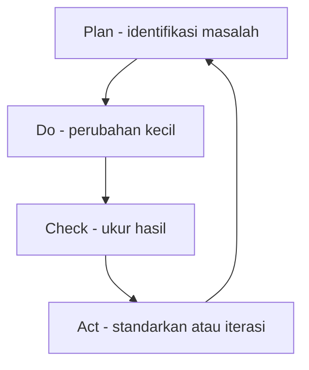
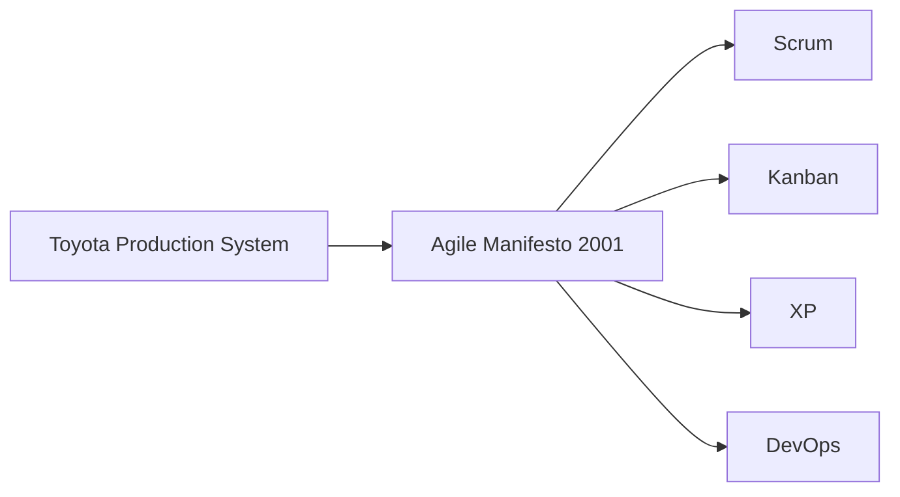

# Software Engineering | Sesi 03: Agile Principles and Lean Foundations

> **Mata Kuliah:** COMP6100001 - Software Engineering | **Sesi:** 03 | **Status:** Materi UTS

---

## 🔑 Cues
- Agile = mindset, bukan metodologi tunggal
- Lean dari Toyota Production System (akhir 1940-an)
- 4 values Agile Manifesto (2001, 17 praktisi)
- 12 prinsip Agile
- Kaizen dan cost of change
- Scrum, Kanban, XP, DevOps sekilas

---

## 📖 Materi Utama

### 1. Agile: Adaptif, Bukan Tanpa Rencana
- **Agile** = kemampuan menciptakan dan merespons perubahan agar sukses di tengah ketidakpastian; yang dioptimalkan adalah **adaptiveness**, bukan predictability.
- Agile adalah **mindset** berpanduan nilai Manifesto, bukan satu metodologi. Timnya cross-functional (skill > peran kaku) dan bekerja dalam loop pendek: **try → get feedback → adapt**.
- Klarifikasi penting: Agile memakai *adaptive planning*, bukan *no planning*. "Responding to change" berbeda dari "tidak punya rencana".

### 2. Akar Lean dari Lantai Pabrik Toyota
- **Toyota Production System (TPS)**, akhir 1940-an: bangun hanya yang dibutuhkan saat dibutuhkan (**pull system**), hentikan dan perbaiki masalah sedini mungkin (quality first), tim berdaya dan multi-skill.
- **Kaizen** = perbaikan berkelanjutan lewat perubahan kecil: identifikasi masalah → ubah sedikit → ukur hasil → ulangi. Agile adalah penerapan cara berpikir Lean ke software: belajar cepat, buang waste.

### 3. Manifesto 2001: 4 Values
Diterbitkan 17 praktisi software tahun 2001:
1. **Individuals and interactions** over processes and tools
2. **Working software** over comprehensive documentation
3. **Customer collaboration** over contract negotiation
4. **Responding to change** over following a plan

### 4. Manifesto 2001: 12 Prinsip
1. Puaskan customer lewat delivery valuable software yang awal dan kontinu.
2. Terima perubahan requirements bahkan di tahap akhir; jadikan keunggulan kompetitif.
3. Deliver working software sesering mungkin (mingguan–bulanan, pilih timescale pendek).
4. Business people dan developers bekerja bersama setiap hari.
5. Bangun proyek di sekitar individu termotivasi; beri lingkungan dan kepercayaan.
6. Komunikasi paling efisien = **face-to-face conversation**.
7. **Working software** adalah ukuran utama kemajuan.
8. Jaga sustainable pace yang konstan untuk semua pihak.
9. Technical excellence dan good design yang kontinu meningkatkan agility.
10. Simplicity — memaksimalkan pekerjaan yang **tidak** dilakukan (YAGNI).
11. Arsitektur, requirements, dan desain terbaik lahir dari **self-organizing teams**.
12. Tim rutin merefleksikan efektivitasnya lalu menyesuaikan perilaku.

### 5. Ekonomi Perubahan
- Di Waterfall, biaya perubahan naik eksponensial menjelang akhir siklus. Agile menahannya tetap rendah lewat iterasi pendek dan feedback cepat — inilah **cost of change** yang dijinakkan.

### 6. Empat Framework Turunan (Overview)
- **Scrum:** kerja dibagi per sprint; testing dan dokumentasi berjalan terus; demo tiap sprint.
- **Kanban:** visualisasi workflow di papan, batasi **WIP**; 6 praktik: visualize workflow, limit WIP, manage flow, make policies explicit, feedback loops, collaborative improvement.
- **XP (Extreme Programming):** praktik teknis — unit test sebelum koding, pair programming, refactoring, user stories; desain mengikuti KIS (Keep It Simple).
- **DevOps:** Agile + Lean di seluruh supply chain — continuous development → testing → integration → deployment → monitoring.

---

## Library Diagram & Arsitektur

### Loop Kaizen (Plan-Do-Check-Act)

### Dari Lean ke Framework Agile

---

## 🛠️ Use Case / Implementasi Nyata
- **Skenario:** Startup edutech membangun tryout online; dua minggu sebelum peluncuran, sekolah mitra meminta mode offline karena internet lab tidak stabil.
- **Masalah yang Diatasi:** Requirement berubah di tahap akhir — mimpi buruk Waterfall.
- **Keuntungan:** Dengan prinsip 2 dan 3 Manifesto, tim memasukkan mode offline ke sprint berikutnya sebagai keunggulan kompetitif, bukan krisis; working software tiap sprint membuat sekolah mitra percaya progresnya nyata.

---

## 🗂️ Konsep Kunci

| Istilah | Definisi | Contoh / Catatan |
|---------|----------|-----------------|
| Agile | Mindset adaptasi dan kolaborasi menghadapi perubahan | Cara berpikir, bukan tool/proses |
| Lean | Filosofi kurangi waste, fokus pada nilai | Berakar di TPS Toyota |
| Kaizen | Perbaikan kecil kontinu | Change for the better |
| Pull system | Bangun saat dibutuhkan | Lawan dari push/stock |
| WIP | Pekerjaan yang sedang berjalan | Kanban membatasinya agar fokus |
| Self-organizing team | Tim mengatur cara kerjanya sendiri | Prinsip ke-11 Manifesto |
| Sprint | Siklus pengembangan pendek Scrum | Umumnya 1–4 minggu |

---

## 📊 Tabel Ringkasan

| Framework | Ciri Khas | Cocok Untuk |
|-----------|-----------|-------------|
| Scrum | Sprint, backlog, 3 roles | Tim kecil, scope berubah |
| Kanban | Papan visual, batasi WIP | Alur kontinu, support/ops |
| XP | Pair programming, TDD, refactoring | Butuh kualitas teknis tinggi |
| DevOps | Continuous delivery end-to-end | Ingin siklus rilis pendek |

---

## ⚠️ Catatan Penting
> **Lean ≠ Agile, tapi Agile berakar dari Lean** — Lean lahir untuk manufaktur, Agile mengadaptasinya ke software; keduanya memerangi waste lewat continuous improvement.

---

## 📝 Materi Tambahan (Visual Insights)
- Prinsip ke-7 (working software sebagai ukuran kemajuan) adalah penantang langsung big-bang delivery Waterfall.
- Prinsip ke-12 melembagakan Kaizen di dalam tim: refleksi berkala bukan seremoni, melainkan mesin adaptasi.

---

## ✅ Standar Visual & Orisinalitas
- Sintesis orisinal sesi 03; alur, diagram, dan contoh edutech milik sendiri; 4 values, 12 prinsip, dan fakta TPS/Manifesto merujuk materi asli.
