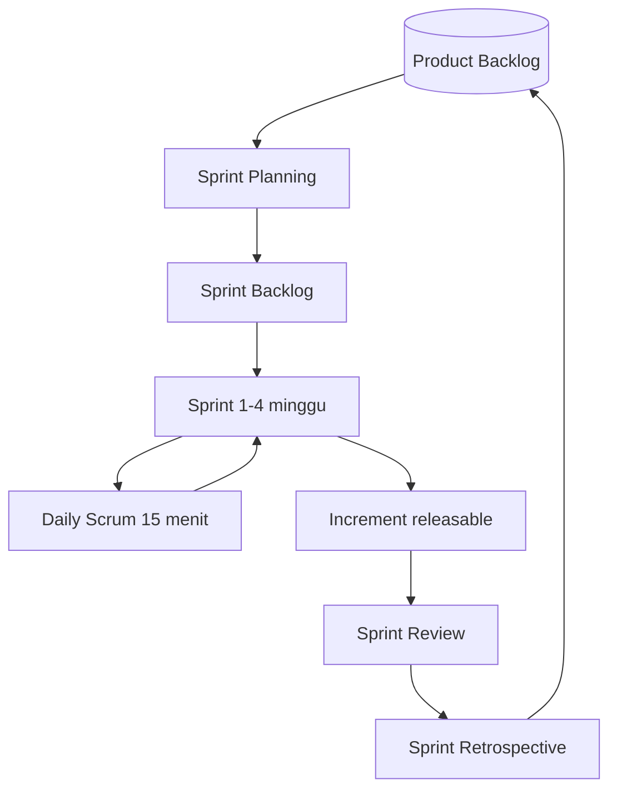
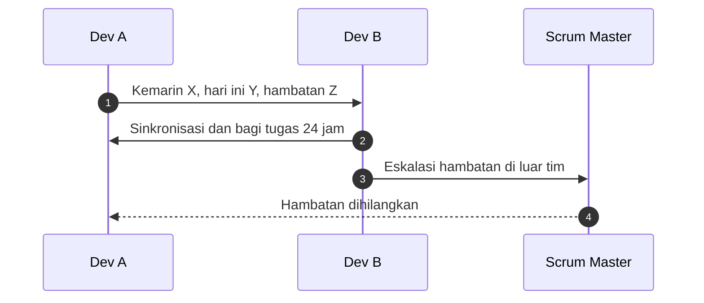

# Software Engineering | Sesi 04: Scrum Framework

> **Mata Kuliah:** COMP6100001 - Software Engineering | **Sesi:** 04 | **Status:** Materi UTS

---

## 🔑 Cues
- Scrum: purposefully incomplete, empiricism, lean thinking
- 3 pilar: transparency, inspection, adaptation
- 3 roles: PO, Scrum Master, Dev Team (3–9 orang)
- 3 artifacts: Product Backlog, Sprint Backlog, Increment
- 5 events + timebox-nya
- User stories 3C dan INVEST
- DoD, velocity, impediment

---

## 📖 Materi Utama

### 1. Hakikat Scrum
- **Scrum** = framework ringan penghasil nilai lewat solusi adaptif untuk masalah kompleks.
- Ciri: **purposefully incomplete** (hanya mendefinisikan yang perlu), **empiricism** (keputusan berbasis observasi), **lean thinking** (buang waste).
- Tiga pilar empiris: **transparency** (proses dan hasil terlihat), **inspection** (artifact dan progres diperiksa rutin), **adaptation** (deviasi dikoreksi sesegera mungkin).

### 2. Tiga Peran
- **Product Owner (PO):** memaksimalkan nilai produk; mengelola dan mengurutkan Product Backlog; jembatan stakeholder–tim.
- **Scrum Master (SM):** memastikan Scrum dipahami dan dijalankan; servant-leader penghilang **impediment**; melatih self-management dan cross-functionality.
- **Development Team:** profesional lintas fungsi dan self-organizing (3–9 orang) yang mengantar **Increment** yang potentially releasable.

### 3. Tiga Artifact
- **Product Backlog:** daftar terurut dinamis berisi fitur, perbaikan, dan peningkatan produk.
- **Sprint Backlog:** item backlog terpilih untuk satu sprint + rencana delivery.
- **Increment:** hasil nyata sprint yang memenuhi Definition of Done dan usable.

### 4. Lima Events dan Batas Waktunya
- **Sprint:** wadah semua events, durasi tetap maksimal 1 bulan.
- **Sprint Planning** (maks 8 jam untuk sprint 1 bulan): tetapkan apa yang selesai dan caranya → output Sprint Goal + Sprint Backlog.
- **Daily Scrum** (15 menit): sinkronisasi dev team + rencana 24 jam ke depan.
- **Sprint Review** (4 jam): periksa Increment bersama stakeholders → Product Backlog disesuaikan.
- **Sprint Retrospective** (3 jam): rencanakan perbaikan kualitas dan efektivitas tim.

### 5. User Stories yang Bagus
- **3C:** Card (pengingat tertulis singkat), Conversation (detail via diskusi), Confirmation (acceptance criteria sebagai verifikasi).
- **INVEST:** Independent, Negotiable, Valuable, Estimable, Small, Testable.
- Pendukung: **Definition of Done** (standar selesai: reviewed, tested, documented) dan **velocity** (kapasitas tim per sprint untuk perencanaan rilis PO).

---

## Library Diagram & Arsitektur

### Putaran Scrum End-to-End

### Daily Scrum sebagai Sequence

---

## 🛠️ Use Case / Implementasi Nyata
- **Skenario:** Aplikasi reservasi lapangan kampus; pengelola meminta fitur "bagi tagihan patungan" di tengah semester berjalan.
- **Masalah yang Diatasi:** Kebutuhan berubah cepat dan rilis besar-besaran berisiko merusak musim penyewaan.
- **Keuntungan:** Versi dasar patungan rilis satu sprint, disempurnakan sprint berikut; stakeholder melihat Increment tiap review; testing berjalan ongoing selama construction, bukan menumpuk di akhir.

---

## 🗂️ Konsep Kunci

| Istilah | Definisi | Contoh / Catatan |
|---------|----------|-----------------|
| Timebox | Batas waktu maksimal sebuah event | Planning 8 jam, review 4 jam, retro 3 jam |
| Definition of Done | Standar mutu agar item sah disebut selesai | Reviewed, unit tested, documented |
| Impediment | Hambatan menuju tujuan sprint | Server down, lisensi habis |
| Velocity | Kapasitas kerja tim per sprint | Basis perencanaan rilis PO |

---

## 📊 Tabel Ringkasan

| Event | Peserta | Durasi (sprint 1 bln) | Output |
|-------|---------|----------------------|--------|
| Sprint Planning | PO, SM, Dev Team | 8 jam | Sprint Goal + Sprint Backlog |
| Daily Scrum | Dev Team (+SM opsional) | 15 menit | Rencana 24 jam |
| Sprint Review | PO, SM, DT, stakeholders | 4 jam | Update Product Backlog |
| Sprint Retrospective | PO, SM, Dev Team | 3 jam | Daftar perbaikan proses |

---

## ⚠️ Catatan Penting
> **Scrum menguji dan mendokumentasi secara ongoing** — bukan fase terpisah di akhir seperti Waterfall; Increment tiap sprint harus benar-benar usable.

---

## 📝 Materi Tambahan (Visual Insights)
- Rantai pilar: tanpa **transparency**, inspection buta; tanpa inspection akurat, adaptation salah sasaran.
- User story adalah unit terkecil Product Backlog yang ditarik ke Sprint Backlog — kualitas INVEST-nya menentukan kelancaran sprint.

---

## ✅ Standar Visual & Orisinalitas
- Sintesis orisinal sesi 04; diagram dan contoh reservasi milik sendiri; timebox, peran, artifact, dan kriteria INVEST merujuk materi asli.
