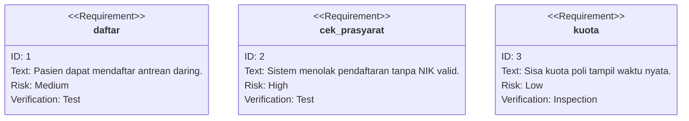
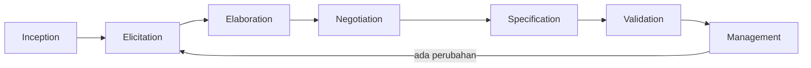

# Software Engineering | Sesi 06: Requirements Engineering

> **Mata Kuliah:** COMP6100001 - Software Engineering | **Sesi:** 06 | **Status:** Materi UTS

---

## 🔑 Cues
- RE: definisi dan 4 alasan penting
- 4 tipe stakeholder
- FR vs NFR + contoh angka
- 4 teknik elicitation
- 7 tugas RE (inception → management)
- MoSCoW, scope creep, traceability, verifiability

---

## 📖 Materi Utama

### 1. Mengapa Requirements Engineering Menentukan Segalanya
- **RE** = proses mendefinisikan, mendokumentasikan, dan memelihara persyaratan dalam desain rekayasa.
- Empat alasan: **fondasi** seluruh aktivitas lanjutan; **kepuasan stakeholder** (produk = ekspektasi); **pengurangan risiko** (masalah ketahuan awal, rework murah); **manajemen scope** (scope terdefinisi, scope creep tertahan).

### 2. Kenali Stakeholder Dulu
- **Stakeholder** = individu/organisasi yang memengaruhi atau terpengaruh sistem.
- Empat tipe: **users** (utama + sekunder), **clients** (pemberi tugas), **developers** (pembangun), **regulators** (penegak standar/regulasi).

### 3. Dua Jenis Requirements
- **Functional (FR)** — *apa* yang sistem lakukan: "pengguna dapat membuat profil", "sistem menghasilkan laporan penjualan bulanan".
- **Non-Functional (NFR)** — *bagaimana* sistem bekerja (kualitas + batasan: performance, security, usability, reliability): "mendukung 10.000 pengguna bersamaan", "waktu respons < 2 detik".
- Aturan emas penulisan: hindari kata subjektif ("cepat", "mudah", "user-friendly") tanpa kriteria teknis — setiap requirement harus **verifiable** ("respons < 2 detik", bukan "sistem harus cepat").

### 4. Menggali Kebutuhan (Elicitation)
- **Interviews** (terstruktur/tak terstruktur) untuk detail mendalam; **surveys & questionnaires** untuk data kuantitatif massal; **workshops & focus groups** untuk feedback cepat multi-perspektif; **observation & ethnography** untuk melihat alur kerja nyata dan titik sakit pengguna.

### 5. Tujuh Tugas RE sebagai Pipeline
1. **Inception** — pahami masalah bisnis dan batasannya. 2. **Elicitation** — gali tujuan stakeholder. 3. **Elaboration** — haluskan skenario dan perilaku sistem. 4. **Negotiation** — damai konflik, tetapkan prioritas. 5. **Specification** — dokumentasikan (teks, model, prototipe). 6. **Validation** — pastikan jelas, konsisten, testable. 7. **Management** — kelola perubahan + jaga **traceability**.
- **MoSCoW** (Must, Should, Could, Won't) memfokuskan negosiasi pada fitur kritis lebih dulu.

---

## Library Diagram & Arsitektur

### Requirement Diagram: Antrean Puskesmas

### Alur Tujuh Tugas RE

---

## 🛠️ Use Case / Implementasi Nyata
- **Skenario:** Sistem antrean puskesmas kecamatan menggantikan kupon kertas.
- **Masalah yang Diatasi:** Pasien datang subuh untuk kupon, NIK ditulis tangan sehingga salah input, dan bentrok jadwal poli baru ketahuan di lokasi.
- **Keuntungan:** Aturan prasyarat (NIK valid, rujukan) dicek otomatis; bentrok jadwal terdeteksi real-time; sisa kuota transparan — tiga FR yang lahir langsung dari observasi lapangan, bukan asumsi.

---

## 🗂️ Konsep Kunci

| Istilah | Definisi | Contoh / Catatan |
|---------|----------|-----------------|
| MoSCoW | Prioritas Must, Should, Could, Won't | Fokus ke fitur kritis dulu |
| Scope creep | Perluasan fitur tak terkendali tanpa tambah resource | Gejala management RE lemah |
| Traceability | Setiap requirement terlacak ke asal dan implementasinya | Tak ada requirement yatim |
| Verifiability | Requirement harus bisa diuji kebenarannya | Tolak kata "cepat" tanpa angka |

---

## 📊 Tabel Ringkasan

| Karakteristik | Functional (FR) | Non-Functional (NFR) |
|---------------|-----------------|----------------------|
| Fokus | What: aksi/fitur | How: kualitas/aturan |
| Contoh | Buat profil, cetak laporan | Uptime 99%, respons < 2 dtk |
| Pengujian | Functional testing | Load, security, stress testing |
| Jika gagal | Fitur tak bisa dipakai | Sistem lambat/tak aman/sulit scale |

---

## ⚠️ Catatan Penting
> **Ambiguity adalah bug paling awal** — requirement yang tidak verifiable akan melahirkan sengketa di validation dan rework di semua fase sesudahnya.

---

## 📝 Materi Tambahan (Visual Insights)
- Elicitation buruk → inception tanpa pijakan masalah yang kuat → elaboration membangun di atas pasir.
- Negotiation adalah titik temu FR ambisius vs batasan NFR (biaya, waktu, regulasi); traceability di management memastikan tiap baris kode merujuk specification yang sudah divalidasi.

---

## ✅ Standar Visual & Orisinalitas
- Sintesis orisinal sesi 06; diagram requirement puskesmas dan contoh antrean milik sendiri (pengganti tipe diagram use-case yang invalid di Mermaid); definisi, 7 tugas, dan contoh FR/NFR merujuk materi asli.
