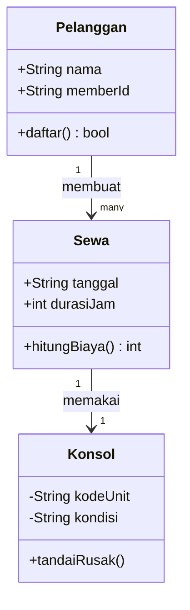
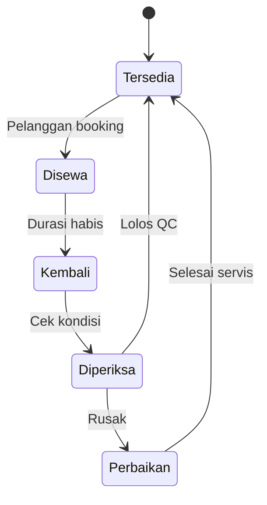

# Software Engineering | Sesi 07: Requirements Modeling and UML

> **Mata Kuliah:** COMP6100001 - Software Engineering | **Sesi:** 07 | **Status:** Materi UTS

---

## 🔑 Cues
- Analysis asks what, not how
- 5 prinsip modeling
- 5 tipe model requirements
- Grammatical parse (nouns → kelas)
- Kriteria Coad & Yourdon
- Actor, swimlane, passive vs active state

---

## 📖 Materi Utama

### 1. Filosofi Modeling: What, Bukan How
- Modeling requirements adalah jembatan antara deskripsi bisnis dan desain teknis — ia menjawab **what**, bukan how. Model analisis harus independen teknologi: jangan sebut "database SQL" atau "protokol HTTP" di dalamnya.

### 2. Lima Prinsip Modeling
1. **Represent the information domain** — petakan data masuk, keluar, dan tersimpan. 2. **Define software functions** — tetapkan fungsi bernilai bagi pengguna. 3. **Represent software behavior** — respons sistem terhadap event eksternal. 4. **Partition the problem** — pecah masalah kompleks (separation of concerns). 5. **Move from essence to detail** — kuasai kebutuhan inti sebelum detail teknis.

### 3. Lima Tipe Model
- **Scenario-based:** interaksi pengguna (use case, activity, sequence). **Class-based:** struktur objek + atribut + operasi (class diagram). **Behavioral:** respons terhadap event (state diagram). **Data modeling:** domain informasi (ERD). **Flow-oriented:** transformasi data fungsional (DFD).

### 4. Dari Narasi ke Kelas Analisis
- **Grammatical parse:** garisbawahi kata benda (nouns) dalam skenario sebagai kandidat kelas.
- **Filter Coad & Yourdon** — kelas layak jika memenuhi: menyimpan informasi (retained information), menyediakan layanan yang dibutuhkan (needed services), punya banyak atribut (multiple attributes), serta atribut/operasinya berlaku umum untuk semua instansi.

### 5. Fakta Rujukan: SafeHome Surveillance
- Fungsi surveilans: pemilik memilih kamera dari floor plan digital, kontrol pan/zoom dinamis, kamera sensitif dilindungi password spesifik, sensor eksternal memicu alert.
- Struktur kelas: FloorPlan (type; Scout(), changeColor()) berisi banyak Camera (type, ID; determineType(), translateLoc()) dan banyak Wall (wallDim; computeConst()).
- Status panel: Reading → Comparing saat password dimasukkan → Selecting jika valid, Locked jika 3x salah → kembali via timeout/reset atau admin reset.

---

## Library Diagram & Arsitektur

### Class Diagram: Rental Konsol Game (Contoh Sendiri)

### State Diagram: Status Unit Sewa

---

## 🛠️ Use Case / Implementasi Nyata
- **Skenario:** Sistem rental konsol game harian di sekitar kampus.
- **Masalah yang Diatasi:** Pencatatan kertas membuat unit rusak tetap disewakan dan durasi sewa dihitung asal.
- **Keuntungan:** Grammatical parse atas keluhan pemilik langsung menghasilkan kelas Pelanggan–Konsol–Sewa; state diagram mencegah unit berstatus Perbaikan tersewakan; swimlane memperjelas siapa (kasir vs teknisi) bertanggung jawab di tiap langkah.

---

## 🗂️ Konsep Kunci

| Istilah | Definisi | Contoh / Catatan |
|---------|----------|-----------------|
| Actor | Peran yang berinteraksi dengan sistem | Manusia, sistem eksternal, hardware |
| Swimlane | Pembagian tanggung jawab dalam activity diagram | Menunjukkan siapa melakukan apa |
| Passive state | Nilai atribut objek pada satu titik | status = active |
| Active state | Mode operasi objek saat itu | Processing, Waiting for Input |

---

## 📊 Tabel Ringkasan

| Model | Diagram Utama | Fokus |
|-------|---------------|-------|
| Scenario-based | Use case | Interaksi aktor–sistem |
| Class-based | Class diagram | Struktur data + method |
| Behavioral | State diagram | Perubahan status akibat event |
| Functional | Activity diagram | Alur proses dan keputusan |

---

## ⚠️ Catatan Penting
> **Model analisis ≠ desain implementasi** — menyebut teknologi konkret di tahap ini mengunci solusi terlalu dini dan mengkhianati prinsip essence-to-detail.

---

## 📝 Materi Tambahan (Visual Insights)
- Alur derivasi: use case → grammatical parse → kandidat kelas → filter Coad & Yourdon → class diagram → sequence diagram kolaborasi antar kelas.
- Activity diagram merinci langkah dalam use case; sequence diagram menunjukkan bagaimana kelas-kelas berkolaborasi mengeksekusinya.

---

## ✅ Standar Visual & Orisinalitas
- Sintesis orisinal sesi 07; class dan state diagram rental konsol milik sendiri (pengganti tipe diagram use-case yang invalid); fakta SafeHome dan kriteria Coad & Yourdon merujuk materi asli.
