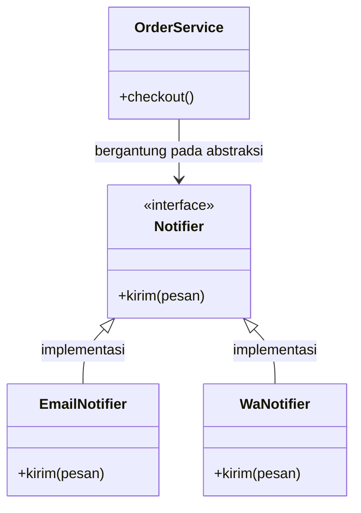
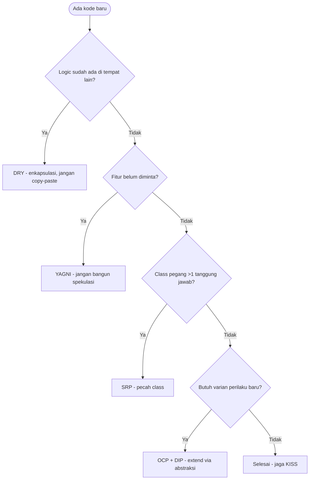

# Software Engineering | Sesi 08: Software Design Principles

> **Mata Kuliah:** COMP6100001 - Software Engineering | **Sesi:** 08 | **Status:** Materi UTS

---

## 🔑 Cues
- Software design = blueprint dari requirements
- 6 kriteria good design
- KISS, DRY, YAGNI
- Coupling vs cohesion (target: loose + high)
- SOLID (5 prinsip + contoh)
- 8 golden rules Shneiderman

---

## 📖 Materi Utama

### 1. Desain sebagai Blueprint
- **Software design** = mendefinisikan arsitektur, komponen, dan antarmuka untuk mengubah requirements menjadi panduan pembangunan — model sistem yang memenuhi requirements.
- Targetnya: kurangi kompleksitas, cegah duplikasi, naikkan maintainability, scalability, dan readability.
- Kriteria good design: **modular** (unit kecil independen), **low coupling**, **high cohesion** (satu modul satu task), **reusability**, **scalability**, **maintainability**.
- Payung semuanya: **separation of concern** — tiap bagian sistem punya satu concern yang jelas (misal frontend vs backend).

### 2. Tiga Prinsip Umum
- **KISS (Keep It Simple, Stupid):** pilih desain paling sederhana yang cukup; lawan over-engineering; menyederhanakan debugging dan maintenance.
- **DRY (Don't Repeat Yourself):** tiap logic punya satu representasi otoritatif — enkapsulasi ke method/function. Catatan: DRY soal logic yang sama, bukan kode yang kebetulan mirip; abstraksi prematur juga berbahaya.
- **YAGNI (You Aren't Gonna Need It):** jangan implementasikan fitur spekulatif masa depan; cegah code bloat dan buang resource.

### 3. Coupling dan Cohesion
- **Coupling** = ketergantungan antar modul. Tight coupling (saling menempel) → perubahan kecil merembet ke mana-mana. Loose coupling → modul bebas diubah tanpa efek besar.
- **Cohesion** = kesatuan fungsi dalam satu modul. High cohesion = satu modul satu task; low cohesion = modul gado-gado (login + report + SMS).
- Target abadi: **high cohesion + loose coupling**.

### 4. SOLID untuk Desain OOP
- **S — Single Responsibility:** 1 class 1 alasan berubah; pisahkan data handling dari UI logic (misal UserDAO vs UserUI). Efek: cohesion naik, testing mudah.
- **O — Open-Closed:** terbuka untuk extension, tertutup untuk modification; fitur baru (misal metode pembayaran baru) ditambah via abstract class/interface tanpa menyentuh kode lama.
- **L — Liskov Substitution:** subclass harus bisa menggantikan superclass tanpa mengubah behavior; inheritance tidak boleh merusak ekspektasi pemakai parent (kasus klasik Square vs Rectangle).
- **I — Interface Segregation:** client tak boleh dipaksa bergantung pada method yang tak dipakai; pecah interface gemuk jadi interface kecil spesifik.
- **D — Dependency Inversion:** modul high-level dan low-level sama-sama bergantung pada abstraksi (interface), bukan concrete class; membuka jalan dependency injection dan testing mudah.

### 5. Desain Antarmuka dan Pengalaman
- **UI:** clarity (jelas tak ambigu), consistency (seragam), feedback (respons tiap aksi), affordance (wujud menunjukkan fungsi).
- **UX:** user-centered design, simplicity, accessibility.
- **8 golden rules Shneiderman:** (1) strive for consistency, (2) shortcuts untuk frequent users, (3) informative feedback, (4) dialogue yang tuntas (closure), (5) simple error handling, (6) easy reversal of actions, (7) internal locus of control, (8) reduce short-term memory load.

---

## Library Diagram & Arsitektur

### Dependency Inversion pada Notifikasi (Contoh Sendiri)

### Memilih Prinsip Saat Mendesain

---

## 🛠️ Use Case / Implementasi Nyata
- **Skenario:** Modul pembayaran UKT kampus yang tiap semester tambah metode bayar (transfer, VA, e-wallet, gerai retail).
- **Masalah yang Diatasi:** Setiap metode baru merusak perhitungan denda lama karena semua logika menempel di satu class raksasa (tight coupling + low cohesion).
- **Keuntungan:** Dengan OCP + DIP, metode baru cukup sebagai implementasi interface pembayaran; SRP memisahkan hitung denda dari render kuitansi; KISS menahan godaan framework berat untuk CRUD sederhana.

---

## 🗂️ Konsep Kunci

| Istilah | Definisi | Contoh / Catatan |
|---------|----------|-----------------|
| KISS | Pilih kompleksitas minimum yang cukup | Algoritma sederhana > canggih sulit paham |
| DRY | Satu logic, satu representasi otoritatif | Ekstrak ke fungsi, bukan copy-paste |
| YAGNI | Tolak fitur spekulatif | Hemat resource, cegah bloat |
| Coupling | Ketergantungan antar modul | Target: loose |
| Cohesion | Kesatuan fungsi per modul | Target: high |
| Affordance | Wujud elemen menunjukkan fungsinya | Tombol terlihat bisa diklik |

---

## 📊 Tabel Ringkasan

| Prinsip | Inti | Jika Dilanggar |
|---------|------|----------------|
| SRP | 1 class, 1 tanggung jawab | Sulit ditest dan diubah |
| OCP | Extend yes, modify no | Fitur baru merusak kode lama |
| LSP | Subclass gantikan superclass | Inheritance merusak ekspektasi |
| ISP | Interface kecil spesifik | Client implement method tak relevan |
| DIP | Bergantung pada abstraksi | High-level menempel ke low-level |

---

## ⚠️ Catatan Penting
> **OCP butuh DIP sebagai fondasi** — extension tanpa modifikasi hanya mungkin bila kode bergantung pada abstraksi; dan SRP adalah wajah lain dari high cohesion di level class.

---

## 📝 Materi Tambahan (Visual Insights)
- KISS, DRY, YAGNI berlaku di semua level; SOLID mengkhususkannya ke OOP.
- Loose coupling berkerabat dengan DIP dan ISP; high cohesion berkerabat dengan SRP.

---

## ✅ Standar Visual & Orisinalitas
- Sintesis orisinal sesi 08; class diagram notifikasi dan flowchart pemilihan prinsip milik sendiri; ekspansi SOLID, contoh Square/Rectangle, dan 8 golden rules merujuk materi asli.
