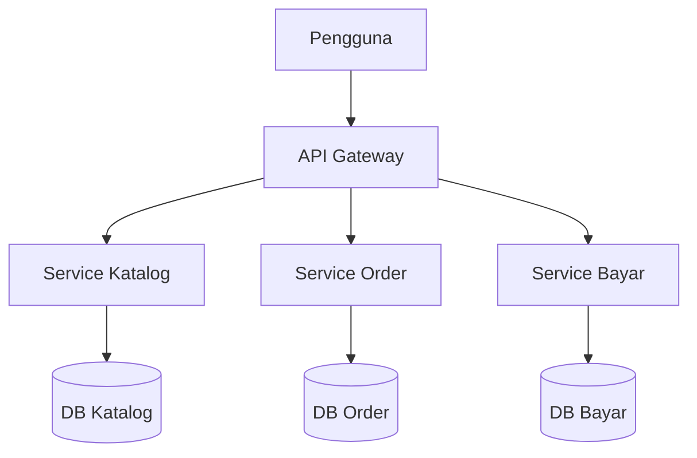
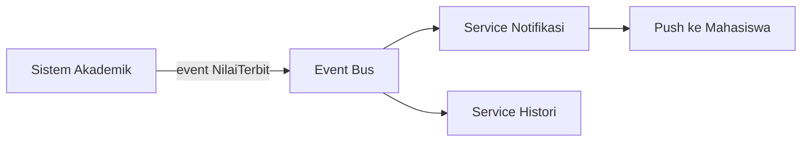

# Software Engineering | Sesi 09: Software Architecture Design Concepts and Styles

> **Mata Kuliah:** COMP6100001 - Software Engineering | **Sesi:** 09 | **Status:** Materi UTS

---

## 🔑 Cues
- Arsitektur = struktur high-level + keputusan sulit-diubah
- Bedakan requirements, architecture, OO design, code
- 8 styles: monolit, layered, client-server, MVC, MVVM, event-driven, SOA, microservices
- Trade-off tiap style
- Microservices ≠ selalu terbaik

---

## 📖 Materi Utama

### 1. Arsitektur adalah Big Picture yang Mengikat
- **Software architecture** = struktur fundamental sistem: komponen utama, hubungannya, dan prinsip yang memandu desain serta evolusinya.
- Tiga perannya: memandu design/implementation lewat constraints yang menjaga konsistensi; memungkinkan reuse pola yang terbukti; me-manage risiko lewat keputusan awal yang tepat.
- Keputusan arsitektur bersifat strategis — mahal diubah setelah implementasi berjalan.

### 2. Empat Level Pertanyaan
- **Requirements** menjawab apa: "sistem harus support 10.000 user". **Architecture (high-level design)** menjawab bagaimana di level tinggi: "pakai microservices demi scalability". **OO design (low-level)** menjawab detail: "pakai singleton untuk connection pool". **Code** adalah implementasi konkretnya.

### 3. Delapan Gaya Arsitektur
- **Monolithic:** UI + logic + DB satu unit deploy; satu shared database. Mudah dibangun, high performance satu memory space, 1 file/app deployment. Kelemahan: sulit di-maintain saat tumbuh, perubahan kecil berdampak ke semua, non-scalable. Pas untuk tim/proyek kecil.
- **Layered:** Presentation → Business → Data Access → Database, tiap layer tanggung jawab jelas. Well-structured dan mudah di-maintain/test per layer. Kelemahan: overhead komunikasi antar layer; over-engineered untuk app kecil. Pas untuk medium-large apps jangka panjang.
- **Client-Server:** client (UI) request ke server (logic + DB). Scalable horizontal di server, centralized control, client-server dikembangkan terpisah. Kelemahan: network dependency, server beban berat, single point of failure. Pas untuk web tradisional dan sistem internal.
- **MVC:** Model (data + logic), View (presentasi), Controller (terima request, ambil data, tampilkan). Separation jelas, parallel developing, unit testable. Kelemahan: overhead di struktur kecil, peran controller membingungkan. Pas untuk modern web app dengan tim frontend-backend terpisah.
- **MVVM:** varian MVC; ViewModel mengikat model ↔ view via data binding, auto-sync dengan View. Loosely coupled dan responsif untuk front-end heavy (Angular, React). Kelemahan: debugging data binding sulit. Tidak pas untuk backend-only.
- **Event-Driven:** komponen berkomunikasi lewat events. Pertukaran info lancar, integrasi mudah (termasuk legacy), reusable tinggi. Kelemahan: lebih kompleks dari monolit, overhead mirip microservices. Pas untuk real-time (notif/chat), games, IoT, finance alerts.
- **SOA:** services via protokol standar (SOAP, XML, HTTP) dengan reusable services dan standardized contracts. Highly scalable. Kelemahan: butuh infrastruktur komunikasi ekstra (ESB), kompleksitas distribusi dan manajemen service. Pas untuk enterprise besar dan integrasi legacy.
- **Microservices:** services kecil independen, masing-masing punya database, komunikasi via REST/message broker; mirip SOA tapi tanpa central service, tiap fungsi self-contained. Develop & deploy independen, highly scalable. Kelemahan: kompleks, butuh infrastruktur dan DevOps matang. Pas untuk big startup, SaaS, organisasi multi-tim.

---

## Library Diagram & Arsitektur

### Microservices Toko Online (Render Sendiri)

### Event-Driven Notifikasi Kampus (Contoh Sendiri)

---

## 🛠️ Use Case / Implementasi Nyata
- **Skenario:** Sistem parkir mall: gerbang tiket, tarif dinamis akhir pekan, dan dashboard okupansi real-time.
- **Masalah yang Diatasi:** Modul tarif sering berubah mengikuti promo, sementara gerbang tiket tidak boleh ikut down.
- **Keuntungan:** Gaya event-driven paling pas — gerbang memancarkan event masuk/keluar, service tarif dan dashboard bereaksi independen; perubahan aturan promo tak menyentuh kode gerbang sama sekali.

---

## 🗂️ Konsep Kunci

| Istilah | Definisi | Contoh / Catatan |
|---------|----------|-----------------|
| Software architecture | Struktur high-level + relasi + prinsip evolusi | Big picture sistem |
| Layered | Layer bertanggung jawab jelas | Presentation → Business → Data → DB |
| MVC / MVVM | Pisahkan data, UI, dan pengendali | Django/Laravel; Angular/React |
| Event-driven | Komunikasi via events | Chat, IoT, finance alerts |
| SOA | Service via kontrak standar | Integrasi enterprise/legacy |
| Microservices | Service kecil independen ber-DB sendiri | Netflix, Uber |

---

## 📊 Tabel Ringkasan

| Arsitektur | Cocok Untuk | Waspadai |
|---|---|---|
| Monolithic | Tim kecil, proyek kecil | Single point of failure |
| Layered | Apps medium-large jangka panjang | Overhead antar layer |
| Client-Server | Web tradisional, sistem internal | Server jadi bottleneck |
| MVC | Modern web app, tim terpisah | Controller membengkak |
| MVVM | Front-end heavy, reactive UI | Data binding sulit di-debug |
| Event-Driven | Real-time, IoT, games | Alur event sulit ditelusuri |
| SOA | Enterprise, integrasi legacy | Butuh ESB dan tata kelola |
| Microservices | Big startup, SaaS | Butuh DevOps matang |

---

## ⚠️ Catatan Penting
> **Tidak ada arsitektur sempurna** — pilih berdasarkan functional + non-functional requirements (scalability, performance, security, maintainability), ukuran tim, dan budget. Netflix dan Uber pun mulai dari monolit sebelum migrasi saat scale menuntut.

---

## 📝 Materi Tambahan (Visual Insights)
- Monolit yang tumbuh lazimnya di-decompose menjadi microservices; tiap service hasil pecahan pun biasanya berstruktur layered di dalamnya.
- MVC/MVVM adalah pola level aplikasi — ia bisa hidup di dalam client-server maupun microservices, bukan penggantinya.

---

## ✅ Standar Visual & Orisinalitas
- Sintesis orisinal sesi 09; diagram toko online, event notifikasi, dan contoh parkir milik sendiri; 8 styles beserta trade-off-nya merujuk materi asli.
