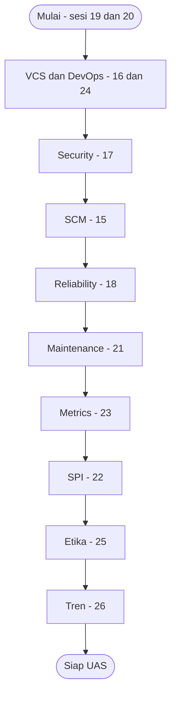

# Software Engineering | Sesi 15-26: Kisi-Kisi UAS

> **Mata Kuliah:** Rekayasa Perangkat Lunak (Software Engineering) | **Sesi:** 15-26 | **Status:** Materi UAS

---

## 🔑 Cues
- UAS: 10 essay, 100 poin, 120 menit, open book
- 8 studi kasus: LokerKu, SmartTani, KarirKita, PajakKita, KasirPintar, SantapKilat, NusaRail, SiKlaim
- RE = P × C; MTBF = MTTF + MTTR
- TDD Red-Green-Refactor; GQM Goal-Question-Metric
- Goodhart's Law; STRIDE; strangler fig
- Blue-green vs canary; GitFlow hotfix
- UU PDP No. 27 Tahun 2022; ACM 1.2 dan 1.6, IEEE Article 1

---

## 📖 Materi Utama

### 1. Format Ujian

| Komponen | Detail |
|----------|--------|
| Mata kuliah | Rekayasa Perangkat Lunak (Software Engineering), S1 Ilmu Komputer / Teknik Informatika |
| Cakupan | Sesi 15–26, semester genap 2025/2026 |
| Bentuk | Essay semua, 10 soal berbobot, total 100 poin |
| Waktu dan sifat | 120 menit, open book, dilarang bekerja sama |

### 2. Peta Sesi 15–26

| Sesi | Judul | Fokus |
|------|-------|-------|
| 15 | Software Configuration Management | SCI, baseline, change control |
| 16 | Version Control Systems and Dependency Management | Generasi VCS, Git, one-version rule |
| 17 | Secure Software Development | Secure SDLC, shift-left, serangan jaringan |
| 18 | Reliability Engineering and Fault Tolerance | MTBF/MTTR, redundancy, failover |
| 19 | Fundamentals of Software Testing | Levels, types, error–fault–failure |
| 20 | Automated Testing and TDD | Otomasi, Red-Green-Refactor, CI |
| 21 | Software Maintenance, Legacy Systems, Technical Debt | 4 tipe maintenance, strategi deployment, strangler fig |
| 22 | Software Process Improvement | SPI, CMM level 1–5 dan KPA |
| 23 | Metrics and Measurement | IEEE 1061, GQM, skala, Goodhart |
| 24 | DevOps Culture, Principles, Toolchains | CI/CD, toolchain, blameless postmortem |
| 25 | Legal, Social Impact, Professional Ethics | IP, lisensi, GDPR/CCPA, kode etik |
| 26 | Emerging Trends | Cloud, AI/ML, blockchain, quantum, open source |

### 3. Prioritas dan Urutan Belajar

| Prioritas | Topik | Sesi | Alasan |
|-----------|-------|------|--------|
| Tertinggi | Testing & TDD | 19, 20 | Fundamental, selalu diujikan |
| Tertinggi | VCS & CI/CD | 16, 24 | Praktik industri modern |
| Tertinggi | Secure development | 17 | Isu kritis sistem |
| Menengah | SCM | 15 | Perubahan dan baseline |
| Menengah | Reliability & fault tolerance | 18 | Sistem kritis |
| Menengah | Maintenance & tech debt | 21 | Lifecycle panjang |
| Menengah | Metrics | 23 | Pengukuran kualitas |
| Dasar | SPI | 22 | CMMI, maturity |
| Dasar | Legal, etik, sosial | 25 | Aspek non-teknis |
| Dasar | Emerging trends | 26 | AI, cloud, DevSecOps |

Urutan baca: Testing (19–20) → VCS & DevOps (16, 24) → Security (17) → SCM (15) → Reliability (18) → Maintenance (21) → Metrics (23) → SPI (22) → Etika (25) → Trends (26).

### 4. Pola Menjawab Essay
- **Definisi** konsep yang ditanya dengan kata sendiri. **Penjelasan** komponen/tahapan/aspek utama. **Contoh nyata** dari industri/kasus soal. **Perbandingan** bila diminta. **Diagram/skema** bila membantu.

---

## Library Diagram & Arsitektur

### Rute Belajar 12 Sesi



---

## 🛠️ Use Case / Implementasi Nyata
- **Skenario:** Memakai file ini sebagai simulator 120 menit: pilih satu kasus, tutup jawabannya, tulis jawaban essay, lalu bandingkan kelengkapan definisi–penjelasan–contoh–angka.
- **Masalah yang Diatasi:** Belajar pasif (baca ulang) yang gagal melatih recall bertekanan waktu.
- **Keuntungan:** Setiap kasus melatih pola essay lengkap plus angka kunci (48 jam, RE 7,2, rollback < 30 detik) yang sering jadi pembeda nilai.

---

## 🗂️ Konsep Kunci

| Istilah | Definisi | Contoh / Catatan |
|---------|----------|-----------------|
| Risk exposure | RE = P × C | R1 SmartTani: 0,8 × 9 = 7,2 |
| MTBF / MTTR | MTBF = MTTF + MTTR | Target pulih (MTTR) < 30 menit |
| Availability | MTTF/(MTTF+MTTR) × 100% | Kesiapan saat dibutuhkan |
| TDD | Test dulu, kode menyusul | Red → Green → Refactor |
| GQM | Goal → question → metric | Kerangka metrik top-down |
| Goodhart's Law | Target metrik merusak metrik | Bonus LOC → kode bertele-tele |
| Strangler fig | Ganti legacy bertahap paralel | Tanpa big-bang rewrite |
| Debt register | Daftar eksplisit tech debt | Basis prioritas pembayaran |

---

## 📊 Tabel Ringkasan

| Kasus | Sesi | Konsep yang Diuji |
|-------|------|-------------------|
| LokerKu (smart locker) | 19, 20 | TDD, category-partition, EP/BVA, regression, CI/CD, mock |
| SmartTani (IoT + ML tani) | 22, 23, 25 | RE, risk table, RMMM, etika rilis |
| KarirKita (job-matching) | 22, 23, 25 | Goodhart, SPI/CMMI, privacy by design, UU PDP |
| PajakKita (SPT online) | 17, 18, 21 | Vuln API, shift-left, fault tolerance, tech debt |
| KasirPintar (POS cloud) | 15, 16, 24 | SCM, hotfix GitFlow, pipeline, blue-green |
| SantapKilat (food delivery) | 24 | Budaya DevOps, toolchain, DevSecOps |
| NusaRail (sinyal kereta) | 23 | IEEE 1061, GQM, skala, LOC, McNamara |
| SiKlaim (asuransi legacy 15 thn) | 21, 16 | 4 maintenance, tacit knowledge, debt management |

---

## ⚠️ Catatan Penting
> **Angka adalah jangkar nilai** — cantumkan selalu: 48 jam LokerKu, RE per risiko, threshold rollback (error > 1%, respons > 3 s, payment timeout > 5 s), target metrik (coverage ≥ 70–80%, defect < 1/KLOC, pass ≥ 95%, MTTR < 30 mnt), dan rujukan hukum (UU PDP No. 27 Tahun 2022).

---

## 📝 Materi Tambahan (Visual Insights)

### Kasus 1 — LokerKu: Smart Locker (Sesi 19–20)
- Aturan bisnis: paket Kecil/Sedang/Besar hanya menempati loker sama atau lebih besar; kode pengambilan berlaku 48 jam; ambil via PIN atau QR; loker penuh → tolak graceful (pesan jelas, tanpa crash, beri alternatif); notifikasi via API pihak ketiga.
- **a. Konsep:** TDD = test dulu sebelum kode (Red → Green → Refactor), misal tulis `test_paket_kecil_masuk_ke_loker_sedang_jika_kecil_penuh()` dulu. Category-partition = pecah input ke kategori + pilihan lalu kombinasikan (ukuran paket, ketersediaan loker, masa kode, metode ambil). EP = uji per kelas ekuivalen (ukuran valid vs invalid); BVA = uji batas (47:59, tepat 48:00, 48:01). Regression = uji ulang fitur lama tiap ada perubahan (misal tambah ukuran Ekstra Besar).
- **b. Category-partition:** kategori Ukuran Paket (Kecil/Sedang/Besar/Invalid), Loker Cocok (ada/tidak), Masa Kode (<48/=48/>48 jam), Metode (PIN/QR). Empat TC: TC1 Kecil + loker Sedang + 20 jam + PIN → alokasi + PIN terkirim; TC2 Besar + tak ada loker → tolak graceful + saran; TC3 Sedang + tepat 48 jam → kedaluwarsa, tarik petugas; TC4 input invalid → error validasi tanpa crash.
- **c. TDD konkret:**

```python
def test_paket_kecil_bisa_masuk_loker_besar():
    result = alokasikan_loker(ukuran_paket="Kecil", loker_tersedia=["Besar"])
    assert result.status == "BERHASIL"

def test_paket_besar_tidak_bisa_masuk_loker_kecil():
    result = alokasikan_loker(ukuran_paket="Besar", loker_tersedia=["Kecil"])
    assert result.status == "DITOLAK"
```

Green minimal:

```python
URUTAN = {"Kecil": 1, "Sedang": 2, "Besar": 3}

def alokasikan_loker(ukuran_paket, loker_tersedia):
    for loker in loker_tersedia:
        if URUTAN[loker] >= URUTAN[ukuran_paket]:
            return AllokasiResult(status="BERHASIL", loker=loker)
    return AllokasiResult(status="DITOLAK")
```

Refactor: pindah `URUTAN` ke konfigurasi + validasi input. Ukuran Ekstra Besar cukup tambah `"Ekstra Besar": 4` + test baru; regression suite + pipeline CI (jalan tiap push, deploy hanya bila hijau) menangkap breaking change. API notifikasi di-mock/stub saat unit test agar tak flaky; integrasi nyata hanya di integration stage.

### Kasus 2 — SmartTani: IoT + ML Pertanian (Sesi 22, 23, 25)
- Konteks: ratusan sensor, ML belum pernah dipakai tim, akurasi awal tak terprediksi, hibah 8 bulan tak bisa tambah, tim mayoritas ahli pertanian.
- **a. Konsep:** RE = P × C, misal 0,7 × Rp 500 juta (salah tanam). Proactive (register + mitigasi di awal) vs reactive (respons setelah meledak) — SmartTani wajib proaktif karena gagal panen tak bisa dibalik. Risk (misal sensor mati saat hujan) vs impact (rekomendasi salah → petani rugi). Refinement: pecah "ML tak akurat" jadi data tak representatif, fitur tak relevan, overfitting data historis.
- **b. Risk table (urut RE):** R1 model ML tak teruji — Technology to be Built — P 0,8, C 9, RE 7,2, catastrophic. R2 tim bukan software engineer — Staff Size & Experience — 0,7 × 8 = 5,6, critical. R3 sensor gagal cuaca ekstrem — Technology to be Built — 0,6 × 7 = 4,2, critical. R4 dana habis — Budget — 0,5 × 8 = 4,0, critical. R5 tenggat ketat — Schedule — 0,6 × 6 = 3,6, marginal.
- **c. RMMM dua teratas:** R1 — mitigasi: baseline regresi linear + pilot 2–3 lahan + data scientist eksternal; monitoring: akurasi per sprint (target ≥ 75%); kontingensi: akurasi < 60% → fallback rule-based expert system. R2 — mitigasi: rekrut 1–2 tech lead + pelatihan agile/Git minggu pertama; monitoring: review code mingguan (complexity, coverage) + velocity; kontingensi: tertinggal > 2 sprint → outsource modul IoT gateway.
- **d. Etika:** konflik kewajiban kontraktual (kejar hibah) vs tanggung jawab profesional. ACM 1.2 (avoid harm) + IEEE Article 1 (utamakan keselamatan/kesejahteraan publik): model rendah akurasi bisa sebabkan salah tanam massal. Sikap: transparan ke stakeholder soal keterbatasan; rilis parsial sebagai advisory berlabel Beta + validasi penyuluh; tolak full deployment bila dipaksa tanpa disclaimer.

### Kasus 3 — KarirKita: Job-Matching (Sesi 22, 23, 25)
- Konteks: KPI jumlah fitur + kecepatan → bug dan tech debt meledak, review dan docs ditinggalkan; data perilaku kandidat dikumpulkan diam-diam untuk ranking perekrut.
- **a. Konsep:** Goodhart — "jumlah fitur" sebagai target berhenti jadi ukuran baik (vanity metric). SPI — perbaikan sistematis via CMMI/ISO 15504 (ganti metrik vanity dengan defect density, coverage). Privacy by design — privasi dirancang sejak awal, bukan tempelan; pengumpulan diam-diam melanggarnya. Etis vs legal — legal = wajib hukum (UU PDP: consent eksplisit); etis = standar moral di atas hukum (inferensi diskriminatif tetap salah walau lolos celah hukum).
- **b. Metrik & SPI:** sebab-akibat — kejar kuantitas → review dilewati → bug lolos; tanpa waktu refactor → debt menumpuk; docs tak dihitung output → tacit knowledge hilang. Tiga metrik seimbang: defect density per KLOC per sprint (kualitas), code coverage target ≥ 80% (maintainability), MTTR (keandalan). SPI ala CMMI Level 2: requirements management (acceptance criteria tertulis), monitoring & control (dashboard kualitas, bukan velocity saja), configuration management (PR ≥ 2 reviewer); target menengah Level 3 (defined).
- **c. Privasi & legal 3 lensa:** profesionalisme — kumpulkan diam-diam langgar kepercayaan (ACM 1.6 respect privacy); etika — inferensi perilaku berisiko diskriminasi algoritmik tak transparan; legal — UU No. 27 Tahun 2022 (UU PDP): consent eksplisit, hak akses/koreksi/hapus, sanksi administratif dan pidana. Risiko kandidat (diskriminasi, bocor) dan perusahaan (sanksi, reputasi, class action). Rekomendasi: data minimization, informed consent berbahasa sederhana, fairness audit berkala, explainability rekomendasi.

### Kasus 4 — PajakKita: SPT Online (Sesi 17, 18, 21)
- Konteks: bocor NPWP + penghasilan via endpoint API publik; down tiap tenggat; recovery lama; legacy penuh quick fix.
- **a. Konsep:** vulnerability (endpoint tanpa auth) vs threat (hacker ekstraksi NPWP) vs risk (P × dampak ke jutaan wajib pajak). Secure SDLC + shift-left: keamanan di tiap fase, dimajukan ke awal (threat modeling di requirements, SAST saat coding). Fault tolerance: tetap layani (atau gagal aman) saat komponen gagal. Technical debt: bunga jalan pintas — tiap fix kecil berisiko bug baru tanpa test coverage.
- **b. Keamanan API:** tiga vuln — broken access control (endpoint tanpa auth → bocor massal, sanksi, reputasi); data tak terenkripsi transit/at-rest (MITM, curi DB → privasi jutaan korban); input tak divalidasi → SQL injection (integritas rusak, fraud pajak). Shift-left: requirements/design — threat modeling STRIDE + least privilege per endpoint; coding — SAST SonarQube + AES-256 + sanitasi input; testing — DAST OWASP ZAP + pentest tiap rilis major; deployment — WAF + API gateway (rate limiting, OAuth2/JWT) + monitoring anomali.
- **c. Fault tolerance:** lonjakan trafik → redundancy + load balancing (≥ 3 instance, auto-scale saat CPU > 70%) — request tersebar, naik 10x tetap hidup. Crash + pulih lambat → failover active-passive (standby sinkron ambil alih, RTO < 30 detik) + checkpointing berkala (rollback ke checkpoint, RPO kecil). Bonus: graceful degradation — matikan sekunder (preview PDF real-time) agar inti terima SPT tetap jalan.
- **d. Debt & maintenance:** dampak — velocity melambat, bug rate tinggi (regression), onboarding sulit, security debt tersembunyi. Prioritas: corrective (bocor API) dan adaptive (TLS 1.3) segera; perfective (refactor modul hitung pajak) dan preventive (unit test modul kritis) menengah. Modernisasi strangler fig: komponen baru paralel, alihkan traffic bertahap, pensiunkan lama. Pencegahan: Definition of Done (coverage ≥ 80%, ≥ 2 reviewer, nol critical SonarQube), 20% kapasitas sprint untuk debt, debt register eksplisit.

### Kasus 5 — KasirPintar: POS Cloud (Sesi 15, 16, 24)
- Konteks: konflik merge antar tim, tanpa versioning/baseline (bug tak terlacak), deploy ke production jam operasional (kasir mati menit-menit), rollback manual lama, tanpa staging, tiap tim beda cara rilis.
- **a. Konsep:** SCM = disiplin kelola perubahan artefak; configuration item = kode, schema DB, config server, skrip deploy, docs API yang dikelola SCM. Baseline = snapshot CI disetujui sebagai acuan (misal Release Baseline v2.3.1); tanpa baseline tak ada rollback konsisten. CI (push → build + test otomatis) vs continuous delivery (siap deploy, rilis manual berizin) vs continuous deployment (lolos test langsung tayang). Rollback cepat vital karena tiap menit POS mati = transaksi riil gagal.
- **b. Hotfix:** CI yang dikelola — source semua branch, migration scripts, config staging/prod, deployment scripts, API contract, test suite, release notes. Change control: rutin via CCB (~48 jam, PR ≥ 2 reviewer, full regression, docs lengkap) vs darurat via tech lead + product owner real-time (< 1 jam, ≥ 1 senior reviewer, targeted test, post-incident review 24 jam). GitFlow:

```
main ───── hotfix/struk ───── v2.3.1 (tag)
develop ─── merge hotfix ──── lanjut
feature/laporan-multi-toko (tak terganggu)
```

Langkah: checkout main → branch hotfix → fix + test + commit → merge ke main → tag v2.3.1 → merge juga ke develop → deploy via pipeline. Cocok multi-tim: main selalu production-ready, develop menampung integrasi.

- **c. Pipeline & strategi:** push → build → unit test → SAST → integration test → deploy staging → regression + UAT → approval gate → deploy production (blue-green) → health check → traffic switch → monitor 30 menit → auto rollback bila gagal. Blue-green (dua environment identik, switch sekaligus, rollback instan) mengalahkan canary (bertahap per % user, rollback lambat, kasir beda versi) untuk POS yang menuntut konsistensi. Auto rollback dipicu error rate > 1%, respons > 3 detik, atau payment timeout > 5%; load balancer kembalikan traffic ke Blue < 30 detik.

### Kasus 6 — SantapKilat: Food Delivery (Sesi 24)
- Konteks: Dev–Ops silo dan saling salahkan, deploy manual lama, integrasi jarang (konflik menumpuk), tanpa monitoring real-time, config dev ≠ prod ("di saya jalan"), target rilis sering dan andal.
- **a. Konsep:** DevOps = hapus silo Dev–Ops demi delivery berkualitas kontinu. CI/CD seperti Kasus 5 (CI atasi konflik menumpuk; CD percepat rilis). Toolchain = rangkaian Plan (Jira) → Code (Git) → Build (Maven/Gradle) → Test (JUnit/Selenium) → Release (Jenkins/GitHub Actions) → Deploy (Kubernetes/Docker) → Operate (Nginx) → Monitor (Prometheus/Grafana). Blameless postmortem = bedah what/why tanpa who — pengganti budaya tuding.
- **b. Budaya + teknis:** shared ownership (dev ikut on-call), squad lintas fungsi, postmortem ≤ 48 jam (timeline, 5 Whys, action items). Teknis: CI (push harian, build + test otomatis) untuk integrasi; CD pipeline untuk rilis; IaC Terraform/Ansible untuk environment identik; Prometheus + Grafana + alert threshold untuk deteksi dini.
- **c. Toolchain:** Plan Jira/Linear (visibilitas); Code Git + GitHub (konflik); Build GitHub Actions/Jenkins (integrasi dini); Test Jest/Selenium/k6 (regresi); Release ArgoCD/Actions (akhiri manual); Deploy Docker + Kubernetes (environment identik + auto-scale lonjakan); Operate Terraform + Ansible (konsistensi); Monitor Prometheus + Grafana + ELK (alert real-time sebelum komplain).
- **d. Adopsi + DevSecOps:** tantangan — resistensi senior (solusi: jadikan DevOps champion + quick win 2 sprint), skills gap Docker/K8s (pelatihan bertahap), tooling overload (fase: bulan 1–2 Git + CI, 3–4 Docker, 5–6 CD + monitoring). DevSecOps (data + pembayaran): SAST tiap push, dependency scanning (Snyk/Dependabot), secrets di Vault/AWS Secrets Manager (bukan di kode), scan image container (Trivy), security gate + kepatuhan PCI-DSS sebelum deploy.

### Kasus 7 — NusaRail: Sinyal Kereta (Sesi 23)
- Konteks: safety-critical; rencana bonus berbasis LOC/hari + sedikit bug; LOC sebagai ukuran kompleksitas/produktivitas; temuan "modul berdokumen tebal = sedikit bug" ingin dijawab dengan mewajibkan dokumentasi.
- **a. Konsep:** quality metric (IEEE 1061) = fungsi entity → attribute → measurement (modul sinyal → keandalan → MTBF), bukan hitung LOC. GQM = goal → questions → metrics (goal keandalan → "seberapa sering gagal?" → MTBF/failure rate). Goodhart: bonus LOC → kode bertele-tele; bonus sedikit-bug → bug disembunyikan — keselamatan penumpang taruhannya.
- **b. GQM:** goal — purpose mengevaluasi, issue keandalan dan keselamatan, object modul kendali sinyal, viewpoint safety engineer. Q1 seberapa sering gagal operasi normal → MTBF (waktu operasi/jumlah gagal) + failure rate per 1.000 jam (benchmark DO-178C). Q2 seberapa cepat pulih → MTTR (deteksi → normal kembali; downtime lama = bahaya).
- **c. Skala & LOC:** keparahan bug (Critical/High/Medium/Low) = ordinal — boleh diurut, tak boleh dirata-rata. Peringkat keahlian (Junior/Mid/Senior) = ordinal — rata-ratanya tak bermakna. Latensi (ms) = rasio — nol mutlak, semua operasi sah. Jalur independen (cyclomatic complexity) = rasio — sama sahnya. LOC hanya ukur volume, bukan logika/nilai; McNamara fallacy (ukur yang mudah, abaikan keamanan/keterbacaan); streetlight effect (optimalkan yang terang, bukan yang relevan); 1.000 LOC sampah ≠ 50 LOC elegan. Korelasi docs–bug bukan kausalitas: mewajibkan dokumentasi tanpa paham sebabnya tak menurunkan bug.

### Kasus 8 — SiKlaim: Asuransi Legacy (Sesi 21, 16)
- Konteks: 15 tahun, penulis awal pergi, docs minim/usang, quick fix + hardcoded, tanpa automated test, commit langsung ke main, PR raksasa; lima pekerjaan: bug crash klaim, kompatibilitas DB/OS baru, fitur lacak status, regulasi OJK, rapikan modul premi.
- **a. Konsep:** technical debt = metafora finansial keputusan jangka pendek berbunga; tak sama dengan kualitas buruk — debt bisa sadar (cepat kini, bayar nanti), kualitas buruk adalah debt tak terbayar (SiKlaim: 15 tahun tanpa bayar). 4 maintenance: corrective (bug crash), adaptive (DB/OS baru, regulasi OJK), perfective (fitur lacak status), preventive (refactor + test modul premi). Refactoring = restruktur internal tanpa ubah perilaku (hardcoded → konfigurasi, pecah fungsi, tambah test). Bitrot = software "membusuk" tanpa diubah karena lingkungan berubah (OS, library deprecated, API pihak ketiga).
- **b. Klasifikasi:** 1 crash klaim → corrective (defect produksi). 2 DB/OS baru → adaptive (lingkungan eksternal). 3 fitur lacak → perfective (fungsi baru). 4 regulasi OJK → adaptive (eksternal regulasi). 5 refactor + test premi → preventive (risiko masa depan).
- **c. Engineer baru vs tacit knowledge:** pengetahuan tak tertulis (alasan keputusan, workaround DB lama, aturan informal) hilang bersama penulisnya → arkeologi kode. Langkah: temukan entry point (`hitungPremi()`/endpoint, via find references); static gathering (baca alur, hardcoded, dependensi, peta SonarQube); build + jalankan lokal (dokumentasikan hambatan); dynamic gathering (debugger + breakpoints input nyata); probes (log sementara titik kritis); characterization test dulu (kunci perilaku existing) baru modifikasi — lolos semua = tak ada yang rusak di luar niat.
- **d. Debt management:** akumulasi — tenggat → quick fix; commit ke main tanpa review; PR raksasa tak terreview; docs buruk → workaround di atas workaround. Identifikasi: code review (code smell), SonarQube (smell, hotspot, coverage gap, complexity > 15), survei "area yang takut disentuh". Prioritas: matriks risk × business value (modul klaim crash dulu, regulasi OJK, UI usang terakhir). Strategi: debt register, boy scout rule, 1 debt sprint per bulan, code ownership per modul, wajib PR (≥ 2 reviewer, tanpa commit ke main). Metrik pantau: defect density < 1/KLOC, regression pass ≥ 95%, MTTR < 30 menit, coverage ≥ 70%, complexity rata-rata < 10.

---

## ✅ Standar Visual & Orisinalitas
- Sintesis orisinal bank soal UAS sesi 15–26 (sumber LatSol_UAS 1–10); struktur, rute belajar, dan narasi milik sendiri; seluruh fakta kasus, angka, rumus, perintah, dan kode merujuk materi asli. Jawaban adalah panduan belajar — elaborasi pribadi sangat dianjurkan.
