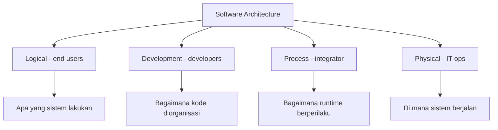

# Software Engineering | Sesi 10: Software Architecture Documentation and Patterns

> **Mata Kuliah:** Software Engineering | **Sesi:** 10 | **Status:** Materi UTS

---

## 🔑 Cues
- 4 tujuan dokumentasi arsitektur
- Overview vs detailed, high vs low level
- ADL: UML dan Acme
- 4 views Kruchten + audiensnya
- ATAM vs CBAM, prototyping, peer review
- Legend wajib; decisions > diagrams

---

## 📖 Materi Utama

### 1. Mengapa Arsitektur Didokumentasikan
- **Blueprint for system design:** panduan teknis membangun sistem.
- **Communication tool:** jembatan developers–stakeholders–project managers.
- **Design consistency:** seluruh tim mengikuti pola dan standar yang sama.
- **Knowledge transfer:** keputusan + justifikasinya tidak ikut hilang saat personel berganti.

### 2. Level dan Tipe Dokumen
- **Overview documents:** high-level — tujuan sistem, pilihan desain utama, constraints; untuk stakeholder non-teknis.
- **Detailed design documents:** komponen, koneksi, aliran data, langkah keamanan; untuk tim teknis (struktur kode, algoritma, integrasi).

### 3. Bahasa Deskripsi Arsitektur (ADL)
- **ADL** = bahasa khusus untuk komponen, konektor, dan konfigurasi sistem.
- Dua contoh utama: **UML** (standar industri diagram visual: class, sequence, use case) dan **Acme** (ADL riset untuk gaya dan pola arsitektural).
- Manfaat: deteksi error dini, otomasi pembuatan kode, analisis desain lebih dalam.

### 4. Empat Views dan Pemiliknya
- **Logical view:** fungsionalitas dan interaksi komponen utama (modul Login, Dashboard) — untuk end users.
- **Development view:** organisasi modul, layers, dan dependensinya — untuk developers.
- **Process view:** perilaku runtime — konkurensi, sinkronisasi, komunikasi proses — untuk system integrator.
- **Physical view:** deployment, topologi jaringan, hardware (server, cloud nodes) — untuk IT ops.
- Aturan penyajian: tiap view idealnya muat satu halaman; level abstraksi di subsistem/proses (bukan class/object); **setiap diagram wajib ber-legenda** menjelaskan arti kotak dan garis.

### 5. Evaluasi dan Validasi
- **ATAM (Architecture Tradeoff Analysis Method):** memahami trade-off atribut kualitas (keamanan vs performa).
- **CBAM (Cost-Benefit Analysis Method):** dampak ekonomi/ROI keputusan arsitektural.
- **Prototyping:** versi skala kecil penguji asumsi. **Peer reviews:** review ahli pendeteksi cacat desain sejak awal.

---

## Library Diagram & Arsitektur

### Empat Views dan Audiensnya

---

## 🛠️ Use Case / Implementasi Nyata
- **Skenario:** Dokumentasi arsitektur sistem informasi kos-kosan (kamar, tagihan, komplain) yang dikerjakan 3 angkatan asisten berbeda.
- **Masalah yang Diatasi:** Tiap angkatan menebak ulang maksud angkatan sebelumnya; integrasi payment gateway dua kali jebol karena asumsi kontrak API yang salah.
- **Keuntungan:** Satu halaman logical view + kontrak antar komponen yang terdokumentasi membuat angkatan baru produktif dalam seminggu; peer review desain mencegah error integrasi sebelum jadi kode.

---

## 🗂️ Konsep Kunci

| Istilah | Definisi | Contoh / Catatan |
|---------|----------|-----------------|
| ADL | Bahasa formal deskripsi arsitektur | UML, Acme |
| ATAM | Analisis trade-off atribut kualitas | Keamanan vs performa |
| CBAM | Analisis biaya-manfaat keputusan arsitektur | Fokus ROI desain |
| Legend | Keterangan arti kotak dan garis | Wajib di tiap diagram |

---

## 📊 Tabel Ringkasan

| Pattern | Karakteristik | Kapan Dipakai |
|---------|---------------|---------------|
| Layered | Separation of concerns jelas | Alur UI–logic–data sederhana |
| Client-Server | Pembagian request–provide | App database, sistem terdistribusi |
| Microservices | Loosely coupled, deploy independen | Sistem besar butuh fleksibilitas |
| Event-Driven | Responsif real-time | Feed sosmed, notifikasi |

---

## ⚠️ Catatan Penting
> **Dokumentasi arsitektur bukan soal gambar** — yang menentukan umur panjang sistem adalah keputusan (decisions) dan alasannya (why) yang tercatat, bukan indahnya diagram.

---

## 📝 Materi Tambahan (Visual Insights)
- Microservices = layanan loosely coupled dengan independent deployment; risiko integrasinya nyata — menggabung dua fitur tanpa kontrak jelas mudah memicu konflik.
- Standards dokumentasi menjaga konsistensi pemakaian ADL; views yang berbeda menjawab stakeholder yang berbeda.

---

## ✅ Standar Visual & Orisinalitas
- Sintesis orisinal sesi 10; diagram views dan contoh kos-kosan milik sendiri; 4 views, ATAM/CBAM, dan aturan legenda merujuk materi asli.
