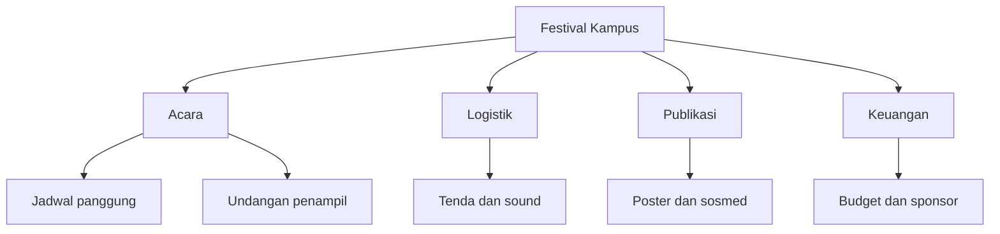
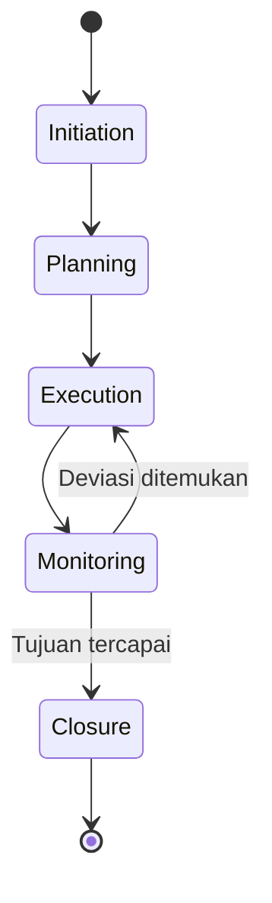

# Software Engineering | Sesi 11: Project Management and Planning

> **Mata Kuliah:** COMP6100001 - Software Engineering | **Sesi:** 11 | **Status:** Materi UTS

---

## 🔑 Cues
- 5 aktivitas manajemen proyek
- 4P: People, Product, Process, Project
- EM vs TL vs TLM + 3 aturan emas
- Pola manajer positif vs antipattern
- W5HH dan WBS
- Engineering for equity (kasus 2015)

---

## 📖 Materi Utama

### 1. Lima Aktivitas Manajemen
- **Initiation** (definisikan proyek), **Planning** (scope, tujuan, prosedur), **Execution** (koordinasi orang + resource), **Monitoring & Control** (lacak kemajuan dan kinerja), **Closure** (formalisasi penerimaan dan penutupan).

### 2. Spektrum 4P
- **People:** stakeholder (senior manager, praktisi, customer, user) dan organisasi tim. **Product:** scope software, konteks bisnis, tujuan informasi. **Process:** pilih model proses yang pas (communication, planning, modeling, construction, deployment). **Project:** strategi pragmatis mengontrol, melacak, memantau proyek teknis kompleks.

### 3. Kepemimpinan Engineering
- **Engineering Manager (EM):** kinerja, produktivitas, dan kebahagiaan tiap anggota tim. **Tech Lead (TL):** sisi teknis — arsitektur, keputusan teknologi, prioritas, velocity. **Tech Lead Manager (TLM):** merangkap keduanya.
- Tiga aturan emas: **always be deciding** (fokus strategi dan trade-off), **always be leaving** (bangun self-driving team), **always be scaling** (penting > mendesak). Plus tugas senyap: shield team from chaos — beri air cover agar tim fokus.

### 4. Pola Manajer: Lakukan vs Hindari
- Lakukan: lose the ego (humble), be a catalyst, remove roadblocks, track happiness.
- Hindari: hire pushovers (cari penurut), ignore low performers, treat team like children (micromanage), be everyone's friend (gagal tegas).

### 5. Perencanaan Praktis: W5HH + WBS
- **W5HH** (why, what, when, who, where, how, how much) menetapkan objektif dan jadwal; **WBS** memecah proyek jadi paket kerja hierarkis yang menjawab what dan how much.

### 6. Engineering for Equity
- Kasus Google Photos (2015): algoritma salah mengklasifikasi orang kulit hitam sebagai "gorila" karena dataset tak lengkap dan organisasi bias.
- Pelajaran: diversity as default sejak desain, dataset representatif seluruh populasi target, designing for the edge (rancang untuk yang paling tidak mirip pengembang) — pengalaman semua orang ikut naik.

---

## Library Diagram & Arsitektur

### WBS Festival Kampus (Contoh Sendiri)

### Siklus Fase Manajemen

---

## 🛠️ Use Case / Implementasi Nyata
- **Skenario:** Ketua tim proyek akhir 5 orang membangun kasir kantin dalam 14 minggu.
- **Masalah yang Diatasi:** Awalnya semua orang mengerjakan semua hal; dua minggu sebelum demo tidak ada yang bisa di-demo.
- **Keuntungan:** Dengan W5HH + WBS mini, scope dipatok (kasir + stok saja, tanpa loyalty), peran dibagi (1 TL merangkap TLM + 4 dev), dan monitoring mingguan menangkap keterlambatan modul stok di minggu ke-6 — masih sempat di-crashing.

---

## 🗂️ Konsep Kunci

| Istilah | Definisi | Contoh / Catatan |
|---------|----------|-----------------|
| W5HH | Kerangka objektif dan jadwal proyek | Why, what, when, who, where, how, how much |
| WBS | Dekomposisi hierarkis pekerjaan | Menjawab what dan how much |
| Bias default | Mengabaikan kelompok tertentu dalam desain | Sering tak disengaja, tim kurang beragam |
| Delegation | Penyerahan tanggung jawab teknis | Menumbuhkan kapasitas tim dan pemimpin |
| Scope creep | Scope melar tanpa kontrol formal | Buah perencanaan lemah |

---

## 📊 Tabel Ringkasan

| Lakukan (Positive) | Hindari (Antipattern) |
|---|---|
| Lose the ego | Hire pushovers |
| Be a catalyst | Ignore low performers |
| Remove roadblocks | Treat team like children |
| Track happiness | Be everyone's friend |

---

## ⚠️ Catatan Penting
> **Pemimpin melindungi tim dari kekacauan luar** — air cover organisasional adalah prasyarat fokus; tanpa itu, planning terbaik pun bocor oleh distraksi.

---

## 📝 Materi Tambahan (Visual Insights)
- Resolusi konflik: jangan asumsikan niat orang; bicarakan dampaknya; jika terpicu, jeda 1 jam; minta bantuan teknis dengan formula "saya mencoba X supaya Y, tapi menemui Z" agar tak duplikat kerja.
- Rantai 4P: people yang bahagia menjalankan process lebih baik → product berkualitas → project terencana.

---

## ✅ Standar Visual & Orisinalitas
- Sintesis orisinal sesi 11; WBS festival dan contoh kasir milik sendiri; 4P, 3 aturan emas, pola manajer, dan kasus 2015 merujuk materi asli.
