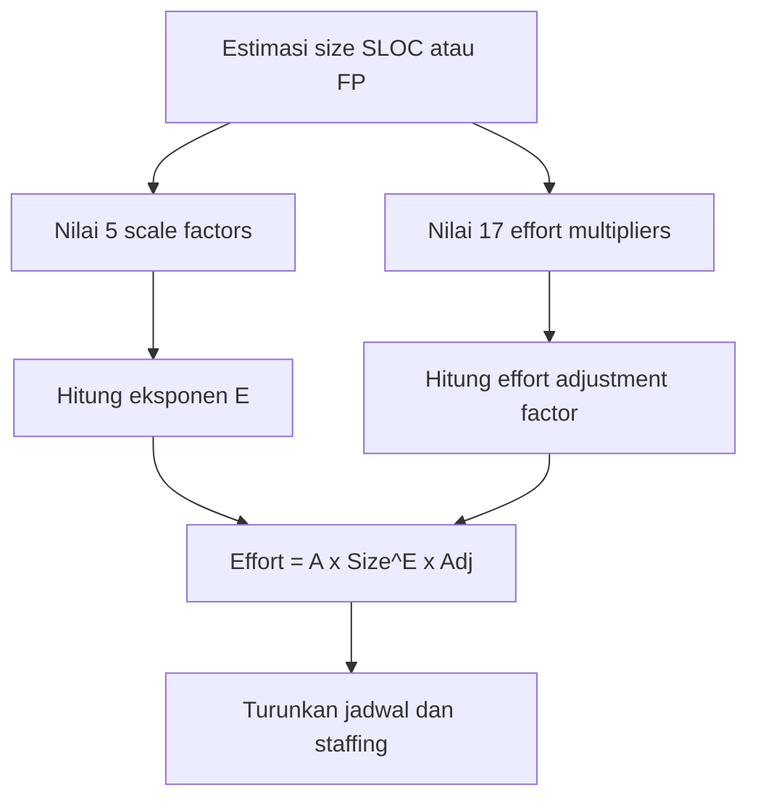

# Software Engineering | Sesi 12: Project Estimation Techniques

> **Mata Kuliah:** COMP6100001 - Software Engineering | **Sesi:** 12 | **Status:** Materi UTS

---

## 🔑 Cues
- 4 teknik estimasi dasar + PERT
- TE = (O + 4M + P) / 6
- FPA: 5 komponen + VAF (14 GSC, TDI)
- UCP = UUCP × TCF × EF
- COCOMO II: 3 model, 5 SF, 17 EM
- Contoh hitung: (3 + 20 + 10) / 6 = 5,5 hari

---

## 📖 Materi Utama

### 1. Empat Teknik Estimasi Dasar
- **Expert judgement:** intuisi ahli — cepat tapi subjektif. **Analogous:** data historis proyek sejenis. **Parametric:** model matematis (misal biaya per LOC). **Three-point (PERT):** merangkul ketidakpastian dengan rumus TE = (O + 4M + P) / 6 (O = optimis, M = most likely, P = pesimis).

### 2. Mengukur Ukuran Software
- **Function Point Analysis (FPA):** mengukur fungsionalitas dari desain logis via 5 komponen — External Inputs (EI), External Outputs (EO), External Inquiries (EQ), Internal Logical Files (ILF), External Interface Files (EIF).
- **VAF (Value Adjustment Factor):** penyesuai dari 14 karakteristik sistem umum (GSC) dengan total skor **TDI** (Total Degree of Influence).
- **Use Case Points (UCP):** estimasi dari skenario interaksi — gabungan Unadjusted Use Case Weight (UUCW) + Unadjusted Actor Weight (UAW) menjadi UUCP, disesuaikan Technical Complexity Factors (TCF) dan Environmental Factors (EF): UCP = UUCP × TCF × EF. Paling relevan untuk desain berorientasi objek di tahap requirements/analisis.

### 3. Dari Ukuran ke Usaha: COCOMO II
- Tiga model sesuai kematangan: **Application Composition** (prototyping), **Early Design** (berbasis function point), **Post-Architecture** (paling detail, basis LOC/FP).
- Dua penentunya: **5 Scale Factors** (PREC, FLEX, RESL, TEAM, PMAT) penentu skala ekonomi, dan **17 Effort Multipliers** (atribut product, platform, personnel, project).
- Langkah post-architecture: estimasi size (abaikan kode lama tak dimodifikasi) → rating SF (very low–extra high) → rating EM → hitung effort → turunkan jadwal dan staffing.

---

## Library Diagram & Arsitektur

### Alur Kalkulasi COCOMO II Post-Architecture

---

## 🛠️ Use Case / Implementasi Nyata
- **Skenario:** Estimasi fitur "ekspor rekap nilai" di sistem akademik fakultas; integrasi databasenya belum pasti stabil.
- **Masalah yang Diatasi:** Satu angka tebakan ("seminggu") selalu meleset dan memicu lembur.
- **Implementasi PERT:** Optimis 2 hari (API siap), realistis 4 hari, pesimis 9 hari (sinkronisasi bermasalah) → TE = (2 + 16 + 9) / 6 = **4,5 hari**.
- **Keuntungan:** Angka berbobot yang bisa dipertahankan ke ketua tim, lengkap dengan rentang risikonya.

---

## 🗂️ Konsep Kunci

| Istilah | Definisi | Contoh / Catatan |
|---------|----------|-----------------|
| LOC / SLOC | Baris kode sumber | Metrik ukuran tradisional |
| Function point | Unit fungsionalitas software | Independen bahasa pemrograman |
| TDI | Total Degree of Influence | Jumlah skor 14 GSC |
| Scale factor | Faktor efisiensi skala proyek | TEAM (kohesi), PMAT (kematangan) |

---

## 📊 Tabel Ringkasan

| Karakteristik | Function Point (FPA) | Use Case Point (UCP) |
|---------------|----------------------|----------------------|
| Basis | Elemen data & transaksi | Skenario interaksi user |
| Dipakai saat | Analisis/desain logis | Requirements/analisis |
| Penyesuai | 14 GSC teknis (VAF) | TCF teknis + EF lingkungan |
| Keunggulan | Standar industri luas | Relevan untuk OO |

| Contoh PERT e-commerce | Nilai |
|---|---|
| Optimis (API stabil) | 3 hari |
| Realistis (rata-rata tim) | 5 hari |
| Pesimis (DB bermasalah) | 10 hari |
| TE = (3 + 20 + 10) / 6 | **5,5 hari** |

---

## ⚠️ Catatan Penting
> **Pecah tugas besar sebelum mengestimasi, dan lawan conformity bias** — mengikuti pendapat mayoritas tanpa data menghasilkan angka konsensus yang rapi tapi salah.

---

## 📝 Materi Tambahan (Visual Insights)
- Rantai estimasi: software sizing (FP/LOC) → COCOMO II → effort (orang-bulan) → jadwal + staffing.
- TCF di UCP dan VAF di FPA memainkan peran sejajar: mengoreksi angka mentah berdasarkan kesulitan teknis sistem.

---

## ✅ Standar Visual & Orisinalitas
- Sintesis orisinal sesi 12; contoh rekap nilai dan hitungan 4,5 hari milik sendiri; rumus TE, komponen FPA/UCP, fakta COCOMO II, dan hitungan 5,5 hari merujuk materi asli.
