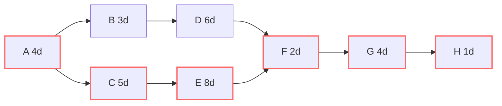
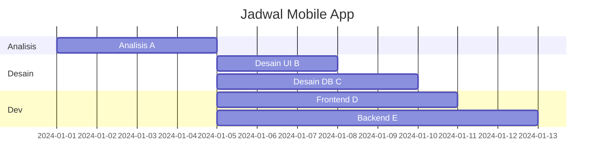

# Software Engineering | Sesi 13: Project Scheduling

> **Mata Kuliah:** COMP6100001 - Software Engineering | **Sesi:** 13 | **Status:** Materi UTS

---

## 🔑 Cues
- 4 guna penjadwalan
- Gantt vs PERT vs CPM
- ES, EF, LS, LF, Float = LS − ES
- Critical path = float nol
- Contoh A–H: jalur 2 (24 hari) kritis
- Fast tracking vs crashing

---

## 📖 Materi Utama

### 1. Mengapa Jadwal Dibuat Serius
- **Timeline tegas:** kapan tugas dan milestones selesai. **Resource planning:** alokasi tim dan peralatan. **Mitigasi risiko:** bottleneck terlihat sebelum terjadi (dasar kontinjensi). **Komunikasi stakeholder:** progres punya representasi visual.

### 2. Tiga Teknik Penjadwalan
- **Gantt chart:** visualisasi timeline berbasis batang — komponennya tugas, durasi, dependensi, milestones. Mudah dipahami dan dikomunikasikan.
- **PERT chart:** diagram jaringan node (event) + arrow (aktivitas) yang menonjolkan dependensi; kuat untuk durasi tugas yang tak pasti.
- **Critical Path Method (CPM):** jalur aktivitas dependen terpanjang = durasi minimum proyek.

### 3. Matematika Jalur Kritis
- **Forward pass:** Earliest Start (ES) = waktu tercepat mulai; Earliest Finish (EF) = ES + durasi.
- **Backward pass:** Latest Finish (LF) = batas lambat selesai tanpa menunda proyek; Latest Start (LS) = LF − durasi.
- **Float (slack)** = LS − ES = fleksibilitas tugas. **Jalur kritis** = rangkaian tugas ber-float nol.
- Fakta dinamis: jalur kritis bisa berpindah — tugas non-kritis yang telat melebihi float-nya menjadi kritis baru.

### 4. Studi Kasus: Aplikasi Mobile A–H
- Durasi: A analisis 4, B desain UI 3, C desain DB 5, D frontend 6, E backend 8, F integrasi 2, G testing 4, H deployment 1 (hari).
- Jalur 1 (A-B-D-F-G-H) = 20 hari; jalur 2 (A-C-E-F-G-H) = **24 hari → critical path**. Telat 1 hari di C atau E = peluncuran mundur 1 hari. Respons manajerial: pasang resource terbaik di jalur 2.

### 5. Mempercepat Jadwal
- **Fast tracking:** sekuensial diparalelkan — risiko rework tinggi. **Crashing:** tambah resource di jalur kritis — biaya naik, hasil tak selalu linear.
- Pendukung: **timeboxing** (periode tetap ala sprint Agile), **resource leveling** (selaraskan jadwal dengan ketersediaan tim), milestones (misal "Beta Version Released"), tooling kolaboratif (Jira, Asana), dan update jadwal rutin.

---

## Library Diagram & Arsitektur

### Network Diagram A–H (Jalur Kritis)

Garis merah = critical path (A-C-E-F-G-H, 24 hari).

### Gantt Mini Proyek Mobile

---

## 🛠️ Use Case / Implementasi Nyata
- **Skenario:** Panitia wisuda fakultas menyusun 9 pekerjaan (venue, toga, konsumsi, dokumentasi...) dengan tenggat gedung yang tak bisa mundur.
- **Masalah yang Diatasi:** Semua divisi mengira pekerjaannya "santai" sampai H-7 venue belum pasti.
- **Keuntungan:** CPM versi kertas menunjukkan pemesanan venue + perizinan adalah jalur kritis ber-float nol; konsumsi yang ber-float 5 hari digeser untuk menolong divisi venue — tepat guna prinsip float.

---

## 🗂️ Konsep Kunci

| Istilah | Definisi | Contoh / Catatan |
|---------|----------|-----------------|
| Milestone | Titik signifikan proyek | Beta version released |
| Float / slack | Fleksibilitas waktu tugas (LS − ES) | Nol = kritis |
| Timeboxing | Periode tetap untuk sebuah proses | Sprint Agile |
| Crashing | Tambah resource ke jalur kritis | Cepat tapi mahal |
| Resource leveling | Selaraskan jadwal vs ketersediaan tim | Cegah overload satu orang |

---

## 📊 Tabel Ringkasan

| Teknik Percepatan | Cara | Risiko |
|---|---|---|
| Fast tracking | Sekuensial jadi paralel | Rework tinggi |
| Crashing | Tambah resource jalur kritis | Biaya naik, hasil tak linear |

---

## ⚠️ Catatan Penting
> **Jadwal adalah dokumen hidup** — critical path hari ini belum tentu critical path minggu depan; perbarui berkala mengikuti progres nyata.

---

## 📝 Materi Tambahan (Visual Insights)
- Gantt memberi pandangan makro jadwal; CPM/PERT memberi pandangan mikro dependensi dan risiko keterlambatan — keduanya komplementer, bukan pengganti.
- Diagram besar dipecah hierarkis agar tiap halaman hanya memuat satu view yang mudah dibaca.

---

## ✅ Standar Visual & Orisinalitas
- Sintesis orisinal sesi 13; contoh wisuda milik sendiri; rumus ES/EF/LS/LF, data A–H, dan teknik percepatan merujuk materi asli.
