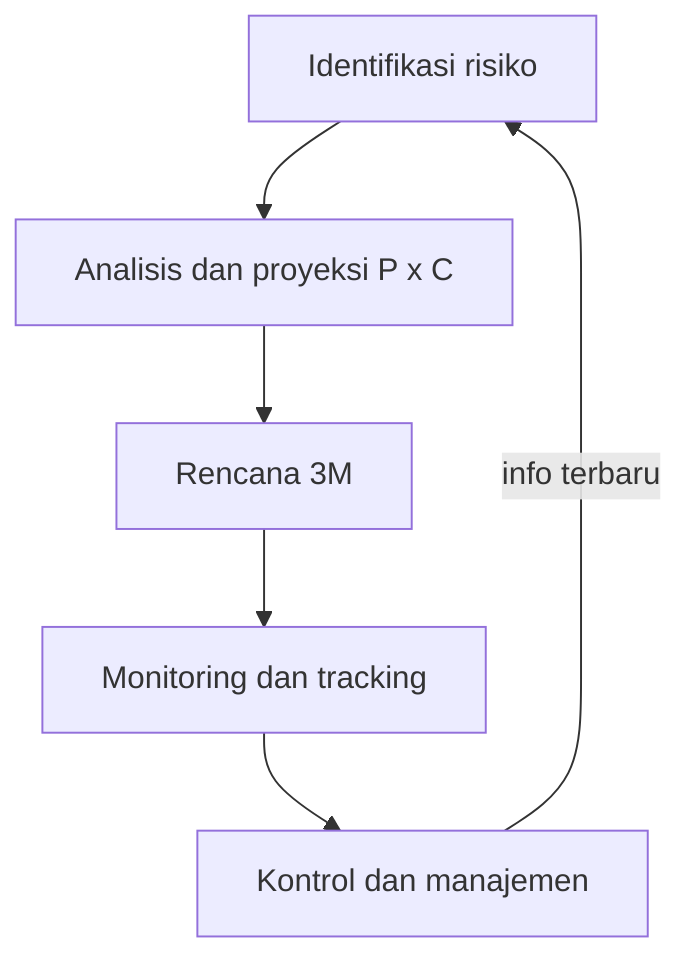
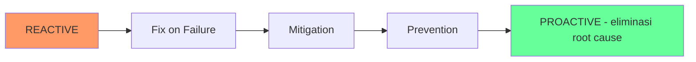

# Software Engineering | Sesi 14: Risk Analysis and Management

> **Mata Kuliah:** COMP6100001 - Software Engineering | **Sesi:** 14 | **Status:** Materi UTS

---

## 🔑 Cues
- Risiko = probability × consequences
- Reactive vs proactive
- 5 level manajemen risiko
- RE = P × C (contoh $20.200)
- Skala dampak 1–4
- Strategi 3M + CI

---

## 📖 Materi Utama

### 1. Anatomi Risiko
- **Risiko** = ukuran potensi gagal mencapai tujuan program (biaya, jadwal, teknis) dalam batasan yang ditentukan.
- Dua komponen: **Probability (P)** — peluang kegagalan terjadi; **Consequences (C)** — kerugian bila benar-benar terjadi. Risiko **internal** bisa dikontrol tim (kualitas kode); **eksternal** di luar kontrol (perubahan pasar).
- Tiga wajah risiko produk: performance (tak kuat 1000 user), cost (anggaran membengkak), schedule (timeline mundur).

### 2. Dua Postur: Pemadam vs Pencegah
- **Reactive (pemadam kebakaran):** bertindak setelah terjadi — fix on failure, fokus krisis dan perbaikan pasca-gagal.
- **Proactive (pencegahan):** analisis formal sebelum masalah muncul — cabut root causes dan kelola perubahan sejak dini.

### 3. Lima Level Kematangan
- Level 1 **crisis management** (terburuk: tangani setelah jadi masalah besar) → level 2 **fix on failure** (reaksi cepat tapi tetap sesudahnya) → level 3 **risk mitigation** (siapkan resource penutup tanpa menghilangkan risiko) → level 4 **prevention** (rencana aktif pencegah) → level 5 **elimination of root causes** (terbaik).

### 4. Menguangkan Risiko: Risk Exposure
- **Proyeksi risiko** menilai probabilitas dan konsekuensi pada skala dampak 1–4 (catastrophic, critical, marginal, negligible).
- **RE = P × C.** Studi kasus reuse: asumsi 70% komponen lama bisa dipakai ulang ternyata berisiko gagal — P = 80%, C = 18 komponen × 100 LOC × $14/LOC = $25.200 → **RE ≈ $20.200**. Dengan angka ini tim bisa menyiapkan buffer atau membatalkan reuse sejak awal.

### 5. Strategi 3M dan Perangkatnya
- **Mitigation** (hindari/cegah — didukung otomatisasi seperti Continuous Integration), **Monitoring** (lacak indikator via track milestones), **Management** (rencana kontinjensi/backup plan).
- Setiap risiko didokumentasikan di **Risk Information Sheet**: ID, deskripsi, probabilitas, dampak, strategi 3M.

---

## Library Diagram & Arsitektur

### Siklus Manajemen Risiko

### Spektrum Postur Risiko

---

## 🛠️ Use Case / Implementasi Nyata
- **Skenario:** Tim Himpunan membangun sistem voting ketua; satu-satunya yang paham server akan lulus 2 bulan sebelum hari-H.
- **Masalah yang Diatasi:** Bus factor = 1 — bila ia sibuk skripsi, tidak ada yang bisa deploy.
- **Keuntungan:** Didaftar sebagai risiko (P tinggi, C critical) dengan 3M: mitigasi via pairing + dokumentasi deploy sejak awal, monitoring via checklist kesiapan mingguan, kontingensi berupa paket deploy sekali-klik — pola proactive level 4–5, bukan panik H-1.

---

## 🗂️ Konsep Kunci

| Istilah | Definisi | Contoh / Catatan |
|---------|----------|-----------------|
| Risk exposure | Kuantifikasi risiko (P × C) | $20.200 pada kasus reuse |
| Risk info sheet | Dokumen formal per risiko | ID, deskripsi, P, C, 3M |
| Performance risk | Produk gagal penuhi syarat teknis | Tak kuat 1000 user |
| Cost / schedule risk | Anggaran membengkak / telat kirim | Lisensi naik; bug kritis |

---

## 📊 Tabel Ringkasan

| Nilai | Kategori | Arti |
|-------|----------|------|
| 1 | Catastrophic | Proyek gagal total, rugi finansial besar |
| 2 | Critical | Jadwal molor signifikan / biaya membengkak |
| 3 | Marginal | Teratasi dengan penyesuaian kecil |
| 4 | Negligible | Dampak minimal, nyaris tak terasa |

---

## ⚠️ Catatan Penting
> **Jangan remehkan risiko kecil dari anggota tim** — open communication menyelamatkan proyek; risiko terkecil yang diabaikan sering menjadi penyebab kegagalan fatal.

---

## 📝 Materi Tambahan (Visual Insights)
- Lihat risiko dalam konteks sistem yang lebih besar dan masalah bisnisnya; selalu forward-looking; integrasikan ke seluruh proses (bukan seremoni akhir); gabungkan keahlian semua stakeholder saat menilai risiko kompleks.

---

## ✅ Standar Visual & Orisinalitas
- Sintesis orisinal sesi 14; contoh voting dan diagram spektrum milik sendiri; rumus RE, hitungan $20.200, 5 level, dan skala dampak merujuk materi asli.
