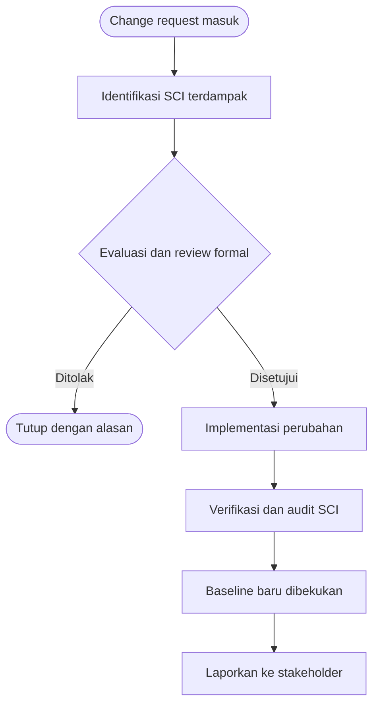

# Software Engineering | Sesi 15: Software Configuration Management

> **Mata Kuliah:** Rekayasa Perangkat Lunak (Software Engineering) | **Sesi:** 15 | **Status:** Materi UAS

---

## 🔑 Cues
- SCM: kendali + lacak perubahan sepanjang SDLC
- 4 tujuan: identifikasi, kendali, implementasi, pelaporan
- SCI: kode, dokumen, requirement, test, build script
- Baseline: functional, design, product
- Semantic versioning Major.Minor.Patch
- SCM di era Agile dan DevOps

---

## 📖 Materi Utama

### 1. SCM sebagai Disiplin Kendali Perubahan
- **Software Configuration Management (SCM)** = disiplin mengendalikan dan melacak perubahan software demi integritas dan traceability sepanjang SDLC.
- Sifatnya **umbrella activity** — berjalan di seluruh proses karena perubahan bisa muncul kapan saja. Empat misinya: (1) identify change, (2) control change, (3) ensure proper implementation, (4) report ke pihak berkepentingan.
- Nilainya rangkap empat: **control of change** (perubahan terdokumentasi, cegah inkonsistensi), **kolaborasi tim** (koordinasi proyek besar), **quality assurance** (integritas terjaga), **compliance & traceability** (audit trail untuk regulasi).

### 2. Apa yang Dikelola: SCI dan Baseline
- **Software Configuration Items (SCI)** = artefak di bawah kendali SCM: source code, design documents, user manuals, test scripts, build scripts, requirements specifications.
- **Baseline** = versi SCI yang sudah direview dan disepakati formal — titik mulai pengembangan lanjutan, hanya berubah lewat change control formal. Tiga jenis: **functional** (spesifikasi awal dari analisis requirements), **design** (ditetapkan pasca fase desain), **product** (produk final + seluruh komponen dan dokumentasi).
- Tiap CI berevolusi melalui state-versioning yang terdokumentasi; praktik penomorannya **semantic versioning Major.Minor.Patch** (contoh 1.2.3).

### 3. SCM Modern: Agile dan DevOps
- Di lingkungan Agile/DevOps, SCM tetap menjadi tulang punggung: change control yang ringan namun formal menjaga kecepatan rilis tanpa mengorbankan traceability.

---

## Library Diagram & Arsitektur

### Alur Change Control SCM

---

## 🛠️ Use Case / Implementasi Nyata
- **Skenario:** Tim robotik kampus (software, elektrik, mekanik) merakit robot kontes; tiap divisi mengutak-atik parameter tanpa catatan.
- **Masalah yang Diatasi:** Robot tercepat di uji coba tak bisa direplikasi di hari lomba karena tidak ada yang tahu versi parameter mana yang dipakai.
- **Keuntungan:** Dengan SCI (kode + config + wiring doc) dan baseline "lolos uji lapangan v1.2.0", tiap tuning tercatat; versi tercepat bisa di-restore kapan pun — change control sederhana menyelamatkan satu musim kontes.

---

## 🗂️ Konsep Kunci

| Istilah | Definisi | Contoh / Catatan |
|---------|----------|-----------------|
| SCM | Disiplin kendali dan lacak perubahan software | Menjaga integritas + traceability |
| SCI | Artefak di bawah configuration management | Kode, dokumen, test, build script |
| Baseline | Versi SCI yang disepakati formal | Berubah hanya via change control |
| Functional baseline | Spesifikasi awal hasil analisis | Fondasi pengembangan |
| Design baseline | Ditetapkan setelah fase desain | Acuan implementasi |
| Product baseline | Produk final + dokumen lengkap | Siap rilis/dipelihara |
| SemVer | Penomoran Major.Minor.Patch | Contoh 1.2.3 |

---

## 📊 Tabel Ringkasan

| Misi SCM | Pertanyaan yang Dijawab |
|----------|------------------------|
| Identify change | Apa yang berubah dan SCI apa yang kena? |
| Control change | Siapa menyetujui dan lewat prosedur apa? |
| Ensure implementation | Apakah perubahan benar terpasang? |
| Report change | Siapa perlu tahu dan apa baseline barunya? |

---

## ⚠️ Catatan Penting
> **Tanpa baseline, tidak ada rollback yang bisa dipercaya** — baseline yang dibekukan formal adalah satu-satunya titik kembali yang sah saat perubahan bermasalah.

---

## 📝 Materi Tambahan (Visual Insights)
- Referensi utama: slide asli sesi 15 (COMP6100001, Kenny Jingga, S.Kom., M.T.); learning objectives: memahami konsep configuration dan cara mengonfigurasi software.
- Kaji ulang contoh soal latihan SCM yang relevan sebelum UAS.

---

## ✅ Standar Visual & Orisinalitas
- Sintesis orisinal sesi 15; alur change control dan contoh robotik milik sendiri; definisi SCM, 4 misi, SCI, baseline, dan SemVer merujuk materi asli.
