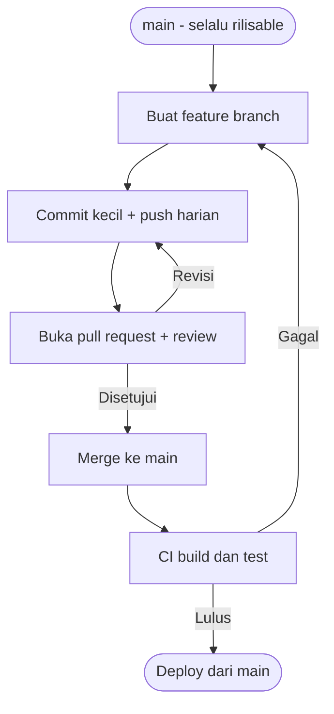
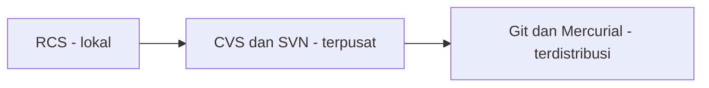

# Software Engineering | Sesi 16: Version Control Systems and Dependency Management

> **Mata Kuliah:** Rekayasa Perangkat Lunak (Software Engineering) | **Sesi:** 16 | **Status:** Materi UAS

---

## 🔑 Cues
- VCS = prosedur + tools pengelola versi configuration objects
- 3 generasi: RCS → CVS/SVN → Git/Mercurial
- CVCS vs DVCS
- Git fundamentals + collaborative workflows
- Advanced Git + best practices tim
- Dependency management + one-version rule
- Pelajaran left-pad (22 Maret 2016)

---

## 📖 Materi Utama

### 1. Apa dan Mengapa Version Control
- **Version control** = kombinasi prosedur dan tools untuk mengelola versi configuration objects yang lahir selama proses software. **VCS** = tool yang mengelola perubahan source code lintas waktu.
- Empat gunanya: melacak history perubahan, memfasilitasi kolaborasi multi-developer, rollback ke versi lama bila perlu, dan branching-merging untuk parallel development.

### 2. Tiga Generasi, Dua Arsitektur
- **Generasi 1 (lokal):** RCS (Revision Control System). **Generasi 2 (terpusat):** CVS dan SVN. **Generasi 3 (terdistribusi):** Git dan Mercurial.
- **CVCS** = satu central repository yang disinkron semua client; keputusan konfigurasi, policy, dan scaling terpusat. **DVCS** = tiap clone membawa history penuh, kerja offline dan merge fleksibel.
- Perbedaan arsitektural ini menentukan kemudahan scaling dan kebijakan tim — pilih sadar, bukan ikut tren.

### 3. Git untuk Kerja Tim
- Fundamental: commit, branch, merge, dan collaborative workflows antar anggota.
- Fitur lanjutan dan best practices: branch pendek yang sering di-merge, pesan commit bermakna, review sebelum merge, lindungi branch utama.
- Dependency management + **one-version rule** menjaga seluruh tim pada satu versi dependensi yang sama — menghindari "di saya jalan" akibat library beda versi.

### 4. Peringatan left-pad (22 Maret 2016)
- Kasus left-pad (source code + docs): satu paket mungil yang dihapus dari registry melumpuhkan ribuan build — bukti dependensi transitif wajib dikunci versinya dan dipahami risikonya.

---

## Library Diagram & Arsitektur

### Alur Kerja Branch Tim

### Generasi VCS

---

## 🛠️ Use Case / Implementasi Nyata
- **Skenario:** Kepanitiaan dokumentasi 20 orang menyusun buku angkatan; tiap seksi mengedit naskah yang sama via kirim file.
- **Masalah yang Diatasi:** File `final_REVISI_FINAL2.docx` menumpuk dan revisi saling menimpa.
- **Keuntungan:** Dengan pola DVCS, tiap seksi bekerja di branch-nya, konflik merge terlihat eksplisit per paragraf, dan panitia inti me-review sebelum merge — tidak ada lagi revisi hilang tanpa jejak.

---

## 🗂️ Konsep Kunci

| Istilah | Definisi | Contoh / Catatan |
|---------|----------|-----------------|
| VCS | Tool pengelola perubahan source code lintas waktu | Git, Mercurial, SVN |
| CVCS | Satu repository pusat disinkron semua client | CVS, SVN |
| DVCS | Tiap clone bawa history penuh | Git, Mercurial |
| Branching/merging | Kerja paralel lalu digabung | Fitur dan hotfix terisolasi |
| One-version rule | Satu versi dependensi untuk semua | Cegah inkonsistensi lingkungan |
| left-pad | Paket mungil yang memorak-porandakan build (2016) | Kunci versi dependensi |

---

## 📊 Tabel Ringkasan

| Aspek | CVCS | DVCS |
|-------|------|------|
| Repository | Satu pusat | Terduplikasi penuh per clone |
| Kerja offline | Terbatas | Penuh (commit/branch lokal) |
| Contoh | CVS, SVN | Git, Mercurial |
| Cocok saat | Kontrol terpusat prioritas | Kolaborasi cepat dan paralel |

---

## ⚠️ Catatan Penting
> **Dependensi adalah kode yang kamu tidak tulis tapi ikut kamu rilis** — one-version rule dan version locking mengubah left-pad berikutnya dari bencana menjadi insiden kecil.

---

## 📝 Materi Tambahan (Visual Insights)
- Referensi utama: slide asli sesi 16 (COMP6100001); objectives: peran dan tipe VCS, fundamental Git dan collaborative workflows, advanced Git, best practices tim, dependency management dan one-version rule.
- Kaji ulang contoh soal latihan VCS yang relevan sebelum UAS.

---

## ✅ Standar Visual & Orisinalitas
- Sintesis orisinal sesi 16; diagram branch dan contoh kepanitiaan milik sendiri; definisi VCS, 3 generasi, CVCS/DVCS, one-version rule, dan fakta left-pad merujuk materi asli.
