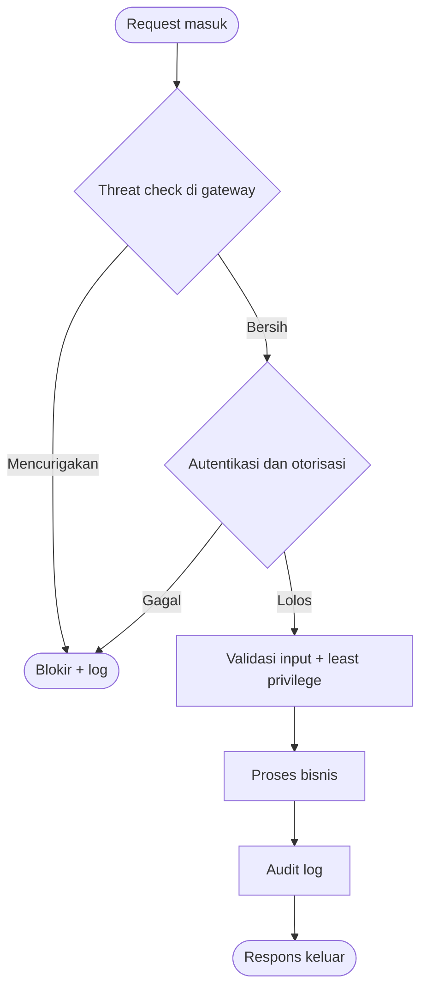

# Software Engineering | Sesi 17: Secure Software Development

> **Mata Kuliah:** Rekayasa Perangkat Lunak (Software Engineering) | **Sesi:** 17 | **Status:** Materi UAS

---

## 🔑 Cues
- Security = lindungi data, privasi, cegah breach
- Secure SDLC: keamanan di tiap fase
- Shift-left: threat model dan SAST di awal
- Least privilege + defense in depth
- Serangan jaringan: person-in-the-middle, sniffing
- Asumsikan jaringan tidak aman

---

## 📖 Materi Utama

### 1. Mengapa Keamanan Tak Bisa Menunggu
- **Software security** melindungi data dan privasi pengguna serta mencegah breach yang berujung financial loss dan reputation damage. Dengan cyber threats yang meningkat, keamanan harus menjadi prioritas sepanjang lifecycle — bukan tempelan akhir.

### 2. Secure SDLC per Fase (Shift-Left)
- **Requirements:** definisikan security requirements berbasis threat models (risk assessment).
- **Design:** design for security — least privilege, defense in depth — via threat modeling & design review.
- **Coding:** patuhi secure coding standards untuk mencegah vulnerabilities (static analysis).
- **Testing:** security testing berdampingan dengan functional testing (security testing & code review).
- **Deployment:** secure configurations dan access controls (security assessment & secure configuration).
- **Maintenance:** update dan patch reguler terhadap ancaman baru.
- Intinya **shift-left**: aktivitas keamanan dimajukan ke fase awal saat biaya perbaikan masih murah.

### 3. Musuh di Jaringan
- Prinsip ganda: kita harus berasumsi **jaringan tidak aman** dan berjaga terhadap **compromised network**.
- **Person-in-the-middle:** penyadap yang mencegat traffic — bisa membaca pesan pergi-datang dan mengubahnya sebelum diteruskan ke tujuan benar maupun salah.
- **Sniffing/eavesdropping:** menyimak traffic yang lewat (umumnya di subnet sendiri) — dan isinya kerap sangat menarik bagi penyerang.

---

## Library Diagram & Arsitektur

### Gerbang Keamanan Berlapis (Defense in Depth)

---

## 🛠️ Use Case / Implementasi Nyata
- **Skenario:** Dompet digital kantin kampus menyimpan saldo dan riwayat jajan 5.000 mahasiswa.
- **Masalah yang Diatasi:** Endpoint saldo bisa diakses dengan menebak ID user, dan traffic Wi-Fi kampus mudah disadap.
- **Keuntungan:** Threat modeling di fase requirements menangkap keduanya sebelum koding: semua endpoint wajib token + least privilege, semua traffic wajib TLS; SAST di pipeline menangkap query tanpa parameterisasi — tiga lapis yang masing-masing murah karena dipasang di awal.

---

## 🗂️ Konsep Kunci

| Istilah | Definisi | Contoh / Catatan |
|---------|----------|-----------------|
| Secure SDLC | Praktik keamanan di tiap fase SDLC | Dari requirements hingga maintenance |
| Shift-left | Majukan aktivitas keamanan ke fase awal | Threat model dan SAST sejak dini |
| Least privilege | Hak akses minimum yang diperlukan | Tiap endpoint dan role |
| Defense in depth | Lapisan pertahanan berlapis | Gateway + auth + validasi + log |
| Person-in-the-middle | Mencegat, membaca, mengubah traffic | Lawannya: enkripsi + autentikasi |
| Sniffing | Menyadap traffic jaringan | Waspadai subnet bersama |

---

## 📊 Tabel Ringkasan

| Fase SDLC | Fokus Keamanan | Aktivitas |
|-----------|----------------|-----------|
| Requirements | Ancaman sejak awal | Threat models, risk assessment |
| Design | Arsitektur aman | Least privilege, design review |
| Coding | Kode bebas pola rentan | Secure standards, static analysis |
| Testing | Bukti ketahanan | Security testing, code review |
| Deployment | Konfigurasi aman | Assessment, access control |
| Maintenance | Adaptif ancaman baru | Update dan patch reguler |

---

## ⚠️ Catatan Penting
> **Jaringan selalu diasumsikan hostile** — desain yang aman di lab kampus harus tetap aman di Wi-Fi kafe; enkripsi dan autentikasi bukan opsional.

---

## 📝 Materi Tambahan (Visual Insights)
- Referensi utama: slide asli sesi 17 (COMP6100001); objectives: urgensi security, identifikasi vulnerabilities dan secure practices, secure SDLC dan security testing, studi kasus kegagalan dan keberhasilan nyata.
- Kaji ulang contoh soal latihan security yang relevan sebelum UAS.

---

## ✅ Standar Visual & Orisinalitas
- Sintesis orisinal sesi 17; diagram defense in depth dan contoh dompet kampus milik sendiri; pemetaan secure SDLC dan model serangan jaringan merujuk materi asli.
