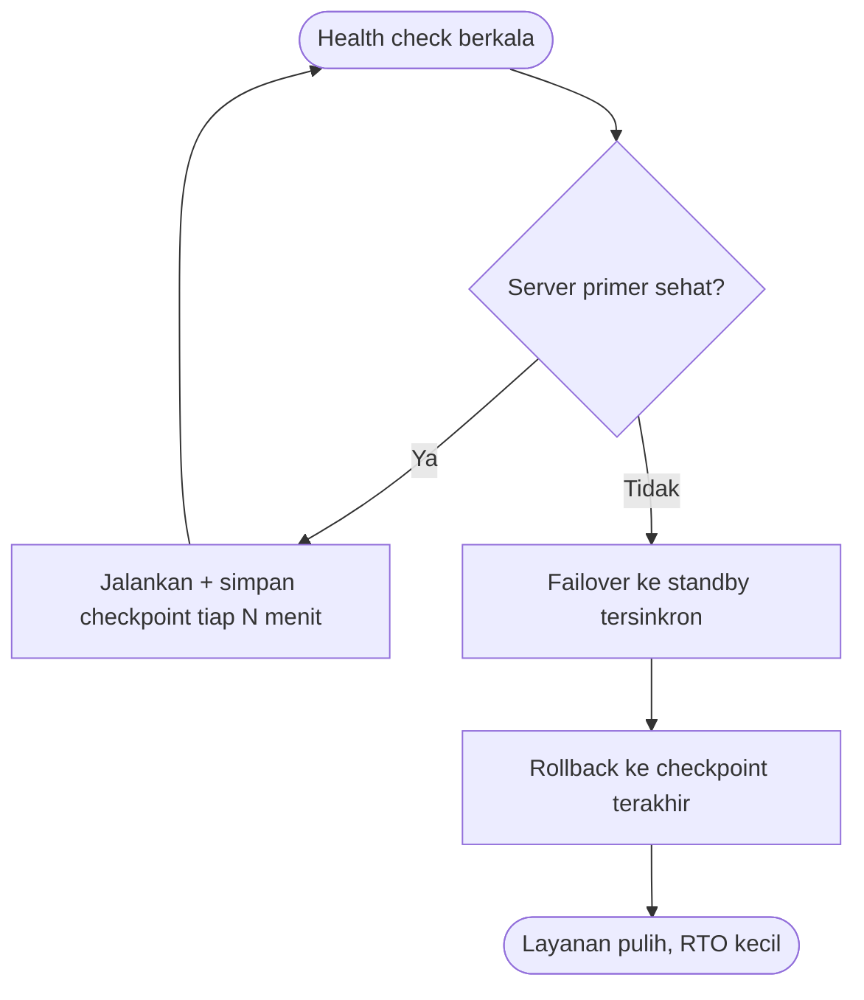

# Software Engineering | Sesi 18: Reliability Engineering and Fault Tolerance

> **Mata Kuliah:** Rekayasa Perangkat Lunak (Software Engineering) | **Sesi:** 18 | **Status:** Materi UAS

---

## 🔑 Cues
- Reliability = probabilitas operasi bebas-gagal
- MTBF = MTTF + MTTR
- Availability = MTTF/(MTTF+MTTR) × 100%
- Contoh: MTBF 200 jam, MTTR 1 jam
- Model Jelinski-Moranda
- Teknik: redundancy, graceful degradation, recovery, failover

---

## 📖 Materi Utama

### 1. Definisi dan Taruhannya
- **Software reliability** = probabilitas operasi software bebas kegagalan selama periode tertentu dalam kondisi tertentu.
- Taruhannya nyata: sistem kritis (healthcare, finance, transportation — kendali pesawat, alat medis) menuntut operasi aman dan konsisten; di perbankan, downtime menggerus trust dan integritas finansial. Reliability bertaut langsung dengan user satisfaction dan safety.

### 2. Model dan Metrik
- **Failure rate model:** probabilitas gagal per satuan waktu.
- **MTBF (Mean Time Between Failures):** rata-rata jeda antar kegagalan — makin tinggi makin reliabel. **MTTR (Mean Time to Repair):** rata-rata waktu perbaikan; krusial untuk mission-critical.
- Hubungan intinya: **MTBF = MTTF + MTTR** (MTTF = mean-time-to-failure).
- **Availability** = probabilitas program beroperasi sesuai requirements pada titik waktu tertentu: **Availability = [MTTF/(MTTF + MTTR)] x 100%**.
- Contoh hitung: aplikasi web MTBF 200 jam dan MTTR 1 jam → reliabilitas tinggi dengan pemulihan cepat.
- **Reliability growth models** (misal Jelinski-Moranda) menilai peningkatan reliabilitas seiring waktu.

### 3. Teknik Fault Tolerance
- **Redundancy:** komponen/sistem ganda mengambil alih saat yang utama gagal.
- **Graceful degradation:** fungsi menurun bertahap, bukan mati total.
- **Recovery mechanisms:** checkpointing and rollback ke state terakhir yang sehat.
- **Failover systems:** perpindahan otomatis ke cadangan.

### 4. Merancang Arsitektur yang Reliabel
- Reliability engineering = mengukur (MTBF/MTTR/availability), merancang toleransi di arsitektur, memakai tools dan praktik yang tepat, dan belajar dari case studies sistem reliabel nyata.

---

## Library Diagram & Arsitektur

### Failover dengan Checkpoint (Contoh Sendiri)

---

## 🛠️ Use Case / Implementasi Nyata
- **Skenario:** Sistem antrean loket beasiswa yang pendaftarannya dibuka 2 jam dan diserbu 10.000 mahasiswa.
- **Masalah yang Diatasi:** Satu server down = ribuan pendaftar gagal + data setengah tersimpan.
- **Keuntungan:** Redundancy menahan lonjakan, failover memulihkan dalam detik, checkpointing mencegah pendaftar mengulang dari nol — availability tinggi tanpa hardware eksotis.

---

## 🗂️ Konsep Kunci

| Istilah | Definisi | Contoh / Catatan |
|---------|----------|-----------------|
| Reliability | Probabilitas bebas-gagal per periode/kondisi | Fokus safety-critical |
| MTBF | Rata-rata jeda antar kegagalan | Makin tinggi makin baik |
| MTTR | Rata-rata waktu perbaikan | Kecil = pulih cepat |
| Availability | Probabilitas operasional saat dibutuhkan | Rumus MTTF/(MTTF+MTTR) |
| Redundancy | Duplikasi penanggung kegagalan | Active-passive/aktif |
| Graceful degradation | Turun fungsi, bukan mati | Mode hemat fitur |

---

## 📊 Tabel Ringkasan

| Metrik | Rumus | Dibaca Sebagai |
|--------|-------|----------------|
| MTBF | MTTF + MTTR | Seberapa jarang gagal |
| MTTR | Total repair / jumlah insiden | Seberapa cepat pulih |
| Availability | MTTF/(MTTF+MTTR) × 100% | Seberapa siap saat dibutuhkan |

---

## ⚠️ Catatan Penting
> **MTBF tinggi tanpa MTTR rendah adalah setengah solusi** — untuk mission-critical, kecepatan pulih sama pentingnya dengan jarangnya gagal.

---

## 📝 Materi Tambahan (Visual Insights)
- Referensi utama: slide asli sesi 18 (COMP6100001); objectives: definisi reliability, model dan metrik, teknik fault tolerance, desain arsitektur reliabel, pengukuran dan tools, case studies.
- Kaji ulang contoh soal latihan reliability yang relevan sebelum UAS.

---

## ✅ Standar Visual & Orisinalitas
- Sintesis orisinal sesi 18; diagram failover dan contoh antrean milik sendiri; definisi, rumus MTBF/availability, contoh 200 jam/1 jam, dan teknik fault tolerance merujuk materi asli.
