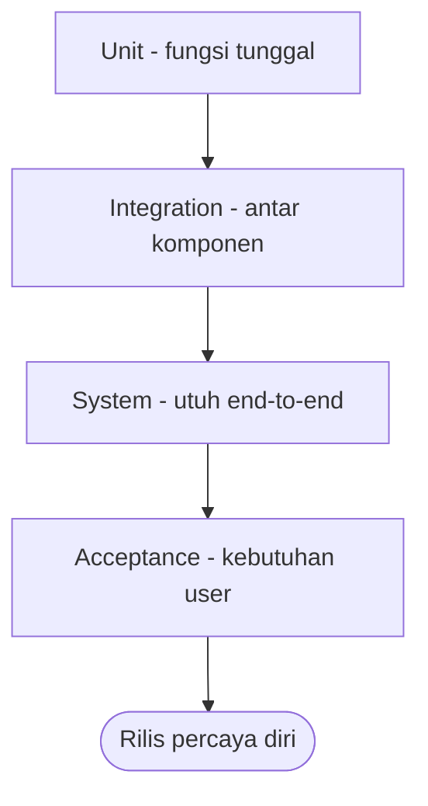

# Software Engineering | Sesi 19: Fundamentals of Software Testing

> **Mata Kuliah:** Rekayasa Perangkat Lunak (Software Engineering) | **Sesi:** 19 | **Status:** Materi UAS

---

## 🔑 Cues
- Testing = picu failures; debugging = cari faults
- Internal vs external quality
- Error → fault/defect → failure
- 4 levels: unit, integration, system, acceptance
- 5 tipe: functional, non-functional, regression, performance, usability
- 3 teknik: black, white, grey-box

---

## 📖 Materi Utama

### 1. Tujuan dan Rahasia Kualitas
- **Testing** memastikan software quality lewat dua sisi: **internal quality** (kode terstruktur? understandable? terdokumentasi baik?) dan **external quality** (tidak crash? memenuhi requirements? UI baik?).
- Kuncinya: **assuring external quality** — pengguna menilai dari luar, sehebat apa pun kode di dalam.

### 2. Kosakata yang Sering Tertukar
- **Error/mistake:** tindakan manusia yang menghasilkan hasil salah. **Fault/defect:** cacat di komponen/sistem yang bisa membuatnya gagal. **Failure:** ketidakmampuan nyata + deviasi dari yang diharapkan.
- Rantai baca: error manusia → fault tersembunyi → failure saat dieksekusi.
- **Testing** = attempt to trigger failures. **Debugging** = attempt to find faults given a failure. Berbeda arah, berbeda skill.

### 3. Empat Levels of Testing
- **Unit:** fungsi/metode individual. **Integration:** interaksi antar komponen. **System:** sistem utuh end-to-end. **Acceptance:** validasi terhadap kebutuhan user.

### 4. Lima Tipe + Tiga Teknik
- Tipe: **functional** (sesuai spesifikasi?), **non-functional** (kualitas/atribut), **regression** (perubahan tak merusak lama), **performance** (beban dan kecepatan), **usability** (mudah dipakai?).
- Teknik: **black-box** (tanpa intip implementasi), **white-box** (berbasis struktur kode), **grey-box** (kombinasi keduanya).

### 5. Disiplin Pelaksanaannya
- Test planning and design → test case development and execution → defect identification → defect reporting and tracking. Testing tanpa tracking sama dengan temuan tanpa tindak lanjut.

---

## Library Diagram & Arsitektur

### Piramida Levels of Testing

---

## 🛠️ Use Case / Implementasi Nyata
- **Skenario:** Kalkulator estimasi UKT online yang dipakai calon mahasiswa baru.
- **Masalah yang Diatasi:** Rumus golongan salah untuk satu jalur masuk, dan halaman macet di browser lama.
- **Keuntungan:** Unit test menangkap salah rumus di level fungsi; system test menangkap macet browser; acceptance test oleh staf kemahasiswaan memastikan angka sesuai SK rektor — tiap level menangkap kelas cacat berbeda.

---

## 🗂️ Konsep Kunci

| Istilah | Definisi | Contoh / Catatan |
|---------|----------|-----------------|
| Error/mistake | Aksi manusia yang salah | Salah tulis operator |
| Fault/defect | Cacat yang bisa picu gagal | Kode salah yang belum tereksekusi |
| Failure | Kegagalan nyata teramati | Crash saat dipakai |
| Testing | Upaya memicu failures | preventif |
| Debugging | Cari faults dari failure | korektif |
| Regression | Pastikan lama tak rusak | Setiap ada perubahan |

---

## 📊 Tabel Ringkasan

| Level | Target | Pertanyaan |
|-------|--------|-----------|
| Unit | Fungsi/metode | Apakah unit ini benar? |
| Integration | Interaksi komponen | Apakah mereka cocok? |
| System | Sistem utuh | Apakah perilaku utuh benar? |
| Acceptance | Kebutuhan user | Apakah user menerimanya? |

---

## ⚠️ Catatan Penting
> **Testing menunjukkan adanya bug, bukan ketiadaannya** — lolos semua test berarti siap dengan bukti, bukan terbukti sempurna.

---

## 📝 Materi Tambahan (Visual Insights)
- Referensi utama: slide asli sesi 19 (COMP6100001); objectives: objectives dan importance testing, levels dan types, testing techniques, test planning, defect tracking dan reporting.
- Kaji ulang contoh soal latihan testing yang relevan sebelum UAS.

---

## ✅ Standar Visual & Orisinalitas
- Sintesis orisinal sesi 19; piramida levels dan contoh kalkulator milik sendiri; rantai error-fault-failure, levels, types, dan techniques merujuk materi asli.
