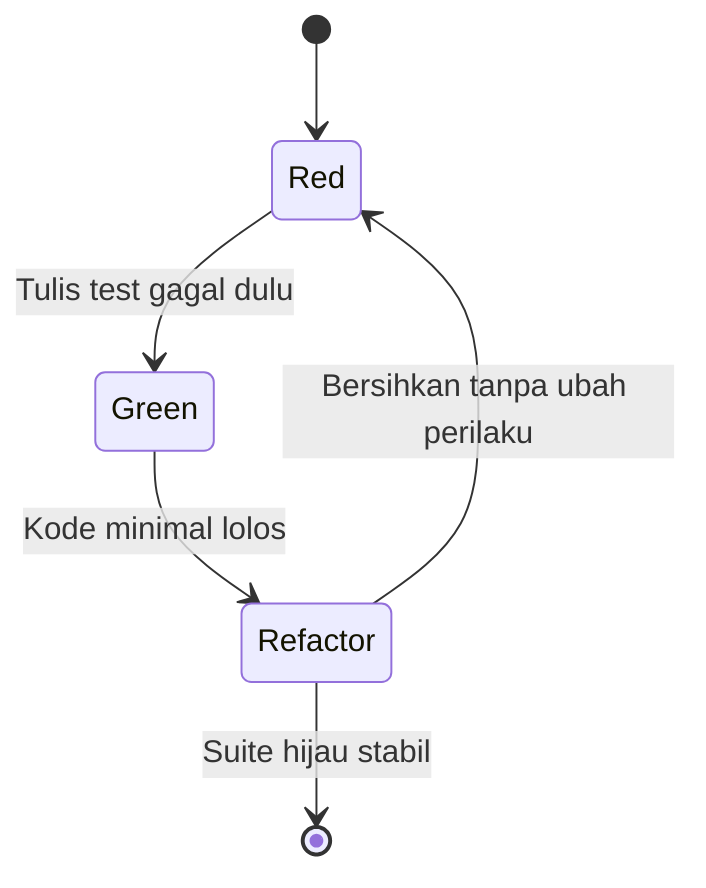

# Software Engineering | Sesi 20: Automated Testing and Test-Driven Development (TDD)

> **Mata Kuliah:** Rekayasa Perangkat Lunak (Software Engineering) | **Sesi:** 20 | **Status:** Materi UAS

---

## 🔑 Cues
- Automated testing = skrip/tools eksekusi test terdesain
- 3 tipe: unit, integration, E2E
- 4 benefit vs 4 challenge otomasi
- Framework: standarisasi tulis–eksekusi–kelola (misal JUnit Java)
- TDD: Red → Green → Refactor
- TDD + CI dan perawatan test

---

## 📖 Materi Utama

### 1. Otomasi Pengujian
- **Automated testing** = memakai skrip/tools untuk mengeksekusi pre-designed tests — validasi functionality, performance, dan atribut lain secara otomatis. Contoh: skrip menguji login otomatis setiap kode di-update.
- Perannya: mempercepat validation cycles dan menjaga konsistensi — krusial untuk Agile dengan rilis frekuen.
- Tiga tipe: **unit tests** (fungsi/metode individual), **integration tests** (interaksi antar komponen), **end-to-end tests** (workflow utuh dari sudut user).

### 2. Manfaat vs Tantangan
- Manfaat: **testing speed** (lebih cepat dari manual), **coverage** (repetisi multi-skenario lebih luas), **early defect detection** (jalan tiap commit, cacat ketahuan sebelum membesar), **consistency** (bebas human error).
- Tantangan: **initial setup costs** (skrip, tools, framework mahal di awal), **false positives/negatives** (test buruk menyesatkan), **maintenance overhead** (test harus berevolusi ikut kode — test decay), **not for all tests** (exploratory, usability, UX, edge cases tetap manual).

### 3. Framework Otomasi
- **Test automation frameworks** = tools + libraries terstandar untuk menulis, mengeksekusi, dan mengelola automated tests. Contoh populer: **JUnit (Java)**.

### 4. TDD dan Integrasinya
- **Test-Driven Development**: tulis test dulu, implementasi minimal menyusul, lalu refactor — siklus Red → Green → Refactor.
- Praktik proyek: TDD diintegrasikan ke **CI workflows** (suite jalan tiap push) dan dijaga via best practices perawatan test (nama jelas, independen, cepat, deterministik).

---

## Library Diagram & Arsitektur

### Siklus Red-Green-Refactor



### Contoh Mini TDD (Validasi NIM)

```python
def test_nim_wajib_10_digit():
    assert valid_nim("1234567890") is True
    assert valid_nim("12345") is False
    assert valid_nim("ABCDEFGHIJ") is False

def valid_nim(nim):
    return len(nim) == 10 and nim.isdigit()
```

Test ditulis dulu (Red), fungsi minimal menyusul (Green), lalu rapikan (Refactor).

---

## 🛠️ Use Case / Implementasi Nyata
- **Skenario:** Modul pemotongan beasiswa di sistem akademik — salah hitung berarti mahasiswa dirugikan finansial.
- **Masalah yang Diatasi:** Rumus potongan berubah tiap SK baru dan regresi diam-diam merusak kasus lama.
- **Keuntungan:** TDD mengunci tiap SK sebagai test; CI menjalankan suite tiap commit; exploratory manual tetap dipakai untuk UX slip potongan — otomasi dan manusia berbagi peran sesuai kekuatannya.

---

## 🗂️ Konsep Kunci

| Istilah | Definisi | Contoh / Catatan |
|---------|----------|-----------------|
| Automated testing | Eksekusi test terdesain via skrip/tools | Skrip login tiap update |
| Unit / integration / E2E | Level cakupan otomasi | Fungsi → interaksi → workflow |
| Test decay | Test usang karena kode berubah | Butuh maintenance rutin |
| False positive/negatif | Hasil menyesatkan dari test buruk | Gagal padahal benar dan sebaliknya |
| TDD | Test dulu, kode menyusul | Red-Green-Refactor |
| JUnit | Framework otomasi populer Java | Standarisasi kelola test |

---

## 📊 Tabel Ringkasan

| Dimensi | Manfaat Otomasi | Tantangan Otomasi |
|---------|-----------------|-------------------|
| Kecepatan | Run lebih cepat dari manual | Setup awal mahal |
| Cakupan | Repetisi multi-skenario luas | Test harus ikut berevolusi |
| Kualitas | Dini + konsisten | False result bila desain buruk |
| Batas | — | Exploratory/UX tetap manual |

---

## ⚠️ Catatan Penting
> **Otomasi tanpa perawatan = hutang baru** — suite yang dibiarkan decay berubah dari jaring pengaman menjadi sumber false alarm yang diabaikan tim.

---

## 📝 Materi Tambahan (Visual Insights)
- Referensi utama: slide asli sesi 20 (COMP6100001); objectives: fundamental dan benefit otomasi, frameworks populer, prinsip TDD, implementasi TDD + CI, best practices perawatan test.
- Kaji ulang contoh soal latihan TDD yang relevan sebelum UAS.

---

## ✅ Standar Visual & Orisinalitas
- Sintesis orisinal sesi 20; state diagram TDD, snippet NIM, dan contoh beasiswa milik sendiri; definisi, benefit/challenge, framework JUnit, dan prinsip TDD merujuk materi asli.
