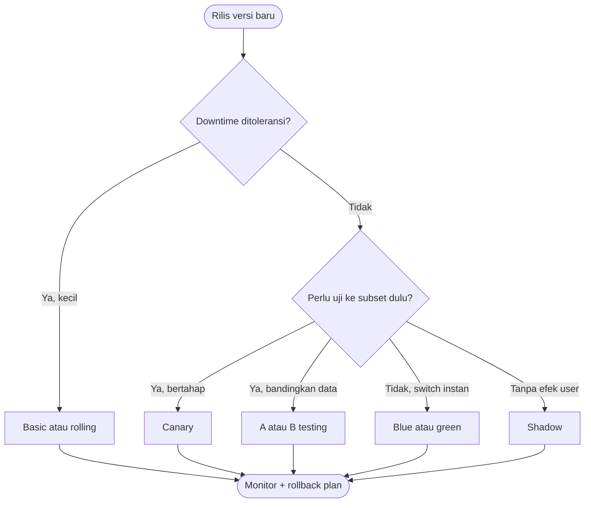

# Software Engineering | Sesi 21: Software Maintenance, Legacy Systems, and Technical Debt

> **Mata Kuliah:** Rekayasa Perangkat Lunak (Software Engineering) | **Sesi:** 21 | **Status:** Materi UAS

---

## 🔑 Cues
- Deployment = rilis ke production (install, config, aktivasi, verifikasi)
- Maintenance dimulai KARENA deployment
- 4 tipe: corrective, adaptive, perfective, preventive
- 7 strategi deployment (basic → shadow)
- Legacy challenges + technical debt
- Strangler fig, boy scout rule, debt register

---

## 📖 Materi Utama

### 1. Dari Deployment ke Maintenance
- **Software deployment** = proses merilis software ke production — mencakup installation, configuration, activation, verification.
- Dua kebenaran: deployment menandai **dimulainya fase maintenance**, dan keputusan di sini memengaruhi ease of updates, failure recovery, frekuensi intervensi, cost of fixing defects, serta beban tim operasi. Ringkasnya: **maintenance does not begin after deployment — it begins because of deployment.**

### 2. Tujuh Strategi Deployment
- **Basic:** update semua node serentak ke versi baru. **Rolling:** update subset instance bertahap (bukan full sekaligus). **Multi-service:** update semua node dengan banyak services sekaligus.
- **Blue/green:** dua versi jalan simultan, traffic dialihkan sekaligus. **Canary:** rilis bertahap (increments) ke sebagian user. **A/B testing:** subset kecil ke fungsi baru untuk kumpulkan statistik keputusan bisnis. **Shadow:** dua versi paralel — request di-fork ke versi baru tanpa memengaruhi user.

### 3. Empat Tipe Maintenance
- **Corrective:** perbaiki defect yang ada (bug crash perhitungan). **Adaptive:** ikuti perubahan eksternal (DB/OS baru, regulasi OJK). **Perfective:** tambah/tingkatkan fungsi (fitur lacak status). **Preventive:** cegah kegagalan masa depan (refactor modul rawan + tambah test).
- Fakta lifecycle: maintenance mendominasi biaya dan umur sistem — desain yang mengabaikannya membayar mahal di belakang.

### 4. Legacy dan Technical Debt
- **Legacy challenges:** pengembang awal pergi (tacit knowledge hilang), dokumentasi minim/usang, quick fix bertahun-tahun, hardcoded values, tanpa automated tests.
- **Technical debt** = konsekuensi keputusan jangka pendek yang berbunga tiap kali kode disentuh; strategi bayarnya: continuous refactoring, dedicated debt-reduction sprint, refactor bareng fitur baru, **debt register** eksplisit, standar koding + code ownership, dan modernisasi bertahap ala **strangler fig** (bukan big-bang rewrite).

---

## Library Diagram & Arsitektur

### Memilih Strategi Deployment

---

## 🛠️ Use Case / Implementasi Nyata
- **Skenario:** Aplikasi kasir kantin kejujuran kos: kode 3 tahun, tak ada test, semua edit langsung di hosting.
- **Masalah yang Diatasi:** Tambah menu promo merusak total harian; tak ada yang berani menyentuh modul diskon.
- **Keuntungan:** Preventive dulu (characterization test + debt register), lalu strangler fig: modul diskon baru jalan paralel satu bulan sebelum modul lama dipensiunkan — tanpa sehari pun kasir mati.

---

## 🗂️ Konsep Kunci

| Istilah | Definisi | Contoh / Catatan |
|---------|----------|-----------------|
| Deployment | Rilis ke production + verifikasi | Install, config, aktivasi |
| Corrective | Perbaiki bug yang ada | Crash perhitungan |
| Adaptive | Ikuti perubahan eksternal | OS/DB baru, regulasi |
| Perfective | Fungsi baru/lebih baik | Fitur lacak status |
| Preventive | Cegah gagal di masa depan | Refactor + test |
| Technical debt | Bunga keputusan jangka pendek | Dibayar via refactor |
| Strangler fig | Ganti bertahap komponen lama | Tanpa big-bang rewrite |
| Debt register | Daftar eksplisit tech debt | Basis prioritas bayar |

---

## 📊 Tabel Ringkasan

| Strategi | Cara | Kekuatan |
|----------|------|----------|
| Basic | Semua node serentak | Simpel |
| Rolling | Subset bertahap | Downtime kecil |
| Blue/green | Dua versi, switch sekaligus | Rollback instan |
| Canary | Increments ke subset | Risiko terbatas |
| A/B testing | Subset untuk statistik | Keputusan berbasis data |
| Shadow | Fork paralel tanpa efek user | Uji paling aman |

---

## ⚠️ Catatan Penting
> **Rewrite total hampir selalu kalah dari strangler fig** — sistem lama yang masih menghasilkan nilai diganti sambil jalan, bukan dimatikan untuk janji manis.

---

## 📝 Materi Tambahan (Visual Insights)
- Referensi utama: slide asli sesi 21 (COMP6100001); objectives: dominasi maintenance, tipe maintenance, legacy challenges, technical debt dan strateginya.
- Ukur keberhasilan pembenahan dengan MTTR, defect density, regression pass rate, coverage, dan cyclomatic complexity.

---

## ✅ Standar Visual & Orisinalitas
- Sintesis orisinal sesi 21; decision flow deployment dan contoh kasir kos milik sendiri; definisi deployment, 7 strategi, 4 tipe maintenance, dan strategi debt merujuk materi asli.
