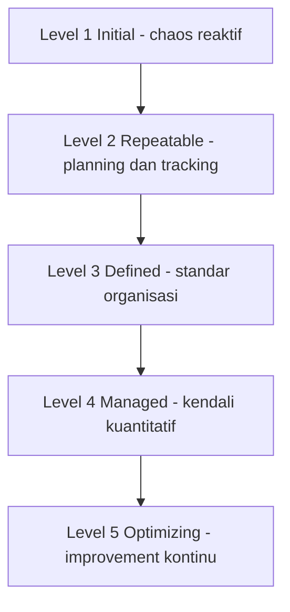

# Software Engineering | Sesi 22: Software Process Improvement

> **Mata Kuliah:** Rekayasa Perangkat Lunak (Software Engineering) | **Sesi:** 22 | **Status:** Materi UAS

---

## 🔑 Cues
- SPI = nilai + perbaiki proses (quality, productivity, predictability)
- 4 manfaat: quality, productivity, risk, satisfaction (+ competitive edge)
- CMM: definisi dan purpose
- 5 maturity levels (Initial → Optimizing)
- KPA per level 2–5
- Benefits vs criticisms CMM

---

## 📖 Materi Utama

### 1. SPI dan Alasannya
- **Software Process Improvement (SPI)** = praktik menilai dan meningkatkan proses development demi quality, productivity, dan predictability — temukan kelemahan proses kini, implementasikan perubahan yang menaikkan performance dan outcomes.
- Empat manfaat: **quality enhancement** (produk lebih baik), **productivity increase** (waktu dan biaya ramping), **risk reduction** (masalah ketahuan awal), **customer satisfaction** (delivery reliabel) — plus **competitive advantage** di pasar.

### 2. CMM: Penggaris Kematangan
- **Capability Maturity Model (CMM)** = framework elemen kunci proses software yang efektif. **Purpose**: memandu organisasi mengendalikan proses development dan maintenance-nya.
- Lima levels: **Initial (1)** — unpredictable, poorly controlled, reactive. **Repeatable (2)** — basic project management terbentuk untuk track cost, schedule, functionality. **Defined (3)** — proses didokumentasikan, distandarkan, diintegrasikan organisasi. **Managed (4)** — measures detail proses dan kualitas produk dikumpulkan dan dikendalikan. **Optimizing (5)** — improvement kontinu via quantitative feedback dan piloting ide/teknologi inovatif.

### 3. KPA Tiap Level
- **Level 2:** Requirements Management, Project Planning, Project Tracking and Oversight, Subcontract Management, Quality Assurance, Configuration Management.
- **Level 3:** Organization Process Focus, Process Definition, Training Program, Integrated Software Management, Product Engineering, Intergroup Coordination, Peer Reviews.
- **Level 4:** Quantitative Process Management, Software Quality Management.
- **Level 5:** Defect Prevention, Technology Change Management, Process Change Management.

### 4. Menilai Keberhasilan
- Ukur dengan metrik proses (defect trends, estimation accuracy, delivery predictability) dan validasi lewat case studies implementasi nyata; sisi kritik CMM (birokrasi, kaku untuk tim kecil) dibayar oleh benefit quality, predictability, dan satisfaction bila diterapkan proporsional.

---

## Library Diagram & Arsitektur

### Tangga Kematangan CMM

---

## 🛠️ Use Case / Implementasi Nyata
- **Skenario:** Studio game indie 8 orang: rilis selalu molor, bug save-data terulang tiap sekuel.
- **Masalah yang Diatasi:** Semua pengetahuan di kepala founder; tidak ada yang tahu kenapa build gagal dua hari sebelum rilis.
- **Keuntungan:** Naik ke level 2 dulu (planning + tracking + QA minimal ala KPA), bukan lompat ke level 5 — estimation accuracy naik dalam 2 proyek, dan defect prevention level 5 baru realistis setelah data defect terkumpul.

---

## 🗂️ Konsep Kunci

| Istilah | Definisi | Contoh / Catatan |
|---------|----------|-----------------|
| SPI | Menilai + meningkatkan proses software | Quality, productivity, predictability |
| CMM | Framework elemen proses efektif | Penggaris kematangan 1–5 |
| KPA | Key process area per level | Syarat naik level |
| Managed (L4) | Kendali via measures kuantitatif | Data-driven |
| Optimizing (L5) | Improvement kontinu | Feedback + piloting inovasi |

---

## 📊 Tabel Ringkasan

| Level | Nama | Ciri Satu Baris |
|-------|------|-----------------|
| 1 | Initial | Chaos, reaktif |
| 2 | Repeatable | Planning + tracking dasar |
| 3 | Defined | Standar organisasi terdokumentasi |
| 4 | Managed | Dikendalikan angka |
| 5 | Optimizing | Membaik terus-menerus |

---

## ⚠️ Catatan Penting
> **Naik level berurutan, bukan melompat** — KPA level 2 (planning, tracking, QA) adalah fondasi yang membuat angka level 4 bermakna dan inovasi level 5 tidak buta.

---

## 📝 Materi Tambahan (Visual Insights)
- Referensi utama: slide asli sesi 22 (COMP6100001); objectives: konsep dan pentingnya SPI, model kunci, strategi dan metrik improvement, case studies nyata.
- Benefits CMM: improved quality, predictability jadwal-biaya, customer satisfaction.

---

## ✅ Standar Visual & Orisinalitas
- Sintesis orisinal sesi 22; tangga diagram dan contoh studio game milik sendiri; definisi SPI/CMM, 5 levels, dan seluruh KPA merujuk materi asli.
