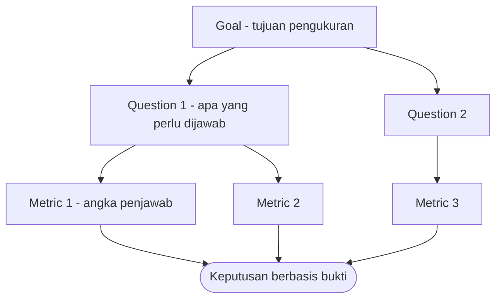

# Software Engineering | Sesi 23: Metrics and Measurement

> **Mata Kuliah:** Rekayasa Perangkat Lunak (Software Engineering) | **Sesi:** 23 | **Status:** Materi UAS

---

## 🔑 Cues
- Kelvin: to measure is to know
- Craner–Bond: assignment angka empiris-objektif
- Hubbard: reduksi ketidakpastian kuantitatif
- IEEE 1061: fungsi data → satu angka kualitas
- Entitas: product vs process
- Kualitas: functionality, scalability, extensibility, docs, performance
- Bahaya: Goodhart, vanity metrics, insentif salah

---

## 📖 Materi Utama

### 1. Tiga Definisi Fondasional
- **Kelvin:** "To measure is to know; if you cannot measure it, you cannot improve it" — William Thomson, Lord Kelvin.
- **Craner–Bond:** measurement = penetapan angka secara empiris dan objektif menurut aturan dari model/teori ke atribut objek atau events untuk mendeskripsikannya ("Software Engineering Metrics: What Do They Measure and How Do We Know?").
- **Hubbard:** measurement = reduksi ketidakpastian berbasis kuantitatif dari satu atau lebih observasi ("How to Measure Anything ...").
- **IEEE 1061:** software quality metric = fungsi ber-input data software dan ber-output satu angka yang diinterpretasikan sebagai derajat kepemilikan atribut kualitas.

### 2. Measurement dalam Hidup Sehari-hari
- Sehari-hari: price, inflation rate, stock price, volume; heart rate, blood pressure, body temperature, ECG. Engineering: force, torque, heat transfer coefficient, thermal efficiency. Sains alam: AQI, carbon footprint, soil pH. Polanya sama: objek/proses → kualitas yang dipedulikan → metode memperoleh angka/simbol.

### 3. Entitas dan Kualitas Software
- Entitas yang dipedulikan: **software product** dan **software development process**.
- Contoh kualitas: functionality (misal data integrity), scalability, extensibility, documentation, performance. Tiap kualitas boleh punya metrik usulan sendiri.

### 4. Memakai Metrik dengan Benar (dan Bahayanya)
- Gunakan kerangka berbasis tujuan (seperti GQM: goal → question → metric) untuk decision making, bukan mengoleksi angka.
- Bahayanya: metrik yang jadi target berhenti jadi ukuran baik (**Goodhart's Law**), insentif berbasis angka salah mendorong perilaku salah, dan korelasi disulap jadi kausalitas (dokumentasi tebal ≠ otomatis sedikit bug).

---

## Library Diagram & Arsitektur

### Kerangka Goal-Question-Metric

---

## 🛠️ Use Case / Implementasi Nyata
- **Skenario:** Komunitas lari kampus memakai aplikasi pencatat latihan; pengurus ingin menilai "apakah aplikasi makin baik".
- **Masalah yang Diatasi:** Vendor memamerkan "10.000 baris kode baru" sebagai bukti progres.
- **Keuntungan:** Dengan GQM mini — goal "latihan tercatat andal", question "berapa persen aktivitas gagal tersimpan?", metric "failure rate sync" — LOC besar terbukti tak menjawab apa-apa; crash-free sessions dan sync success rate yang menjawab.

---

## 🗂️ Konsep Kunci

| Istilah | Definisi | Contoh / Catatan |
|---------|----------|-----------------|
| Measurement | Penetapan angka empiris-objektif ke atribut | Craner–Bond |
| Quality metric | Fungsi data → satu angka kualitas | IEEE 1061 |
| Entity | Objek/proses yang diukur | Product, process |
| GQM | Goal → question → metric | Kerangka top-down |
| Goodhart's Law | Target metrik merusak metrik | Bonus LOC → kode bertele-tele |
| McNamara fallacy | Hanya ukur yang mudah diukur | Abaikan yang sulit tapi penting |

---

## 📊 Tabel Ringkasan

| Pertanyaan GQM | Contoh Jawaban |
|---|---|
| Goal (purpose, issue, object, viewpoint) | Evaluasi keandalan modul sync (pengurus) |
| Question 1 | Seberapa sering sync gagal? |
| Metric 1.1–1.2 | Failure rate per 1000 sync; MTBF |
| Question 2 | Seberapa cepat pulih? |
| Metric 2.1 | MTTR |

---

## ⚠️ Catatan Penting
> **Ukur untuk memutuskan, bukan untuk memamerkan** — metrik tanpa goal melahirkan vanity metrics; metrik dengan insentif salah melahirkan perilaku salah.

---

## 📝 Materi Tambahan (Visual Insights)
- Referensi utama: slide asli sesi 23 (COMP6100001); objectives: pentingnya measurement, contoh metrik kualitas dan proses, kerangka goal-based, limitasi dan bahaya insentif berbasis ukuran; case study: autonomous vehicle software.
- Software engineering = principles dan practices (teknis dan non-teknis) untuk membangun software berkualitas dengan percaya diri.

---

## ✅ Standar Visual & Orisinalitas
- Sintesis orisinal sesi 23; diagram GQM dan contoh komunitas lari milik sendiri; kutipan Kelvin/Craner–Bond/Hubbard/IEEE 1061 dan contoh measurement merujuk materi asli.
