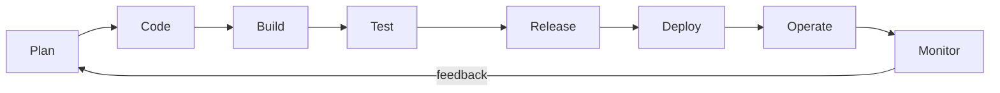

# Software Engineering | Sesi 24: DevOps Culture, Principles, and Toolchains

> **Mata Kuliah:** Rekayasa Perangkat Lunak (Software Engineering) | **Sesi:** 24 | **Status:** Materi UAS

---

## 🔑 Cues
- DevOps = unifikasi Dev + Ops (praktik, prinsip, budaya)
- 4 goals: cepat, berkualitas, tanpa bottleneck, puas
- Budaya: kolaborasi, ownership, blameless postmortem
- CI vs CD vs continuous deployment
- Automation + IaC
- Toolchain 8 tahap + tantangan adopsi

---

## 📖 Materi Utama

### 1. Definisi dan Tujuan
- **DevOps** = set of practices, principles, and cultural philosophies untuk menyatukan development (Dev) dan IT operations (Ops) — bertumpu pada collaboration, automation, dan feedback loops demi software berkualitas dengan cepat.
- Empat goals: **faster delivery** (fitur dan fix mengalir cepat), **improved quality** (kode robust via otomasi + feedback konsisten), **efficiency** (silo Dev–Ops dihapus, bottleneck menyusut), **customer satisfaction** (kebutuhan user cepat terjawab).

### 2. Pergeseran Budaya
- Model tradisional: dev dan ops terpisah → miscommunication dan delays. DevOps: shared responsibilities sepanjang lifecycle.
- Tiga aspek: **collaboration & communication** (stand-up harian, shared tools, cross-functional teams), **empowerment & ownership** (developer ikut deploy dan monitor production), **blameless postmortems** (error dianalisis konstruktif untuk belajar, bukan menghukum).

### 3. Prinsip Teknis Inti
- **Automation:** skrip mengambil alih tugas repetitif (testing, deployment, infra setup) — human error turun, kecepatan naik.
- **Continuous Integration (CI):** developer sering merge ke shared repository; automated tests memvalidasi tiap perubahan (contoh: GitHub Actions atau Jenkins jalan tiap commit).
- **Continuous Delivery (CD):** kode selalu ready deploy ke production. **Continuous deployment:** selangkah lebih jauh — lolos test langsung tayang tanpa intervensi manual.

### 4. Toolchain dan Tantangan
- Rantai tool 8 tahap: plan → code → build → test → release → deploy → operate → monitor; tiap tahap menjawab masalah spesifik (lihat tabel).
- Tantangan adopsi: resistensi budaya, skills gap, kompleksitas tooling, dan keamanan — diatasi bertahap (mulai CI, lalu kontainer, lalu CD + monitoring) dengan DevOps champion dari senior.

---

## Library Diagram & Arsitektur

### DevOps Infinite Loop

---

## 🛠️ Use Case / Implementasi Nyata
- **Skenario:** Aplikasi laundry antar-jemput: order membludak tiap akhir pekan, deploy manual tiap Jumat malam, dan bug "di laptop jalan, di server tidak".
- **Masalah yang Diatasi:** Silo dev–ops saling lempar saat order gagal; gangguan ketahuan dari komplain, bukan monitor.
- **Keuntungan:** CI menghentikan konflik menumpuk, Docker menyamakan dev–prod, Prometheus + Grafana memberi alert sebelum pelanggan mengeluh — plus blameless postmortem menghentikan budaya tuding.

---

## 🗂️ Konsep Kunci

| Istilah | Definisi | Contoh / Catatan |
|---------|----------|-----------------|
| DevOps | Unifikasi Dev–Ops via praktik + budaya | Kolaborasi, otomasi, feedback |
| CI | Merge sering + test otomatis | GitHub Actions, Jenkins |
| Continuous delivery | Selalu siap deploy | Gerbang manual opsional |
| Continuous deployment | Lolos test langsung tayang | Tanpa campur tangan |
| Blameless postmortem | Bedah insiden tanpa menyalahkan | Fokus what + why |
| IaC | Infrastruktur sebagai kode | Terraform, Ansible |

---

## 📊 Tabel Ringkasan

| Tahap | Kategori | Contoh Tool | Masalah Terjawab |
|-------|---------|-------------|------------------|
| Plan | Manajemen proyek | Jira | Visibilitas lintas tim |
| Code | Version control | Git + GitHub | Konflik antar developer |
| Build | CI | GitHub Actions, Jenkins | Deteksi konflik dini |
| Test | Testing | Jest, Selenium, k6 | Regresi sebelum rilis |
| Release | CD | ArgoCD | Akhiri deploy manual |
| Deploy | Kontainer + orkestrasi | Docker, Kubernetes | Dev = staging = prod; auto-scale |
| Operate | IaC | Terraform, Ansible | Konsistensi konfigurasi |
| Monitor | Observability | Prometheus, Grafana, ELK | Alert sebelum komplain |

---

## ⚠️ Catatan Penting
> **DevOps adalah budaya yang dipersenjatai tooling, bukan tooling yang diberi label budaya** — pipeline tanpa shared ownership hanya memindahkan silo ke tempat baru.

---

## 📝 Materi Tambahan (Visual Insights)
- Referensi utama: slide asli sesi 24 (COMP6100001); objectives: definisi dan goals, cultural shift, prinsip automation/CI/CD, benefits, case studies sukses, tantangan adopsi.
- Kaji ulang contoh soal latihan DevOps yang relevan sebelum UAS.

---

## ✅ Standar Visual & Orisinalitas
- Sintesis orisinal sesi 24; loop diagram dan contoh laundry milik sendiri; definisi, 4 goals, aspek budaya, dan toolchain merujuk materi asli.
