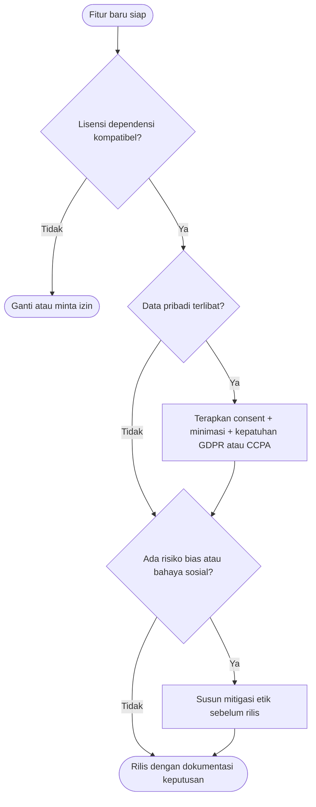

# Software Engineering | Sesi 25: Legal Issues, Social Impact, and Professional Ethics in Software Engineering

> **Mata Kuliah:** Rekayasa Perangkat Lunak (Software Engineering) | **Sesi:** 25 | **Status:** Materi UAS

---

## 🔑 Cues
- Legal constraints sepanjang development
- IP: copyright, patent, trademark
- Lisensi: proprietary, open source (MIT/GPL), freeware/shareware
- Privasi: GDPR, CCPA
- Social impact + professional ethics
- Ethical decision-making

---

## 📖 Materi Utama

### 1. Hukum Bukan Urusan Belakangan
- Software engineer wajib menimbang **legal constraints** di seluruh proses — isu ini bertumpang tindih dengan intellectual property, data security, dan compliance.
- Relevansinya: compliance mencegah lawsuits, financial loss, dan reputational damage.

### 2. Tiga Pilar Intellectual Property
- **Copyrights:** melindungi kode dan dokumentasi sebagai original works — unauthorized copying/distribution ilegal.
- **Patents:** melindungi invensi baru yang non-obvious dan proses unik — contoh patent Google atas page-ranking algorithm.
- **Trademarks:** melindungi nama, simbol, logo layanan — contoh trademark Microsoft atas logo Windows.
- Intinya: IP mendorong inovasi — kreator menikmati hasil invensinya sambil terlindungi dari misuse.

### 3. Model Lisensi Software
- **Proprietary:** melarang modify, share, redistribute. **Open source:** bebas akses, modifikasi, share source code (misal MIT, GPL). **Freeware/shareware:** gratis atau trial terbatas sebelum membayar.
- Pentingnya lisensi: ia mendefinisikan bagaimana software boleh dipakai, didistribusikan, dan dimodifikasi — menentukan cara developer boleh berinteraksi dengannya.

### 4. Privasi, Dampak Sosial, dan Etika Profesi
- **Privacy laws & compliance:** GDPR dan CCPA sebagai acuan perlindungan data dan standar kepatuhan.
- **Social impact:** software membentuk masyarakat — engineer menanggung konsekuensi sosial pilihannya.
- **Professional ethics & codes of conduct:** standar perilaku profesi di atas sekadar legal; **ethical decision-making models** melatih penerapannya ke skenario nyata.

---

## Library Diagram & Arsitektur

### Alur Keputusan Legal-Etik Rilis Fitur

---

## 🛠️ Use Case / Implementasi Nyata
- **Skenario:** Developer lepas membangun web PPDB sekolah memakai template berlisensi tak jelas, plus font dan ikon "gratis" dari hasil pencarian.
- **Masalah yang Diatasi:** Sekolah bisa dituntut karena distribusi ulang aset ber-copyright; data calon siswa tercecer tanpa dasar consent.
- **Keuntungan:** Audit lisensi 30 menit (ganti aset ke MIT/CC0, catat atribusi) + formulir consent sederhana menutup dua risiko hukum sekaligus — jauh lebih murah dari somasi.

---

## 🗂️ Konsep Kunci

| Istilah | Definisi | Contoh / Catatan |
|---------|----------|-----------------|
| Copyright | Lindungi karya orisinal (kode, docs) | Copy ilegal tanpa izin |
| Patent | Lindungi invensi baru non-obvious | Page-ranking Google |
| Trademark | Lindungi nama/simbol/logo | Logo Windows |
| Proprietary | Larang ubah/sebar ulang | Lisensi komersial tertutup |
| Open source | Bebas akses–ubah–sebar | MIT, GPL |
| GDPR / CCPA | Regulasi perlindungan data | Acuan compliance privasi |

---

## 📊 Tabel Ringkasan

| Lisensi | Boleh Diubah? | Boleh Disebar? | Contoh |
|---------|---------------|----------------|--------|
| Proprietary | Tidak | Tidak | Software komersial tertutup |
| Open source | Ya | Ya (ikuti syarat) | MIT, GPL |
| Freeware/shareware | Tidak | Terbatas | Trial sebelum bayar |

---

## ⚠️ Catatan Penting
> **Legal adalah batas bawah, etika adalah batas atas** — patuh hukum saja tidak cukup bila keputusanmu tetap merugikan pengguna; engineer profesional memenuhi keduanya.

---

## 📝 Materi Tambahan (Visual Insights)
- Referensi utama: slide asli sesi 25 (COMP6100001); objectives: aspek legal, IP dan licensing, privacy laws dan compliance, social implications, professional ethics, ethical decision-making.
- Kaji ulang contoh soal latihan legal-etik yang relevan sebelum UAS.

---

## ✅ Standar Visual & Orisinalitas
- Sintesis orisinal sesi 25; flowchart keputusan dan contoh PPDB milik sendiri; tiga pilar IP, model lisensi, dan kerangka privasi-etika merujuk materi asli.
