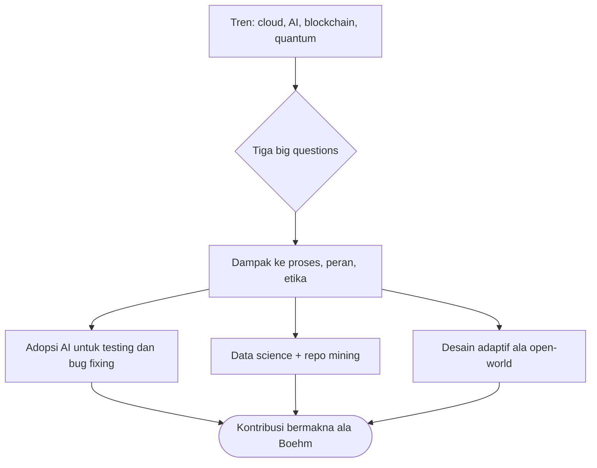

# Software Engineering | Sesi 26: Emerging Trends in Software Engineering

> **Mata Kuliah:** Rekayasa Perangkat Lunak (Software Engineering) | **Sesi:** 26 | **Status:** Materi UAS

---

## 🔑 Cues
- 4 arah teknologi: cloud/serverless, AI/ML, blockchain, quantum
- 3 big questions abad 21
- Shaw: mobilitas + interdependensi kompleks
- Boehm: rapid change, uncertainty, emergence
- AI bantu testing/bug fixing; data science; repo mining
- Open-world software + open source

---

## 📖 Materi Utama

### 1. Arah Teknologi yang Mengubah Praktik
- **Cloud computing & serverless architectures; AI & ML dalam development; blockchain dan aplikasinya; quantum computing basics** — empat gelombang yang memengaruhi praktik, peran, tanggung jawab, dan etika software engineering.

### 2. Tiga Pertanyaan Besar Abad 21
1. How rapidly does a technology evolve? 2. How significant are the effects of positive feedback? 3. How profound will the resultant changes be?

### 3. Disiplin di Tengah Kompleksitas Sosial
- Seiring mobilitas mendominasi lanskap software, **Shaw** melihat tantangan dari interdependensi mendalam antara sistem sangat kompleks dan penggunanya; knowledge base menuju purposeful practice telah didemokratisasi jejaring sosial terspesialisasi di Web.
- Konsekuensinya: masalah engineer kian situated di konteks sosial kompleks, batas problem kian sulit digambar, dan isolasi fondasi saintifik disiplin tetap menantang. Wajar menyatakan penemuan ide baru SE kini naturally incremental dan evolutionary.

### 4. Mengamati Tren: Konektivitas dan Globalisasi
- **Boehm:** engineer menghadapi rapid change, uncertainty and emergence, dependability, diversity, interdependence — sekaligus punya peluang berkontribusi bermakna.
- Connectivity + high-bandwidth collaboration melahirkan tim tanpa satu lokasi (telecommuting, part-time lokal); globalisasi membawa workforce beragam (bahasa, budaya, problem resolution, filosofi manajemen, prioritas komunikasi).
- Dulu kompleksitas dikelola ad-hoc; kini via process, methods, tools — dan esok? AI techniques membantu mengelola kompleksitas [Har12b], [Xie18].

### 5. Soft Trends yang Patut Dicatat
- **ML untuk testing dan bug fixing** [Mei18]; **data science** membaca tumpukan data engineering proyek besar [Kim16b]; **mining repositories** sebagai teknik riset yang diterima [Dye15].
- **Ambient intelligence, context-aware apps, pervasive/ubiquitous computing:** integrasi sistem software ke lingkungan jauh melampaui laptop/perangkat mobile.
- **Open-world software:** didesain beradaptasi ke lingkungan yang terus berubah "by self-organizing its structure and self-adapting its behavior".
- **Open source:** "a development method for software that harnesses the power of distributed peer review and transparency of process. The promise of open source is better quality, higher reliability, more flexibility, lower cost, and an end to predatory vendor lock-in." Istilahnya berarti work products (models, source code, test suites) terbuka untuk direview dan diextend publik (dengan kontrol).
- Penutup yang menancap: software engineering is about far more than technology — tentang people dan kemampuannya mengomunikasikan kebutuhan serta berinovasi mewujudkannya; dan whenever people are involved, change occurs slowly in fits and starts.

---

## Library Diagram & Arsitektur

### Dari Tren ke Respons Engineer

---

## 🛠️ Use Case / Implementasi Nyata
- **Skenario:** Unit IT kampus menimbang chatbot AI untuk layanan akademik 24/7.
- **Masalah yang Diatasi:** Antrean loket menumpuk tiap awal semester; staf kewalahan pertanyaan repetitif.
- **Keuntungan:** Lensa tiga big questions mencegah hype-driven adoption — diukur kecepatan evolusi model, efek feedback (jawaban salah yang dipercaya), dan kedalaman perubahan peran staf; hasilnya pilot terbatas + repo mining atas log pertanyaan, bukan full-automation buta.

---

## 🗂️ Konsep Kunci

| Istilah | Definisi | Contoh / Catatan |
|---------|----------|-----------------|
| Serverless | Komputasi tanpa kelola server | Arah cloud |
| AI/ML in SE | AI membantu complexity, testing, fixing | [Har12b], [Mei18] |
| Ubiquitous computing | Software meresap ke lingkungan | Ambient, context-aware |
| Open-world software | Self-organizing + self-adapting | Adaptif ke lingkungan berubah |
| Open source | Peer review terdistribusi + transparan | Anti vendor lock-in |
| Soft trends | Tren lunak pendorong praktik | Data science, repo mining |

---

## 📊 Tabel Ringkasan

| Tren | Pengaruh ke SE | Respons |
|------|---------------|---------|
| Cloud/serverless | Deploy tanpa kelola server | Desain cloud-native |
| AI/ML | Testing, fixing, kelola kompleksitas | Adopsi + validasi ketat |
| Blockchain | Trust tanpa perantara | Aplikasi selektif |
| Quantum | Komputasi baru | Pantau basics-nya |
| Globalisasi | Tim lintas budaya/lokasi | Kolaborasi async-first |

---

## ⚠️ Catatan Penting
> **Ide baru SE kini incremental dan evolutionary** — jangan berburu revolusi; yang menang adalah yang paling cepat belajar dari tren tanpa mabuk tren.

---

## 📝 Materi Tambahan (Visual Insights)
- Referensi utama: slide asli sesi 26 (COMP6100001); objectives: pengaruh emerging tech ke praktik dan etika, dampak future tech ke proses, peran, dan tanggung jawab.
- Konektivitas dan globalisasi: tim tak lagi selokasi; keragaman menjadi fitur, bukan friksi.

---

## ✅ Standar Visual & Orisinalitas
- Sintesis orisinal sesi 26; diagram respons dan contoh chatbot kampus milik sendiri; kutipan Shaw/Boehm, definisi open-world/open source, dan 3 big questions verbatim dari materi asli.
