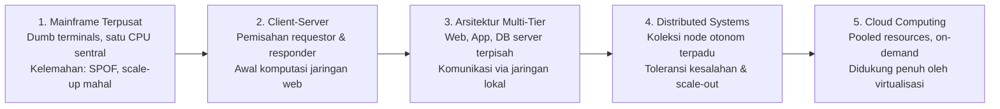
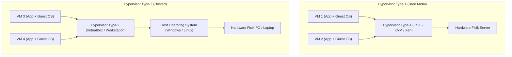
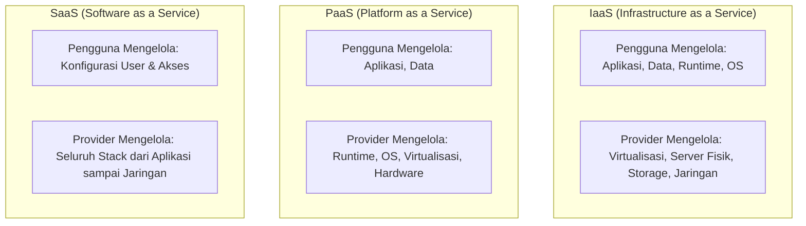

# Cloud Interfacing with Virtualization | Sesi 1: Foundations of Cloud and Virtualization

> **Mata Kuliah:** Cloud Interfacing with Virtualization | **Sesi:** 1 | **Status:** Materi UTS
> **Sumber:** Slide dosen, adaptasi Erl & Barceló Monroy (2024), *Cloud Computing: Concepts, Technology, Security & Architecture*; Marinescu (2022), *Cloud Computing: Theory and Practice*.

---

## 🔑 Cues

- Evolusi komputasi: mainframe, client-server, multi-tier, distributed
- Keterbatasan sistem terpusat: single point of failure dan skala vertikal
- Definisi sistem terdistribusi dan prinsip pooled resources
- Taksonomi virtualisasi: pemisahan abstraksi hardware dari OS
- Peran Virtual Machine Monitor (VMM) atau Hypervisor
- Klasifikasi hypervisor: Type-1 (Bare-Metal) vs Type-2 (Hosted)
- Relevansi virtualisasi terhadap Infrastructure as a Service (IaaS)
- Model layanan cloud: IaaS, PaaS, dan SaaS
- Matriks tanggung jawab bersama (Shared Responsibility Model)
- Model deployment cloud: Public, Private, Hybrid, dan Multi-Cloud
- Efisiensi ekonomi: pergeseran belanja modal (CapEx) ke operasional (OpEx)
- Peningkatan utilisasi server fisik dari 15% menjadi 80%+
- Karakteristik on-demand self-service dan multi-tenancy

---

## 📖 Materi Utama

### 1. Evolusi Menuju Sistem Terdistribusi dan Cloud

Perjalanan arsitektur komputasi modern didorong oleh tuntutan keandalan, ketersediaan tinggi, dan efisiensi biaya:

#### **A. Sistem Terpusat Awal (Centralized Mainframe)**
- Komputasi awal mengandalkan satu komputer sentral berukuran besar (*mainframe*) yang mengeksekusi seluruh aplikasi, logika bisnis, dan penyimpanan data.
- Pengguna berinteraksi melalui terminal bodoh (*dumb terminals*) yang hanya bertindak sebagai perangkat input keyboard dan output layar.
- **Keterbatasan Utama:**
  - *Single Point of Failure (SPOF):* Jika mainframe mati, seluruh operasional organisasi lumpuh total.
  - *Skalabilitas Terbatas (Scale-Up Only):* Peningkatan performa menuntut penggantian mesin utama yang sangat mahal (*expensive vertical scaling*).
  - *Bottleneck Kapasitas:* Penambahan pengguna baru langsung menurunkan performa pemrosesan sentral.

#### **B. Arsitektur Client-Server dan Multi-Tier**
- Beban kerja dipecah menjadi dua peran: klien (*client*) mengirimkan permintaan, dan peladen (*server*) memproses data lalu mengirimkan respons balik.
- Seiring membesarnya beban trafik, satu server tidak lagi memadai. Sistem berevolusi memisahkan tanggung jawab ke server-server khusus: *Web Server* (antarmuka HTTP), *Application Server* (logika bisnis), *Database Server* (penyimpanan relasional), dan *Storage System*.

#### **C. Sistem Terdistribusi (Distributed Systems)**
- Kumpulan komputer independen (*nodes*) yang saling terhubung melalui jaringan komunikasi dan berkoordinasi sehingga tampak bagi pengguna akhir sebagai satu sistem tunggal yang utuh.
- **Keunggulan:** Skalabilitas horizontal (*scale-out* dengan menambah node murah), ketersediaan tinggi (*high availability*), dan toleransi terhadap kegagalan sebagian komponen (*partial failure tolerance*).
- **Tantangan Inti:** Latensi komunikasi jaringan, konsistensi data antar-node (CAP Theorem), konkurensi, dan kegagalan partisi jaringan.

### 2. Dari Sistem Terdistribusi ke Cloud Computing

Cloud computing merupakan evolusi industrial dari sistem terdistribusi yang dipadukan dengan otomasi dan virtualisasi:
- **Konsep Inti Cloud:** Kumpulan sumber daya komputasi, jaringan, dan penyimpanan yang dikumpulkan (*resource pooling*) dan dapat disewa oleh pengguna secara mandiri (*on-demand self-service*) melalui internet tanpa interaksi manusia langsung dengan provider.
- **Peran Kunci Virtualisasi:** Virtualisasi bertindak sebagai fondasi pemungkin (*enabler*) utama cloud. Tanpa virtualisasi, provider cloud harus mengalokasikan satu server fisik untuk satu pelanggan, yang membatasi elastisitas dan membuat biaya menjadi sangat mahal.

### 3. Taksonomi Virtualisasi

Virtualisasi adalah proses abstraksi perangkat keras komputasi fisik sehingga satu mesin fisik dapat menjalankan beberapa mesin virtual (*Virtual Machines - VMs*) yang terisolasi secara bersamaan.

- **Hypervisor / Virtual Machine Monitor (VMM):** Lapisan perangkat lunak, firmware, atau modul kernel yang mengontrol alokasi CPU, memori, I/O, dan jaringan ke setiap VM.
- **Tipe 1 (Bare-Metal Hypervisor):** Berjalan langsung di atas hardware fisik tanpa sistem operasi perantara. Memberikan performa maksimal, latensi rendah, dan isolasi kuat. Menjadi standar emas data center enterprise dan public cloud (contoh: VMware ESXi, KVM, Xen, Microsoft Hyper-V).
- **Tipe 2 (Hosted Hypervisor):** Berjalan sebagai program aplikasi di atas sistem operasi host. Bergantung pada driver dan penjadwal OS host. Mudah diinstal untuk keperluan pengujian dan pembelajaran di PC desktop (contoh: Oracle VirtualBox, VMware Workstation).

### 4. Model Layanan Cloud (Delivery Models) & Shared Responsibility

Pembagian tanggung jawab pengelolaan tumpukan teknologi terbagi ke dalam tiga model layanan utama:

| Lapisan Stack | Tradisional (On-Premises) | IaaS | PaaS | SaaS |
|---|---|---|---|---|
| **Aplikasi (*Applications*)** | Pengguna | Pengguna | Pengguna | Provider |
| **Data** | Pengguna | Pengguna | Pengguna | Provider |
| **Runtime & Middleware** | Pengguna | Pengguna | Provider | Provider |
| **Sistem Operasi (*OS*)** | Pengguna | Pengguna | Provider | Provider |
| **Virtualisasi (*Hypervisor*)** | Pengguna | Provider | Provider | Provider |
| **Server Fisik Komputasi** | Pengguna | Provider | Provider | Provider |
| **Penyimpanan (*Storage*)** | Pengguna | Provider | Provider | Provider |
| **Jaringan (*Networking*)** | Pengguna | Provider | Provider | Provider |

### 5. Model Deployment Cloud

1. **Public Cloud:** Infrastruktur komputasi dimiliki dan dioperasikan oleh penyedia pihak ketiga (misal Microsoft Azure, AWS, Google Cloud). Sumber daya dibagi secara multi-tenant melalui jaringan internet publik.
2. **Private Cloud:** Infrastruktur komputasi dioperasikan semata-mata untuk satu organisasi tunggal. Dapat di-host di data center internal (*on-premises*) atau dikelola pihak ketiga, menawarkan kontrol privasi dan kepatuhan regulasi data tertinggi.
3. **Hybrid Cloud:** Menggabungkan infrastruktur private cloud dan public cloud yang diikat oleh teknologi terstandarisasi, memungkinkan portabilitas data dan aplikasi (misal menggunakan Azure Stack atau AWS Outposts).
4. **Multi-Cloud:** Menggunakan layanan komputasi dari dua atau lebih penyedia public cloud yang berbeda secara independen untuk mencegah *vendor lock-in* dan mengoptimalkan keunggulan fitur masing-masing provider.

---

## 🛠️ Use Case / Implementasi Nyata

- **Skenario:** Lembaga keuangan perbankan ingin meremajakan sistem perbankan inti (*core banking*) dan portal aplikasi pinjaman nasabah.
- **Implementasi Hybrid Cloud & Multi-Tier:**
  - *Private Cloud (IaaS/Bare-metal):* Basis data saldo dan catatan transaksi rekening nasabah dipertahankan di data center privat on-premises untuk mematuhi regulasi ketat kedaulatan data perbankan.
  - *Public Cloud (PaaS):* Antarmuka frontend web dan microservice pengajuan pinjaman online di-deploy ke public cloud (Azure App Service) agar dapat diskalakan secara elastis mengikuti lonjakan pengajuan nasabah saat tanggal promosi.
  - *Konektivitas:* Jaringan privat virtual terenkripsi (Azure ExpressRoute / VPN Gateway) menghubungkan private cloud dan public cloud secara aman.

---

## 🗂️ Konsep Kunci

| Istilah | Definisi | Contoh / Catatan |
|---|---|---|
| Virtualisasi | Abstraksi perangkat keras fisik agar dapat menjalankan banyak lingkungan OS terisolasi | Fondasi komputasi cloud |
| Hypervisor (VMM) | Lapisan perangkat lunak/firmware yang mengelola dan mengalokasikan hardware fisik ke VM | VMware ESXi, KVM |
| Type-1 Hypervisor | Hypervisor bare-metal yang berjalan langsung di atas hardware fisik tanpa OS host | Standar data center enterprise |
| Type-2 Hypervisor | Hypervisor hosted yang berjalan sebagai aplikasi di atas sistem operasi host | VirtualBox, VMware Workstation |
| IaaS | Model cloud di mana provider menyewakan infrastruktur dasar (VM, storage, network) | Azure Virtual Machines, AWS EC2 |
| PaaS | Model cloud di mana provider menyediakan platform lengkap (OS, runtime) siap pakai | Azure App Service, Heroku |
| SaaS | Model cloud di mana perangkat lunak utuh disediakan langsung lewat web browser | Gmail, Microsoft 365 |
| Shared Responsibility | Matriks pembagian tanggung jawab keamanan dan operasional antara user dan cloud provider | User selalu bertanggung jawab atas data |

---

## 📊 Tabel Ringkasan

**Perbandingan Karakteristik Model Layanan Cloud**

| Parameter | IaaS | PaaS | SaaS |
|---|---|---|---|
| **Tingkat Kontrol Pengguna** | Sangat Tinggi (Akses root OS) | Menengah (Akses kode & setting) | Rendah (Hanya konfigurasi user) |
| **Beban Pemeliharaan OS** | Tanggung Jawab Pengguna (Patching) | Tanggung Jawab Cloud Provider | Tanggung Jawab Cloud Provider |
| **Sasaran Pengguna Utama** | Network Engineer, Sysadmin, SRE | Pengembang Aplikasi (*Developers*) | Pengguna Akhir (*End Users* / Bisnis) |
| **Waktu Pemasangan Solusi** | Menengah (Butuh konfigurasi OS) | Cepat (Tinggal upload kode/image) | Instan (Tinggal login akun) |
| **Contoh Layanan Nyata** | Azure VM, AWS EC2, GCE | Azure App Service, Elastic Beanstalk | Microsoft 365, Google Workspace |

---

## ⚠️ Catatan Penting

> **Data selalu menjadi tanggung jawab pengguna.** Dalam model cloud apa pun (IaaS, PaaS, bahkan SaaS), data dan klasifikasi hak akses akun pengguna tidak pernah dialihkan ke penyedia cloud. Jika kredensial bocor akibat kelalaian internal, penyedia cloud tidak bertanggung jawab.
>
> **Type-1 Hypervisor bukan berarti tanpa overhead.** Meskipun berjalan langsung di atas bare-metal, Type-1 hypervisor tetap memiliki overhead komputasi untuk emulasi perangkat, penjadwalan vCPU, dan translasi tabel halaman memori.
>
> **Utilisasi server adalah pembeda ekonomi terbesar.** Sebelum era virtualisasi, rata-rata server fisik di perusahaan hanya beroperasi pada kapasitas 10–15% CPU. Virtualisasi memungkinkan rasio konsolidasi tinggi sehingga satu mesin fisik dapat melayani puluhan VM dengan utilisasi 70–85%.

---

## 📝 Materi Tambahan (Visual Insights)

- **Pergeseran Finansial CapEx ke OpEx:**
  - *Capital Expenditure (CapEx):* Biaya modal di muka untuk membeli rak server, pendingin data center, genset cadangan, dan lisensi hardware fisik (biaya depresiasi bertahun-tahun).
  - *Operational Expenditure (OpEx):* Biaya operasional rutin bulanan berbasis pemakaian (*pay-as-you-go*) di cloud, mengeliminasi risiko pembelian server yang berakhir menganggur (*underutilized hardware*).
- **Referensi Buku:**
  - Erl, T., & Barceló Monroy, E. (2024). *Cloud Computing: Concepts, Technology, Security & Architecture* (2nd ed.). Pearson.
  - Marinescu, D. C. (2022). *Cloud Computing: Theory and Practice* (3rd ed.). Elsevier / Morgan Kaufmann.
