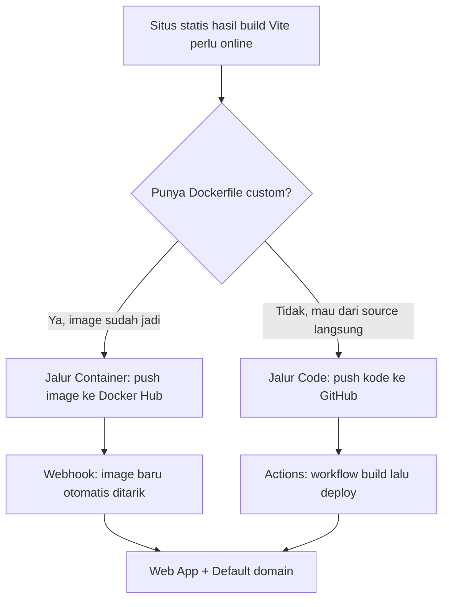

# Cloud Interfacing with Virtualization | Sesi 1: Introduction to Azure App Service

> **Mata Kuliah:** Cloud Interfacing with Virtualization | **Sesi:** 1 | **Status:** Materi Lab

---

## 🔑 Cues
- PaaS: bawa aplikasi, Azure urus mesin
- App Service Plan sebagai "paket kos"
- Region East Asia + nama unik global
- Dua pintu rilis: image vs source
- Dockerfile dua fase (build lalu serve)
- Webhook continuous deployment
- Startup command SPA
- Runtime Status sebagai lampu kesehatan

---

## 📖 Materi Utama

### 1. Cara Berpikir PaaS: Sewa Kamar Furnished, Bukan Tanah Kosong

- Analogi sendiri: VM itu seperti sewa tanah kosong — bangun fondasi (OS), pasang listrik (runtime), baru dirikan rumah (aplikasi). App Service itu kamar kos furnished: kasur, lemari, Wi-Fi sudah ada; penghuni tinggal bawa koper (kode atau image).
- Konsekuensi praktisnya: tidak ada akses SSH ke OS, tidak ada install manual. Yang dikendalikan hanya tiga hal: isi koper (aplikasi), label koper (environment variable, networking), dan kurir pengantar (metode deploy).
- "Kamar" ini disewa lewat **App Service Plan** — paket yang menentukan jatah CPU/RAM. Saat Web App dibuat, plan ini ter-generate otomatis; performa mentok biasanya urusan plan, bukan kode.

#### **Memilih Kurir Rilis**


### 2. Fondasi Bersama: Resource Group dan Aturan Main

- Semua resource lab dikumpulkan dalam satu **Resource Group** agar gampang dilacak dan dihapus sekaligus. Alur portal: *Resource groups → Create →* isi nama → **Region East Asia** → *Review + create → Create → Go to resource group*.
- Dua jebakan klasik sesi ini: region harus East Asia, dan nama Web App harus unik sedunia (bila ditolak, tambah angka seperti `contoh1`).
- Setelah resource jadi, alamat publiknya ada di **Default domain** (Overview → Properties). Variabel lingkungan ditambah via Settings → Environment variables; koneksi ke database via Settings → Networking.

### 3. Jalur Image: Dari Laptop ke Docker Hub ke Azure

- Pembuatan Web App: portal → cari *App Services → Create →* **Web App**, Resource Group yang tadi, **Publish: Container**, OS Linux, region East Asia.
- Di tab **Container**: *Image Source = Other container registries*, *Registry server URL* diisi alamat registry Docker Hub (format `.../username_docker_hub`), *Image and tag* diisi `nama:latest`.
- Di tab **Monitor + secure**: *Application Insights = Yes*. Lalu *Review + create → Create → Go to resource*.
- Agar rilis berjalan sendiri, buka Deployment → **Deployment Center**: aktifkan *Continuous deployment*, klik *Enable* pada Webhook URL, centang *SCM Basic Auth Publishing Credentials* lalu Apply. Salin Webhook URL ini.
- Di sisi Docker Hub: buat repository (namanya harus sama dengan segmen `nama` pada `nama:latest`) → tab **Webhooks** → nama bebas + paste URL tadi. Sejak itu setiap `docker push` memicu Azure menarik image terbaru.

### 4. Isi Koper Jalur Image: Dockerfile Dua Fase

- Project frontend dibuat dari `npm create vite@latest` (React + TypeScript + ESLint). Di root project, `Dockerfile` dibagi dua fase agar image akhir ramping: fase `builder` merakit file statis, fase `runner` hanya menyajikannya.
- Fase pertama memakai Node, fase kedua memakai nginx:

```dockerfile
FROM node:22-alpine AS builder
WORKDIR /app
COPY package.json package-lock.json ./
RUN npm ci
COPY . .
RUN npm run build
FROM nginx:alpine AS runner
WORKDIR /usr/share/nginx/html
COPY --from=builder /app/dist ./
CMD ["nginx", "-g", "daemon off;"]
```

- Build lalu dorong ke registry (sesuaikan username, nama repo, tag, folder):

```bash
docker build -t username_docker_hub/nama_repository:tag_image .\nama_folder\
docker images
docker push username_docker_hub/nama_repository:tag_image
```

- `docker images` memastikan image lokal terbentuk; baris `latest: digest: ...` setelah push berarti upload sukses. Cek silang di Docker Hub tab General bahwa tag baru masuk.

### 5. Jalur Source: Dari Git ke Workflow Otomatis

- Dorong kode ke repo GitHub baru:

```bash
git init
git add .
git commit -m "Initial Commit"
git branch -M main
git remote add origin <url>
git push origin main
```

- Bila `git` menuntut identitas, set sesuai akun lalu ulangi perintah yang gagal:

```bash
git config --global user.email "you@example.com"
git config --global user.name "Your Name"
```

- Web App kedua dibuat dengan **Publish: Code**, runtime **Node 22 LTS**, Linux, East Asia. Di tab Deployment: Continuous Deployment = Enable, hubungkan akun GitHub, pilih repo dan branch `main`.
- Azure lalu menanam folder `.github/workflows` berisi `main_<app>.yml`. Alurnya dua tahap: *build* (checkout, setup Node 22, `npm install`/`build`/`test`, upload artifact) lalu *deploy* (download artifact, login via OIDC, `azure/webapps-deploy`). Kerangka padatnya:

```yaml
on:
  push:
    branches: [main]
  workflow_dispatch:
jobs:
  build:
    runs-on: ubuntu-latest
    steps:
      - uses: actions/checkout@v4
      - uses: actions/setup-node@v3
        with: { node-version: '22.x' }
      - run: npm install / npm run build / npm run test
      - uses: actions/upload-artifact@v4
        with: { name: node-app, path: . }
  deploy:
    runs-on: ubuntu-latest
    needs: build
    steps:
      - uses: actions/download-artifact@v4
      - uses: azure/login@v2
      - uses: azure/webapps-deploy@v3
        with: { app-name: '<nama-app>', slot-name: 'Production', package: . }
```

- Satu setting penentu: Settings → Configuration → Stack Settings → **Startup command**, isi lalu Apply:

```
pm2 serve /home/site/wwwroot/dist --no-daemon --spa
```

- Tanpa perintah itu, output build Vite (`dist/`) tidak disajikan sebagai SPA.

### 6. Membaca Lampu Kesehatan

- Portal → Web App → Overview → Properties → **Runtime Status**. `Healthy` berarti Default Domain siap dibuka.
- `Unknown` artinya masih proses — tunggu dan refresh beberapa menit. `Error` berarti baca detail error-nya (atau tanya aslab), jangan langsung menghapus resource.
- Uji rilis otomatis: ubah `<h1>` di `App.tsx` (misalnya jadi `Get started V2`), build + push ulang, refresh Default Domain — perubahan muncul tanpa klik apa pun di portal.

---

## 🛠️ Use Case / Implementasi Nyata
- **Skenario:** Tim frontend punya situs statis hasil build Vite yang harus bisa dibuka publik sore ini juga, tanpa ada anggota paham administrasi server.
- **Masalah yang Diatasi:** Urutan manual yang panjang dan mudah terlewat: siapkan OS, install runtime, konfigurasi web server, copy file, restart service.
- **Keuntungan:** Dengan PaaS, rilis menyusut jadi satu kebiasaan: `push`. Pilihan image cocok saat butuh lingkungan custom; pilihan source cocok saat ingin pipeline CI yang transparan di GitHub.

---

## 🗂️ Konsep Kunci

| Istilah | Definisi | Contoh / Catatan |
|---------|----------|-----------------|
| PaaS | Layanan platform: OS dan runtime diurus penyedia | App Service: kirim kode/image saja |
| App Service Plan | Paket kuota CPU/RAM untuk aplikasi | Dibuat otomatis saat Web App dibuat |
| Resource Group | Amplop logis pengelompok resource | Satu grup per sesi lab |
| Continuous deployment | Penarikan rilis otomatis tiap ada versi baru | Via webhook atau Actions |
| Startup command | Perintah eksekusi saat aplikasi start | `pm2 serve ... --spa` untuk SPA |
| Runtime Status | Lampu kesehatan hasil deploy | Healthy / Unknown / Error |

---

## 📊 Tabel Ringkasan

| Aspek | Jalur Container | Jalur Code (GitHub) |
|-------|----------------|---------------------|
| Artefak yang di-push | Image (`nama:latest`) ke Docker Hub | Source ke branch `main` |
| Pemicu rilis | Webhook registry | Workflow GitHub Actions |
| Penyaji file | nginx di dalam image | Node + `pm2 serve dist` |
| Kapan dipilih | Butuh image custom multi-stage | Ingin build log terlihat di repo |

---

## ⚠️ Catatan Penting
> **Keputusan region dan nama tidak bisa ditawar** — East Asia dan nama unik global. Saat deploy bermasalah, baca Runtime Status dulu: `Unknown` diobati dengan menunggu, `Error` diobati dengan membaca pesan, bukan mengulang dari nol.

---

## 📝 Materi Tambahan (Visual Insights)

### Trik Hafalan Klik Portal
- Ingat rantai tempat setting tersebar: identitas aplikasi (Overview → Default domain), rahasia (Environment variables), koneksi (Networking), otomasi (Deployment Center). Empat pintu itu mencakup hampir semua klik sesi ini.

### Gangguan Lingkungan Lokal
- Terminal protes `npm` tidak dikenal berarti Node.js belum terinstall; `git` protes identitas berarti `user.email`/`user.name` belum di-set sesuai akun GitHub.
