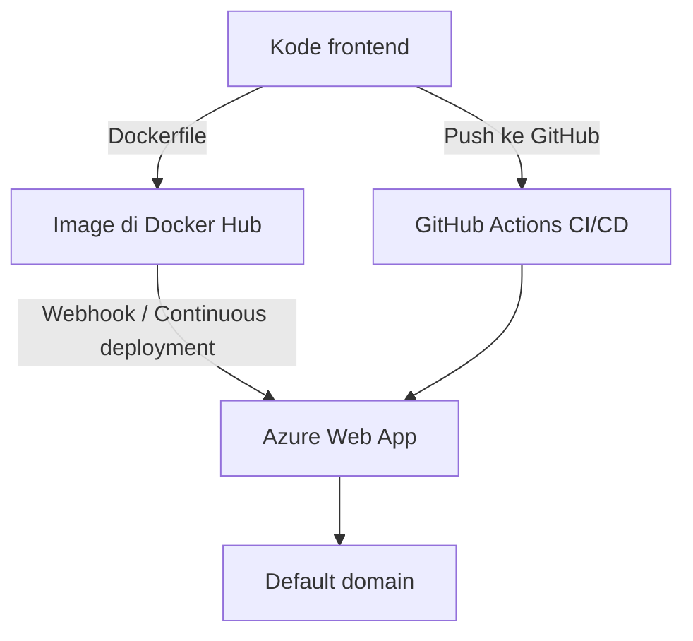

# Cloud Interfacing with Virtualization | Sesi 1: Introduction to Azure App Service

> **Mata Kuliah:** Cloud Interfacing with Virtualization | **Sesi:** 1 | **Status:** Materi Lab

---

## 🔑 Cues
- PaaS (Platform as a Service)
- Azure App Service + App Service Plan
- Resource Group (Region East Asia)
- Deploy via Container vs via GitHub (Code)
- Dockerfile multi-stage (Node build → nginx serve)
- Continuous deployment + webhook Docker Hub
- Startup command (`pm2 serve ... --spa`)
- Runtime Status: Healthy vs Issues Detected

---

## 📖 Materi Utama

### 1. Azure App Service itu PaaS

- App Service adalah wujud **Platform as a Service**: kita cukup membawa kode/image, Azure yang mengurus server, OS, dan runtime di bawahnya.
- Konsekuensinya: tidak ada SSH ke VM, tidak ada instalasi OS — yang kita atur hanya aplikasi, konfigurasi (environment variable, networking), dan cara deploy-nya.
- Pola deploy yang dipraktikkan ada dua: dari **container image** (Docker Hub) dan dari **source code di GitHub** (Code + GitHub Actions).

#### **Alur Umum Deploy**


### 2. Persiapan: Resource Group

- Semua resource lab dikumpulkan dalam satu **Resource Group** supaya gampang dilacak dan (nanti) dihapus sekaligus.
- Caranya: portal → *Resource groups* → *Create* → isi nama → **Region East Asia** → *Review + create* → *Create* → *Go to resource group*.
- Kalau notifikasi pembuatannya kelewat, refresh lalu klik nama resource group-nya.

### 3. Membuat Web App Berbasis Container

- Portal → cari *App Services* → *Create* → **Web App**. Isian pentingnya:
  - Resource Group: pakai yang baru dibuat. Nama: harus unik global (kalau error, tambah angka, mis. `contoh1`).
  - **Publish: Container**, OS: Linux, Region: East Asia.
  - Saat form ini diisi, Azure otomatis men-generate **App Service Plan** — di sinilah jatah CPU/RAM aplikasi ditentukan.
- Lanjut *Next* sampai tab **Container**: *Image Source* = *Other container registries*, *Registry server URL* diisi alamat registry Docker Hub (`.../username_docker_hub`), *Image and tag* = `nama:latest`.
- Tab **Monitor + secure**: *Application Insights* = Yes. Terus *Review + create* → *Create* → *Go to resource*.
- Di halaman resource: link hasil ada di **Default domain** (Overview → Properties). Environment variable bisa ditambah lewat Settings → Environment variables. Konektivitas (mis. ke database) diatur di Settings → Networking.
- Supaya tiap ada image baru langsung ter-deploy, buka Deployment → **Deployment Center**: centang *Continuous deployment*, klik *Enable* pada Webhook URL, dan centang *SCM Basic Auth Publishing Credentials* + Apply.

### 4. Menghubungkan ke Docker Hub

- Webhook URL dari Deployment Center disalin, lalu di Docker Hub: buat repository (namanya samakan dengan bagian `nama` pada `nama:latest`) → tab **Webhooks** → isi nama bebas + paste URL tadi.
- Artinya: setiap `docker push` image baru ke repo itu, Docker Hub memanggil webhook Azure dan Web App menarik image terbaru.

### 5. Dockerfile: Build React, Serve via Nginx

- Project frontend dibuat dengan `npm create vite@latest` (React + TypeScript + ESLint), lalu di root project dibuat file `Dockerfile` dua tahap:
```dockerfile
FROM node:22-alpine AS builder
WORKDIR /app
COPY package.json package-lock.json ./
RUN npm ci
COPY . .
RUN npm run build
FROM nginx:alpine AS runner
WORKDIR /usr/share/nginx/html
COPY --from=builder /app/dist ./
CMD ["nginx", "-g", "daemon off;"]
```
- Idenya: tahap pertama mem-build static file (`/app/dist`), tahap kedua hanya menyajikan hasilnya lewat nginx — image akhir jadi kecil.
- Build dan push (sesuaikan username, nama repo, tag, dan folder):
```bash
docker build -t username_docker_hub/nama_repository:tag_image .\nama_folder\
docker images
docker push username_docker_hub/nama_repository:tag_image
```
- `docker images` dipakai memastikan image lokal sudah terbentuk; tulisan `latest: digest: ...` sesudah push artinya upload berhasil.

### 6. Mengecek Hasil Deploy

- Docker Hub → tab General repo untuk memastikan tag baru masuk.
- Portal → Web App → Overview → Properties → **Runtime Status**: `Healthy` = sukses dan Default Domain bisa dibuka.
- Kalau `Issues Detected`: klik tulisannya. `Unknown` = masih proses, tunggu + refresh beberapa menit. `Error` = baca info error-nya atau tanya aslab.
- Uji continuous deploy: ubah `<h1>` di `App.tsx` (mis. jadi `Get started V2`), build + push ulang, refresh Default Domain — perubahan harus muncul tanpa klik apa pun di portal.

### 7. Deploy via GitHub (Code)

- Source code di-push dulu ke repo GitHub baru:
```bash
git init
git add .
git commit -m "Initial Commit"
git branch -M main
git remote add origin <url>
git push origin main
```
- Kalau `git` protes identitas, set dulu (sesuai akun GitHub), lalu ulangi perintah yang error:
```bash
git config --global user.email "you@example.com"
git config --global user.name "Your Name"
```
- Web App kedua dibuat dengan **Publish: Code**, Runtime stack **Node 22 LTS**, Linux, East Asia. Di tab Deployment: Continuous Deployment = Enable, sambungkan akun GitHub → pilih repo → branch `main`.
- Azure otomatis membuat folder `.github/workflows` berisi file `main_<app>.yml`: workflow terpicu saat push ke `main` (atau manual), tahap *build* (checkout, setup Node 22, `npm install/build/test`, upload artifact) lalu tahap *deploy* (download artifact, login Azure via OIDC, `azure/webapps-deploy`). Kerangka strukturnya:
```yaml
on:
  push:
    branches: [main]
  workflow_dispatch:
jobs:
  build:
    runs-on: ubuntu-latest
    steps:
      - uses: actions/checkout@v4
      - uses: actions/setup-node@v3
        with: { node-version: '22.x' }
      - run: npm install / npm run build / npm run test
      - uses: actions/upload-artifact@v4
        with: { name: node-app, path: . }
  deploy:
    runs-on: ubuntu-latest
    needs: build
    steps:
      - uses: actions/download-artifact@v4
      - uses: azure/login@v2
      - uses: azure/webapps-deploy@v3
        with: { app-name: '<nama-app>', slot-name: 'Production', package: . }
```
- Satu setting wajib sesudahnya: Settings → Configuration → Stack Settings → **Startup command** diisi seperti di bawah → Apply. Tanpa ini, hasil build Vite (`dist/`) tidak disajikan.
```
pm2 serve /home/site/wwwroot/dist --no-daemon --spa
```

---

## 🛠️ Use Case / Implementasi Nyata
- **Skenario:** Frontend statis (hasil build Vite) perlu online cepat tanpa mengurus server.
- **Masalah yang Diatasi:** Instalasi OS/runtime, konfigurasi web server, dan deploy manual yang rawan lupa langkah.
- **Keuntungan:** Dua jalur deploy (image & source) + continuous deployment membuat rilis cukup dengan `push`.

---

## 🗂️ Konsep Kunci

| Istilah | Definisi | Contoh / Catatan |
|---------|----------|-----------------|
| PaaS | Model cloud di mana platform (OS, runtime) dikelola penyedia | App Service: bawa kode/image saja |
| App Service Plan | Penentu kuota CPU/RAM aplikasi | Ter-generate otomatis saat create |
| Resource Group | Wadah logis resource Azure | Region East Asia untuk lab |
| Continuous deployment | Deploy ulang otomatis tiap ada perubahan | Webhook (container) / Actions (GitHub) |
| Startup command | Perintah jalan saat app start | `pm2 serve ... --spa` untuk SPA |
| Runtime Status | Indikator kesehatan deploy | Healthy / Unknown / Error |

---

## 📊 Tabel Ringkasan

| Aspek | Jalur Container | Jalur GitHub (Code) |
|-------|----------------|---------------------|
| Yang di-push | Image ke Docker Hub | Kode ke branch `main` |
| Pemicu deploy | Webhook Docker Hub | GitHub Actions workflow |
| Runtime serving | nginx (dari Dockerfile) | Node + `pm2 serve dist` |
| Cocok untuk | Image custom / multi-stage | Source langsung, CI terlihat |

---

## ⚠️ Catatan Penting
> **Region dan nama itu jebakan klasik** — selalu East Asia; nama Web App harus unik global. Kalau deploy gagal, cek Runtime Status dulu sebelum mengulang dari awal: `Unknown` cukup ditunggu, `Error` baru di-debug.

---

## 📝 Materi Tambahan (Visual Insights)
- Screenshot portal pada tiap langkah (resource group, form Web App, Deployment Center, webhook Docker Hub, Runtime Status) — jadikan acuan urutan klik, bukan sekadar bacaan.
- Kalau `npm` tidak dikenali di terminal, install Node.js dulu; kalau `git` protes identitas, set `user.email`/`user.name` sesuai akun GitHub.
