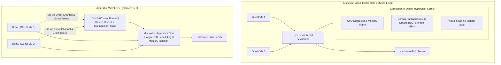

# Cloud Interfacing with Virtualization | Sesi 2: Hypervisor Architectures and VMMs

> **Mata Kuliah:** Cloud Interfacing with Virtualization | **Sesi:** 2 | **Status:** Materi UTS
> **Sumber:** Slide dosen, adaptasi Erl & Barceló Monroy (2024), *Cloud Computing: Concepts, Technology, Security & Architecture*; Marinescu (2022), *Cloud Computing: Theory and Practice*; Xen Project Documentation.

---

## 🔑 Cues

- Perbedaan fundamental arsitektur Monolithic vs Microkernel hypervisor
- Penempatan device drivers: di dalam kernel hypervisor vs di domain terisolasi
- Analisis komparasi performa I/O vs toleransi kesalahan (fault isolation)
- Analisis ukuran basis kode (codebase footprint) dan luas permukaan serangan (attack surface)
- Klasifikasi Type-1 (Bare-Metal) vs Type-2 (Hosted) hypervisor
- Analisis jalur latensi I/O (dual kernel traversal) pada Type-2 hypervisor
- Arsitektur KVM (Kernel-based Virtual Machine) berbasis modul Linux kernel
- Peran QEMU di user space dalam emulasi perangkat KVM
- Arsitektur domain Xen: Dom0 (kontrol istimewa) vs DomU (tamu unprivileged)
- Karakteristik VMware ESXi dan arsitektur VMkernel enterprise
- Konsolidasi server dan multitenancy aman di data center

---

## 📖 Materi Utama

### 1. Monolithic vs. Microkernel Hypervisors

Dalam merancang hypervisor (Virtual Machine Monitor / VMM), terdapat dua filosofi arsitektur utama dalam mengorganisasi komponen internal dan driver perangkat keras:

#### **A. Monolithic Hypervisor (Arsitektur Monolitik)**
- **Karakteristik:** Menyatukan seluruh fungsi virtualisasi—termasuk penjadwal CPU, manajemen memori, tumpukan jaringan, dan **seluruh driver perangkat keras fisik**—langsung di dalam kernel hypervisor tunggal.
- **Keuntungan:**
  - *Performa I/O Sangat Tinggi:* Komunikasi antara VM dan driver berlangsung cepat melalui pemanggilan fungsi langsung di memori kernel tanpa overhead *inter-domain communication* atau context switch antar-lapisan.
  - *Kontrol Hardware Penuh:* Hypervisor memiliki otoritas penuh atas perangkat keras secara langsung.
- **Kelemahan:**
  - *Basis Kode Raksasa (*Large Codebase Footprint*):* Jutaan baris kode driver pihak ketiga berjalan di level privilese tertinggi hardware.
  - *Isolasi Kesalahan Rendah (*Fault Isolation Risk*):* Jika salah satu driver kartu jaringan atau kontroler storage mengalami crash atau bug memori, seluruh hypervisor dan semua VM di atasnya dapat mengalami *kernel panic* (pemadaman total).
  - *Permukaan Serangan Luas (*Larger Attack Surface*):* Semakin banyak kode di kernel hypervisor, semakin besar peluang eksploitasi keamanan.
- **Contoh Utama:** **VMware ESXi**.

#### **B. Microkernel Hypervisor (Arsitektur Microkernelized)**
- **Karakteristik:** Inti hypervisor (*core*) dibuat sekecil dan seringkas mungkin (*minimalist microkernel*), hanya menangani fungsi paling krusial: alokasi memori dasar, penjadwalan vCPU, dan penegakan isolasi proteksi. Seluruh driver perangkat keras dan tumpukan manajemen dipindahkan ke luar hypervisor core dan dijalankan di dalam sebuah partisi/domain istimewa tersendiri.
- **Keuntungan:**
  - *Toleransi Kesalahan Sangat Tinggi (*Strong Fault Isolation*):* Jika sebuah driver jaringan crash, hanya domain driver tersebut yang perlu direstart tanpa menumbangkan hypervisor core atau VM lainnya.
  - *Basis Kode Sangat Kecil (*Small TCB - Trusted Computing Base*):* Hypervisor core hanya berukuran beberapa ratus kilobyte atau megabyte, sangat mudah diaudit keamanannya secara formal.
- **Kelemahan:**
  - *Overhead Komunikasi (*IPC Overhead*):* Setiap operasi I/O dari VM tamu harus melewati hypervisor core menuju domain kontrol/driver, menambah latensi pemrosesan dan context switch.
- **Contoh Utama:** **Xen** dan **Microsoft Hyper-V** (dengan model *Parent Partition* vs *Child Partitions*).

---

### 2. Type-1 (Bare-Metal) vs. Type-2 (Hosted) Hypervisors

Klasifikasi hypervisor berdasarkan tempat berjalannya di atas tumpukan komputasi:

```mermaid
flowchart TD
    subgraph Path_Type1 ["Jalur Eksekusi I/O: Type-1 Hypervisor"]
        G1["Guest OS Application"] --> GOS1["Guest OS Kernel"]
        GOS1 --> T1_VMM["Type-1 Hypervisor (Native Drivers)"]
        T1_VMM --> HW1["Storage Controller / Hardware"]
    end

    subgraph Path_Type2 ["Jalur Eksekusi I/O: Type-2 Hypervisor (Dual Traversal)"]
        G2["Guest OS Application"] --> GOS2["Guest OS Kernel"]
        GOS2 --> T2_VMM["Type-2 Hypervisor Process"]
        T2_VMM --> H_Syscall["Host OS System Call (I/O Buffering)"]
        H_Syscall --> H_Kernel["Host OS Kernel & Drivers"]
        H_Kernel --> HW2["Storage Controller / Hardware"]
    end
```

#### **Mengapa Type-2 Mengalami Latensi I/O Lebih Panjang? (The Architectural Gap)**
Saat Guest OS di dalam Type-2 VM melakukan operasi baca-tulis file disk:
1. Permintaan I/O diproses oleh Guest Kernel $\rightarrow$ memicu trap ke proses Hypervisor Type-2.
2. Hypervisor Type-2 tidak memiliki akses langsung ke hardware; ia harus membuat *system call* standar (misal `write()` atau `pwrite()`) ke Host Operating System.
3. Host OS Kernel menangani system call, mengalokasikan buffer di kernel space host, menjadwalkan request I/O melalui scheduler disk host, baru kemudian mengirimkannya ke driver fisik dan controller disk.
4. Terjadi **penjelajahan ganda dua kernel (*dual kernel traversal*)**, sakelar konteks ganda (*double context switching*), dan buffering data berlapis yang melipatgandakan latensi. Sebaliknya, Type-1 Hypervisor langsung mengirimkan perintah I/O ke driver perangkat keras di lapisannya sendiri.

---

### 3. Studi Kasus Tiga Hypervisor Utama Dunia

| Aspek Komparasi | KVM (Kernel-based Virtual Machine) | Xen Project | VMware ESXi |
|---|---|---|---|
| **Kategori Arsitektur** | Type-1 (Berbasis Linux Kernel) | Type-1 Microkernel | Type-1 Monolitik Enterprise |
| **Model Domain/Struktur**| Modul Kernel (`kvm.ko`) + Proses QEMU | Domain 0 (Dom0) & Domain U (DomU) | VMkernel Monolitik Tunggal |
| **Lokasi Driver Perangkat**| Menggunakan driver kernel Linux host | Terkonsentrasi di dalam Dom0 | Terintegrasi langsung di dalam VMkernel |
| **Pengelolaan Resource**| Penjadwal bawaan Linux (CFS) & cgroups | Penjadwal independen Xen (Credit Scheduler) | Penjadwal khusus proprietary VMware |
| **Ekosistem Penggunaan**| OpenStack, Red Hat KVM, Proxmox, AWS Nitro | Cloud publik generasi awal (AWS EC2), riset isolasi | Data center privat enterprise, VMware vSphere |
| **Keunggulan Utama**| Kode ramping, integrasi Linux native, performa tinggi | Isolasi fault sangat ketat, keamanan teruji | Alat manajemen GUI terpusat (vCenter) sangat matang |

#### **1. KVM (Kernel-based Virtual Machine):**
- Mengubah kernel Linux menjadi hypervisor Type-1 melalui pemuatan modul kernel `kvm.ko` serta modul hardware `kvm-intel.ko` / `kvm-amd.ko`.
- Setiap VM dieksekusi sebagai proses Linux biasa (*standard Linux task/thread*) yang dijadwalkan oleh kernel Linux bawaan.
- KVM menangani virtualisasi CPU dan memori, sementara emulasi perangkat I/O (disk, network, keyboard) didelegasikan ke program user space **QEMU**.

#### **2. Xen:**
- Mengimplementasikan konsep domain independen:
  - **Dom0 (*Domain 0*):** VM kontrol istimewa pertama yang otomatis dibuat saat sistem boot. Dom0 memuat driver hardware fisik nyata, menjalankan antarmuka manajemen (seperti Xen API / `xl`), dan mengontrol VM lain.
  - **DomU (*Domain U / Unprivileged*):** Mesin virtual tamu tempat aplikasi pengguna berjalan tanpa hak mengontrol hardware.
- Menjadi pelopor arsitektur paravirtualisasi yang mendasari pertumbuhan awal komputasi cloud publik dunia.

#### **3. VMware ESXi:**
- Menggunakan kernel bare-metal proprietary berukuran sangat ramping bernama **VMkernel**.
- VMkernel mengendalikan seluruh proses komputasi fisik, alokasi memori NUMA, dan tumpukan storage (*VMFS - Virtual Machine File System*) secara langsung, menjadikannya pilihan dominan di kalangan enterprise swasta.

---

## 🛠️ Use Case / Implementasi Nyata

- **Skenario:** Penyedia layanan public cloud (IaaS) harus menjalankan ribuan VM dari ratusan perusahaan pesaing yang berbeda pada kumpulan server fisik yang sama.
- **Tantangan Keamanan & Performa:** Menjamin isolasi multi-tenant yang ketat agar eksploitasi pada VM satu tenant tidak dapat mengintip memori tenant lain, sekaligus menyediakan throughput jaringan mendekati kabel fisik.
- **Implementasi Solusi:**
  - Cloud provider memilih arsitektur Type-1 (berbasis KVM atau Xen).
  - Hypervisor core berukuran kecil menjamin batasan memori antar-tenant tidak dapat ditembus (*memory boundary enforcement*).
  - Untuk modul jaringan bertrafik tinggi, provider menggunakan pemisahan isolasi domain atau integrasi perangkat akselerasi keras (seperti kartu akselerator *AWS Nitro* atau *Intel IPU*) yang memindahkan beban driver ke luar prosesor host.

---

## 🗂️ Konsep Kunci

| Istilah | Definisi | Contoh / Catatan |
|---|---|---|
| Monolithic Hypervisor | Hypervisor yang menyatukan seluruh layanan virtualisasi dan driver di dalam satu kernel | VMware ESXi |
| Microkernel Hypervisor | Hypervisor dengan core minimalis; memindahkan driver dan tumpukan I/O ke domain eksternal | Xen, Microsoft Hyper-V |
| Dom0 (Domain 0) | Domain istimewa pada Xen yang memuat driver fisik dan mengelola DomU | Control Domain |
| DomU (Domain U) | Domain tamu tanpa hak istimewa pada Xen tempat workload dieksekusi | Unprivileged Guest |
| KVM | Modul kernel Linux yang mengubah OS Linux menjadi hypervisor Type-1 | `kvm.ko` |
| QEMU | Emulator prosesor dan perangkat I/O user space yang sering dipasangkan dengan KVM | Emulasi hardware perangkat |
| VMkernel | Sistem operasi bare-metal proprietary milik VMware ESXi | Inti ESXi |
| Dual Traversal | Jalur eksekusi I/O pada Type-2 yang melintasi dua kernel (guest dan host) | Pemicu latensi tinggi |

---

## 📊 Tabel Ringkasan

**Matriks Komparasi Karakteristik Hypervisor**

| Karakteristik | Monolithic (ESXi) | Microkernel (Xen) | Linux-Integrated (KVM) | Hosted Type-2 (VirtualBox) |
|---|---|---|---|---|
| **Basis Instalasi** | Bare-Metal Fisik | Bare-Metal Fisik | Kernel Linux Bare-Metal | Di atas Sistem Operasi Host |
| **Ukuran Kernel Core** | Besar (Memuat drivers) | Sangat Ramping (~1MB) | Sedang (Kernel Linux) | Tergantung OS Host (GB) |
| **Overhead Komunikasi**| Sangat Rendah | Sedang (IPC ke Dom0) | Rendah (KVM $\leftrightarrow$ QEMU) | Sangat Tinggi (Dual Traversal) |
| **Toleransi Driver Crash**| Rendah (Bisa PSOD) | Tinggi (Isolasi di Dom0)| Menengah (Isolasi di host)| Tinggi (Aplikasi host biasa) |
| **Skenario Ideal** | Enterprise Data Center | Multi-Tenant Cloud Aman | Cloud OpenStack / Skala Masif| Pembelajaran / Lab Desktop |

---

## ⚠️ Catatan Penting

> **KVM adalah Type-1, bukan Type-2.** Sering muncul salah kaprah bahwa KVM adalah Type-2 karena dipasang pada distro Linux (seperti Ubuntu atau RHEL). Faktanya, saat modul KVM dimuat, ia mengoperasikan CPU secara langsung di mode privilese bare-metal hardware (*Intel VT-x VMX Root Mode*), menjadikan Linux itu sendiri sebagai kernel hypervisor Type-1.
>
> **Trade-off Microkernel:** Keamanan dan ketahanan yang lebih baik pada microkernel dibayar dengan *IPC context-switch latency*. Jika sistem sangat didominasi oleh operasi I/O jaringan berkecepatan tinggi, arsitektur monolitik sering kali mencatatkan throughput puncak yang sedikit lebih tinggi.
>
> **Dom0 adalah target serangan paling kritis di Xen.** Karena Dom0 mengendalikan seluruh hardware dan hak administratif pembuatan VM, membobol Dom0 sama artinya dengan menguasai seluruh kluster server fisik.

---

## 📝 Materi Tambahan (Visual Insights)

- **Anatomi PSOD (Purple Screen of Death):** Pada VMware ESXi, crash pada driver storage atau memori pihak ketiga yang berjalan di dalam VMkernel memicu layar ungu (*Purple Screen of Death*), menghentikan seluruh operasi server fisik seketika sebagai mekanisme perlindungan integritas data.
- **Arsitektur AWS Nitro Modern:** Pada generasi awal, AWS menggunakan Xen (Dom0/DomU). Pada generasi modern, AWS merancang arsitektur **Nitro System**: modul KVM yang sangat ramping dipertahankan pada CPU utama server, sementara seluruh tugas emulasi disk, jaringan VPC, dan keamanan dipindahkan ke kartu prosesor fisik terpisah (*Nitro ASIC cards*), membebaskan 100% kapasitas CPU server fisik untuk disewa oleh pelanggan.
- **Referensi Buku:**
  - Erl, T., & Barceló Monroy, E. (2024). *Cloud Computing: Concepts, Technology, Security, and Architecture*. Pearson.
  - Marinescu, D. C. (2022). *Cloud Computing: Theory and Practice* (3rd ed.). Morgan Kaufmann.
