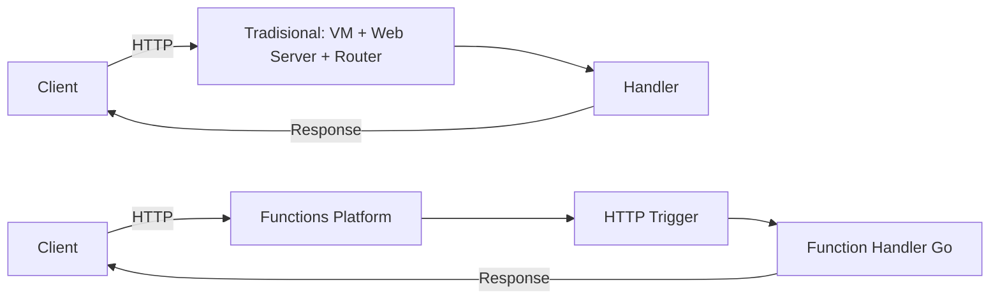

# Cloud Interfacing with Virtualization | Sesi 2: Serverless Computing (Azure Function App)

> **Mata Kuliah:** Cloud Interfacing with Virtualization | **Sesi:** 2 | **Status:** Materi Lab

---

## 🔑 Cues
- Serverless: fokus ke fungsi + trigger, bukan server
- Azure Functions (Go, Flex Consumption)
- HTTP trigger vs Timer/Cron trigger (NCRONTAB 6 field)
- Authorization level: anonymous / function / admin
- Function key via `?code=` atau header `x-functions-key`
- Structured logging (`slog` + `r.Context()`)
- Deploy dari VS Code, observasi via Application Insights
- Timer Azure pakai UTC (WIB = UTC+7)

---

## 📖 Materi Utama

### 1. Arsitektur HTTP Tradisional vs Serverless

- Di arsitektur tradisional, aplikasi **terus hidup** di VM/container: OS, web server, dan runtime harus disiapkan dan dijaga. Di dalam aplikasi ada **router/multiplexer** (mis. `http.HandleFunc("/hello", HelloHandler)`) yang mengarahkan request ke **handler function** berisi business logic.
- Beban developer di model ini: provisioning kapasitas, patching OS, scaling, load balancing, logging/monitoring — dan bayar penuh walau trafik sepi.
- Di **Azure Functions**, yang kita tulis hanya fungsi + trigger-nya. Platform yang mengurus host, worker bahasa, scaling, key, log, dan integrasi. Client tetap mengirim HTTP biasa; platform yang memetakan event ke function.

#### **Perbandingan Alur Request**


### 2. Yang Di-handle Siapa

- **Client** mengurus: endpoint benar (`https://<app>.azurewebsites.net/api/hello`), method/header/query/body sesuai, menyertakan function key bila levelnya `function`/`admin`, dan membaca status + body response.
- **Platform Functions** mengurus: menerima event, menjalankan host + language worker, scaling sesuai hosting plan, serta integrasi (Application Insights, log, deployment, storage, access key) dan trigger/binding lain (Blob, Queue, Service Bus, Event Grid, Event Hubs, Timer).

### 3. Membuat Function App (Portal)

- Resource Group baru `sesi2-rg`, lalu Create **Function App** dengan kombinasi lab:
  - Hosting: **Flex Consumption**. Nama: `sesi2-function-app`. Region: **East Asia**. Runtime: **Go** (versi tersedia; Go masih public preview, butuh ≥1.24 untuk dev lokal). Instance: 2048 MB. Zone redundancy: Disabled.
  - Storage: biarkan Azure buatkan (dipakai runtime untuk metadata, host storage, key, 일부 trigger).
  - Monitoring: Application Insights = Yes. Networking: public access On, VNet integration Off. Deployment: continuous deployment Disabled (deploy manual dari VS Code). Durable Functions: skip (belum didukung Go preview).
- Tools lokal: `winget install --id Microsoft.Azure.FunctionsCoreTools --exact`, plus Go 1.24+, Azure CLI, dan extension Azure Functions + Go di VS Code.

### 4. Project Go di VS Code

- Command palette → *Azure Functions: Create New Project* (Current directory, language Go) → `go mod tidy` untuk merapikan dependency (`go.mod`/`go.sum`).
- File penting: `main.go` (entry point + registrasi trigger), `host.json` (konfigurasi host), `local.settings.json` (env lokal, tidak ikut publish).
- Pola `main.go`: `app := sdk.FunctionApp()`, daftarkan endpoint (`app.HTTP("hello", handler, sdk.WithMethods("GET","POST"), sdk.WithAuth("function"))`), tutup dengan `worker.Start(app)`. Tiga level auth yang dipakai: `anonymous` (bebas), `function` (butuh function/host key), `admin` (butuh master key).
- Handler memakai signature standar `net/http`: baca `r.URL.Query().Get("name")`, tulis via `fmt.Fprintf(w, ...)`, dan log dengan `slog.InfoContext(r.Context(), ..., "method", r.Method, "path", r.URL.Path)`.
- Tools lokal dipasang via:
```bash
winget install --id Microsoft.Azure.FunctionsCoreTools --exact
```
- Kerangka `main.go` (tiga level auth):
```go
package main

import (
    "fmt"
    "log/slog"
    "net/http"

    "github.com/azure/azure-functions-golang-worker/sdk"
    "github.com/azure/azure-functions-golang-worker/worker"
)

func main() {
    app := sdk.FunctionApp()
    app.HTTP("hello", HTTPTriggerHandlerFunction,
        sdk.WithMethods("GET", "POST"), sdk.WithAuth("function"))
    app.HTTP("hello2", HTTPTriggerHandlerAnonymous,
        sdk.WithMethods("GET", "POST"), sdk.WithAuth("anonymous"))
    app.HTTP("hello3", HTTPTriggerHandlerAdmin,
        sdk.WithMethods("GET", "POST"), sdk.WithAuth("admin"))
    worker.Start(app)
}

func HTTPTriggerHandlerFunction(w http.ResponseWriter, r *http.Request) {
    slog.InfoContext(r.Context(), "Function endpoint called",
        "method", r.Method, "path", r.URL.Path)
    name := r.URL.Query().Get("name")
    if name == "" {
        name = "world"
    }
    fmt.Fprintf(w, "Hello from function auth, %s!", name)
}
```
- Test endpoint via curl (key lewat query atau header), dan cek subscription aktif:
```bash
curl -i "https://<nama-function-app>.azurewebsites.net/api/hello?code=<function-key>"
curl "https://<nama-function-app>.azurewebsites.net/api/hello" -H "x-functions-key: <function-key>"
az account show
```

### 5. Authorization, Key, dan Test via curl

- Cek level auth function di Portal (tab Integration → Trigger → Authorization level). Ambil URL di tab **Code + Test → Get function URL**: bentuknya `https://<app>.azurewebsites.net/api/<function>?code=<key>`. Key alternatif dikirim lewat header `x-functions-key`.
- Aturan key: auth `function` bisa pakai function key atau host key; `admin` wajib master key; `anonymous` tanpa `?code=`. Beri user biasa function key saja; kalau key bocor, regenerate di portal (key ≠ autentikasi penuh untuk production).
- Test: `curl -i "<function-url>"`. Harapkan `200 OK` + body dari handler; `401` = key salah/tidak dikirim.
- Kalau tab Log kosong padahal request sukses, berarti handler belum menulis log — tambahkan `slog` lalu deploy ulang, baru cek Log/Monitor/Application Insights.

### 6. Trigger Lain: Timer/Cron

- Timer trigger = function terjadwal, bukan endpoint URL. Handler Go menerima `(ctx context.Context, timer bindings.TimerInfo)` dan mengembalikan `error` (tambah `return nil` saat sukses).
- Registrasi: `app.Timer("cronJob", handleCronJob, sdk.WithSchedule("0 0 13 * * *"))`. Format **NCRONTAB 6 field**: detik menit jam tanggal bulan hari-minggu. Contoh: `0 0 13 * * *` = tiap hari 13:00; `0 */5 * * * *` = tiap 5 menit; `0 30 9 * * 1-5` = hari kerja 09:30.
- Handler timer (perhatikan ejaan: `handleCronJob`, `ctx`, `bindings.TimerInfo`, `ScheduleStatus.Next`, `return nil`):
```go
func handleCronJob(ctx context.Context, timer bindings.TimerInfo) error {
    slog.InfoContext(ctx, "Cron job success",
        "next_schedule", timer.ScheduleStatus.Next)
    return nil
}

func main() {
    app := sdk.FunctionApp()
    app.Timer("cronJob", handleCronJob,
        sdk.WithSchedule("0 0 13 * * *"))
    worker.Start(app)
}
```
- Contoh jadwal lain (ingat Timer Azure jalan di UTC; 13:00 WIB = 06:00 UTC):
```bash
0 0 13 * * *    # tiap hari 13:00 (server time)
0 */5 * * * *   # tiap 5 menit
0 30 9 * * 1-5  # hari kerja 09:30
0 0 6 * * *     # 13:00 WIB dalam UTC
```
- Jebakan: `* * 13 * * *` = tiap detik selama jam 13 (log meledak). Timer Azure memakai **UTC**; Flex Consumption Linux tak mendukung `WEBSITE_TIME_ZONE`, jadi 13:00 WIB = `0 0 6 * * *`.
- Deploy: simpan `main.go` → `go mod tidy` bila import baru → *Deploy to Function App* → pilih app → cek function `cronJob` + pesannya di Monitor/Application Insights.

---

## 🛠️ Use Case / Implementasi Nyata
- **Skenario:** Endpoint `/hello` dan job harian tanpa menyewa VM idle.
- **Masalah yang Diatasi:** Provisioning, patching, dan scaling server untuk beban kecil/tak menentu.
- **Keuntungan:** Bayar per eksekusi; trigger siap pakai (HTTP, Timer, Blob, Queue, Event Grid).

---

## 🗂️ Konsep Kunci

| Istilah | Definisi | Contoh / Catatan |
|---------|----------|-----------------|
| Trigger | Pemicu eksekusi function | HTTP, Timer, Blob, Queue |
| Binding | Koneksi deklaratif ke layanan | Input/output tanpa SDK manual |
| Flex Consumption | Hosting plan serverless elastis | Dipakai di lab sesi ini |
| Auth level | Syarat key pada HTTP trigger | anonymous / function / admin |
| Function key | Kredensial panggil endpoint | Query `?code=` / header |
| NCRONTAB | Format jadwal Timer Azure | 6 field, detik di depan, UTC |
| Structured logging | Log key-value, bukan teks polos | `slog.InfoContext` + Insights |

---

## 📊 Tabel Ringkasan

| Aspek | Tradisional (VM) | Azure Functions |
|-------|-----------------|-----------------|
| Unit deploy | Aplikasi utuh always-on | Fungsi per trigger |
| Scaling | Manual / diatur sendiri | Otomatis oleh platform |
| Biaya sepi | Tetap bayar server | Mendekati nol |
| Tanggung jawab | OS s/d monitoring | Kode + konfigurasi trigger |

---

## ⚠️ Catatan Penting
> **Tiga sumber nilai klasik**: nama resource unik + region East Asia; NCRONTAB 6 field diawali detik (`0 0 13 * * *` bukan `* * 13 * * *`); timer jalan di UTC (kurangi 7 jam dari WIB). Plus: log kosong = handler belum `slog`, bukan function yang rusak.

---

## 📝 Materi Tambahan (Visual Insights)
- Diagram alur request tradisional vs serverless — pahami dulu siapa mengerjakan apa sebelum menghafal klik portal.
- Perhatikan ejaan istilah (Serverless, Continuous deployment, Configure later, Zone redundancy, VNet integration, Cron/Timer trigger) karena materi aslinya menandai koreksinya.
