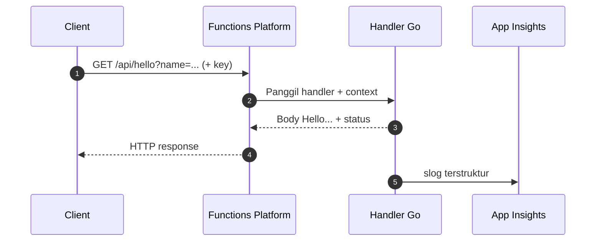

# Cloud Interfacing with Virtualization | Sesi 2: Serverless Computing (Azure Function App)

> **Mata Kuliah:** Cloud Interfacing with Virtualization | **Sesi:** 2 | **Status:** Materi Lab

---

## 🔑 Cues
- Serverless: bayar per eksekusi, bukan per jam sewa
- Function App Go di Flex Consumption
- Trigger HTTP vs Timer terjadwal
- Auth: anonymous, function, admin
- Function key via query atau header
- NCRONTAB 6 kolom + jebakan UTC
- Logging terstruktur dengan slog
- Deploy via VS Code, intip via Insights

---

## 📖 Materi Utama

### 1. Logika Tagihan Baru: Sewa Mobil vs Ojek

- Analogi sendiri: VM itu seperti sewa mobil harian — dibayar penuh walau diparkir. Serverless itu seperti ojek: argo jalan hanya saat ada perjalanan (eksekusi fungsi), diam berarti nyaris nol biaya.
- Di model sewa mobil (tradisional), developer menanggung semuanya: siapkan OS, jaga web server, tulis router (`http.HandleFunc("/hello", ...)`) yang mengarahkan request ke handler, plus atur scaling, patching, dan monitoring.
- Di model ojek (Azure Functions), yang ditulis hanya fungsi dan pemicunya (**trigger**). Sisanya — host, worker bahasa, scaling, key, log, integrasi — dikerjakan platform. Client tetap mengirim HTTP biasa; platform yang memetakan event ke fungsi yang tepat.

#### **Siapa Mengerjakan Apa Saat Request Masuk**


### 2. Anatomi Function App: Host, Worker, Trigger, Binding

- **Client** bertanggung jawab: endpoint benar (`https://<app>.azurewebsites.net/api/hello`), method/query/body sesuai, menyertakan key bila levelnya `function`/`admin`, dan membaca status + body balasan.
- **Platform** bertanggung jawab: menerima event, menjalankan host + language worker, scaling mengikuti hosting plan, serta menyediakan integrasi (Application Insights, log, deployment, storage, access key) dan ragam trigger/binding (HTTP, Timer, Blob, Queue, Service Bus, Event Grid, Event Hubs).
- Pembedanya: **trigger** adalah pintu masuk eksekusi (HTTP, Timer), **binding** adalah konektor deklaratif ke layanan lain tanpa SDK manual.

### 3. Merakit dari Nol: Portal, Perkakas, Project Go

- Resource Group baru `sesi2-rg`, lalu Create **Function App** dengan resep lab: hosting **Flex Consumption**, nama `sesi2-function-app`, region **East Asia**, runtime **Go** (masih public preview; dev lokal butuh Go ≥1.24), instance 2048 MB, zone redundancy Disabled.
- Storage biarkan dibuatkan Azure (menyimpan metadata runtime, host storage, dan key). Monitoring: Application Insights = Yes. Networking: public access On, VNet integration Off. Deployment: continuous deployment Disabled (rilis manual dari VS Code). Durable Functions dilewati (belum didukung Go preview).
- Perkakas lokal:

```bash
winget install --id Microsoft.Azure.FunctionsCoreTools --exact
```

- Butuh juga Go 1.24+, Azure CLI, serta extension Azure Functions dan Go di VS Code.
- Project: Command palette → *Azure Functions: Create New Project* (current directory, bahasa Go) → `go mod tidy` untuk merapikan `go.mod`/`go.sum`. File yang wajib dikenal: `main.go` (entry + registrasi), `host.json` (konfigurasi host), `local.settings.json` (env lokal, tidak ikut publish).
- Pola `main.go`: buat app (`sdk.FunctionApp()`), daftarkan endpoint dengan method dan level auth, lalu `worker.Start(app)`. Handler memakai signature `net/http` standar: baca `r.URL.Query().Get("name")`, tulis via `fmt.Fprintf(w, ...)`, log via `slog.InfoContext(r.Context(), ..., "method", r.Method, "path", r.URL.Path)`.
- Kerangka tiga level auth:

```go
package main

import (
    "fmt"
    "log/slog"
    "net/http"

    "github.com/azure/azure-functions-golang-worker/sdk"
    "github.com/azure/azure-functions-golang-worker/worker"
)

func main() {
    app := sdk.FunctionApp()
    app.HTTP("hello", HTTPTriggerHandlerFunction,
        sdk.WithMethods("GET", "POST"), sdk.WithAuth("function"))
    app.HTTP("hello2", HTTPTriggerHandlerAnonymous,
        sdk.WithMethods("GET", "POST"), sdk.WithAuth("anonymous"))
    app.HTTP("hello3", HTTPTriggerHandlerAdmin,
        sdk.WithMethods("GET", "POST"), sdk.WithAuth("admin"))
    worker.Start(app)
}

func HTTPTriggerHandlerFunction(w http.ResponseWriter, r *http.Request) {
    slog.InfoContext(r.Context(), "Function endpoint called",
        "method", r.Method, "path", r.URL.Path)
    name := r.URL.Query().Get("name")
    if name == "" {
        name = "world"
    }
    fmt.Fprintf(w, "Hello from function auth, %s!", name)
}
```

### 4. Kunci Masuk: Level Auth dan Cara Mengetes

- Level auth dicek di portal (tab Integration → Trigger → Authorization level). URL uji diambil dari **Code + Test → Get function URL**, bentuknya `https://<app>.azurewebsites.net/api/<function>?code=<key>`. Alternatifnya kirim key via header `x-functions-key`.
- Aturannya: `anonymous` tanpa `?code=`; `function` menerima function key atau host key; `admin` wajib master key. Beri user biasa function key saja; key bocor cukup di-regenerate di portal. Catatan jujur: key bukan pengganti autentikasi penuh untuk production.
- Cara mengetes dari terminal:

```bash
curl -i "https://<nama-function-app>.azurewebsites.net/api/hello?code=<function-key>"
curl "https://<nama-function-app>.azurewebsites.net/api/hello" -H "x-functions-key: <function-key>"
az account show
```

- `curl -i "<function-url>"` yang sehat mengembalikan `200 OK` + body handler; `401` berarti key salah atau tidak terkirim. `az account show` memastikan subscription yang dipakai benar.
- Bila tab Log kosong padahal request sukses, bukan function-nya rusak — handler memang belum menulis log. Tambahkan `slog`, deploy ulang, baru cek Log/Monitor/Application Insights.

### 5. Fungsi Tanpa URL: Timer dan Perang Melawan Zona Waktu

- Timer trigger adalah fungsi kalender: tidak punya URL, dijalankan jadwal. Handler Go menerima `(ctx context.Context, timer bindings.TimerInfo)` dan wajib `return nil` saat sukses.
- Pendaftaran dan handler:

```go
func handleCronJob(ctx context.Context, timer bindings.TimerInfo) error {
    slog.InfoContext(ctx, "Cron job success",
        "next_schedule", timer.ScheduleStatus.Next)
    return nil
}

func main() {
    app := sdk.FunctionApp()
    app.Timer("cronJob", handleCronJob,
        sdk.WithSchedule("0 0 13 * * *"))
    worker.Start(app)
}
```

- Format **NCRONTAB 6 kolom** (detik menit jam tanggal bulan hari-minggu), bukan cron Linux 5 kolom:

```bash
0 0 13 * * *    # tiap hari 13:00 (waktu server)
0 */5 * * * *   # tiap 5 menit
0 30 9 * * 1-5  # hari kerja 09:30
0 0 6 * * *     # 13:00 WIB bila server UTC
```

- Dua jebakan: `* * 13 * * *` berarti tiap detik selama jam 13 (log meledak) — yang benar `0 0 13 * * *`. Dan Timer Azure berjalan di **UTC**; Flex Consumption Linux tidak mendukung `WEBSITE_TIME_ZONE`, sehingga 13:00 WIB = `0 0 6 * * *` (kurangi 7 jam).
- Rilis timer: simpan `main.go` → `go mod tidy` bila import bertambah → *Deploy to Function App* → pilih app → pastikan `cronJob` muncul dan pesannya terlihat di Monitor/Application Insights.

---

## 🛠️ Use Case / Implementasi Nyata
- **Skenario:** Dibutuhkan endpoint sapaan `/hello` dan satu job harian, tapi trafiknya kecil dan tidak menentu sehingga menyewa VM idle itu boros.
- **Masalah yang Diatasi:** Provisioning kapasitas, patching OS, dan scaling manual untuk beban yang sebenarnya hanya butuh beberapa detik eksekusi.
- **Keuntungan:** Bayar per eksekusi dengan trigger siap pakai (HTTP untuk endpoint, Timer untuk jadwal, plus Blob/Queue/Event Grid bila nanti dibutuhkan).

---

## 🗂️ Konsep Kunci

| Istilah | Definisi | Contoh / Catatan |
|---------|----------|-----------------|
| Trigger | Pemicu yang membangunkan fungsi | HTTP, Timer, Blob, Queue |
| Binding | Konektor deklaratif ke layanan | Tanpa SDK manual |
| Flex Consumption | Paket hosting elastis serverless | Resep lab sesi ini |
| Auth level | Syarat key pada HTTP trigger | anonymous / function / admin |
| Function key | Kredensial pemanggil endpoint | `?code=` atau header |
| NCRONTAB | Format jadwal Timer Azure | 6 kolom, detik di depan, UTC |
| Structured logging | Log key-value yang bisa di-query | `slog.InfoContext` + Insights |

---

## 📊 Tabel Ringkasan

| Aspek | Sewa Mobil (VM) | Ojek (Functions) |
|-------|----------------|------------------|
| Unit rilis | Aplikasi utuh always-on | Satu fungsi per trigger |
| Scaling | Diatur manual | Otomatis oleh platform |
| Biaya saat sepi | Tetap bayar penuh | Mendekati nol |
| Tanggung jawab dev | OS sampai monitoring | Kode + konfigurasi trigger |

---

## ⚠️ Catatan Penting
> **Tiga angka yang menentukan nilai**: nama unik + East Asia; NCRONTAB 6 kolom diawali detik; timer memakai UTC (WIB dikurangi 7 jam). Ditambah satu diagnosa cepat: log kosong artinya handler belum `slog`, bukan platform yang rusak.

---

## 📝 Materi Tambahan (Visual Insights)

### Ejaan yang Ditandai Materi Asli
- Perhatikan penulisan yang dikoreksi sumber: Serverless, Continuous deployment, Configure later, Zone redundancy, VNet integration, Cron/Timer trigger. Salah eja di ujian praktik membuat opsi atau menu susah ditemukan.

### Cara Menghafal Cepat
- Hafalkan kalimat rantai tanggung jawab: client membawa URL + key, platform membawa host + scaling + log, handler hanya membawa business logic + `return nil` untuk timer.
