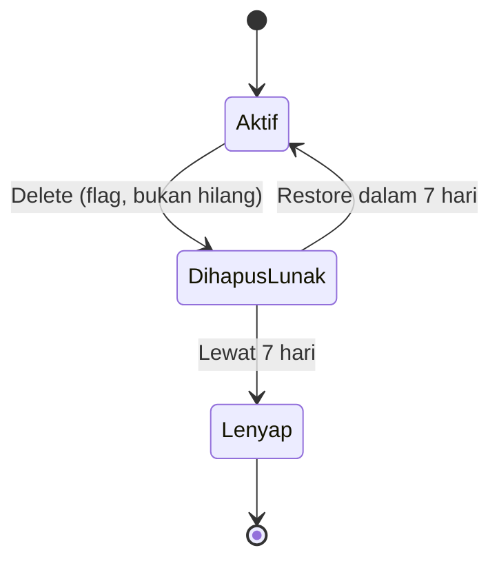

# Cloud Interfacing with Virtualization | Sesi 3: Azure Storage Account

> **Mata Kuliah:** Cloud Interfacing with Virtualization | **Sesi:** 3 | **Status:** Materi Lab

---

## 🔑 Cues
- Storage Account sebagai gudang file terkelola
- Hierarki: account, container, blob
- Tier Hot, Cool, Cold sebagai strategi arsip
- Redundansi GRS dan namespace hierarkis
- Soft delete 7 hari sebagai jaring pengaman
- Tiga pintu: portal, SFTP, Go SDK
- Connection string via Access keys + .env
- Pager untuk list berskala besar

---

## 📖 Materi Utama

### 1. Peta Gudang: Account, Container, Blob

- Analogi sendiri: Storage Account itu gedung gudang; **container** (misalnya `tes`) adalah ruangan di dalamnya; **blob** (misalnya `namafile.txt`) adalah kardus di ruangan itu. Portal, SFTP, dan Go SDK hanyalah tiga pintu masuk menuju gudang yang sama.
- Pembuatan dimulai dari Resource Group seperti biasa, lalu Create **Storage Account**. Resep lab: nama bebas, region **East Asia**, primary service **Azure Blob Storage**, performance **Standard**, redundancy **GRS**.
- Opsi Advanced: **hierarchical namespace** diaktifkan (membuka kapabilitas Data Lake), **SFTP** diaktifkan, access tier **Hot** untuk data sering dibaca (Cool/Cold untuk arsip jarang dibuka), plus enkripsi transit SMB untuk Azure Files.
- Opsi Networking: public access Enable; scope *all networks* bila diakses dari laptop sendiri, *selected networks* bila hanya dari VM tertentu; routing memakai Microsoft network routing. Security/Encryption biarkan default, lalu *Review + Create*.

#### **Siklus Hidup File yang Dihapus**


### 2. Ekonomi Penyimpanan: Tier, Redundansi, Pengaman

- **Access tier** adalah pilihan tarif vs frekuensi: Hot untuk file aktif, Cool/Cold untuk backup/arsip yang jarang dibuka. Salah pilih tier bukan error, tapi boros.
- **GRS** (pilihan lab) berarti salinan geografis; **soft delete** berarti file terhapus hanya diberi flag dan bisa di-restore dalam 7 hari. Buktinya di portal: centang *Show active and deleted objects* — file yang "hilang" masih terlihat.
- Cara membaca kegagalan klasik: koneksi SDK gagal biasanya connection string salah atau `.env` tidak ke-load (cek `client.URL()`); file tidak ditemukan biasanya container tujuan (`tes`) memang belum dibuat.

### 3. Pintu Manusia: Portal dan SFTP

- Via SFTP: menu SFTP → *Add local user* → username bebas, auth **SSH password** → Permissions: buat container baru (mis. `tes`), akses **All**, home directory `/tes` → Add. Copy password ke Notepad karena hanya tampil sekali.
- Sambungkan dari CMD memakai `sftp <connection-string>` + password. Perintah sesi yang dipakai lab: `help` (daftar perintah), `ls` (lihat isi), `lcd "path_file_txt"` (pindah folder lokal), `put namafile.txt` (upload), `get namafile.txt` (download).
- Verifikasi dua arah: file hasil `put` harus muncul di portal (Containers → `tes`), dan file hasil delete harus masih terlihat saat *Show active and deleted objects* dicentang.

### 4. Pintu Program: Go SDK dari Koneksi sampai List

- Siapkan project:

```bash
go mod init namapackage
go get github.com/Azure/azure-sdk-for-go/sdk/storage/azblob@v1.8.1
go get github.com/joho/godotenv
```

- Connection string diambil dari portal (Storage Account → Access keys), disimpan di `.env` — bukan di kode:

```
CONNECTION_STRING=connection_string_dari_azure
```

- Pola koneksi: load `.env`, ambil variabel, bangun client, cetak URL sebagai tes kesehatan:

```go
godotenv.Load()
connectionString, _ := os.LookupEnv("CONNECTION_STRING")
client, err := azblob.NewClientFromConnectionString(connectionString, nil)
if err != nil { fmt.Printf("%s", err); return }
fmt.Printf("%s", client.URL())
```

- `os.LookupEnv` mengembalikan pasangan (string, bool); bool dibuang dengan `_`. URL tercetak tanpa error berarti koneksi valid.
- Upload ke container `tes` (verifikasi di portal → Containers → `tes`):

```go
file, err := os.OpenFile("namafile.txt", os.O_RDONLY, 0)
if err != nil {
    fmt.Printf("%s", err)
    return
}
_, err = client.UploadFile(
    context.TODO(),
    "tes",
    "namafile.txt",
    file,
    nil,
)
if err != nil {
    fmt.Printf("%s", err)
    return
}
```

- Download dan cetak ukuran buffer (`n`):

```go
file, err = os.Create("read_test.txt")
n, err := client.DownloadFile(
    context.TODO(),
    "tes",
    "namafile.txt",
    file,
    nil,
)
if err != nil {
    fmt.Printf("%s", err)
    return
}
fmt.Printf("Buffer Size: %d", n)
```

- List memakai pager karena hasil dibagi per halaman:

```go
pager := client.NewListBlobsFlatPager("tes", nil)
for pager.More() {
    page, err := pager.NextPage(context.TODO())
    if err != nil { fmt.Printf("%s", err); continue }
    for _, blob := range page.Segment.BlobItems {
        fmt.Println(*blob.Name)
    }
}
```

- Jalankan via `go run .\main.go`. Tips VS Code: `Ctrl + Space` memancing auto-import (misalnya `context`).

---

## 🛠️ Use Case / Implementasi Nyata
- **Skenario:** Aplikasi kecil butuh penitipan file yang bisa diakses manusia (via terminal) dan kode (via SDK) sekaligus, tanpa ada yang mengurus hard disk server.
- **Masalah yang Diatasi:** Disk penuh, backup manual, dan file yang hanya bisa diakses dari satu mesin.
- **Keuntungan:** Satu account melayani tiga pintu sekaligus, dengan soft delete sebagai tombol undo saat ada yang tidak sengaja menghapus.

---

## 🗂️ Konsep Kunci

| Istilah | Definisi | Contoh / Catatan |
|---------|----------|-----------------|
| Container | Ruangan level atas di Blob | `tes` |
| Blob | Kardus/file di dalam container | `namafile.txt` |
| Access tier | Tarif vs frekuensi akses | Hot / Cool / Cold |
| Soft delete | Hapus ber-flag, bisa restore | Retensi 7 hari |
| SFTP local user | Akun transfer scoped per container | Home `/tes` |
| Connection string | Kredensial akses SDK | Simpan di `.env` |
| Pager | Iterasi hasil list per halaman | `NewListBlobsFlatPager` |

---

## 📊 Tabel Ringkasan

| Pintu | Cocok untuk | Perintah kunci |
|-------|-------------|----------------|
| Portal | Klik cepat dan verifikasi | Containers, Access keys |
| SFTP | Transfer manual via terminal | `lcd`, `put`, `get`, `ls` |
| Go SDK | Akses dari aplikasi | `UploadFile`, `DownloadFile`, pager |

---

## ⚠️ Catatan Penting
> **File "hilang" belum tentu hilang** — sebelum panik, centang *Show active and deleted objects*. Dan sebelum menyalahkan jaringan, pastikan `.env` ke-load (`client.URL()` tercetak) serta container `tes` memang sudah ada.

---

## 📝 Materi Tambahan (Visual Insights)

### Hafalan Alur Satu Kalimat
- RG → Storage Account → local user → container → transfer → verifikasi portal. Enam kata itu adalah urutan klik portal; sisanya (perintah SFTP, fungsi SDK) tinggal menempel pada tahap yang sesuai.
