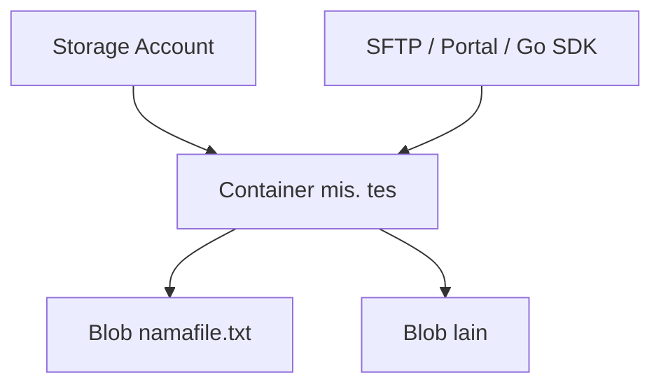

# Cloud Interfacing with Virtualization | Sesi 3: Azure Storage Account

> **Mata Kuliah:** Cloud Interfacing with Virtualization | **Sesi:** 3 | **Status:** Materi Lab

---

## 🔑 Cues
- Storage Account (Blob, GRS, Access tier Hot/Cool/Cold)
- Hierarchical namespace + SFTP
- Soft delete (restore ≤ 7 hari)
- SFTP: local user, `lcd/put/get/ls`
- Go SDK `azblob` + connection string + `.env`
- Upload / Download / List (pager)

---

## 📖 Materi Utama

### 1. Membuat Storage Account

- Diawali Resource Group seperti biasa, lalu Create **Storage Account**. Isian kunci:
  - Basics: nama bebas, Region **East Asia**, Primary service **Azure Blob Storage**, Performance **Standard**, Redundancy **GRS**.
  - Advanced: **hierarchical namespace** diaktifkan (buka kapabilitas Data Lake), **SFTP** diaktifkan, Access tier **Hot** (sering dibaca; Cool/Cold untuk arsip/backup jarang diakses), enkripsi transit SMB untuk Azure Files.
  - Networking: public access Enable; scope *all networks* bila ingin bisa dari laptop sendiri, *selected networks* bila hanya VM tertentu. Routing: Microsoft network routing.
  - Data Protection: **soft delete** — file terhapus hanya diberi flag dan bisa di-restore dalam 7 hari.
  - Security/Encryption: biarkan default. *Review + Create*, tunggu selesai.

#### **Lapisan Akses Data**


### 2. Mengakses via SFTP

- Di menu SFTP: *Add local user* → username bebas, auth **SSH password** → Permissions: buat container baru (mis. `tes`), akses **All**, home directory `/tes` → Add. Copy password-nya ke Notepad (hanya tampil sekali).
- Sambungkan dari CMD: `sftp <connection-string>` + password. Di dalam sesi: `help` (daftar perintah), `ls` (lihat file), `lcd "path_file_txt"` (pindah folder lokal), `put namafile.txt` (upload), `get namafile.txt` (download).
- Verifikasi dua arah: file muncul di portal (Containers → `tes`), dan file yang di-delete tetap terlihat saat *Show active and deleted objects* dicentang (bukti soft delete bekerja).

### 3. Mengakses Blob via Go (azblob SDK)

- Project: folder baru → VS Code → terminal:
```bash
go mod init namapackage
go get github.com/Azure/azure-sdk-for-go/sdk/storage/azblob@v1.8.1
go get github.com/joho/godotenv
```
- Connection string (portal → Storage Account → Access keys) disimpan di `.env`, bukan di kode:
```
CONNECTION_STRING=connection_string_dari_azure
```
- Connection string diambil dari portal (Storage Account → Access keys) lalu disimpan di `.env` sebagai `CONNECTION_STRING=...` — jangan hardcode di kode.
- Pola koneksi:
```go
godotenv.Load()
connectionString, _ := os.LookupEnv("CONNECTION_STRING")
client, err := azblob.NewClientFromConnectionString(connectionString, nil)
if err != nil { fmt.Printf("%s", err); return }
fmt.Printf("%s", client.URL())
```
- `os.LookupEnv` mengembalikan (string, bool); bool dibuang dengan `_`. `client.URL()` yang tercetak tanpa error = koneksi valid.

### 4. Upload, Download, List

- Upload: buka file lokal lalu unggah ke container `tes` (cek di portal → Containers → `tes`):
```go
file, err := os.OpenFile("namafile.txt", os.O_RDONLY, 0)
if err != nil {
    fmt.Printf("%s", err)
    return
}
_, err = client.UploadFile(
    context.TODO(),
    "tes",
    "namafile.txt",
    file,
    nil,
)
if err != nil {
    fmt.Printf("%s", err)
    return
}
```
- Download: siapkan file tujuan, unduh, lalu cetak ukuran buffer (`n`):
```go
file, err = os.Create("read_test.txt")
n, err := client.DownloadFile(
    context.TODO(),
    "tes",
    "namafile.txt",
    file,
    nil,
)
if err != nil {
    fmt.Printf("%s", err)
    return
}
fmt.Printf("Buffer Size: %d", n)
```
- List semua blob pakai pager (data dibagi per halaman):
```go
pager := client.NewListBlobsFlatPager("tes", nil)
for pager.More() {
    page, err := pager.NextPage(context.TODO())
    if err != nil { fmt.Printf("%s", err); continue }
    for _, blob := range page.Segment.BlobItems {
        fmt.Println(*blob.Name)
    }
}
```
- Jalankan dengan `go run .\main.go`. Tips VS Code: `Ctrl + Space` membantu auto-import `context`.

---

## 🛠️ Use Case / Implementasi Nyata
- **Skenario:** Aplikasi butuh simpan/ambil file tanpa mengelola disk server.
- **Masalah yang Diatasi:** Kapasitas disk, backup manual, dan akses file lintas mesin.
- **Keuntungan:** Satu account melayani SFTP (manusia), portal (klik), dan SDK (kode) sekaligus + soft delete sebagai jaring pengaman.

---

## 🗂️ Konsep Kunci

| Istilah | Definisi | Contoh / Catatan |
|---------|----------|-----------------|
| Container | Namespace/“folder” level atas di Blob | `tes` |
| Blob | File/opaque object di dalam container | `namafile.txt` |
| Access tier | Kelas biaya vs frekuensi akses | Hot / Cool / Cold |
| Soft delete | Hapus ber-flag, bisa restore | Retensi 7 hari |
| SFTP local user | Akun file-transfer scoped per container | Home `/tes` |
| Connection string | Kredensial akses SDK | Simpan di `.env` |
| Pager | Iterasi hasil list per halaman | `NewListBlobsFlatPager` |

---

## 📊 Tabel Ringkasan

| Cara akses | Cocok untuk | Perintah kunci |
|-----------|-------------|----------------|
| Portal | Klik-cepat, verifikasi | Containers, Access keys |
| SFTP | Transfer manual via terminal | `lcd`, `put`, `get`, `ls` |
| Go SDK | Akses dari kode aplikasi | `UploadFile`, `DownloadFile`, pager |

---

## ⚠️ Catatan Penting
> **Dua penyebab gagal klasik**: connection string salah/tidak ke-load dari `.env` (cek `client.URL()`), dan lupa container tujuan (`tes`) belum dibuat. Untuk soft delete: file "hilang" belum tentu hilang — cek *Show active and deleted objects* dulu.

---

## 📝 Materi Tambahan (Visual Insights)
- Urutan layar portal (form Create → SFTP → Containers) penting dihafal sebagai alur, bukan sekadar bacaan: RG → SA → user → container → transfer → verifikasi.
