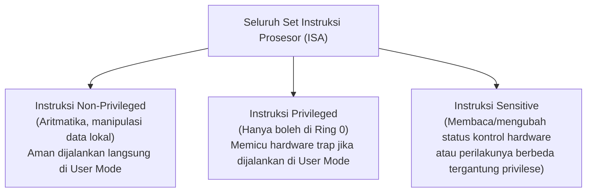
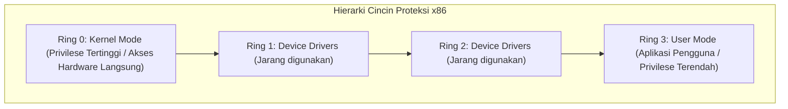
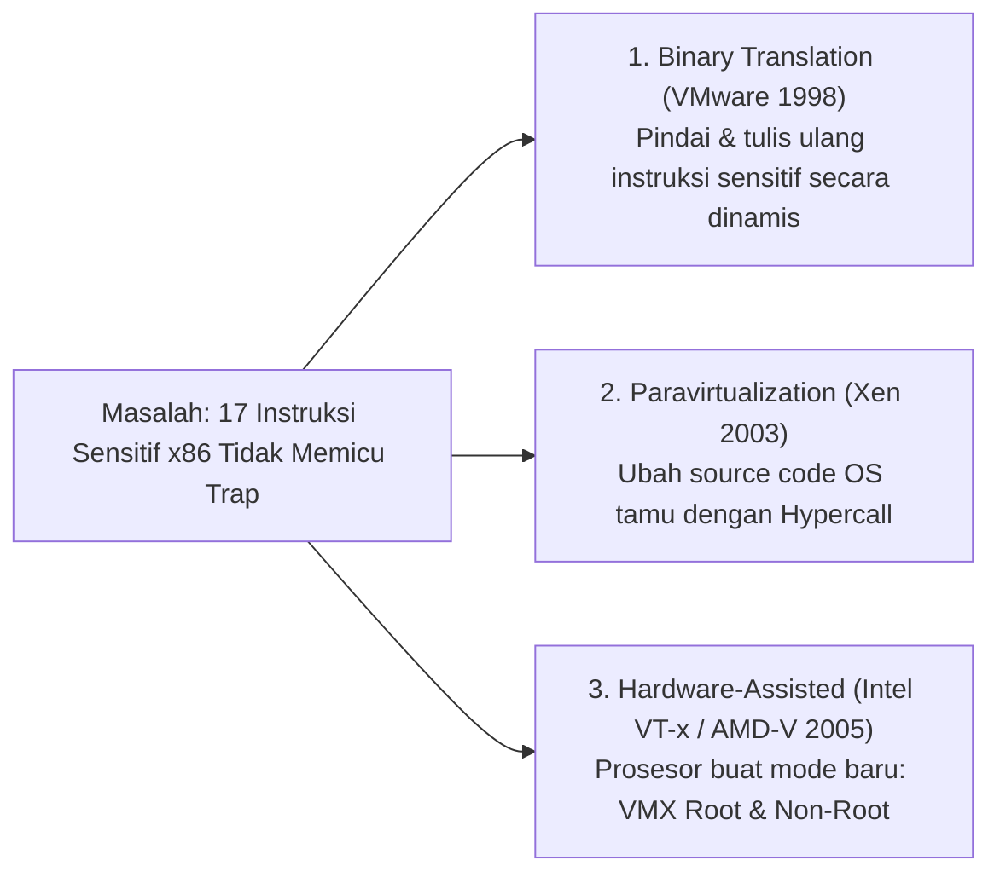
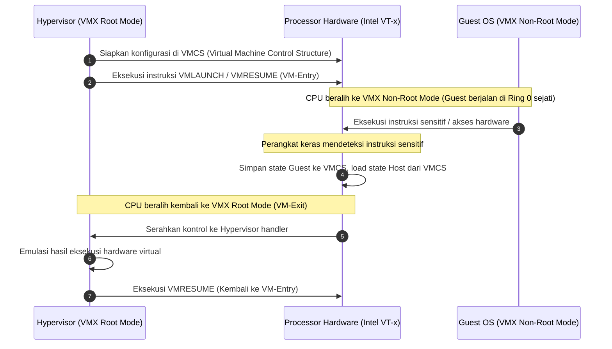

# Cloud Interfacing with Virtualization | Sesi 3: Execution Environment Virtualization

> **Mata Kuliah:** Cloud Interfacing with Virtualization | **Sesi:** 3 | **Status:** Materi UTS
> **Sumber:** Slide dosen, adaptasi Erl & Barceló Monroy (2024), *Cloud Computing: Concepts, Technology, Security & Architecture*; Marinescu (2022), *Cloud Computing: Theory and Practice*; Intel 64 and IA-32 Architectures Software Developer’s Manual.

---

## 🔑 Cues

- Kategori instruksi CPU: Non-Privileged, Privileged, dan Sensitive
- Teorema Virtualisasi Popek-Goldberg (1974)
- Arsitektur proteksi prosesor x86: Hierarki Ring 0 hingga Ring 3
- Masalah lubang virtualisasi x86 klasik (The x86 Virtualization Hole)
- Fenomena Ring Compression / Ring Deprivileging
- 17 instruksi sensitif non-privileged yang gagal secara senyap (silent failure)
- Solusi perangkat lunak: Binary Translation dinamis (VMware)
- Solusi paravirtualisasi: Modifikasi kernel dan Hypercall (Xen)
- Mekanisme Trap-and-Emulate pada virtualisasi prosesor
- Hardware-Assisted Virtualization: Intel VT-x dan AMD-V
- Mode operasional CPU: VMX Root Operation vs VMX Non-Root Operation
- Struktur data perangkat keras: VMCS (Intel) dan VMCB (AMD)
- Siklus transisi hardware: VM-Entry dan VM-Exit
- Eliminasi overhead translasi biner di cloud modern

---

## 📖 Materi Utama

### 1. Klasifikasi Instruksi CPU & Teorema Popek-Goldberg

Setiap program perangkat lunak dieksekusi oleh unit pemroses sentral (*CPU*) sebagai urutan instruksi biner. Berdasarkan dampaknya terhadap stabilitas sistem, instruksi prosesor dikelompokkan menjadi:

#### **Teorema Virtualisasi Popek-Goldberg (1974):**
Gerald J. Popek dan Robert P. Goldberg merumuskan syarat matematis formal agar suatu arsitektur komputer dapat divirtualisasikan secara efisien murni menggunakan teknik *trap-and-emulate*:
> *"Sebuah arsitektur prosesor bersifat **dapat divirtualisasikan secara murni (*purely virtualizable*)** jika dan hanya jika **seluruh instruksi sensitif merupakan subset dari instruksi privileged**."*
> $$\text{Sensitive Instructions} \subseteq \text{Privileged Instructions}$$

Artinya: Setiap kali sebuah sistem operasi tamu mencoba membaca atau memanipulasi hardware (instruksi sensitif), CPU **wajib secara otomatis memicu interupsi keras (*hardware trap*)** ke hypervisor agar hypervisor dapat mengemulasikan aksi tersebut secara aman.

---

### 2. Arsitektur Ring Proteksi x86 & Masalah "Virtualization Hole"

Prosesor x86 membagi hak akses eksekusi ke dalam 4 tingkatan cincin proteksi (*privilege rings*):

#### **A. Konflik Ring pada Virtualisasi Klasik (Ring Compression):**
- Pada sistem non-virtualisasi, OS Kernel berjalan di **Ring 0** dan aplikasi berjalan di **Ring 3**.
- Saat divirtualisasikan, Hypervisor harus menguasai **Ring 0** fisik untuk menjaga kontrol hardware server.
- Akibatnya, Guest OS terpaksa diturunkan tingkat privilesenya ke **Ring 1** (atau Ring 3). Fenomena ini disebut **Ring Compression** atau **Ring Deprivileging**.

#### **B. Lubang Virtualisasi x86 (The x86 Virtualization Hole):**
Arsitektur prosesor x86 klasik (32-bit IA-32) **melanggar Teorema Popek-Goldberg**. Terdapat **17 instruksi sensitif** yang ternyata **bersifat non-privileged**!
- Contoh instruksi sensitif non-privileged: `POPF` (Push/Pop to Interrupt Flag), `PUSHF`, `SMSW` (Store Machine Status Word), `LAR` (Load Access Rights), dan `SGDT` (Store Global Descriptor Table).
- **Bahaya Fatal:** Ketika Guest OS berjalan di Ring 1 dan memanggil instruksi `POPF` untuk mematikan interupsi (misal saat memasuki *critical section*), prosesor x86 klasik **tidak memicu trap ke hypervisor**! Sebaliknya, CPU mengabaikan instruksi tersebut secara diam-diam (*fails silently*). Guest OS mengira interupsi sudah mati, padahal interupsi fisik masih menyala. Akibatnya, sinkronisasi memori rusak dan kernel tamu mengalami crash mendadak.

---

### 3. Tiga Solusi Mengatasi Lubang Virtualisasi

Sebelum era prosesor modern, industri menciptakan teknik rekayasa perangkat lunak canggih untuk mengatasi lubang virtualisasi x86:

#### **1. Binary Translation Dinamis (Pelopor: VMware, 1998)**
- Hypervisor membedah aliran kode biner Guest OS tepat sebelum dieksekusi di prosesor.
- *Instruksi biasa (non-sensitif):* Dibiarkan berjalan langsung pada CPU dengan kecepatan penuh (*direct execution*).
- *Instruksi sensitif (bermasalah):* Dideteksi oleh mesin penerjemah hypervisor, lalu **ditulis ulang secara dinamis (*dynamic code rewriting*)** di memori menjadi urutan instruksi aman yang memanggil hypervisor.
- *Keunggulan:* Guest OS tidak perlu dimodifikasi sama sekali (bisa menjalankan Windows/Linux mentah).
- *Kelemahan:* Membutuhkan overhead CPU yang signifikan untuk memindai dan menyimpan cache terjemahan instruksi (*translation cache*).

#### **2. Paravirtualisasi (Pelopor: Xen, 2003)**
- Alih-alih menerjemahkan kode biner saat jalan, kode sumber (*source code*) kernel Guest OS dimodifikasi secara sengaja.
- Seluruh instruksi sensitif digantikan dengan pemanggilan eksplisit ke hypervisor yang disebut **Hypercall** (analog dengan *system call* dari aplikasi ke kernel).
- *Keunggulan:* Performa mendekati sistem fisik tanpa overhead penerjemahan biner.
- *Kelemahan:* Sistem operasi proprietary (seperti Windows komersial) yang tertutup tidak dapat dimodifikasi kernelnya tanpa izin khusus.

#### **3. Trap-and-Emulate Tradisional**
- Mekanisme ideal di mana setiap kali Guest OS mengeksekusi instruksi istimewa, perangkat keras mendeteksi pelanggaran izin dan menghasilkan pengecualian (*trap*).
- Hypervisor mencegat trap tersebut, mengemulasikan efek perangkat keras virtual secara aman, memperbarui status register virtual, lalu mengembalikan kendali eksekusi ke Guest OS.

---

### 4. Hardware-Assisted Virtualization (Intel VT-x & AMD-V)

Melihat kerumitan solusi software, vendor prosesor (Intel pada 2005 dengan **VT-x**, AMD pada 2006 dengan **AMD-V**) mendesain ulang arsitektur x86 di tingkat silikon fisik:

#### **A. Dua Mode Operasi Baru (Dua Dimensi Privilese):**
1. **VMX Root Operation:** Mode eksekusi berhak penuh tempat Hypervisor berjalan. Seluruh instruksi prosesor berjalan normal tanpa intersepsi.
2. **VMX Non-Root Operation:** Mode eksekusi terkontrol tempat Guest OS dan aplikasi berjalan.
   - **Kunci Revolusi Hardware:** Di dalam VMX Non-Root, **seluruh 4 Ring (Ring 0 sampai Ring 3) tersedia utuh kembali!**
   - Guest OS kernel berjalan di **Ring 0 sejati** (di dalam VMX non-root) dan aplikasi berjalan di **Ring 3**. Masalah *Ring Compression* lenyap total.
   - Setiap kali Guest OS mengeksekusi instruksi sensitif, CPU di tingkat silikon secara otomatis memicu transisi perangkat keras yang disebut **VM-Exit**.

#### **B. Struktur Kontrol Perangkat Keras: VMCS dan VMCB**
- **Intel VMCS (*Virtual Machine Control Structure*):** Blok memori fisik 4KB yang dikelola CPU per vCPU, memuat 6 area data penting:
  1. *Guest-State Area:* Snapshot register vCPU saat Guest berjalan.
  2. *Host-State Area:* Snapshot register CPU fisik tempat Hypervisor kembali.
  3. *VM-Execution Control Fields:* Menentukan aksi apa saja yang wajib memicu VM-Exit.
  4. *VM-Exit Control Fields:* Pengaturan penyimpanan status saat keluar dari guest.
  5. *VM-Entry Control Fields:* Pengaturan injeksi interupsi saat masuk ke guest.
  6. *VM-Exit Information Fields:* Alasan teknis (*exit reason*) pemicu VM-Exit.
- **AMD VMCB (*Virtual Machine Control Block*):** Struktur data padanan milik prosesor AMD-V.

---

## 🛠️ Use Case / Implementasi Nyata

- **Skenario:** Mengoperasikan ribuan instance virtual server di Microsoft Azure atau AWS yang menjalankan berbagai sistem operasi berbeda (Windows Server, Debian, Ubuntu, FreeBSD) tanpa kompromi performa.
- **Masalah yang Diatasi:** Meniadakan overhead kompilasi biner software yang memakan 10–20% CPU pada generasi awal virtualisasi x86.
- **Keuntungan Hardware-Assisted Virtualization:**
  - Hypervisor (seperti KVM pada AWS Nitro atau Hyper-V pada Azure) mengaktifkan ekstensi VT-x/AMD-V.
  - Setiap sistem operasi tamu dapat langsung di-boot dari file ISO resmi tanpa modifikasi kernel (*unmodified guest OS*).
  - Eksekusi kode non-sensitif berjalan pada kecepatan 100% instruksi silikon native, sementara instruksi sensitif ditangani secara atomik oleh mekanisme hardware VMCS VM-Exit / VM-Entry.

---

## 🗂️ Konsep Kunci

| Istilah | Definisi | Contoh / Catatan |
|---|---|---|
| Popek-Goldberg | Teorema kelayakan virtualisasi murni berbasis trap-and-emulate | Sensitive $\subseteq$ Privileged |
| Ring Compression | Kondisi terpaksa menempatkan Guest OS di Ring 1/3 akibat Ring 0 dipakai Hypervisor | Masalah virtualisasi x86 klasik |
| Binary Translation | Teknik software memindai dan menulis ulang instruksi sensitif saat runtime | Solusi awal VMware 1998 |
| Trap-and-Emulate | Pola di mana instruksi istimewa dicegat oleh CPU lalu diemulasi oleh hypervisor | Model virtualisasi ideal |
| Intel VT-x / AMD-V | Ekstensi instruksi perangkat keras CPU untuk mendukung virtualisasi native | Solusi silikon modern |
| VMX Root Mode | Mode eksekusi berdaya penuh khusus hypervisor | Mode kontrol master |
| VMX Non-Root Mode | Mode eksekusi khusus VM di mana operasi sensitif memicu hardware VM-Exit | Guest OS berjalan di Ring 0 |
| VMCS | Virtual Machine Control Structure; blok memori 4KB pengatur state VM di Intel VT-x | VMCB pada AMD-V |
| VM-Exit | Peristiwa transisi hardware dari VMX Non-Root kembali ke VMX Root | Dipicu instruksi sensitif |

---

## 📊 Tabel Ringkasan

**Evolusi Tiga Metode Virtualisasi Eksekusi CPU**

| Parameter | Software Binary Translation | Paravirtualisasi | Hardware-Assisted (VT-x / AMD-V) |
|---|---|---|---|
| **Modifikasi Guest OS** | Tidak Perlu (*Unmodified*) | Wajib Modifikasi Kernel OS | Tidak Perlu (*Unmodified*) |
| **Overhead CPU** | Tinggi (Analisis & caching biner) | Rendah (Langsung via hypercall) | Sangat Rendah (Hardware Trap) |
| **Dukungan OS Tertutup** | Mendukung (Windows/Linux) | Sulit untuk OS closed-source | Sangat Mendukung |
| **Mekanisme Eksekusi** | Software Rewriting di Memori | Pemanggilan Fungsi Hypercall | Mode Silikon VMX Root / Non-Root |
| **Status Saat Ini** | Ditinggalkan (Historis) | Dipakai khusus untuk driver I/O | **Standar Universal Industri Cloud** |

---

## ⚠️ Catatan Penting

> **Mengapa perangkat keras harus melakukan trap ke hypervisor?** Jika Guest OS dibiarkan mengeksekusi instruksi istimewa (seperti memodifikasi tabel interupsi fisik atau register kontrol MMU) secara langsung, Guest OS tersebut akan merusak konfigurasi mesin host dan merusak isolasi VM lain pada server fisik yang sama.
>
> **VM-Exit adalah sumber overhead utama di virtualisasi hardware.** Meskipun VT-x menghilangkan overhead penerjemahan biner, siklus pergantian konteks (*context saving & restoring*) antara VMX Non-Root dan VMX Root pada setiap VM-Exit membutuhkan ratusan siklus CPU clock. Mengurangi frekuensi VM-Exit adalah fokus optimasi hypervisor modern.
>
> **VT-x dan AMD-V setara secara konsep.** Keduanya adalah implementasi proprietary dari ide dasar yang sama. Kode hypervisor modern (seperti KVM) memiliki modul pemisah (`kvm-intel` dan `kvm-amd`) yang mengabstraksikan perbedaan penanganan VMCS vs VMCB.

---

## 📝 Materi Tambahan (Visual Insights)

- **Instruksi Khusus Virtualisasi Intel:**
  - `VMXON` : Mengaktifkan operasi VMX pada prosesor.
  - `VMPTRLD` : Memuat alamat fisik VMCS aktif.
  - `VMLAUNCH` : Meluncurkan VM pertama kali (VM-Entry awal).
  - `VMRESUME` : Melanjutkan eksekusi VM setelah menangani VM-Exit.
  - `VMXOFF` : Mematikan operasi virtualisasi prosesor.
- **Nested Virtualization (Virtualisasi Bersarang):** Berkat ekstensi hardware modern, sebuah hypervisor dapat menjalankan hypervisor lain di dalam VM (misal menjalankan Minikube / KVM di dalam Azure VM). Hal ini dimungkinkan karena prosesor modern mampu mengemulasikan instruksi VMX di dalam VMX Non-Root Mode.
- **Referensi Buku:**
  - Erl, T., & Barceló Monroy, E. (2024). *Cloud Computing: Concepts, Technology, Security, and Architecture*. Pearson.
  - Marinescu, D. C. (2022). *Cloud Computing: Theory and Practice* (3rd ed.). Morgan Kaufmann.
