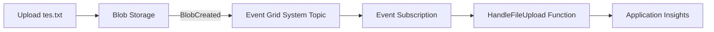

# Cloud Interfacing with Virtualization | Sesi 4: Event Grid Blob Trigger

> **Mata Kuliah:** Cloud Interfacing with Virtualization | **Sesi:** 4 | **Status:** Materi Lab

---

## 🔑 Cues
- Event-driven: Blob Storage → Event Grid → Function
- Event Grid menerima metadata, bukan isi file
- Komponen: source, system topic, subscription, endpoint, filter/delivery
- Event type: `BlobCreated` / `BlobDeleted`
- Handler Go: `app.EventGrid(...)` + `bindings.EventGridEvent`
- Idempotent (aman di-retry)
- KQL: `traces | where ...`

---

## 📖 Materi Utama

### 1. Ide Besar: File Datang, Kode Jalan

- Tujuannya: Azure Function (Go) otomatis berjalan setiap blob **dibuat atau dihapus**. Alurnya: upload ke Blob Storage → Event Grid menerima notifikasi → Event Subscription meneruskan → Function `HandleFileUpload` mengeksekusi logic → log ke Application Insights.
- Poin arsitektur: Blob Storage menyimpan file; Event Grid hanya mengirim **metadata** (tipe event, path subject, waktu, URL, content type, ukuran) — isi file tetap di storage dan diambil terpisah bila perlu.

#### **Alur Event**


### 2. Komponen Event Grid

- **Event source**: penerbit event — di sini Storage Account (mis. `sesi4sa`).
- **System topic**: representasi layanan penerbit yang dikelola Azure (mis. topic `blob-event-channel` untuk `sesi4sa`).
- **Event Subscription**: aturan routing — source apa, event type apa (`Blob Created`, `Blob Deleted`), endpoint mana, plus filter, retry, dan dead-letter.
- **Endpoint**: tujuan event — di sini Function `HandleFileUpload` (alternatif: Webhook, Logic App, Event Hub, Service Bus, Storage Queue).
- **Filter & delivery**: subscription bisa difilter per container/path; pengiriman asinkron dengan retry. Handler production wajib **idempotent** supaya event ganda tidak merusak data.
- Contoh payload `BlobCreated`: `eventType`, `subject` (`/.../containers/data/blobs/tes.txt`), `eventTime`, dan `data` berisi `url`, `contentType`, `contentLength`. File yang sudah ada sebelum subscription aktif tidak diproses otomatis — upload ulang sesudahnya.

### 3. Prasyarat dan Resource

- Subscription Azure + izin buat RG/Storage/Function App/topic/subscription. Tools: Go 1.24+, Functions Core Tools 4.12+, Azure CLI 2.87+ (`go version`, `func --version`, `az version`), VS Code + extension Functions & Go. Storage Account tipe StorageV2/BlobStorage/BlockBlobStorage; Go Functions masih preview di Flex Consumption.
- Resource Group `sesi4-rg` (East Asia) → Storage Account unik huruf-kecil-angka (mis. `sesi4sa`, Standard, LRS) → buat container `data` (Private).
- Function App: Flex Consumption, Go, 2048 MB, zone redundancy Disabled, storage runtime sendiri, Application Insights On, public access On, VNet Off, continuous deployment Disabled, skip Durable.
- Project lokal: folder kosong (mis. `FileUpload`) → *Create New Project* (Go) → `go mod tidy`. Ingat 5 file: `main.go`, `go.mod`, `go.sum`, `host.json`, `local.settings.json`.

### 4. Handler Event Grid di Go

- Struct data blob didefinisikan sendiri, lalu handler men-decode `event.Data`:
```go
type blobEventData struct {
    URL         string `json:"url"`
    API         string `json:"api"`
    ContentType string `json:"contentType"`
}

func HandleFileUpload(ctx context.Context, event bindings.EventGridEvent) error {
    var data blobEventData
    if err := json.Unmarshal(event.Data, &data); err != nil {
        slog.ErrorContext(ctx, "failed to decode Event Grid event data", "error", err)
        return err
    }
    switch event.EventType {
    case "Microsoft.Storage.BlobCreated":
        slog.InfoContext(ctx, "new blob is uploaded", "blob_url", data.URL)
    case "Microsoft.Storage.BlobDeleted":
        slog.InfoContext(ctx, "blob is deleted", "blob_url", data.URL)
    default:
        slog.InfoContext(ctx, "unhandled Event Grid event", "event_type", event.EventType)
    }
    return nil
}

func main() {
    app := sdk.FunctionApp()
    app.EventGrid("HandleFileUpload", HandleFileUpload)
    worker.Start(app)
}
```
- Field penting `EventGridEvent`: `EventType`, `Subject` (path container/blob), `Data` (metadata), `Id`, `EventTime`. Validasi dengan `go mod tidy` + `go build ./...`.
- Deploy seperti biasa dari VS Code (*Deploy to Function App*), pastikan `HandleFileUpload` muncul di menu Functions (`az account show` bila subscription ambigu).

### 5. Subscription, Test, dan Log

- Di Storage Account sumber: Events → **+ Event Subscription** → nama (mis. `blob-to-function`), schema *Event Grid Schema*, system topic (mis. `blob-event-channel`), event *Blob Created* + *Blob Deleted*, endpoint **Azure Function** → pilih app + function. Tambahkan subject filter untuk container `data` bila perlu; retry/dead-letter biarkan default untuk lab. Function tidak jalan saat subscription dibuat — ia jalan saat event cocok terjadi.
- Test: upload `tes.txt` baru ke container `data`, tunggu detik, hapus (uji Deleted), upload ulang (uji Created).
- Log: buka function → Monitor/Log stream **sesudah** view dibuka baru upload (log lama tak muncul). Atau Application Insights → Logs:
```
traces | where message contains "file upload trigger executed" | order by timestamp desc
traces | where message contains "event_type" | order by timestamp desc
```

---

## 🛠️ Use Case / Implementasi Nyata
- **Skenario:** Setiap file masuk harus diproses (validasi, thumbnail, parsing) tanpa polling.
- **Masalah yang Diatasi:** Cron/polling boros yang mengecek storage terus-menerus.
- **Keuntungan:** Reaksi detik-setelah-upload, biaya hanya saat event terjadi.

---

## 🗂️ Konsep Kunci

| Istilah | Definisi | Contoh / Catatan |
|---------|----------|-----------------|
| Event source | Penerbit event | Storage Account `sesi4sa` |
| System topic | Wakilan layanan penerbit | `blob-event-channel` |
| Event Subscription | Aturan routing event → endpoint | Blob Created/Deleted → Function |
| Endpoint | Tujuan pengiriman event | `HandleFileUpload` |
| Payload | Metadata event (bukan isi file) | URL, contentType, ukuran |
| Idempotent | Aman dijalankan berulang | Wajib karena ada retry |

---

## 📊 Tabel Ringkasan

| Tahap | Di mana | Kunci |
|-------|---------|-------|
| Simpan file | Blob container `data` | Private, upload sesudah subscription aktif |
| Rute event | Event Subscription | Schema, filter subject, endpoint Function |
| Eksekusi | Function Go | `app.EventGrid`, switch `EventType` |
| Observasi | Monitor / App Insights | KQL `traces \| where ...` |

---

## ⚠️ Catatan Penting
> **Urutan itu segalanya**: file lama tidak diproses otomatis — upload harus terjadi *sesudah* subscription aktif. Dan buka Log stream *sebelum* meng-upload, kalau tidak log-nya tidak terlihat. Untuk production: selalu asumsikan event bisa datang dua kali (idempotent).

---

## 📝 Materi Tambahan (Visual Insights)
- Hafalkan rantai lima komponen (source → system topic → subscription → endpoint → log) sebagai satu kalimat; sisanya (klik portal, KQL) tinggal mengikuti rantai itu.
