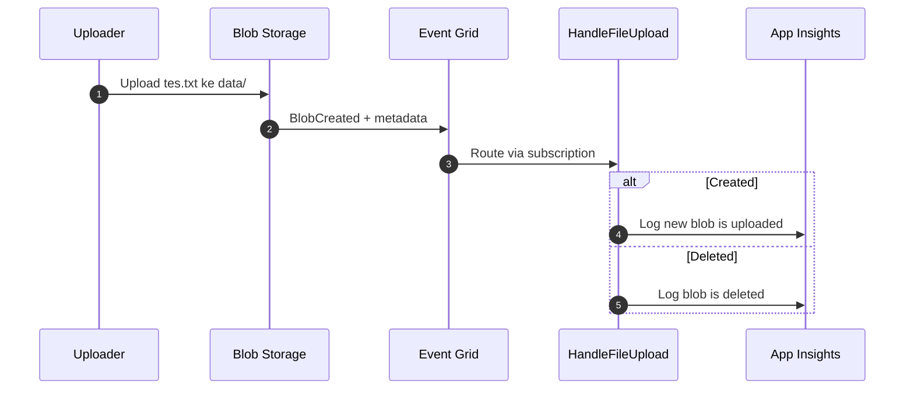

# Cloud Interfacing with Virtualization | Sesi 4: Event Grid Blob Trigger

> **Mata Kuliah:** Cloud Interfacing with Virtualization | **Sesi:** 4 | **Status:** Materi Lab

---

## 🔑 Cues
- Event-driven: reaksi, bukan polling
- Grid kirim metadata, bukan isi file
- Rantai: source, topic, subscription, endpoint
- Event BlobCreated dan BlobDeleted
- Handler Go via app.EventGrid
- Idempotent karena retry
- Observasi via Monitor dan KQL

---

## 📖 Materi Utama

### 1. Kenapa Menunggu Kabar Lebih Murah dari Patroli

- Analogi sendiri: polling itu seperti satpam yang tiap 5 menit menggedor gudang menanyakan "ada barang baru?". Event-driven itu seperti bel pintu: satpam duduk tenang, baru bergerak saat bel berbunyi.
- Tujuannya di lab: Function Go otomatis berjalan setiap blob **dibuat atau dihapus**, tanpa cron yang mengecek storage terus-menerus. Reaksi terjadi detik setelah upload, biaya hanya keluar saat event benar-benar ada.
- Aturan mainnya: Function tidak jalan saat subscription dibuat — ia jalan saat event yang cocok terjadi *sesudah* subscription aktif. File lama yang sudah ada sebelumnya tidak diproses otomatis; upload ulang sesudahnya.

#### **Bel Berbunyi, Satpam Bergerak**


### 2. Isi Amplop: Metadata, Bukan Kardusnya

- Event Grid tidak mengirim isi file — ia mengirim **amplop metadata**: tipe event, path subject, waktu, URL, content type, ukuran. Isi file tetap di storage dan diambil terpisah bila dibutuhkan.
- Contoh payload `BlobCreated`:

```json
{
  "eventType": "Microsoft.Storage.BlobCreated",
  "subject": "/blobServices/default/containers/data/blobs/tes.txt",
  "eventTime": "2026-09-30T08:00:00Z",
  "data": {
    "url": "https://sesi4sa.blob.core.windows.net/data/tes.txt",
    "contentType": "text/plain",
    "contentLength": 120
  }
}
```

### 3. Kantor Pos: Empat Peran Pengiriman

- **Event source**: pengirim surat — di sini Storage Account (misalnya `sesi4sa`).
- **System topic**: cap kantor pos yang dikelola Azure untuk penerbit itu (misalnya topic `blob-event-channel` milik `sesi4sa`).
- **Event Subscription**: slip routing — source apa, event type apa (`Blob Created`, `Blob Deleted`), endpoint mana, plus filter subject, retry, dan dead-letter.
- **Endpoint**: alamat tujuan — di sini Function `HandleFileUpload` (alternatif di luar lab: Webhook, Logic App, Event Hub, Service Bus, Storage Queue).
- Filter subscription bisa dipersempit per container/path (misalnya hanya container `data`). Pengiriman bersifat asinkron dengan retry, sehingga handler production wajib **idempotent**: event yang sama boleh tiba dua kali tanpa merusak data.

### 4. Merakit Kabel: Resource dan Wiring Portal

- Prasyarat: subscription Azure + izin membuat RG/Storage/Function/topic/subscription. Cek perkakas:

```bash
go version
func --version
az version
```

- Butuh VS Code + extension Functions dan Go. Tipe Storage Account: StorageV2/BlobStorage/BlockBlobStorage; Go Functions masih preview di Flex Consumption.
- Resource Group `sesi4-rg` (East Asia) → Storage Account unik huruf-kecil-angka (misalnya `sesi4sa`, Standard, LRS) → container `data` (Private).
- Function App: Flex Consumption, Go, 2048 MB, zone redundancy Disabled, storage runtime sendiri, Application Insights On, public access On, VNet Off, continuous deployment Disabled, skip Durable.
- Project lokal: folder kosong (misalnya `FileUpload`) → *Create New Project* (Go) → `go mod tidy`. Kenali lima file: `main.go`, `go.mod`, `go.sum`, `host.json`, `local.settings.json`.
- Wiring di portal: di Storage Account sumber buka Events → **+ Event Subscription** → nama (misalnya `blob-to-function`), schema *Event Grid Schema*, system topic (misalnya `blob-event-channel`), event *Blob Created* + *Blob Deleted*, endpoint **Azure Function** → pilih app + function. Filter subject untuk container `data` bila perlu; retry/dead-letter biarkan default untuk lab.

### 5. Penerima Surat: Handler Go dan Cara Mengintipnya

- Struct data blob didefinisikan sendiri, lalu handler men-decode `event.Data` dan bercabang per tipe event:

```go
type blobEventData struct {
    URL         string `json:"url"`
    API         string `json:"api"`
    ContentType string `json:"contentType"`
}

func HandleFileUpload(ctx context.Context, event bindings.EventGridEvent) error {
    var data blobEventData
    if err := json.Unmarshal(event.Data, &data); err != nil {
        slog.ErrorContext(ctx, "failed to decode Event Grid event data", "error", err)
        return err
    }
    switch event.EventType {
    case "Microsoft.Storage.BlobCreated":
        slog.InfoContext(ctx, "new blob is uploaded", "blob_url", data.URL)
    case "Microsoft.Storage.BlobDeleted":
        slog.InfoContext(ctx, "blob is deleted", "blob_url", data.URL)
    default:
        slog.InfoContext(ctx, "unhandled Event Grid event", "event_type", event.EventType)
    }
    return nil
}

func main() {
    app := sdk.FunctionApp()
    app.EventGrid("HandleFileUpload", HandleFileUpload)
    worker.Start(app)
}
```

- Field penting `EventGridEvent`: `EventType`, `Subject` (path container/blob), `Data` (metadata), `Id`, `EventTime`. Validasi lokal via `go mod tidy` + `go build ./...`, deploy dari VS Code (*Deploy to Function App*), pastikan `HandleFileUpload` muncul di menu Functions (`az account show` bila subscription ambigu).
- Test: upload `tes.txt` baru ke container `data`, tunggu beberapa detik, hapus (uji Deleted), upload ulang (uji Created).
- Observasi: buka function → Monitor/Log stream **dulu**, baru upload (log lama tidak muncul retroaktif). Alternatif Application Insights → Logs:

```
traces | where message contains "file upload trigger executed" | order by timestamp desc
traces | where message contains "event_type" | order by timestamp desc
```

---

## 🛠️ Use Case / Implementasi Nyata
- **Skenario:** Setiap file yang masuk harus segera diproses — divalidasi, dibuatkan thumbnail, atau di-parsing — tanpa ada proses yang sibuk mengecek folder tiap menit.
- **Masalah yang Diatasi:** Pola cron/polling yang boros: bangun tiap interval hanya untuk menemukan "tidak ada yang baru".
- **Keuntungan:** Bel pintu event bereaksi detik setelah upload dan diam (gratis) saat tidak ada file.

---

## 🗂️ Konsep Kunci

| Istilah | Definisi | Contoh / Catatan |
|---------|----------|-----------------|
| Event source | Penerbit event | Storage Account `sesi4sa` |
| System topic | Cap layanan penerbit milik Azure | `blob-event-channel` |
| Event Subscription | Slip routing event ke endpoint | Created/Deleted → Function |
| Endpoint | Tujuan pengiriman event | `HandleFileUpload` |
| Payload | Metadata event, bukan isi file | URL, contentType, ukuran |
| Idempotent | Aman dieksekusi berulang | Wajib karena ada retry |

---

## 📊 Tabel Ringkasan

| Tahap | Di mana | Kunci |
|-------|---------|-------|
| Simpan file | Blob container `data` | Private; upload sesudah subscription aktif |
| Rute event | Event Subscription | Schema, filter subject, endpoint Function |
| Eksekusi | Function Go | `app.EventGrid` + switch `EventType` |
| Observasi | Monitor / App Insights | KQL `traces \| where ...` |

---

## ⚠️ Catatan Penting
> **Dua urutan yang tidak bisa dibalik**: upload harus sesudah subscription aktif, dan Log stream harus dibuka sebelum upload. Ditambah satu asumsi production: setiap event bisa tiba dua kali, jadi handler harus idempotent.

---

## 📝 Materi Tambahan (Visual Insights)

### Hafalan Satu Kalimat
- Source → system topic → subscription → endpoint → log. Lima kata itu adalah seluruh rantai sesi ini; klik portal dan query KQL hanyalah detail yang menempel pada rantainya.
