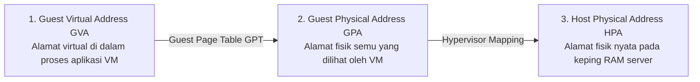
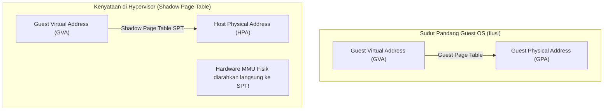
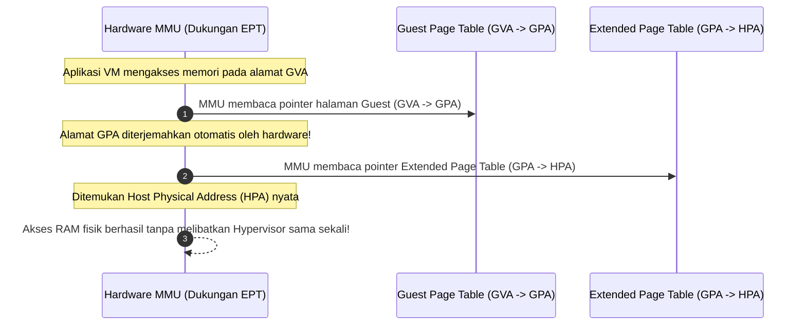
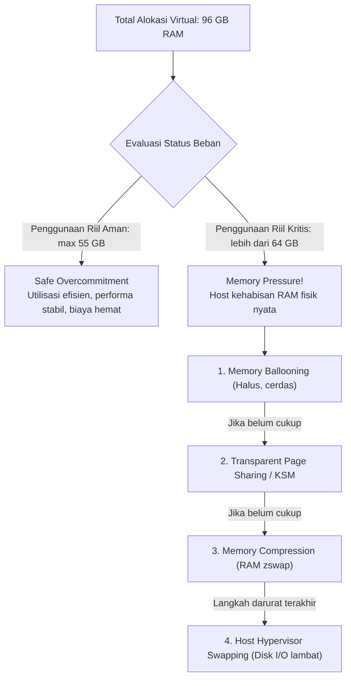
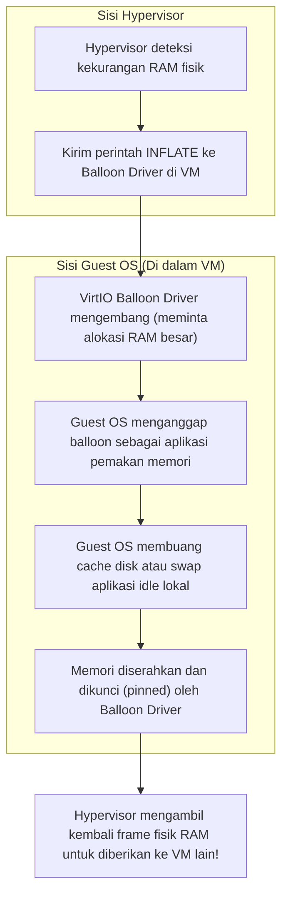

# Cloud Interfacing with Virtualization | Sesi 4: Memory Virtualization and Paging

> **Mata Kuliah:** Cloud Interfacing with Virtualization | **Sesi:** 4 | **Status:** Materi UTS
> **Sumber:** Slide dosen, adaptasi Erl & Barceló Monroy (2024), *Cloud Computing: Concepts, Technology, Security & Architecture*; Marinescu (2023), *Cloud Computing: Theory and Practice*; VMware vSphere Documentation.

---

## 🔑 Cues

- Tiga tingkatan alamat memori: GVA, GPA, dan HPA
- Peran MMU (Memory Management Unit) fisik vs emulasi virtual
- Shadow Page Tables (SPT): Pemetaan langsung software GVA ke HPA
- Masalah overhead sinkronisasi SPT dan intersepsi write-protection trap
- Hardware-Assisted Memory Virtualization: SLAT (Second-Level Address Translation)
- Intel EPT (Extended Page Tables) dan AMD NPT (Nested Page Tables)
- Mekanisme Two-Dimensional Page Walk di tingkat silikon
- Peran VPID (Virtual Processor ID) dalam mencegah flush TLB
- Konsep Memory Overcommitment pada efisiensi cloud multi-tenant
- Kondisi Safe Overcommitment vs bahaya Memory Pressure
- Mekanisme Memory Ballooning: Peran balloon driver (inflate & deflate)
- Kernel Samepage Merging (KSM) / Transparent Page Sharing berbasis CoW
- Hierarki reklamasi memori hypervisor: Ballooning, Compression, Swapping

---

## 📖 Materi Utama

### 1. Tiga Tingkatan Alamat Memori di Lingkungan Virtualisasi

Pada komputer fisik biasa tanpa virtualisasi, translasi alamat hanya melibatkan dua lapisan: *Virtual Address (VA)* dari aplikasi diubah menjadi *Physical Address (PA)* pada chip RAM fisik melalui tabel halaman (*Page Table*) yang dibaca langsung oleh unit perangkat keras MMU (*Memory Management Unit*).

Dalam mesin virtual, proses translasi menjadi lebih kompleks karena Guest OS merasa menguasai memori fisik mandiri, padahal memori tersebut hanyalah potongan virtual yang dialokasikan oleh hypervisor:

1. **Guest Virtual Address (GVA):** Alamat memori virtual yang digunakan oleh aplikasi di dalam VM.
2. **Guest Physical Address (GPA):** Ruang alamat "fisik" semu yang dialokasikan oleh hypervisor untuk VM tersebut. Guest OS meyakini bahwa GPA adalah RAM fisik sesungguhnya.
3. **Host Physical Address (HPA):** Alamat memori fisik yang sebenarnya pada modul RAM perangkat keras server fisik.

Tantangan mendasar hypervisor adalah: **MMU perangkat keras prosesor fisik hanya dapat membaca alamat fisik nyata (HPA)**. MMU tidak memahami konsep GPA semu milik Guest OS.

---

### 2. Shadow Page Tables (Pendekatan Perangkat Lunak Murni)

Sebelum era prosesor modern dengan dukungan SLAT, hypervisor harus menjembatani jurang GVA $\rightarrow$ HPA murni melalui perangkat lunak menggunakan **Shadow Page Tables (SPT)**:

- **Cara Kerja:**
  - Hypervisor membuat tabel halaman bayangan (*Shadow Page Table*) yang secara langsung memetakan **GVA langsung ke HPA**, melewati GPA.
  - Hypervisor mengarahkan register `CR3` prosesor fisik ke Shadow Page Table tersebut. Dengan demikian, MMU fisik dapat langsung menerjemahkan alamat saat eksekusi instruksi.
- **Kelemahan Fatal (Overhead Sinkronisasi yang Sangat Tinggi):**
  - Guest OS tidak mengetahui keberadaan Shadow Page Table dan terus memperbarui tabel halamannya sendiri (*Guest Page Table - GPT*).
  - Agar SPT tetap sinkron dengan GPT, hypervisor **mengunci seluruh halaman GPT di memori sebagai *read-only***.
  - Setiap kali Guest OS mengalokasikan memori baru, membebaskan memori, atau melakukan *context switch*, penulisan ke GPT memicu pengecualian *page fault* (trap) ke hypervisor.
  - Hypervisor harus mencegat trap, menyimulasikan penulisan GPT, memperbarui tabel bayangan SPT yang bersesuaian, lalu mengembalikan kontrol. Ribuan trap per detik ini menghabiskan siklus CPU secara masif.

---

### 3. Hardware-Assisted Paging: Intel EPT dan AMD NPT (SLAT)

Untuk mengeliminasi overhead sinkronisasi Shadow Page Tables, prosesor modern memperkenalkan teknologi **Second-Level Address Translation (SLAT)**:
- **Intel:** *Extended Page Tables (EPT)* (diperkenalkan pada mikroarsitektur Nehalem).
- **AMD:** *Nested Page Tables (NPT)* atau *Rapid Virtualization Indexing (RVI)*.

#### **Mekanisme Two-Dimensional Page Walk:**
- Perangkat keras MMU sekarang memiliki kemampuan cerdas untuk menelusuri dua tabel halaman sekaligus di level silikon (*Two-Dimensional Page Walk*):
  1. Dimensi 1: Menelusuri *Guest Page Table* untuk mendapatkan GPA.
  2. Dimensi 2: Menelusuri *Extended Page Table* untuk mengubah GPA menjadi HPA.
- **Keuntungan Terbesar:** Hypervisor tidak perlu lagi membuat bayangan SPT dan tidak perlu lagi mengunci GPT sebagai read-only. Guest OS bebas memodifikasi tabel halamannya tanpa memicu satu pun trap VM-Exit ke hypervisor!
- **Optimalisasi Tagged TLB (VPID):**
  - Intel menyertakan fitur **VPID (*Virtual Processor ID*)** pada TLB (*Translation Lookaside Buffer*).
  - Cache translasi memori diberi label identitas VM. Ketika terjadi pergantian VM-Exit atau VM-Entry, CPU tidak perlu membuang (*flush*) seluruh isi cache TLB, melipatgandakan kecepatan akses memori berulang.

---

### 4. Memory Overcommitment & Mekanisme Reklamasi

**Memory Overcommitment** adalah teknik di mana hypervisor mengalokasikan total memori virtual kepada seluruh VM melampaui kapasitas RAM fisik yang terpasang pada server:
- *Contoh:* Server fisik memiliki RAM 64 GB, tetapi hypervisor menjalankan 4 VM yang masing-masing dialokasikan 24 GB RAM (Total alokasi = 96 GB, overcommit rasio 150%).
- *Dasar Pemikiran:* Sebagian besar VM tidak menggunakan 100% alokasi RAM-nya secara bersamaan; banyak proses yang berada dalam kondisi idle atau hanya menyimpan cache file sementara.

---

### 5. Memory Ballooning: Reklamasi Memori Cerdas

Saat terjadi *Memory Pressure*, teknik reklamasi terbaik dan paling ramah terhadap performa adalah **Memory Ballooning**:

- **Mekanisme Mengembang (*Inflate*):**
  - Hypervisor memerintahkan driver *balloon* di dalam Guest OS untuk mengembang. Driver meminta alokasi memori dalam jumlah besar ke kernel Guest OS.
  - Kernel Guest OS yang mengetahui prioritas proses internalnya akan membebaskan cache yang tidak penting atau memindahkan proses idle miliknya sendiri ke partisi swap lokal VM.
  - Driver mengunci halaman RAM tersebut dan memberi tahu hypervisor nomor frame fisiknya. Hypervisor kemudian melepaskan pemetaan HPA tersebut untuk dipakai oleh VM lain yang sedang sibuk.
- **Mekanisme Mengempis (*Deflate*):**
  - Ketika beban server normal kembali, hypervisor memerintahkan balloon untuk mengempis, mengembalikan ruang RAM bebas ke sistem operasi tamu.

#### **Teknik Reklamasi Tambahan:**
1. **Transparent Page Sharing (TPS) / Kernel Samepage Merging (KSM):** Hypervisor memindai halaman-halaman RAM fisik yang isinya identik (misal ribuan halaman OS kernel yang sama pada 10 VM Linux yang identik). Halaman-halaman tersebut digabungkan menjadi satu halaman fisik tunggal yang ditandai sebagai *Copy-on-Write (CoW)*.
2. **Hypervisor Swapping:** Langkah darurat terakhir di mana hypervisor memindahkan halaman memori VM langsung ke file swap di disk storage host. Ini sangat dihindari karena menimbulkan penalti latensi ribuan kali lipat (*severe disk thrashing*).

---

## 🛠️ Use Case / Implementasi Nyata

- **Skenario:** Penyedia hosting virtual desktop (*Virtual Desktop Infrastructure - VDI*) menjalankan 200 desktop virtual Windows 11 untuk karyawan kantor pada satu server fisik dengan RAM 512 GB.
- **Masalah yang Diatasi:** Jika setiap desktop dialokasikan 4 GB RAM secara statis (*thick allocation*), server hanya mampu menampung 128 VM sebelum kehabisan memori.
- **Keuntungan Solusi Memory Virtualization Modern:**
  - *Hardware EPT/NPT:* Memastikan setiap vDesktop dapat melakukan browsing dan menjalankan aplikasi dengan performa memori native tanpa trap sinkronisasi.
  - *KSM Deduplication:* Menggabungkan komponen DLL Windows yang identik di 200 VM, menghemat hingga 40% RAM fisik.
  - *VirtIO Ballooning:* Secara dinamis mengambil RAM dari desktop karyawan yang sedang cuti atau istirahat makan siang untuk dialokasikan ke desktop analis data yang sedang memproses query berat, meningkatkan densitas server hingga 200 VM per host.

---

## 🗂️ Konsep Kunci

| Istilah | Definisi | Contoh / Catatan |
|---|---|---|
| GVA | Guest Virtual Address; ruang alamat virtual yang dialokasikan proses di dalam VM | Alamat pointer aplikasi |
| GPA | Guest Physical Address; ruang alamat fisik semu yang dilihat oleh kernel Guest OS | Target translasi GPT |
| HPA | Host Physical Address; alamat fisik nyata pada modul perangkat keras RAM server | Target akhir eksekusi MMU |
| Shadow Page Table | Tabel halaman buatan software hypervisor yang memetakan GVA langsung ke HPA | Solusi pra-EPT (banyak trap) |
| Intel EPT / AMD NPT | Fitur SLAT hardware di mana MMU prosesor membaca dua tingkat page table di silikon | Two-dimensional page walk |
| VPID | Virtual Processor ID; penandaan cache TLB dengan ID VM agar tidak di-flush saat VM-Exit | Akselerasi TLB hardware |
| Memory Overcommit | Alokasi total RAM virtual melampaui kapasitas RAM fisik nyata yang ada di host | Rasio 150% alokasi RAM |
| Memory Ballooning | Driver khusus di guest yang membesar/mengecil untuk mereklamasi RAM secara kooperatif | `virtio_balloon` |
| KSM / TPS | Kernel Samepage Merging; deduplikasi halaman memori identik berbasis Copy-on-Write | Hemat RAM pada OS seragam |

---

## 📊 Tabel Ringkasan

**Perbandingan Metode Virtualisasi Memori**

| Parameter | Shadow Page Tables (SPT - Software) | Hardware-Assisted Paging (EPT / NPT) |
|---|---|---|
| **Mekanisme Pengendali** | Perangkat Lunak Hypervisor murni | Perangkat Keras MMU Silikon Prosesor |
| **Beban Saat Modifikasi Page Table**| Sangat Tinggi (Banyak trap intersepsi write-protection)| **Nol Trap** (Guest OS bebas menulis ke GPT) |
| **Kompleksitas Desain Hypervisor**| Sangat Rumit (Perlu sinkronisasi state terus-menerus) | Sederhana (Cukup siapkan tabel EPT awal) |
| **Biaya Penanganan TLB Miss** | Rendah (Cukup 1 kali lookup pada SPT) | Lebih Tinggi (Two-dimensional page walk hingga 24 akses) |
| **Solusi Optimasi Modern** | Tidak ada | Akselerasi cache TLB hardware dengan VPID |
| **Status Penggunaan Industri** | Ditinggalkan (Legacy) | **Standar Mutlak Seluruh Cloud Modern** |

---

## ⚠️ Catatan Penting

> **Mengapa Ballooning lebih unggul dibanding Hypervisor Swapping?** Saat hypervisor melakukan swapping ke disk secara sepihak, hypervisor tidak tahu halaman mana yang penting; bisa saja halaman kernel kritis milik guest yang di-swap, membuat VM freeze. Sebaliknya, pada ballooning, Guest OS yang memilih halaman mana yang aman dibuang ke swap lokal karena Guest OS memiliki visibilitas penuh atas prioritas proses aplikasinya.
>
> **Overcommitment menuntut pemantauan (*monitoring*) ketat.** Safe overcommitment dapat berubah menjadi bencana *OOM Crash* atau *performance degradation* ekstrem dalam hitungan menit jika seluruh VM tiba-tiba mengalami lonjakan aktivitas bersamaan (misal jadwal scan antivirus serentak pada jam 09.00 pagi).
>
> **EPT Two-Dimensional Walk memiliki biaya latency TLB miss.** Jika data tidak ditemukan di cache TLB, proses penelusuran alamat membutuhkan pembacaan bertingkat (Guest Page Table 4 level dikalikan Extended Page Table 4 level). Itulah sebabnya penggunaan *Huge Pages* (halaman memori 2MB / 1GB) sangat disarankan untuk database di dalam VM guna memperkecil kedalaman level page table.

---

## 📝 Materi Tambahan (Visual Insights)

- **Mekanisme Huge Pages pada EPT:**
  - Standar ukuran halaman memori x86 adalah **4 KB**.
  - Mengaktifkan *Transparent Huge Pages (THP)* sebesar **2 MB** atau **1 GB** secara dramatis mengurangi jumlah entri halaman yang harus ditelusuri oleh MMU, mempercepat proses *two-dimensional page walk* pada sistem database (seperti PostgreSQL atau Oracle) hingga 25%.
- **Anatomi Driver Balloon VirtIO:** Driver `virtio_balloon` berkomunikasi dengan QEMU/KVM melalui antrian memori bersama (*virtqueues*). Pesan perintah `inflate` dikirimkan melalui interupsi virtual, dan pengembalian frame PFN (*Page Frame Number*) dilaporkan kembali ke host dalam hitungan milidetik.
- **Referensi Buku:**
  - Erl, T., & Barceló Monroy, E. (2024). *Cloud Computing: Concepts, Technology, Security, and Architecture*. Pearson.
  - Marinescu, D. C. (2023). *Cloud Computing: Theory and Practice* (3rd ed.). Morgan Kaufmann.
