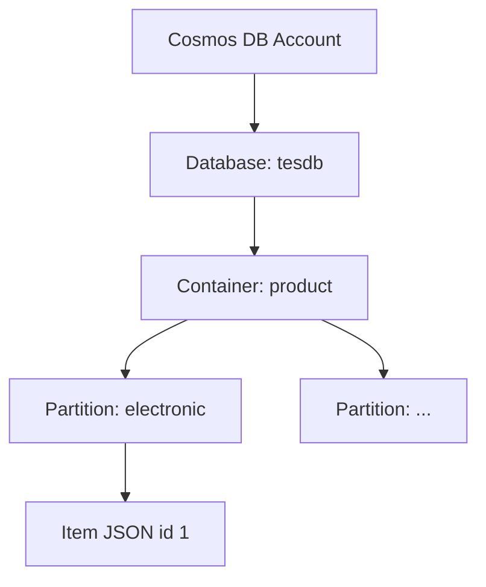

# Cloud Interfacing with Virtualization | Sesi 5: Azure Cosmos DB

> **Mata Kuliah:** Cloud Interfacing with Virtualization | **Sesi:** 5 | **Status:** Materi Lab

---

## 🔑 Cues
- NoSQL: Account → Database → Container → Items (JSON)
- Partition key (`/category`) = pengelompokan logis
- Cosmos DB for NoSQL; backup Periodic vs Continuous
- Go SDK `azcosmos`: client → database → container
- CRUD via Upsert / ReadItem / Query(pager) / DeleteItem
- Query butuh pager; `SELECT *` ikut atribut bawaan (`_rid`, `_etag`, ...)

---

## 📖 Materi Utama

### 1. Cosmos DB dan Struktur Datanya

- Cosmos DB adalah database **NoSQL** terkelola Azure. Tidak ada tabel/kolom — data berupa **item/dokumen JSON** dengan hierarki: Account → Database (mis. `tesdb`, wadah container) → Container (mis. `product`, wadah item) → Items.
- **Partition key** (mis. `/category`) menentukan pengelompokan logis: item dengan `category` sama berada di logical partition yang sama. Mengetahui partition key membuat pencarian langsung ke partition itu (efisien); tanpanya, gunakan query. Path boleh nested mengikuti struktur JSON.

#### **Hierarki**


### 2. Membuat Account, Database, Container

- Portal: Resource Group → Cosmos DB → Create → **Azure Cosmos DB for NoSQL**. Basics: Location boleh beda dari RG (error `RequestDisallowedByAzure` = region dilarang policy → ganti region). Networking: All networks (biar bisa dari internet). Backup: Periodic (interval mis. 240 menit + retensi) atau Continuous (restore ke titik waktu ≤7 hari). Security default → Review + Create.
- Database: Cosmos DB → Data Explorer → New Database → ID `tesdb`. Container dibuat dari kode (bagian 3) dengan partition key `/category` — hasilnya `tesdb → product → Items`. Tips: kalau error, comment dulu blok Create Container (konflik karena container sudah ada).

### 3. Project Go dan Koneksi

- Folder project → VS Code → `main.go` minimal → `go mod init sesi5` → `go get github.com/Azure/azure-sdk-for-go/sdk/data/azcosmos`. Pastikan extension Go terinstall.
- Koneksi memakai connection string (Cosmos DB → Keys → Primary Connection String), disimpan di konstanta:
```go
const connStr = "AccountEndpoint=...;AccountKey=...;"
client, err := azcosmos.NewClientFromConnectionString(connStr, nil)
if err != nil { log.Fatalf("%s\n", err) }
```
- Reference database: `db, err := client.NewDatabase("tesdb")`. Container:
```go
ctx := context.Background()
_, err = db.CreateContainer(ctx, azcosmos.ContainerProperties{
    ID: "product",
    PartitionKeyDefinition: azcosmos.PartitionKeyDefinition{
        Paths: []string{"/category"},
    },
}, nil)
```
- `[]string{"/category"}` = slice string berisi path atribut JSON yang jadi partition key. Jalankan `go run .\main.go`, cek Data Explorer → `tesdb → product → Items`.

### 4. CRUD: Upsert, Read, Query, Delete

- Model struct merepresentasikan item:
```go
type Item struct {
    ID       string `json:"id"`
    Name     string `json:"name"`
    Category string `json:"category"`
}
```
- **Upsert** (insert bila belum ada, update bila ID sudah ada): ambil reference container (`db.NewContainer("product")`), tentukan partition key (`azcosmos.NewPartitionKeyString("electronic")` karena item ber-`category: electronic`), marshal struct (`json.Marshal`), lalu `container.UpsertItem(ctx, pk, payload, nil)`.
- **Read** langsung butuh dua info: partition key + ID: `container.ReadItem(ctx, pk, "1", nil)` → `resp.Value` masih byte → `json.Unmarshal(resp.Value, &decodedItem)` (hasil mis. `{1 laptop electronic}`).
- **Query** bila partition key tak diketahui: `container.NewQueryItemsPager("SELECT * FROM c", azcosmos.NewPartitionKey(), nil)` — `c` alias item. Hasil dibagi halaman, jadi iterasi:
```go
for pager.More() {
    page, err := pager.NextPage(ctx)
    if err != nil { log.Fatalf("%s\n", err) }
    for _, raw := range page.Items {
        log.Printf("Item: %s\n", raw)
    }
}
```
- `SELECT *` ikut mengambil atribut bawaan Cosmos (`_rid`, `_self`, `_etag`, `_attachments`, `_ts`).
- **Delete** butuh partition key + ID: `container.DeleteItem(ctx, pk, "1", nil)` → cek item `1 | laptop | electronic` hilang dari Data Explorer.

### 5. Alur Keseluruhan

- Portal: Resource Group → Cosmos DB Account → Database `tesdb` → Container `product` (partition key `/category`). Kode: project Go → SDK `azcosmos` → connection string → client → database → container. Operasi: Upsert (tulis/ubah) → Read (baca langsung) → Query (cari) → Delete (hapus).

---

## 🛠️ Use Case / Implementasi Nyata
- **Skenario:** Katalog produk JSON yang butuh skala global dan akses per kategori.
- **Masalah yang Diatasi:** Skema kaku SQL dan query lintas-partition yang lambat.
- **Keuntungan:** Partition key mengarahkan baca/tulis ke partition tepat; query + pager menutup kasus pencarian bebas.

---

## 🗂️ Konsep Kunci

| Istilah | Definisi | Contoh / Catatan |
|---------|----------|-----------------|
| Item | Dokumen JSON di container | `{"id":"1","name":"laptop",...}` |
| Partition key | Atribut pengelompok logis | `/category` → `electronic` |
| Upsert | Insert-atau-update by ID | `UpsertItem` |
| Pager | Iterasi hasil query per halaman | `More()` / `NextPage(ctx)` |
| Connection string | Kredensial SDK | Keys → Primary Connection String |
| Periodic backup | Backup interval + retensi | Mis. tiap 240 menit |
| Continuous backup | Restore point-in-time | ≤ 7 hari |

---

## 📊 Tabel Ringkasan

| Operasi | Syarat | Fungsi SDK |
|---------|--------|-----------|
| Create/Update | Struct + partition key | `UpsertItem` |
| Read | Partition key + ID | `ReadItem` + `Unmarshal` |
| Query | Tanpa syarat (lebih lambat) | `NewQueryItemsPager` + loop |
| Delete | Partition key + ID | `DeleteItem` |

---

## ⚠️ Catatan Penting
> **Read/Delete tanpa partition key tidak bisa** — hafalkan pasangan (partition key + ID). Untuk query ingat pager-nya (`More`/`NextPage`), dan jangan kaget atribut `_rid/_etag` ikut muncul di `SELECT *`.

---

## 📝 Materi Tambahan (Visual Insights)
- Satu diagram hierarki (Account → tesdb → product → partition → item) + satu alur portal-vs-kode sudah mencakup 80% sesi ini; sisanya variasi empat operasi CRUD.
