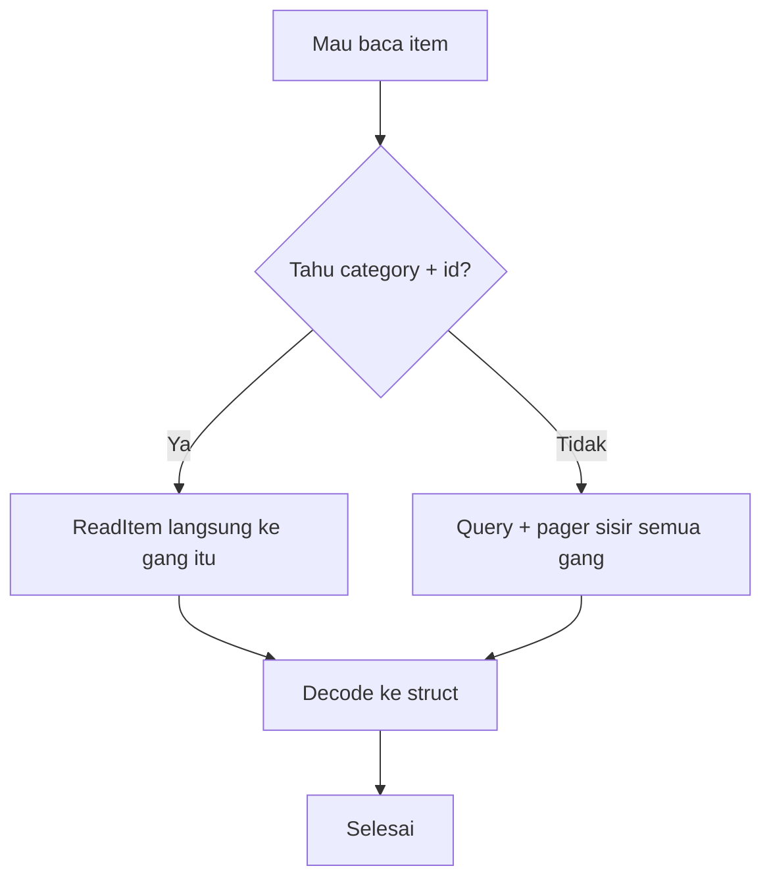

# Cloud Interfacing with Virtualization | Sesi 5: Azure Cosmos DB

> **Mata Kuliah:** Cloud Interfacing with Virtualization | **Sesi:** 5 | **Status:** Materi Lab

---

## 🔑 Cues
- NoSQL dokumen JSON, bukan tabel kaku
- Hierarki: account, database, container, item
- Partition key sebagai alamat gang
- Cosmos DB for NoSQL; backup Periodic vs Continuous
- SDK azcosmos: client, database, container
- Baca langsung vs query + pager
- Upsert, Read, Delete butuh partition key
- Atribut bawaan _rid, _etag ikut SELECT *

---

## 📖 Materi Utama

### 1. Dari Tabel Kaku ke Dokumen Bebas

- Analogi sendiri: SQL itu seperti formulir kelurahan — kolomnya tetap, semua warga mengisi field yang sama. Cosmos DB itu seperti map berisi amplop JSON: tiap amplop (**item**) boleh beda isi, selama punya `id`.
- Hierarkinya: Account (gedung) → Database `tesdb` (lantai, wadah container) → Container `product` (lemari, wadah item) → Items (amplop JSON). Tidak ada tabel/kolom; ada dokumen.
- **Partition key** (misalnya `/category`) adalah "nama gang": amplop dengan `category` sama tinggal di gang logis yang sama. Path boleh nested mengikuti struktur JSON.

#### **Dua Cara Menemukan Amplop**


### 2. Mendirikan Gedung: Account, Database, Container

- Portal: Resource Group → Cosmos DB → Create → **Azure Cosmos DB for NoSQL**. Location boleh beda dari RG; bila muncul `RequestDisallowedByAzure` berarti region dilarang policy — ganti region. Networking: All networks (agar bisa dari internet). Backup: Periodic (interval misalnya 240 menit + retensi) atau Continuous (restore ke titik waktu ≤7 hari). Security biarkan default → Review + Create.
- Database: Cosmos DB → Data Explorer → New Database → ID `tesdb`. Container dibuat dari kode (bagian 3) dengan partition key `/category`, hasilnya `tesdb → product → Items`. Tips lab: bila error container, comment dulu blok Create Container — biasanya konflik karena container sudah ada.

### 3. Kunci Gedung: Project Go dan Koneksi

- Folder project → VS Code → `main.go` minimal, lalu di terminal:

```bash
go mod init sesi5
go get github.com/Azure/azure-sdk-for-go/sdk/data/azcosmos
```

- Pastikan extension Go terinstall.
- Koneksi memakai connection string (Cosmos DB → Keys → Primary Connection String), disimpan di konstanta:

```go
const connStr = "AccountEndpoint=...;AccountKey=...;"
client, err := azcosmos.NewClientFromConnectionString(connStr, nil)
if err != nil { log.Fatalf("%s\n", err) }
```

- Reference database lalu buat container:

```go
db, err := client.NewDatabase("tesdb")
ctx := context.Background()
_, err = db.CreateContainer(ctx, azcosmos.ContainerProperties{
    ID: "product",
    PartitionKeyDefinition: azcosmos.PartitionKeyDefinition{
        Paths: []string{"/category"},
    },
}, nil)
```

- `[]string{"/category"}` adalah slice berisi path atribut JSON yang jadi partition key. Jalankan `go run .\main.go`, verifikasi di Data Explorer → `tesdb → product → Items`.

### 4. Empat Gerakan: Tulis, Baca Langsung, Cari, Hapus

- Model struct sebagai cetakan amplop:

```go
type Item struct {
    ID       string `json:"id"`
    Name     string `json:"name"`
    Category string `json:"category"`
}
```

- **Upsert** (tambah bila ID belum ada, timpa bila sudah ada):

```go
container, err := db.NewContainer("product")
if err != nil {
    log.Fatalf("%s\n", err)
}
pk := azcosmos.NewPartitionKeyString("electronic")
payload, err := json.Marshal(Item{
    ID: "1", Name: "laptop", Category: "electronic",
})
if err != nil {
    log.Fatalf("%s\n", err)
}
_, err = container.UpsertItem(ctx, pk, payload, nil)
if err != nil {
    log.Fatalf("%s\n", err)
}
```

- **Read** langsung — butuh dua info: partition key + ID — lalu decode byte ke struct:

```go
pk := azcosmos.NewPartitionKeyString("electronic")
resp, err := container.ReadItem(ctx, pk, "1", nil)
if err != nil {
    log.Fatalf("%s\n", err)
}
var decodedItem Item
err = json.Unmarshal(resp.Value, &decodedItem)
if err != nil {
    log.Fatalf("%s\n", err)
}
log.Printf("Decoded item: %v\n", decodedItem)
```

- **Query** bila partition key tidak diketahui — `c` adalah alias item; hasil dibagi halaman sehingga perlu iterasi:

```go
pager := container.NewQueryItemsPager("SELECT * FROM c", azcosmos.NewPartitionKey(), nil)
for pager.More() {
    page, err := pager.NextPage(ctx)
    if err != nil { log.Fatalf("%s\n", err) }
    for _, raw := range page.Items {
        log.Printf("Item: %s\n", raw)
    }
}
```

- `SELECT *` ikut mengambil atribut bawaan Cosmos (`_rid`, `_self`, `_etag`, `_attachments`, `_ts`) — jangan kaget melihatnya.
- **Delete** — butuh pasangan yang sama seperti Read (partition key + ID):

```go
pk := azcosmos.NewPartitionKeyString("electronic")
_, err = container.DeleteItem(ctx, pk, "1", nil)
if err != nil {
    log.Fatalf("%s\n", err)
}
```

- Verifikasi: item `1 | laptop | electronic` hilang dari Data Explorer.

### 5. Peta Perjalanan Satu Paragraf

- Portal menyiapkan gedung (RG → account → `tesdb` → `product` dengan `/category`); kode menyiapkan kurir (project Go → SDK `azcosmos` → connection string → client → database → container); operasi menyiapkan gerakan (Upsert untuk tulis/ubah, Read untuk baca langsung, Query untuk cari bebas, Delete untuk hapus).

---

## 🛠️ Use Case / Implementasi Nyata
- **Skenario:** Katalog produk JSON yang skemanya bisa berubah-ubah dan butuh skala global, dengan akses terbanyak per kategori.
- **Masalah yang Diatasi:** Skema SQL yang kaku (tambah field = migrasi) dan pencarian lintas-partition yang lambat karena tidak tahu gangnya.
- **Keuntungan:** Partition key mengarahkan baca/tulis langsung ke gang yang tepat; query + pager menutup kasus "pokoknya cari saja" saat gangnya tidak diketahui.

---

## 🗂️ Konsep Kunci

| Istilah | Definisi | Contoh / Catatan |
|---------|----------|-----------------|
| Item | Amplop dokumen JSON di container | `{"id":"1","name":"laptop",...}` |
| Partition key | Nama gang pengelompok logis | `/category` → `electronic` |
| Upsert | Tulis-atau-timpa berdasar ID | `UpsertItem` |
| Pager | Iterasi hasil query per halaman | `More()` / `NextPage(ctx)` |
| Connection string | Kredensial akses SDK | Keys → Primary Connection String |
| Periodic backup | Backup interval + retensi | Misalnya tiap 240 menit |
| Continuous backup | Restore point-in-time | ≤ 7 hari |

---

## 📊 Tabel Ringkasan

| Operasi | Syarat | Fungsi SDK |
|---------|--------|-----------|
| Create/Update | Struct + partition key | `UpsertItem` |
| Read | Partition key + ID | `ReadItem` + `Unmarshal` |
| Query | Tanpa syarat (lebih lambat) | `NewQueryItemsPager` + loop |
| Delete | Partition key + ID | `DeleteItem` |

---

## ⚠️ Catatan Penting
> **Read dan Delete buta tanpa gang** — hafalkan pasangan (partition key + ID). Untuk query hafalkan pasangannya yang lain (`More`/`NextPage`), dan ingat `SELECT *` selalu membawa atribut bawaan `_rid`/`_etag` serta kawan-kawannya.

---

## 📝 Materi Tambahan (Visual Insights)

### Cara Mengingat 80% Sesi Ini
- Satu keputusan (tahu gang atau tidak) menentukan seluruh operasi baca; sisanya hanya variasi tulis-ubah-hapus di sekitar keputusan itu. Diagram flowchart di atas sudah merangkumnya.
