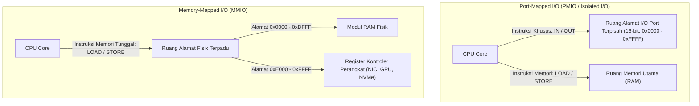
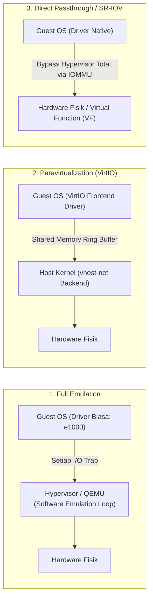
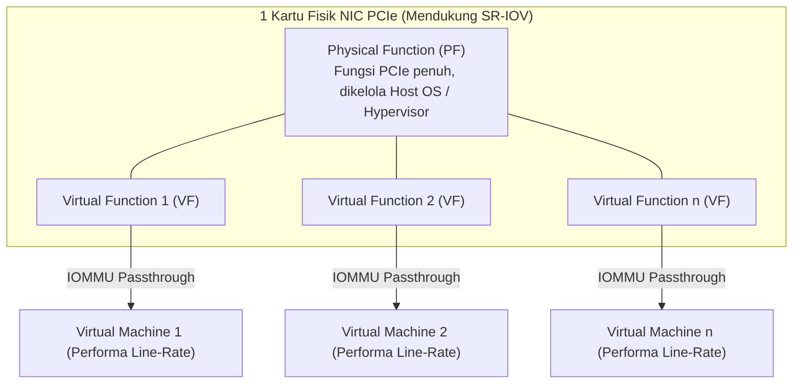
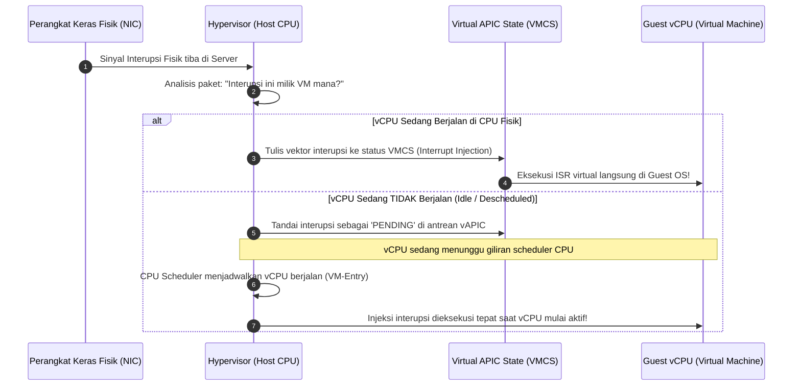

# Cloud Interfacing with Virtualization | Sesi 5: I/O and Device Virtualization

> **Mata Kuliah:** Cloud Interfacing with Virtualization | **Sesi:** 5 | **Status:** Materi UTS
> **Sumber:** Slide dosen, adaptasi Erl & Barceló Monroy (2024), *Cloud Computing: Concepts, Technology, Security & Architecture*; Marinescu (2022), *Cloud Computing: Theory and Practice*; Red Hat Enterprise Linux Virtualization Guide.

---

## 🔑 Cues

- Port-Mapped I/O (PMIO) vs Memory-Mapped I/O (MMIO)
- Spektrum virtualisasi I/O: Emulasi penuh, Paravirtualisasi, dan Passthrough
- Full Device Emulation di QEMU dan beban trap-and-emulate berulang
- Framework Paravirtualisasi VirtIO: Model arsitektur Split-Driver
- Peran Frontend Driver di Guest OS dan Backend Driver di Host Kernel (vhost)
- Antrean cincin memori bersama: Virtqueues dan vrings
- Device Passthrough: Akses hardware eksklusif via IOMMU (Intel VT-d / AMD-Vi)
- Peran DMA Remapping dan Interrupt Remapping dalam isolasi hardware
- Single Root I/O Virtualization (SR-IOV): Physical Function (PF) vs Virtual Functions (VF)
- Throughput jaringan mendekati line-rate pada SR-IOV
- Konsep Virtualized Interrupts dan proses Interrupt Injection
- Penanganan interupsi saat vCPU tidak sedang terjadwal di prosesor fisik
- Akselerasi interupsi modern: APIC-v dan Posted Interrupts

---

## 📖 Materi Utama

### 1. Metode Pengalamatan Perangkat: PMIO vs. MMIO

Sebelum perangkat keras dapat divirtualisasikan, CPU harus memiliki cara untuk mengirimkan perintah dan membaca data dari register pengontrol perangkat (*device controller*). Terdapat dua paradigma arsitektur pengalamatan I/O:

| Parameter | Port-Mapped I/O (PMIO) | Memory-Mapped I/O (MMIO) |
|---|---|---|
| **Ruang Alamat** | Terpisah secara fisik dari memori utama | Bersatu di dalam peta ruang alamat memori utama |
| **Instruksi CPU** | Menggunakan instruksi I/O khusus (`IN`, `OUT`) | Menggunakan instruksi memori standar (`LOAD`, `STORE`, `MOV`) |
| **Intersepsi Hypervisor**| Memeriksa dan mencegat eksekusi port I/O via tabel izin I/O bitmap di VMCS | Menandai halaman memori MMIO sebagai unmapped/fault di EPT untuk memicu trap |
| **Kompleksitas Driver** | Terbatas pada arsitektur tertentu (warisan x86) | Sangat fleksibel, standar dominan perangkat modern (PCIe) |

---

### 2. Spektrum Tiga Model Virtualisasi Perangkat I/O

#### **A. Full Device Emulation (Emulasi Perangkat Lunak Penuh)**
- Hypervisor (seperti QEMU) meniru perangkat keras fisik nyata secara murni melalui kode perangkat lunak (misal kartu jaringan Intel e1000 atau kontroler disk IDE).
- **Keuntungan:** Kompatibilitas absolut 100%. Sistem operasi lawas dapat langsung berjalan tanpa perlu menginstal driver tambahan.
- **Kelemahan Fatal:** Sangat lambat. Setiap operasi baca/tulis register perangkat memicu siklus VM-Exit yang berulang-ulang, memakan siklus CPU yang masif dan menghasilkan latensi tinggi.

#### **B. Paravirtualized Drivers (Framework VirtIO)**
- Menggunakan arsitektur kerja sama kooperatif (*Split-Driver Model*):
  - **Frontend Driver:** Driver khusus yang sadar virtualisasi (*virtualization-aware*) berjalan di dalam kernel Guest OS (misal `virtio-net` untuk jaringan, `virtio-blk` atau `virtio-scsi` untuk disk storage).
  - **Backend Driver:** Komponen di sisi host (berjalan di QEMU atau langsung di dalam kernel host via akselerator kernel seperti `vhost-net`).
  - **Virtqueues & vrings:** Komunikasi data dilakukan melalui antrean cincin memori bersama (*shared-memory circular ring buffers*). Guest OS menaruh paket I/O di vring, lalu membunyikan bel virtual (*doorbell hypercall*). Host membaca puluhan paket sekaligus dalam mode batch (*batching*) tanpa perlu trap per paket.
- **Hasil:** Peningkatan throughput drastis hingga mendekati kecepatan native dengan overhead CPU minimal. Menjadi standar emas default di Linux KVM dan cloud computing.

#### **C. Direct Device Assignment (Device Passthrough)**
- Perangkat keras fisik nyata (seperti GPU Nvidia, kontroler NVMe, atau kartu 100GbE NIC) dialokasikan secara eksklusif 100% ke satu VM tertentu.
- Hypervisor melepaskan diri sepenuhnya dari jalur data (*data plane bypass*). Guest OS berkomunikasi langsung dengan register fisik perangkat.
- **Peran Kritis IOMMU (Intel VT-d / AMD-Vi):**
  - Pada sistem fisik biasa, perangkat PCIe dapat melakukan *Direct Memory Access (DMA)* ke alamat memori fisik mana pun.
  - Di lingkungan VM, DMA sembarangan dapat merusak memori host atau VM lain!
  - **IOMMU** bertindak sebagai "tabel halaman untuk perangkat I/O", menyediakan dua fitur isolasi keamanan vital:
    1. *DMA Remapping:* Memetakan DMA Guest Physical Address (GPA) ke Host Physical Address (HPA) yang sah secara hardware.
    2. *Interrupt Remapping:* Mengarahkan interupsi hardware perangkat secara aman langsung ke VM pemiliknya.
- **Kelemahan:** Perangkat bersifat eksklusif (tidak bisa dibagi ke VM lain) dan menonaktifkan fitur *VM Live Migration* karena state internal hardware fisik tidak dapat disalin ke server lain secara instan.

---

### 3. Single Root I/O Virtualization (SR-IOV)

SR-IOV adalah standar perangkat keras dari PCI-SIG yang memadukan performa mendekati native milik *Passthrough* dengan kemampuan berbagi sumber daya milik *Virtualisasi*:

- **Physical Function (PF):** Fungsi PCIe berfitur penuh yang dikontrol oleh hypervisor host untuk konfigurasi global, manajemen daya, dan alokasi virtual function.
- **Virtual Functions (VF):** Puluhan fungsi PCIe ringan independen yang dipancarkan oleh satu kartu fisik yang sama (misal 1 kartu fisik memancarkan 64 atau 128 VF).
- Setiap VM diberikan satu Virtual Function secara langsung melalui IOMMU passthrough.
- **Dampak Performa:** VM memperoleh latensi sub-mikrodetik dan throughput mendekati batas fisik kabel (*near-line rate*), CPU host terbebas dari pemrosesan paket jaringan, namun puluhan VM tetap dapat berbagi satu kartu fisik secara hemat.

---

### 4. Virtualized Interrupts & Mekanisme Interrupt Injection

Dalam sistem fisik, perangkat I/O mengirimkan sinyal interupsi elektrik ke chip pengendali interupsi CPU (*APIC - Advanced Programmable Interrupt Controller*), memaksa prosesor segera menghentikan tugasnya untuk mengeksekusi *Interrupt Service Routine (ISR)*.

Di lingkungan virtualisasi, alur ini menjadi lebih rumit karena prosesor fisik dibagi bersama oleh banyak vCPU:

#### **Tantangan Injeksi Interupsi (The Interrupt Injection Challenge):**
- **Masalah:** Apa yang terjadi jika kartu jaringan fisik menerima paket data untuk sebuah VM, tetapi vCPU milik VM tersebut saat itu **sedang tidak berjalan (*not scheduled*)** di core prosesor fisik mana pun?
- **Solusi Hypervisor:**
  1. Hypervisor mencegat physical interrupt di host.
  2. Hypervisor menaruh nomor vektor interupsi ke dalam antrean status interupsi virtual (*virtual APIC page / pending interrupt bitmask*).
  3. Hypervisor menandai vCPU tersebut agar segera dibangunkan oleh penjadwal (*CPU Scheduler*).
  4. Begitu vCPU tersebut dijadwalkan dan prosesor mengeksekusi transisi **VM-Entry**, perangkat keras prosesor membaca bidang *VM-Entry Interruption-Information* pada VMCS dan secara otomatis menginjeksikan interupsi virtual ke dalam Guest OS.
- **Akselerasi Hardware Modern (Intel APIC-v & Posted Interrupts):**
  - Pada generasi terbaru, kartu PCIe dapat langsung menulis vektor interupsi ke memori vAPIC dan prosesor mengirimkan *posted interrupt notification*, memungkinkan interupsi terkirim ke vCPU yang sedang aktif tanpa memicu VM-Exit sama sekali!

---

## 🛠️ Use Case / Implementasi Nyata

- **Skenario:** Aplikasi perdagangan saham frekuensi tinggi (*High-Frequency Trading - HFT*) atau fungsi jaringan telekomunikasi (*Network Function Virtualization - NFV*) dijalankan pada mesin virtual di cloud publik.
- **Masalah yang Diatasi:** Driver jaringan emulasi standar menghasilkan *jitter* dan latensi 100–200 mikrodetik per paket akibat trap hypervisor yang berlebihan, menyebabkan kegagalan eksekusi order saham.
- **Penerapan Solusi I/O Modern:**
  - Kartu jaringan 100 Gbps dikonfigurasi dengan **SR-IOV**.
  - Setiap VM perdagangan saham di-binding langsung ke satu Virtual Function (VF) melalui IOMMU passthrough.
  - Driver kernel bypass (seperti DPDK - *Data Plane Development Kit*) digunakan di dalam VM untuk membaca paket langsung dari memori ring buffer kartu jaringan fisik.
  - Hasil: Latensi jaringan anjlok dari ratusan mikrodetik menjadi hanya **1,5 mikrodetik**, mendekati performa server bare-metal tanpa kehilangan fleksibilitas manajemen VM cloud.

---

## 🗂️ Konsep Kunci

| Istilah | Definisi | Contoh / Catatan |
|---|---|---|
| PMIO | Pengalamatan I/O dengan ruang alamat port 16-bit terpisah via instruksi `IN`/`OUT` | Port 0x80 legacy |
| MMIO | Pengalamatan register perangkat langsung di dalam peta memori utama fisik | Kontroler PCIe modern |
| Full Emulation | Peniruan perilaku perangkat keras secara murni melalui perangkat lunak hypervisor | QEMU e1000 NIC |
| VirtIO | Standar framework de facto untuk driver paravirtualisasi performa tinggi | `virtio-net`, `virtio-blk` |
| Split-Driver | Model arsitektur pemisahan driver frontend di guest dan backend di host | VirtIO dan vhost |
| Device Passthrough| Penugasan perangkat keras fisik secara langsung dan eksklusif ke satu VM | GPU Passthrough AI |
| IOMMU | Unit hardware pengatur alamat memori untuk transaksi DMA dan interupsi perangkat | Intel VT-d, AMD-Vi |
| SR-IOV | Standar pembagian 1 kartu PCIe fisik menjadi banyak Virtual Function mandiri | Single Root I/O Virtualization |
| Interrupt Injection | Proses penulisan sinyal interupsi virtual ke dalam struktur status vCPU oleh hypervisor | Injeksi via VMCS VM-Entry |

---

## 📊 Tabel Ringkasan

**Perbandingan Tiga Model Virtualisasi Perangkat I/O**

| Kriteria Evaluasi | Full Emulation | Paravirtualization (VirtIO) | SR-IOV / Passthrough |
|---|---|---|---|
| **Kebutuhan Driver di Guest**| Driver bawaan OS biasa | Driver khusus VirtIO | Driver native perangkat fisik |
| **Overhead CPU Hypervisor** | Sangat Tinggi (Banyak trap) | Rendah (Batching via shared memory)| **Nol (Hardware bypass)** |
| **Throughput & Latensi** | Rendah, latensi tinggi | Tinggi, mendekati native | **Tertinggi (Line-rate fisik)** |
| **Dukungan Berbagi Perangkat**| Ya (Multi-VM sharing) | Ya (Multi-VM sharing) | Passthrough: Tidak, SR-IOV: Ya |
| **Mendukung Live Migration?** | **Ya** (State mudah disalin) | **Ya** (State mudah disalin) | **Sulit / Butuh bonding driver** |
| **Kasus Penggunaan Terbaik** | Kompatibilitas OS lawas | Workload server cloud umum | Database berat, AI/GPU, NFV Telco |

---

## ⚠️ Catatan Penting

> **Passthrough mematikan fitur VM Live Migration secara default.** Karena status register internal kartu fisik (seperti buffer memori GPU atau kartu NIC) tidak dapat disalin secara instan melalui jaringan ke server fisik lain, VM yang menggunakan device passthrough murni tidak dapat dipindahkan secara live tanpa mematikan koneksi perangkat terlebih dahulu.
>
> **IOMMU adalah prasyarat mutlak keamanan Passthrough.** Tanpa IOMMU (Intel VT-d), sebuah VM yang diberikan hak akses PCI dapat memerintahkan kartu jaringan untuk melakukan DMA overwrite ke area memori kernel host, merusak sistem operasi server secara total (*host compromise*).
>
> **VirtIO vring mengandalkan polling dan doorbells.** Pada beban I/O ekstrem, VirtIO dapat beralih dari mode interupsi ke mode polling murni (*poll mode driver*) untuk mengeliminasi overhead interupsi secara keseluruhan.

---

## 📝 Materi Tambahan (Visual Insights)

- **Mekanisme Virtqueue (vring):**
  - Menggunakan tiga struktur data melingkar di shared memory:
    1. *Descriptor Table:* Memuat pointer alamat memori dan panjang buffer data.
    2. *Available Ring:* Digunakan oleh Guest (Frontend) untuk memberi tahu buffer mana yang siap dibaca oleh Host.
    3. *Used Ring:* Digunakan oleh Host (Backend) untuk mengembalikan buffer yang sudah selesai diproses ke Guest.
- **SR-IOV Bonding untuk Live Migration:** Untuk mengatasi masalah live migration pada SR-IOV di cloud (seperti fitur *Accelerated Networking* di Azure), hypervisor memasang dua antarmuka jaringan di dalam VM: satu antarmuka SR-IOV VF berkecepatan tinggi dan satu antarmuka VirtIO sintetis cadangan dalam konfigurasi failover *Linux Network Bonding*. Saat migrasi dimulai, trafik dialihkan sementara ke antarmuka VirtIO sehingga VM dapat berpindah server tanpa putus koneksi.
- **Referensi Buku:**
  - Erl, T., & Barceló Monroy, E. (2024). *Cloud Computing: Concepts, Technology, Security, and Architecture*. Pearson.
  - Marinescu, D. C. (2022). *Cloud Computing: Theory and Practice* (3rd ed.). Morgan Kaufmann.
