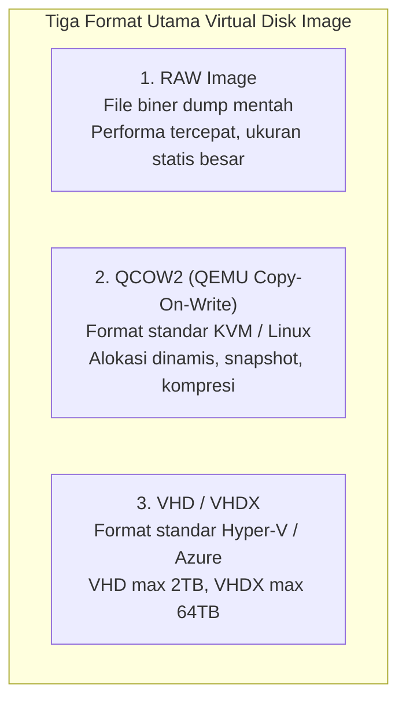
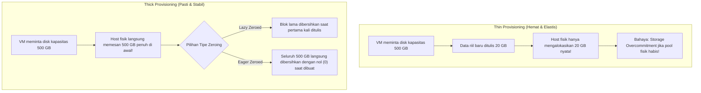

# Cloud Interfacing with Virtualization | Sesi 6: Storage Virtualization and Data Access

> **Mata Kuliah:** Cloud Interfacing with Virtualization | **Sesi:** 6 | **Status:** Materi UTS
> **Sumber:** Slide dosen, adaptasi Erl & Barceló Monroy (2024), *Cloud Computing: Concepts, Technology, Security & Architecture*; Marinescu (2022), *Cloud Computing: Theory and Practice*; AWS & Azure Storage Architecture Guides.

---

## 🔑 Cues

- Tiga paradigma penyimpanan cloud: Block Storage, File Storage, dan Object Storage
- Karakteristik Block Storage: Alamat blok tetap (LBA), protokol iSCSI/FC, performa baca-tulis acak
- Karakteristik File Storage: Hierarki berkas/folder bersama, protokol NFS/SMB
- Karakteristik Object Storage: Namespace datar, metadata kustom, ID unik, antarmuka REST API HTTP
- Mengapa database relasional (PostgreSQL/Oracle) wajib memilih Block Storage
- Format virtual disk image: RAW, QCOW2, dan VHD/VHDX
- QCOW2: Fitur Copy-on-Write, alokasi dinamis, snapshot pohon, dan Backing Files
- VHD vs VHDX pada ekosistem Microsoft Hyper-V dan Azure
- Abstraksi penyimpanan: Logical Storage Pools
- Strategi alokasi: Thin Provisioning vs Thick Provisioning
- Varian Thick Provisioning: Lazy Zeroed vs Eager Zeroed
- Bahaya laten Storage Overcommitment Crash pada Thin Provisioning

---

## 📖 Materi Utama

### 1. Tiga Paradigma Penyimpanan Data di Cloud

Dalam arsitektur virtualisasi dan komputasi awan, penyimpanan data diklasifikasikan ke dalam tiga model arsitektur yang melayani karakteristik pola akses (*data access patterns*) yang berbeda secara fundamental:

```mermaid
flowchart TD
    subgraph Block ["1. Block Storage (SAN / Raw LUN)"]
        B_Data["Data dibagi dalam blok-blok ukuran tetap (4KB/8KB)"] --> B_Access["Diakses via protokol raw: iSCSI / Fibre Channel / NVMe-oF"]
        B_Access --> B_OS["OS memformatnya dengan filesystem (ext4/NTFS/XFS)"]
        B_OS --> B_Use["Kasus Penggunaan: Disk OS Mesin Virtual & Database Transaksional"]
    end

    subgraph File ["2. File Storage (NAS / Shared FS)"]
        F_Data["Data diorganisasi dalam hierarki folder & berkas"] --> F_Access["Diakses via protokol jaringan: NFS (Linux) / SMB (Windows)"]
        F_Access --> F_Use["Kasus Penggunaan: Shared directories, dokumen tim, web media bersama"]
    end

    subgraph Object ["3. Object Storage (Cloud Storage / S3 / Blob)"]
        O_Data["Data disimpan sebagai objek datar (Payload + Metadata + UUID)"] --> O_Access["Diakses via protokol internet: HTTP REST API (GET, PUT, DELETE)"]
        O_Access --> O_Use["Kasus Penggunaan: Backup, arsip log, video streaming, data lakes"]
    end
```

#### **A. Block Storage (Penyimpanan Berbasis Blok)**
- Menyajikan kumpulan blok mentah (*raw blocks*) berukuran tetap tanpa struktur hierarki apa pun. Setiap blok memiliki alamat numerik unik (*Logical Block Address - LBA*).
- Sistem operasi tamu (*Guest OS*) melihat block storage selayaknya hard disk fisik kosong yang harus dipartisi dan diformat dengan sistem berkas pilihan pengguna.
- **Karakteristik Kunci:**
  - Latensi sangat rendah (sub-milidetik hingga mikrodetik) dengan throughput konsisten tinggi.
  - Sangat optimal untuk operasi baca/tulis acak (*random read/write I/O*).
  - Merupakan satu-satunya model penyimpanan yang dapat dijadikan disk boot sistem operasi mesin virtual.

#### **B. File Storage (Penyimpanan Berbasis Berkas)**
- Mengorganisasi data ke dalam pohon direktori dan berkas hierarkis yang mudah dipahami manusia.
- Menyediakan mekanisme penguncian berkas (*file locking*) terpusat sehingga banyak klien/VM dapat mengakses, membaca, dan mengedit file pada saat yang sama melalui jaringan lokal.
- **Karakteristik Kunci:**
  - Mudah dikelola dan dipasang langsung (*mount*) ke sistem operasi.
  - Membawa overhead latensi protokol jaringan (NFS/SMB) dan kurang efisien untuk disk berskala sangat masif (jutaan file kecil).

#### **C. Object Storage (Penyimpanan Berbasis Objek)**
- Mengeliminasi konsep folder hierarkis; seluruh data disimpan di dalam ruang nama datar (*flat namespace*) yang disebut **bucket** atau **container**.
- Setiap objek terdiri dari tiga komponen:
  1. *Data Payload:* Konten berkas mentah (gambar, video, zip, backup).
  2. *Metadata:* Keterangan data yang dapat dikustomisasi tanpa batas (misal tanggal buat, nama pemilik, status enkripsi, tag departemen).
  3. *Unique Identifier (ID):* Pengenal unik (UUID / URL) untuk pencarian instan.
- **Karakteristik Kunci:**
  - Diakses secara global melalui HTTP REST API (`GET`, `PUT`, `DELETE`).
  - Skalabilitas tidak terbatas (*infinitely scalable*) dengan daya tahan data (*durability*) mencapai 99.999999999% (11 nines).
  - **Keterbatasan Mutlak:** Bersifat *immutable/write-once*; tidak mendukung pembaruan data secara parsial di tengah file (jika ingin mengubah 1 byte di dalam file 5GB, seluruh objek harus diunggah ulang).

---

### 2. Mengapa Database Relasional Memilih Block Storage? (The Database Imperative)

Pada kasus implementasi basis data relasional enterprise (seperti PostgreSQL, MySQL, atau Oracle), arsitek sistem **selalu memilih Block Storage** dibanding File atau Object Storage karena alasan teknis berikut:
1. **Dukungan Direct I/O dan Bypass Cache:** Database modern mengelola sistem caching internalnya sendiri di RAM (*buffer pool*). Block storage memungkinkan database mengeksekusi operasi *Direct I/O* (`O_DIRECT`), mengabaikan cache sistem operasi host demi menghindari fenomena *double caching*.
2. **Kepatuhan Transaksional Atomik (WAL & `fsync`):** Database relasional menjamin prinsip ACID (*Atomicity, Consistency, Isolation, Durability*) melalui berkas *Write-Ahead Logging (WAL)*. Saat transaksi di-commit, database memanggil instruksi `fsync()` yang menuntut data segera ditulis ke piringan disk fisik secara atomik dalam waktu mikrodetik. File storage membawa latensi negosiasi jaringan NFS/SMB yang terlalu lambat, sedangkan Object storage tidak mendukung penulisan sekuensial mikrodetik.
3. **Pembaruan Data In-Place (Random Access):** Database sering memperbarui data pada baris atau indeks tertentu (mengubah halaman 8KB di tengah file berukuran 1TB). Block storage mengizinkan modifikasi langsung pada nomor blok LBA yang bersangkutan tanpa menyentuh blok lainnya.

---

### 3. Format Virtual Disk Image: QCOW2 vs. VHD/VHDX

Virtual disk adalah abstraksi perangkat lunak yang disajikan oleh hypervisor kepada VM sebagai hard drive fisik. Di sisi host, seluruh hard disk tersebut sebenarnya hanyalah sebuah file disk image:

| Parameter | Format RAW | Format QCOW2 | Format VHD / VHDX |
|---|---|---|---|
| **Ekosistem Utama** | Bare-metal, Linux KVM | QEMU / KVM, OpenStack | Microsoft Hyper-V, Azure Cloud |
| **Alokasi Penyimpanan** | Statis (Thick 100% dialokasikan) | Dinamis (*Sparse / Thin-provisioned*)| VHD: Fixed/Dynamic, VHDX: Dynamic |
| **Dukungan Snapshot** | Tidak mendukung bawaan | **Mendukung Snapshot Hirarkis internal** | Didukung (melalui checkpoint/AVHDX) |
| **Fitur Backing Files** | Tidak ada | **Mendukung Base Template Differential** | Mendukung Differencing Disks |
| **Batas Kapasitas Maks**| Tergantung filesystem host | Hingga beberapa Petabyte | VHD: 2 TB, VHDX: 64 TB |
| **Performa I/O** | **Paling Cepat (Zero metadata)** | Sangat Tinggi (Overhead metadata kecil)| Tinggi |

#### **Keunggulan Khusus QCOW2 (Backing Files):**
QCOW2 mendukung konsep **Backing File (Golden Image Template)**. Hypervisor dapat menyimpan satu file image sistem operasi dasar (misal `ubuntu-base.qcow2` berukuran 4GB) dalam status read-only. Ketika 20 VM baru dibuat, masing-masing VM hanya membuat file delta QCOW2 baru sebesar beberapa megabyte yang merujuk ke image dasar tersebut. Ruang penyimpanan fisik yang dihemat mencapai lebih dari 90%!

---

### 4. Abstraksi Penyimpanan: Thin vs. Thick Provisioning

Hypervisor mengumpulkan puluhan hard drive fisik menjadi satu kesatuan ruang penyimpanan logis (*Logical Storage Pool*). Saat membuat virtual disk untuk sebuah VM, administrator dihadapkan pada dua strategi alokasi:

1. **Thin Provisioning (Alokasi Dinamis Berbasis Kebutuhan):**
   - Disk virtual tampak berukuran penuh bagi Guest OS (misal 1 TB), namun ruang fisik pada storage pool hanya dikonsumsi bertahap sesuai data yang benar-benar ditulis oleh VM.
   - *Keuntungan:* Menghemat biaya storage fisik secara masif dan memungkinkan konsolidasi banyak VM.
   - *Risiko Kritis (*Storage Overcommitment Crash*):* Jika administrator mengalokasikan total 10 TB disk virtual pada storage fisik yang hanya berkapasitas 4 TB nyata, dan para pengguna secara serentak mengunduh data hingga storage fisik terisi 100%, seluruh VM di kluster tersebut akan mengalami *freeze* atau *I/O error crash* seketika!

2. **Thick Provisioning (Alokasi Kapasitas Penuh di Awal):**
   - Seluruh kapasitas disk dipesan dan dialokasikan 100% pada media fisik saat disk pertama kali dibuat.
   - *Thick Provision Lazy Zeroed:* Ruang fisik dipesan di muka, namun sektor disk lama baru dihapus dengan angka nol (*zeroed out*) saat blok tersebut pertama kali ditulis oleh VM.
   - *Thick Provision Eager Zeroed:* Seluruh blok fisik dipesan dan langsung dihapus bersih dengan angka nol (*fully zeroed out*) saat proses pembuatan disk. Menghasilkan performa tertinggi, bebas fragmentasi, dan nol risiko overcommitment, namun membutuhkan waktu pembuatan file disk yang paling lama.

---

## 🛠️ Use Case / Implementasi Nyata

- **Skenario:** Merancang arsitektur penyimpanan untuk platform perbankan yang terdiri dari:
  1. Mesin virtual database transaksional Core Banking.
  2. Direktori dokumen berkas laporan keuangan internal tim auditor.
  3. Arsip foto KTP nasabah dan log riwayat transaksi 10 tahun terakhir.
- **Implementasi Kombinasi Tiga Model Storage:**
  - *Database Core Banking:* Menggunakan **Block Storage (Thick Provision Eager Zeroed)** berbasis SAN NVMe-over-Fabrics untuk menjamin latensi I/O transaksi perbankan sub-milidetik bebas risiko overcommitment.
  - *Laporan Internal Tim:* Menggunakan **File Storage (NFS/SMB Managed Share)** agar dokumen Excel/PDF dapat diakses bersama secara terpusat oleh ratusan laptop staf perbankan dengan hak akses ACL direktori.
  - *Arsip Foto KTP & Log 10 Tahun:* Menggunakan **Object Storage (Azure Blob / AWS S3)** tier *Cold / Archive*. Biaya penyimpanan menjadi 90% lebih murah dibanding block storage, dengan daya tahan data 11 nines dan akses berbasis REST API terenkripsi.

---

## 🗂️ Konsep Kunci

| Istilah | Definisi | Contoh / Catatan |
|---|---|---|
| Block Storage | Penyimpanan data mentah berbasis blok tetap dengan alamat LBA unik | AWS EBS, Azure Managed Disk |
| File Storage | Penyimpanan data berbasis struktur direktori dan hierarki berkas bersama | NFS, SMB/CIFS, Azure Files |
| Object Storage | Penyimpanan data dalam namespace datar berbasis payload, metadata, dan UUID | AWS S3, Azure Blob Storage |
| QCOW2 | QEMU Copy-On-Write v2; format disk virtual kaya fitur standar KVM | Mendukung snapshots & backing files |
| VHDX | Format disk virtual modern milik Microsoft yang mendukung kapasitas hingga 64 TB | Pengganti format VHD warisan |
| Thin Provisioning | Alokasi kapasitas disk fisik secara bertahap sesuai penulisan riil data | Hemat ruang storage awal |
| Thick Eager Zeroed | Alokasi kapasitas disk fisik 100% di awal dengan pembersihan nol instan | Performa I/O paling stabil |
| Backing File | Image dasar read-only yang dijadikan rujukan oleh banyak file disk diferensial | Template golden image OS |
| Storage Overcommit| Kondisi di mana total kapasitas disk virtual melebihi storage fisik nyata | Risiko fatal jika pool penuh |

---

## 📊 Tabel Ringkasan

**Matriks Perbandingan Tiga Paradigma Penyimpanan Data**

| Parameter Evaluasi | Block Storage | File Storage | Object Storage |
|---|---|---|---|
| **Satuan Unit Data** | Blok Biner Berukuran Tetap (4KB) | File dan Folder Hierarkis | Objek Lengkap (Data + Metadata) |
| **Protokol Komunikasi** | iSCSI, Fibre Channel, NVMe-oF | NFS, SMB / CIFS | HTTP / HTTPS (REST API) |
| **Tingkat Latensi** | **Sangat Rendah (Mikrodetik)** | Menengah (Milidetik) | Lebih Tinggi (Puluhan Milidetik) |
| **Pola Akses Ideal** | Random Read/Write Acak Cepat | Baca/Tulis Bersama File Dokumen | Sekali Tulis, Sering Dibaca (WORM) |
| **Skalabilitas Kapasitas** | Terbatas pada ukuran LUN/Volume | Terbatas pada batas File System | **Nyaris Tanpa Batas (Petabytes+)** |
| **Kemampuan Booting VM** | **Bisa (Standar Utama Boot Disk)** | Sangat jarang / kompleks | **Tidak Bisa** |

---

## ⚠️ Catatan Penting

> **Object Storage tidak mendukung modifikasi data in-place.** Jika Anda ingin memperbarui 1 baris teks di dalam file log berukuran 2 GB yang disimpan di AWS S3 atau Azure Blob, Anda harus mengunggah ulang seluruh objek 2 GB tersebut. Jangan pernah menggunakan Object Storage untuk database transaksional.
>
> **Waspadai bahaya laten Thin Provisioning.** Keuntungan efisiensi biaya pada thin provisioning dapat berbalik menjadi bencana operasional jika storage pool fisik terisi 100%. Saat host kehabisan blok fisik, seluruh VM yang mencoba menulis data akan langsung mengalami I/O freeze. Selalu pasang alarm kapasitas storage pada ambang batas 75% dan 85%.
>
> **Format RAW vs QCOW2:** Gunakan format RAW jika Anda membutuhkan performa I/O murni tanpa overhead pemrosesan metadata (misal pada VM database performa tinggi). Gunakan format QCOW2 jika Anda membutuhkan fitur snapshot berkala, kloning cepat dengan backing file, dan efisiensi ruang disk.

---

## 📝 Materi Tambahan (Visual Insights)

- **Mekanisme Copy-on-Write (CoW) pada Snapshot QCOW2:**
  - Saat snapshot dibuat pada disk QCOW2, file disk asli dibekukan (*frozen/read-only*).
  - Seluruh operasi penulisan baru dialihkan ke file delta baru.
  - Jika VM membaca blok yang belum pernah dimodifikasi, pembacaan diteruskan ke file dasar asli.
  - Mekanisme ini memungkinkan pembuatan backup instan dalam 1 detik tanpa menyalin data bergigabyte.
- **Teknologi NVMe-over-Fabrics (NVMe-oF):** Standar modern block storage jaringan yang menggantikan protokol lawas iSCSI. Menggunakan jaringan Ethernet berkecepatan tinggi (RDMA/RoCE) untuk menghadirkan latensi protokol block storage jaringan setara dengan SSD NVMe yang terpasang langsung pada slot PCIe motherboard fisik.
- **Referensi Buku:**
  - Erl, T., & Barceló Monroy, E. (2024). *Cloud Computing: Concepts, Technology, Security & Architecture*. Pearson.
  - Marinescu, D. C. (2022). *Cloud Computing: Theory and Practice* (3rd ed.). Elsevier / Morgan Kaufmann.
