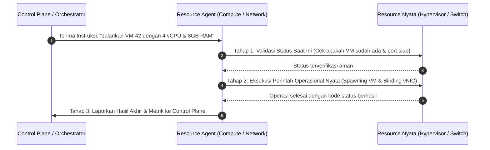
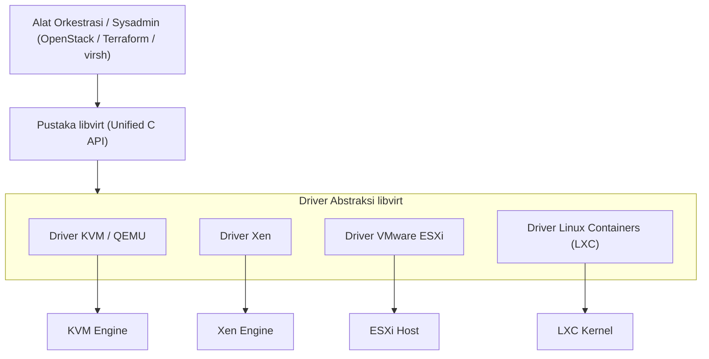
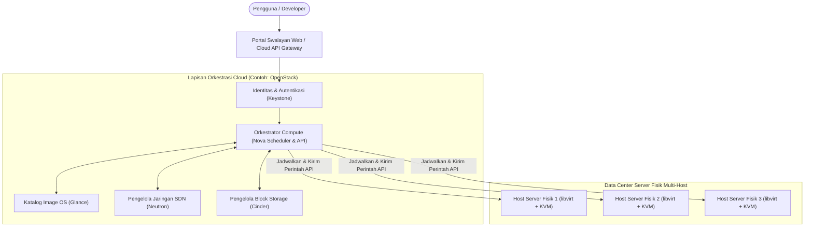
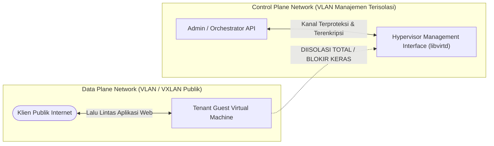

# Cloud Interfacing with Virtualization | Sesi 7: The Control Plane and Programmatic Interfaces

> **Mata Kuliah:** Cloud Interfacing with Virtualization | **Sesi:** 7 | **Status:** Materi UTS
> **Sumber:** Slide dosen, adaptasi Erl & Barceló Monroy (2024), *Cloud Computing: Concepts, Technology, Security & Architecture*; Marinescu (2022), *Cloud Computing: Theory and Practice*; The libvirt Project Documentation.

---

## 🔑 Cues

- Peran Hypervisor API dalam otomasi infrastruktur berskala besar
- Keterbatasan antarmuka GUI manual pada pengelolaan multi-host
- Siklus hidup mesin virtual yang dikelola secara terprogram (API lifecycle)
- Definisi dan alur kerja Resource Agents sebagai jembatan operasional
- Arsitektur libvirt sebagai toolkit abstraksi universal multi-hypervisor
- Penggunaan dokumen XML Domain Specification pada libvirt
- Utilitas Command-Line Interface (CLI) virsh untuk otomasi skrip
- Lapisan Orkestrasi Cloud (Cloud Management Platform - CMP)
- Peran OpenStack dan komponen intinya: Nova, Neutron, Cinder, Glance, Keystone
- Alur pemrosesan request pengguna dari portal web ke provisioning VM
- Prinsip pemisahan jaringan: Control Plane vs Data Plane
- Analisis isolasi VLAN manajemen hypervisor dari lalu lintas VM tenant
- Jaminan Quality of Service (QoS) dan keamanan antarmuka kontrol cloud

---

## 📖 Materi Utama

### 1. Antarmuka Terprogram Hypervisor (Hypervisor APIs)

Di lingkungan pusat data modern yang menaungi puluhan ribu server fisik, pengelolaan mesin virtual secara manual melalui antarmuka grafis (*GUI clicking*) tidak dapat diterapkan. Diperlukan antarmuka terprogram (*Application Programming Interface - API*) yang memungkinkan sistem lain berinteraksi langsung dengan hypervisor:

```mermaid
flowchart TD
    subgraph Clients ["Klien Otomasi & Pengguna"]
        Portal["Portal Swalayan Cloud (Web Dashboard)"]
        CLI["Script Otomasi / CLI (Terraform / Ansible)"]
        Sched["Mesin Penjadwal & Autoscaler"]
    end

    subgraph API_Layer ["Hypervisor Management API"]
        API_Server["REST / RPC Endpoint API"]
    end

    subgraph Hypervisor ["Lapisan Virtualisasi & Host"]
        VMM["Hypervisor Core (KVM / Xen / ESXi)"]
        VMs["Koleksi Mesin Virtual (VM Lifecycle)"]
    end

    Portal -->|HTTP REST / JSON| API_Server
    CLI -->|Command / SDK| API_Server
    Sched -->|API Call| API_Server
    API_Server -->|Driver Call| VMM
    VMM -->|Kendalikan Status| VMs
```



- **Fungsi Utama Hypervisor API:**
  - *Lifecycle Management:* Mengotomasi seluruh fase siklus hidup VM: *create, define, start, pause, resume, snapshot, live-migrate, shutdown,* hingga *destroy*.
  - *Resource Querying:* Memeriksa kapasitas CPU, memori bebas, dan status kesehatan hardware server fisik secara real-time.
  - *Event Notification:* Menerbitkan notifikasi saat terjadi insiden (misal VM mendadak mati atau disk penuh).
  - *Fondasi Portal Swalayan (*Self-Service Cloud*):* Memungkinkan pelanggan membuat VM sendiri dalam hitungan detik dengan integrasi sistem penagihan otomatis (*metering & billing*).

---

### 2. Agen Sumber Daya (Resource Agents)

**Resource Agent** adalah komponen perangkat lunak perantara yang bertindak sebagai pengeksekusi operasional (*operational executor*) antara lapisan control plane tingkat tinggi dengan sumber daya infrastruktur fisik/virtual nyata:



- **Alur Kerja Empat Tahap Resource Agent:**
  1. *Receive Request:* Menerima instruksi deklaratif dari orchestrator pusat.
  2. *State Validation:* Memeriksa kondisi nyata target sebelum bertindak untuk menghindari konflik atau eksekusi ganda (*idempotent verification*).
  3. *Execute Operation:* Menerjemahkan instruksi abstrak menjadi perintah sistem tingkat rendah (misal membuat namespace jaringan, memformat volume disk, atau memanggil biner emulator).
  4. *Report & Self-Heal:* Melaporkan hasil eksekusi kembali ke control plane. Jika terjadi kegagalan parsial, agen dapat melakukan *retry* otomatis atau memicu *rollback* pembersihan.

---

### 3. Peran Toolkit `libvirt` dan Utilitas `virsh`

Setiap hypervisor (KVM, Xen, ESXi, LXC) memiliki set perintah, format konfigurasi, dan API internal yang berbeda-beda. Hal ini menciptakan risiko fragmentasi dan keterikatan vendor.

**`libvirt`** hadir sebagai pustaka C open-source dan daemon layanan (`libvirtd`) yang menyediakan **lapisan abstraksi universal terpadu** di atas berbagai macam teknologi hypervisor:



#### **A. Format Konfigurasi XML Domain:**
Di dalam ekosistem `libvirt`, sebuah mesin virtual disebut sebagai **Domain**. Konfigurasi perangkat keras virtual (jumlah vCPU, kuota memori, disk image path, kartu jaringan, fitur emulasi) didefinisikan secara deklaratif menggunakan dokumen terstandarisasi **XML Domain Specification**.

#### **B. Utilitas Command-Line `virsh`:**
`virsh` adalah antarmuka CLI interaktif dan scriptable resmi untuk berkomunikasi dengan daemon `libvirt`.
- **Perintah Inti Pengelolaan Mesin Virtual:**
  ```bash
  # Menampilkan daftar seluruh VM (aktif maupun mati)
  virsh list --all

  # Membuat dan mendaftarkan konfigurasi VM baru secara permanen dari file XML
  virsh define vm-web-server.xml

  # Menyalakan mesin virtual
  virsh start vm-web-server

  # Mematikan mesin virtual secara anggun (Graceful ACPI Shutdown)
  virsh shutdown vm-web-server

  # Mematikan paksa mesin virtual seketika (setara cabut kabel daya)
  virsh destroy vm-web-server

  # Melakukan live migration VM ke server fisik lain tanpa downtime
  virsh migrate --live vm-web-server qemu+ssh://host-target.lan/system
  ```

---

### 4. Lapisan Orkestrasi Cloud (Cloud Management Platform - CMP)

Hypervisor dan libvirt hanya mengelola virtualisasi pada level **satu mesin fisik tunggal (*single-host*)**. Di atas kumpulan ratusan hypervisor, terdapat **Cloud Management Orchestration Layer** yang bertugas mengoordinasikan seluruh data center sebagai satu kesatuan komputasi raksasa:



- **Tanggung Jawab Lapisan Orkestrator:**
  - *Penjadwalan Beban Kerja (*Placement Scheduling*):* Menghitung server fisik mana yang paling optimal untuk menampung VM baru berdasarkan kapasitas sisa, afinitas lokasi, dan toleransi risiko.
  - *Penegakan Kebijakan & Kuota:* Memastikan pengguna tidak memesan resource melebihi batas langganan akunnya.
  - *Otomasi Pemulihan (*Automated Disaster Recovery*):* Mendeteksi matinya server fisik dan otomatis menjadwalkan ulang seluruh VM yang terdampak ke server fisik cadangan.
  - *Contoh Terkemuka:* **OpenStack** dan **Apache CloudStack**.

---

### 5. Isolasi Saluran: Control Plane vs. Data Plane

Dalam arsitektur data center cloud, jalur komunikasi data wajib dipisahkan secara tegas menjadi dua bidang (*planes*):
1. **Control Plane (Management Traffic):** Jalur komunikasi instruksi manajemen, pemanggilan API hypervisor, sinkronisasi status cluster, heartbeat kesehatan, dan lalu lintas live-migration VM.
2. **Data Plane (Tenant Traffic):** Jalur komunikasi paket data aplikasi, transaksi web publik, dan lalu lintas jaringan yang diproduksi oleh VM penyewa (*guest VMs*).



#### **Mengapa Control Plane Wajib Diisolasi dari Data Plane?**
Terdapat dua alasan kritis yang mendasari pemisahan fisik/logis (via dedicated VLAN atau NIC terpisah):
1. **Pertimbangan Keamanan (*Security Isolation*):**
   - Jika antarmuka manajemen hypervisor dapat diakses dari jaringan yang sama dengan VM penyewa, sebuah VM yang berhasil dibobol hacker dapat meluncurkan serangan *port scanning*, eksploitasi celah API manajemen, serangan Man-in-the-Middle (MitM), atau serangan banjir paket DoS ke hypervisor.
   - Mengisolasi Control Plane memastikan bahwa VM penyewa tidak memiliki rute jaringan sama sekali menuju antarmuka kontrol hypervisor (*zero network reachability*).
2. **Kinerja dan Jaminan Layanan (*Performance & QoS Isolation*):**
   - Transaksi aplikasi penyewa di Data Plane dapat mengalami lonjakan trafik ekstrem yang menghabiskan 100% bandwidth jaringan.
   - Jika Control Plane berbagi kabel jaringan yang sama dengan Data Plane, instruksi kritis hypervisor (seperti sinyal *heartbeat* penjaga quorum kluster atau paket sinkronisasi RAM *live-migration*) akan mengalami keterlambatan (*packet drop/delay*). Hal ini dapat memicu keputusan salah di mana kluster menganggap server telah mati (*false node eviction*).

---

## 🛠️ Use Case / Implementasi Nyata

- **Skenario:** Penyedia hosting cloud publik membangun sistem penambahan kapasitas otomatis (*Autoscaling Group*) untuk menangani lonjakan trafik web e-commerce nasional saat kampanye diskon Midnight Sale.
- **Implementasi Alur Kerja Terprogram:**
  1. Mesin pemantau mendeteksi beban CPU pada kelompok web server rata-rata mencapai 85%.
  2. Autoscaler mengirimkan permintaan API HTTP POST ke Orchestration Layer (OpenStack Nova API).
  3. Nova Scheduler menghitung ketersediaan hardware di kluster data center dan memilih Compute Node fisik nomor 14.
  4. Nova Compute Service pada Node 14 menghubungi daemon `libvirt` lokal via UNIX domain socket terproteksi.
  5. `libvirt` membaca template konfigurasi XML Domain, memanggil KVM/QEMU untuk menyalakan VM baru dalam waktu 15 detik, dan otomatis melaporkan alamat IP baru kembali ke Ingress Load Balancer untuk mulai melayani pembeli.

---

## 🗂️ Konsep Kunci

| Istilah | Definisi | Contoh / Catatan |
|---|---|---|
| Hypervisor API | Antarmuka terprogram terstruktur untuk mengontrol alokasi dan siklus hidup VM | KVM API, VMware vSphere API |
| libvirt | Toolkit C dan daemon open-source penyedia antarmuka universal multi-hypervisor | Abstraksi KVM, Xen, ESXi |
| virsh | Program CLI resmi berbasis terminal untuk mengelola daemon libvirt | `virsh list`, `virsh migrate` |
| XML Domain | File spesifikasi deklaratif standar libvirt untuk mendefinisikan konfigurasi VM | Dokumen XML perangkat VM |
| Resource Agent | Modul perangkat lunak penerjemah instruksi control plane ke sumber daya nyata | Agen komputasi dan storage |
| Cloud Orchestrator| Lapisan pengendali terpusat yang mengoordinasikan seluruh server data center | OpenStack, Apache CloudStack |
| Control Plane | Bidang jaringan khusus untuk transmisi instruksi manajemen dan kendali API | VLAN manajemen privat |
| Data Plane | Bidang jaringan khusus untuk transmisi lalu lintas data aplikasi penyewa | Jalur internet tenant |

---

## 📊 Tabel Ringkasan

**Perbandingan Hierarki Pengendalian Infrastruktur Virtualisasi**

| Lapisan Pengendali | Cakupan Wilayah | Contoh Komponen | Bahasa / Antarmuka Interaksi |
|---|---|---|---|
| **Cloud Orchestrator (CMP)**| Multi-Host & Multi-Data Center | OpenStack, CloudStack | RESTful HTTP API / JSON, Web Dashboard |
| **Universal Hypervisor Layer**| Single-Host Multi-Platform | `libvirt` (`libvirtd`) | C Library Bindings, RPC, XML Domain |
| **Command-Line Interface (CLI)**| Administrasi Host Lokal/Remote | `virsh`, `esxcli`, `xl` | Terminal Shell Scripting |
| **Hypervisor Kernel Driver** | Komponen Hardware Tingkat Rendah| Modul `kvm.ko`, VMkernel | System calls, ioctl, register hardware |

---

## ⚠️ Catatan Penting

> **`virsh` berbicara ke `libvirt`, bukan langsung ke prosesor.** Perintah `virsh start` tidak mengeksekusi instruksi CPU secara mandiri. `virsh` mengirim perintah RPC ke daemon `libvirtd`, lalu `libvirtd` memanggil driver hypervisor backend (seperti KVM) untuk meluncurkan proses virtualisasi yang sesungguhnya.
>
> **Live Migration membutuhkan jaringan Control Plane berkecepatan tinggi.** Proses memindahkan VM yang sedang aktif tanpa mematikan layanannya (*zero-downtime live migration*) memindahkan seluruh isi RAM VM melalui jaringan. Jaringan Control Plane harus memiliki bandwidth tinggi (minimal 10GbE) dan terisolasi agar tidak mengganggu transaksi aplikasi.
>
> **XML Domain adalah kontrak deklaratif.** Jika Anda mengedit konfigurasi VM secara manual di file XML tanpa menggunakan perintah `virsh define`, `libvirt` tidak akan memuat perubahan tersebut ke dalam memorinya sampai daemon direload.

---

## 📝 Materi Tambahan (Visual Insights)

- **Anatomi Perintah Migrasi Langsung virsh:**
  - `virsh migrate --live --copy-storage-all --verbose my-vm qemu+ssh://target-host/system`
  - *--live :* Menjaga VM tetap melayani pengguna selama halaman RAM disalin secara bertahap (*pre-copy memory iteration*).
  - *--copy-storage-all :* Menyalin isi disk secara non-shared jika kedua host tidak menggunakan penyimpanan SAN/NFS bersama.
- **Komponen Inti OpenStack:**
  - `Nova`: Pengatur siklus hidup komputasi virtual.
  - `Glance`: Repositori dan layanan registri image sistem operasi (VHD/QCOW2).
  - `Neutron`: Layanan jaringan virtual terdefinisi perangkat lunak (*Software-Defined Networking - SDN*).
  - `Cinder`: Penyedia volume penyimpanan blok persisten.
  - `Keystone`: Layanan otentikasi identitas terpusat (IAM) berbasis token.
- **Referensi Buku:**
  - Erl, T., & Barceló Monroy, E. (2024). *Cloud Computing: Concepts, Technology, Security, and Architecture*. Pearson.
  - Marinescu, D. C. (2022). *Cloud Computing: Theory and Practice* (3rd ed.). Elsevier / Morgan Kaufmann.
  - The libvirt Project. (2026). *virsh: Management user interface*. Libvirt Documentation.
