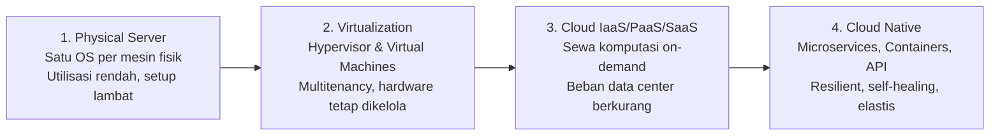
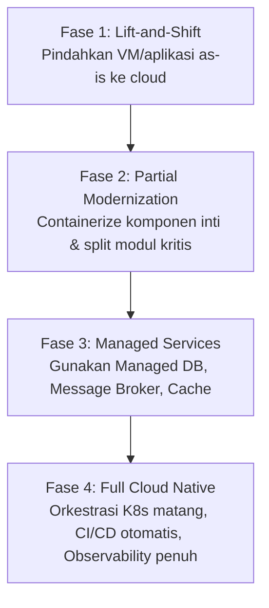

# Cloud Native Applications | Sesi 1: Introduction: Why Cloud Native

> **Mata Kuliah:** COSC6105001 - Cloud Native Applications | **Sesi:** 1 | **Status:** Materi UTS
> **Sumber:** Slide dosen (COSC6105001), adaptasi Singh & Kehoe, *Cloud Native Infrastructure with Azure* (O'Reilly Media, 2022).

---

## 🔑 Cues

- Evolusi infrastruktur: physical server, virtualisasi, cloud computing
- Definisi cloud native vs cloud-based
- Masalah underutilized hardware dan multitenancy
- Tantangan generasi awal vs tantangan cloud modern
- Problem "too many choices" dan laju rilis layanan cloud
- Fenomena lift-and-shift dan technical debt lintas generasi
- Kompleksitas operasional: storage, keamanan, tata kelola
- DevOps dan akselerasi siklus rilis perangkat lunak
- Peran Cloud Native Computing Foundation (CNCF)
- Karakteristik sistem cloud native: resilient, loosely coupled, observable
- Mitos "Kubernetes is a silver bullet"
- Tahapan adopsi cloud: lift-and-shift ke full cloud native
- Alasan pemilihan Microsoft Azure sebagai studi kasus

---

## 📖 Materi Utama

### 1. The Cloud Is Not a Silver Bullet

Migrasi ke cloud bukan jaminan otomatis aplikasi menjadi scalable, selalu tersedia (high availability), atau bebas gangguan. Memindahkan aplikasi monolit ke mesin virtual di cloud (lift-and-shift) atau membungkus aplikasi lama ke dalam container tanpa perombakan arsitektur hanya memindahkan masalah lama ke server milik penyedia cloud.

Cloud computing adalah **tempatnya** (infrastruktur komputasi on-demand yang disewa), sedangkan *cloud native* adalah **cara merancang dan membangun sistem** di tempat tersebut agar benar-benar memanfaatkan keunggulan elastisitas, otomasi, dan skalabilitas cloud.

### 2. Perjalanan Evolusi Menuju Cloud

Evolusi arsitektur infrastruktur IT didorong oleh kebutuhan efisiensi biaya, utilisasi resource, dan kecepatan rilis aplikasi:

#### **A. Era Server Fisik (Bare Metal)**
- Setiap aplikasi membutuhkan pengadaan server fisik tersendiri di data center lokal (*on-premises*).
- **Masalah utama:**
  - Utilisasi resource sangat rendah (sering kali CPU/RAM hanya terpakai 10–15%).
  - Sulit dan berisiko menjalankan beberapa aplikasi berbeda pada satu OS karena konflik dependensi.
  - Biaya modal (*CapEx*), waktu pengadaan (*procurement* berminggu-minggu), dan biaya pemeliharaan pendingin/daya sangat tinggi.

#### **B. Era Virtualisasi (Virtual Machines)**
- Menggunakan lapisan abstraksi (*hypervisor*) di atas hardware fisik untuk membagi CPU, memori, dan storage ke beberapa VM terisolasi.
- **Masalah teratasi:** utilisasi hardware meningkat drastis dan isolasi multitenancy tercapai.
- **Masalah tersisa:** organisasi tetap harus memiliki atau menyewa data center fisik, merawat hardware, dan mengelola overhead sistem operasi penuh (*guest OS*) di setiap VM.

#### **C. Era Cloud Computing (IaaS, PaaS, SaaS)**
- Infrastruktur disediakan oleh *cloud provider* (AWS, Azure, GCP) dan diakses melalui jaringan publik/privat.
- Organisasi beralih dari model *CapEx* (beli server di muka) ke *OpEx* (bayar sesuai pemakaian / *pay-as-you-go*).
- Namun, menyewa infrastruktur saja belum cukup jika aplikasi masih dirancang secara monolitik dan kaku.

### 3. Apa Sebenarnya Cloud Native Itu?

Teknologi cloud native dirancang untuk memaksimalkan potensi cloud, bukan sekadar memindahkan beban kerja:

- **Infrastruktur Cloud Native:** Abstraksi di atas infrastruktur penyedia cloud yang dikendalikan sepenuhnya melalui API deklaratif. Mengurangi kompleksitas manual, mempermudah penskalaan horizontal, dan meningkatkan keandalan (*resiliency*).
- **Aplikasi Cloud Native:** Dirancang sejak awal dengan prinsip *microservices*, telemetri dan metrik terintegrasi (*observability*), pemeriksaan kesehatan mandiri (*health checks*), serta kemampuan pulih otomatis dari kegagalan (*self-healing*).

### 4. Tantangan Cloud Modern (Then vs. Now)

Tantangan generasi awal cloud seperti keamanan dasar, kepatuhan (*compliance*), dan manajemen biaya awal sebagian besar telah terselesaikan oleh fitur bawaan provider modern. Namun, muncul lima tantangan baru di lanskap cloud saat ini:

| Tantangan Modern | Dampak & Konsekuensi Teknis |
|---|---|
| **1. Terlalu Banyak Pilihan (*Too Many Choices*)** | Provider menawarkan ratusan layanan khusus. Membutuhkan arsitek ahli untuk memilih solusi yang tepat tanpa over-engineering. |
| **2. Pertumbuhan Layanan yang Sangat Cepat** | Layanan baru dirilis terus-menerus. Beban pelatihan engineer meningkat dan risiko *vendor lock-in* semakin besar. |
| **3. Lintas Generasi Teknologi (*Generational Churn*)** | Aplikasi sering kali melintasi tiga generasi: VM, Container, dan Serverless. Migrasi menuntut adaptasi paradigma baru. |
| **4. Kompleksitas Operasional yang Meningkat** | Sistem terdistribusi menuntut pemantauan terus-menerus terhadap storage terdistribusi, model hak akses (IAM), dan kepatuhan. |
| **5. Perubahan Kebutuhan Bisnis & DevOps** | Budaya DevOps menuntut siklus rilis dari hitungan bulan menjadi hitungan menit, ditambah integrasi beban kerja data science/AI. |

### 5. Mengadopsi Cloud: Perjalanan Bertahap (A Journey, Not a Leap)

Adopsi cloud native di industri jarang terjadi secara revolusioner dalam satu malam (*big-bang*). Pola umum yang terbukti berhasil di perusahaan skala besar adalah migrasi berfase:

Microsoft Azure dijadikan studi kasus teknis dalam materi perkuliahan ini karena menyediakan *Azure Architecture Center* yang komprehensif, integrasi enterprise yang matang, serta ekosistem komparasi yang jelas antara layanan *cloud-hosted* tradisional vs *cloud-native*.

### 6. Peran Cloud Native Computing Foundation (CNCF)

CNCF adalah organisasi nirlaba di bawah Linux Foundation yang memimpin standardisasi teknologi cloud native secara global:
- **Misi:** Memberdayakan organisasi untuk membangun dan menjalankan aplikasi yang dapat diskalakan pada lingkungan dinamis (public, private, hybrid cloud).
- **Teknologi inti CNCF:** Containers, Service Meshes, Microservices, Immutable Infrastructure, dan Declarative APIs.
- **Tujuan:** Mendorong ekosistem proyek *open-source* yang netral dari vendor (*vendor-neutral*), mendemokratisasi arsitektur modern agar tidak hanya dikuasai oleh raksasa teknologi.
- **Landscape CNCF:** Peta interaktif ekosistem cloud native yang mencakup orkestrasi, runtime, penyimpanan, jaringan, CI/CD, dan observabilitas.

---

## 🛠️ Use Case / Implementasi Nyata

- **Skenario:** Perusahaan e-commerce retail memiliki aplikasi web monolitik yang di-host di data center lokal. Setiap promo diskon kilat (*flash sale*), server fisik kehabisan kapasitas dan situs tumbang.
- **Masalah yang Diatasi:** Skalabilitas manual membutuhkan waktu berminggu-minggu untuk memesan server baru, sementara lonjakan trafik hanya berlangsung beberapa jam.
- **Keuntungan Adopsi Cloud Native:** Aplikasi dipecah menjadi microservices (katalog, checkout, pembayaran), dikemas dalam container, dan diatur oleh orkestrator cloud native. Saat promo, pod checkout otomatis melakukan auto-scaling horizontal dalam hitungan detik dan mengecil kembali saat trafik reda, menghemat biaya hingga 60%.

---

## 🗂️ Konsep Kunci

| Istilah | Definisi | Contoh / Catatan |
|---|---|---|
| Cloud Native | Pendekatan membangun dan menjalankan aplikasi yang memanfaatkan keunggulan model cloud computing | Aplikasi berbasis container, microservices, dan API |
| CNCF | Cloud Native Computing Foundation; badan standardisasi ekosistem cloud native | Pengelola Kubernetes, Prometheus, Envoy |
| Lift-and-Shift | Pola migrasi memindahkan beban kerja ke cloud tanpa mengubah kode atau arsitektur | Memindahkan VM lokal ke Azure Virtual Machine |
| Vendor Lock-in | Keterikatan arsitektur pada API milik satu provider cloud tertentu | Sulit pindah karena menggunakan database proprietary |
| Microservices | Arsitektur memecah aplikasi menjadi layanan independen yang terhubung via jaringan | Service Auth, Service Payment, Service Cart |
| Self-healing | Kemampuan sistem mendeteksi kegagalan pod/node dan memulihkannya secara otomatis | Penggantian container crash oleh orkestrator |
| Declarative API | Pendekatan mendefinisikan *apa yang diinginkan* (state target), bukan langkah cara membuatnya | Manifest YAML pada Kubernetes / Terraform |

---

## 📊 Tabel Ringkasan

**Evolusi Arsitektur Komputasi**

| Parameter | Era Bare Metal (Fisik) | Era Virtual Machine | Era Container / Cloud Native |
|---|---|---|---|
| **Unit Deployment** | Server fisik | Mesin virtual (*Guest OS*) | Container (*Shared Host Kernel*) |
| **Waktu Provisioning** | Minggu – Bulan | Menit – Jam | Milidetik – Detik |
| **Efisiensi Sumber Daya** | Sangat rendah (sering idle) | Menengah (overhead OS VM) | Sangat tinggi (*bin packing*) |
| **Portabilitas** | Terikat spesifikasi hardware | File image VM (besar, GB) | OCI Container Image (ringan, MB) |
| **Isolasi** | Fisik total | Hardware virtual (Hypervisor) | Linux Namespaces & Cgroups |

**Perbandingan Cloud-Based vs Cloud-Native**

| Karakteristik | Cloud-Based (Tradisional di Cloud) | Cloud-Native |
|---|---|---|
| **Arsitektur** | Monolitik atau N-tier konvensional | Microservices loosely-coupled |
| **Infrastruktur** | Mesin virtual statis berumur panjang | Container & serverless dinamis berumur pendek (*ephemeral*) |
| **Pemulihan Bencana** | Manual atau script pemulihan cadangan | Otomatis (*self-healing reconciliation loop*) |
| **Konfigurasi** | Dikonfigurasi manual atau script imperatif | Deklaratif berbasis kode (*Infrastructure as Code*) |
| **Rilis Perangkat Lunak** | Mingguan atau bulanan | Harian atau puluhan kali per hari (CI/CD) |

---

## ⚠️ Catatan Penting

> **Cloud Computing adalah lokasi, Cloud Native adalah metodologi.** Menyewa VM di Azure atau AWS tidak serta-merta menjadikan sistem Anda "cloud native" jika arsitektur masih monolitik dan dikonfigurasi manual.
>
> **Kubernetes bukan obat mujarab (*silver bullet*).** Memasang Kubernetes di atas infrastruktur yang rapuh atau tanpa pemahaman tata kelola jaringan, keamanan, dan observabilitas hanya akan menambah lapisan kompleksitas operasional tanpa menyelesaikan masalah bisnis.
>
> **Adopsi cloud adalah spektrum berkelanjutan.** Jangan paksakan arsitektur microservices yang rumit sejak hari pertama bila tim belum memiliki kematangan DevOps; mulailah dari containerisasi bertahap dan penggunaan managed services.

---

## 📝 Materi Tambahan (Visual Insights)

- **Peta Interaktif CNCF Landscape:** Memuat ratusan proyek yang terbagi dalam kategori *App Definition, Orchestration, Runtime, Provisioning, Observability*. Pemula disarankan hanya fokus pada proyek berstatus **Graduated** (seperti Kubernetes, Prometheus, Envoy, Helm, containerd, Fluentd).
- **Trade-off Migrasi:** Kecepatan migrasi (*migration speed*) berbanding terbalik dengan kematangan cloud-native (*cloud native maturity*). Lift-and-shift sangat cepat tetapi minim keuntungan arsitektur; refactoring total memakan waktu lama namun memberikan skalabilitas maksimal.
- **Referensi Buku:** Singh, N., & Kehoe, M. (2022). *Cloud Native Infrastructure with Azure*. O’Reilly Media.
