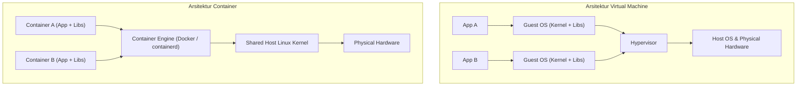
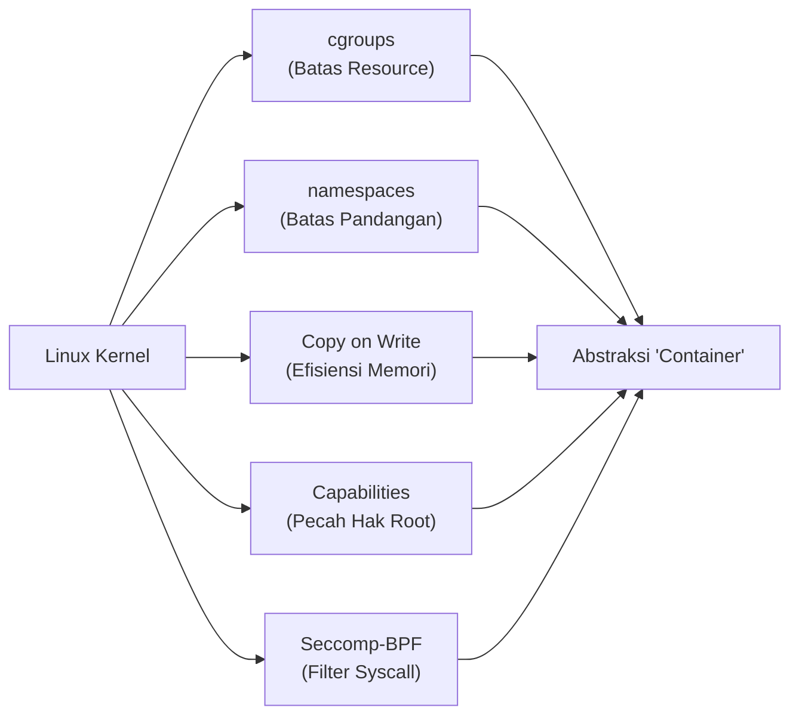
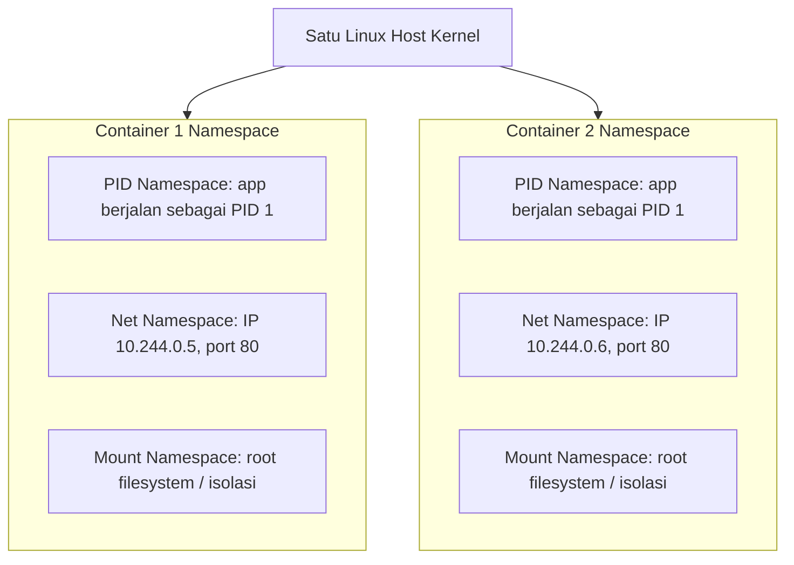

# Cloud Native Applications | Sesi 2: Containerizing Your Application – Part 1

> **Mata Kuliah:** COSC6105001 - Cloud Native Applications | **Sesi:** 2 | **Status:** Materi UTS
> **Sumber:** Slide dosen (COSC6105001), adaptasi Singh & Kehoe, *Cloud Native Infrastructure with Azure* (O'Reilly Media, 2022).

---

## 🔑 Cues

- Alasan container populer: low overhead, portabilitas, keamanan
- Container vs Virtual Machine: shared kernel vs guest OS
- Bin packing dan efisiensi biaya infrastruktur
- Konsep "Container is not a first-class Linux kernel primitive"
- Tiga pilar isolasi: cgroups, namespaces, POSIX limits
- Control Groups (cgroups): pembatasan kuota resource
- Subsystem cgroups: CPU, Memory, Blkio, PID, Devices, Network
- Linux Namespaces: isolasi pandangan sistem (*views of the system*)
- Jenis namespace: mnt, pid, net, ipc, uts, user, cgroup, time
- Mekanisme Copy on Write (CoW) pada efisiensi memori & storage
- Linux Capabilities: pemecahan hak akses root secara granular
- CAP_NET_BIND_SERVICE untuk web server non-root
- Seccomp-BPF: penyaringan system call di level kernel
- Pembatasan radius ledakan keamanan (*blast radius*)

---

## 📖 Materi Utama

### 1. Mengapa Container? (Isolasi Tanpa Beban Berat)

Container meledak dalam adopsi industri bukan sekadar tren teknologi, melainkan karena menghadirkan kombinasi tiga pilar penting: **overhead rendah**, **keamanan bawaan**, dan **portabilitas tinggi**. Container selaras secara alami dengan prinsip cloud native: *immutability*, *ephemerality*, dan *autoscaling*.

- **Perbedaan Mendasar dengan VM:**
  - VM membutuhkan satu sistem operasi tamu (*guest OS*) lengkap per instance, memakan gigabyte RAM dan waktu boot bermenit-menit.
  - Container mengeksekusi aplikasi sebagai proses biasa di atas sistem operasi host, berbagi kernel Linux yang sama (*shared kernel*).
- **Efisiensi Bin Packing:**
  - Isolasi yang ketat memungkinkan orkestrator menjalankan puluhan beban kerja secara padat pada satu server fisik (*bin packing*) tanpa risiko perebutan resource.
  - Dampak ekonomi langsung: pemanfaatan kapasitas server melonjak mendekati 80–90%, menekan tagihan komputasi cloud secara drastis.

### 2. Fakta Menarik: Tidak Ada Objek Bernama "Container" di Kernel Linux

Secara teknis di dalam kernel Linux, **tidak pernah ada primitif sistem tunggal yang bernama container**. Istilah container tidak didefinisikan secara formal hingga lahirnya spesifikasi OCI (*Open Container Initiative*) pada tahun 2017.

Sebuah container sebenarnya adalah **kombinasi orkestrasi dari lima fitur inti kernel Linux**:
1. **Control Groups (cgroups)** — membatasi *seberapa banyak* resource yang boleh dipakai.
2. **Namespaces** — membatasi *apa yang bisa dilihat* oleh proses.
3. **Copy on Write (CoW)** — mengoptimalkan efisiensi penyimpanan dan memori.
4. **Linux Capabilities** — membatasi *tindakan administratif khusus* yang boleh dieksekusi.
5. **Seccomp-BPF** — membatasi *system call apa saja* yang boleh dipanggil ke kernel.

### 3. Control Groups (cgroups): Mencegah Noisy Neighbor

Cgroup adalah mekanisme kernel untuk membatasi, mencatat, dan mengisolasi penggunaan sumber daya (CPU, memori, I/O disk, jaringan) dari sekumpulan proses. Tujuannya adalah melindungi server dari fenomena *noisy neighbor* (satu aplikasi boros yang menghabiskan seluruh resource host).

| Subsystem cgroups | Fungsi & Resource yang Dikontrol |
|---|---|
| **CPU** | Membatasi jatah waktu CPU (*cpuacct*) atau mengikat proses ke core tertentu (*cpuset*). |
| **Memory** | Membatasi alokasi RAM pengguna dan penggunaan swap; memicu OOM Killer jika batas terlampaui. |
| **Blkio** | Membatasi kecepatan baca-tulis disk (IOPS atau Bytes per Second). |
| **PID** | Membatasi jumlah maksimum proses/thread yang boleh dibuat dalam cgroup (mencegah *fork bomb*). |
| **Devices** | Mengizinkan atau memblokir akses ke file perangkat keras host (misalnya `/dev/sda`). |
| **Network** | Menandai paket (*net_cls*) dan mengatur prioritas lalu lintas jaringan (*net_prio*). |

### 4. Linux Namespaces: Menciptakan Ilusi Mesin Mandiri

Jika cgroups membatasi *kuantitas*, maka namespaces membatasi *visibilitas*. Namespace memungkinkan sekelompok proses melihat satu set resource sistem, sementara kelompok lain melihat set yang berbeda, meskipun berjalan di atas kernel yang identik.

Delapan jenis namespace dalam Linux kernel:
1. **Mount (`mnt`)**: Mengisolasi titik pemasangan filesystem. Setiap container memiliki hierarki direktori `/` sendiri.
2. **PID (`pid`)**: Mengisolasi nomor proses. Proses utama di dalam container berjalan sebagai PID 1 (layaknya init system), padahal di host OS memiliki PID biasa (misal PID 43210).
3. **Network (`net`)**: Menyediakan stack jaringan independen (kartu jaringan virtual `veth`, tabel routing, iptables/firewall, port binding terisolasi). Dua container berbeda bisa sama-sama membuka port 80 tanpa konflik.
4. **IPC (`ipc`)**: Mengisolasi memori bersama (*shared memory*) dan antrean pesan antar-proses (*message queues*).
5. **UTS (`uts`)**: Mengisolasi nama host (*hostname*) dan domain NIS.
6. **User (`user`)**: Memetakan UID/GID. Pengguna `root` (UID 0) di dalam container dapat dipetakan ke UID non-privilese (misal UID 10001) di mesin host.
7. **Cgroup (`cgroup`)**: Menyembunyikan hierarki cgroup host agar container tidak dapat melihat cgroup milik tetangganya.
8. **Time (`time`)**: Mengizinkan container memiliki pembacaan jam sistem yang berbeda dari host (berguna untuk pengujian berbasis waktu).

### 5. Copy on Write (CoW): Efisiensi Memori & Layer Gambar

Copy on Write adalah teknik manajemen memori dan storage di mana data hanya diduplikasi saat ada operasi penulisan (*write*).
- Ketika 50 container dijalankan dari base image yang sama (misal `alpine:latest` 5MB), mereka membaca layer filesystem yang sama di memori secara bersamaan.
- Layer baru (*read-write layer*) hanya dibuat tipis di atas layer dasar saat container memodifikasi suatu file.
- **Hasil:** Menjalankan 50 container dari satu image tidak membutuhkan 50× lipat ruang memori atau disk.

### 6. Linux Capabilities & Seccomp-BPF: Membatasi Radius Ledakan (*Blast Radius*)

Secara tradisional, izin Unix bersifat biner: pengguna biasa (hampir tidak punya kuasa) vs `root` (bisa melakukan apa saja).

#### **A. Linux Capabilities (Granularitas Hak Akses)**
- Memecah kewenangan absolut `root` menjadi token-token izin kecil yang independen.
- **Contoh Kasus:** Web server membutuhkan izin untuk membuka port di bawah 1024 (seperti port 80). Alih-alih menjalankan proses sebagai root penuh, container hanya diberi hak `CAP_NET_BIND_SERVICE`. Jika web server dieksploitasi oleh hacker, penyerang tidak memiliki hak me-reboot mesin atau membaca file shadow password.

#### **B. Seccomp-BPF (Secure Computing dengan Berkeley Packet Filter)**
- Ditambahkan pada kernel Linux versi 3.5 (2012).
- Berfungsi mencegat dan menyaring panggilan sistem (*system call*) sebelum diproses oleh kernel.
- Seccomp-BPF menggunakan program filter BPF yang dieksekusi di kernel space untuk memeriksa syscall beserta argumennya. Jika aplikasi web mencoba memanggil syscall berbahaya (misalnya `reboot` atau `ptrace`), panggilan tersebut langsung diblokir atau dimatikan oleh kernel.

---

## 🛠️ Use Case / Implementasi Nyata

- **Skenario:** Menjalankan aplikasi microservice Node.js yang memproses unggahan file PDF dari pengguna publik pada kluster multi-tenant.
- **Masalah yang Diatasi:** Jika file PDF mengeksploitasi celah parser (misal buffer overflow), penyerang berpotensi mengambil alih proses dan mengakses filesystem server atau mengintip memory proses lain.
- **Keuntungan Pengamanan Container:**
  - *User Namespace* memetakan root container ke user non-root di host.
  - *cgroups* membatasi konsumsi memory maksimal 512MB (mencegah DoS memory).
  - *Seccomp profile* standar Docker memblokir lebih dari 40 syscall berbahaya (termasuk `kexec_load`, `reboot`, dan `sys_chroot`).
  - *Capabilities drop* mencabut `CAP_SYS_ADMIN` dan `CAP_NET_RAW`. Bahkan jika aplikasi berhasil diretas, penyerang terkurung di sandbox tanpa akses ke host.

---

## 🗂️ Konsep Kunci

| Istilah | Definisi | Contoh / Catatan |
|---|---|---|
| cgroups | Fitur kernel Linux untuk membatasi kuota konsumsi sumber daya komputasi | Limit memory 512MiB, CPU 0.5 core |
| Namespaces | Fitur kernel Linux untuk mengisolasi pandangan proses terhadap resource | PID terisolasi, Network stack mandiri |
| Bin Packing | Algoritma penempatan beban kerja agar server fisik terisi seefisien mungkin | Memadatkan 20 container pada 1 node |
| Copy on Write | Teknik efisiensi memori/disk yang hanya menduplikasi blok saat terjadi modifikasi | Shared base image layers |
| Linux Capabilities | Pembagian hak akses root menjadi privilege individual yang dapat diaktifkan/dicabut | `CAP_NET_BIND_SERVICE`, `CAP_CHOWN` |
| Seccomp-BPF | Mekanisme filter system call berbasis Berkeley Packet Filter | Memblokir syscall `ptrace` atau `syslog` |
| Blast Radius | Sejauh mana kerusakan dapat menyebar saat satu komponen mengalami kompromi keamanan | Pembatasan pergerakan lateral attacker |

---

## 📊 Tabel Ringkasan

**Ringkasan Peran 5 Komponen Primitif Container**

| Primitif Kernel | Pertanyaan yang Dijawab | Fungsi Utama | Dampak Langsung |
|---|---|---|---|
| **Cgroups** | *Seberapa banyak?* | Membatasi alokasi CPU, RAM, Disk I/O, PID | Mencegah crash host akibat kehabisan memori |
| **Namespaces** | *Apa yang terlihat?* | Memisahkan identitas proses, jaringan, mount direktori | Aplikasi merasa memiliki OS dan IP privat sendiri |
| **Copy on Write** | *Bagaimana agar hemat?* | Berbagi layer baca bersama, membuat layer tulis tipis | Menghemat konsumsi storage dan startup time |
| **Capabilities** | *Aksi istimewa apa yang boleh?* | Memecah kekuasaan root menjadi izin spesifik | Menjalankan service tanpa perlu hak root penuh |
| **Seccomp-BPF** | *Syscall apa yang diizinkan?* | Memfilter pemanggilan fungsi kernel tingkat rendah | Menahan eksploitasi kernel dari dalam container |

---

## ⚠️ Catatan Penting

> **Container bukan isolasi tingkat hardware.** Container berbagi satu kernel yang sama dengan host OS. Jika terjadi kerentanan *kernel privilege escalation* (seperti Dirty COW atau Dirty Pipe), penyerang di container yang tidak di-sandbox dengan baik dapat keluar (*container escape*) ke host.
>
> **UID 0 di dalam container = UID 0 di host (tanpa User Namespace).** Jika User Namespace tidak diaktifkan, proses yang berjalan sebagai root di dalam container secara efektif memiliki UID 0 di host kernel. Selalu jalankan container dengan user non-root atau aktifkan `userns-remap`.
>
> **cgroups v1 vs v2:** cgroups v1 memiliki hierarki terpisah untuk setiap resource yang menyulitkan koordinasi, sedangkan cgroups v2 menggunakan single unified hierarchy yang jauh lebih stabil dan mendukung isolasi resource yang lebih terpadu.

---

## 📝 Materi Tambahan (Visual Insights)

- **Evolusi Sejarah Isolasi:** Teknologi container adalah penyempurnaan dari teknologi chroot (1979), FreeBSD Jails (2000), Solaris Zones (2004), dan Linux Containers / LXC (2008), sebelum Docker menyederhanakan antarmuka pengguna pada tahun 2013.
- **Diskusi Evaluasi:** Penalti performa menjalankan container di atas VM umumnya sangat minim (overhead CPU/memori di bawah 2%), namun isolasi ganda (Hypervisor + Cgroup/Namespace) sering digunakan di public cloud (seperti AWS Fargate atau Azure Container Instances) untuk menjamin keamanan antar-pelanggan.
- **Referensi Buku:** Singh, N., & Kehoe, M. (2022). *Cloud Native Infrastructure with Azure*. O’Reilly Media.
